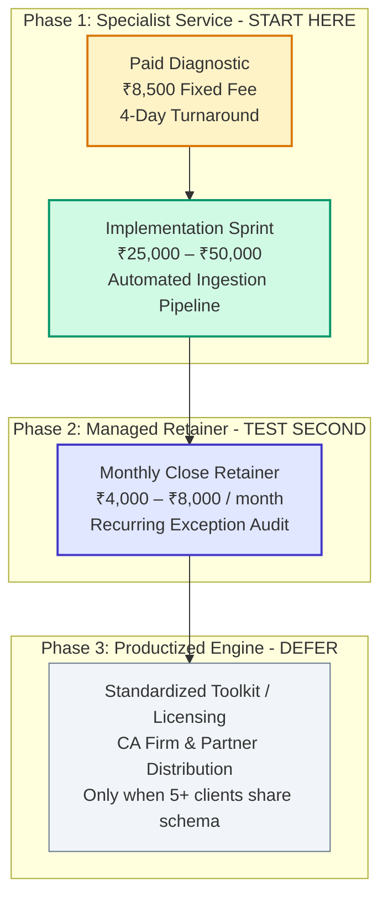
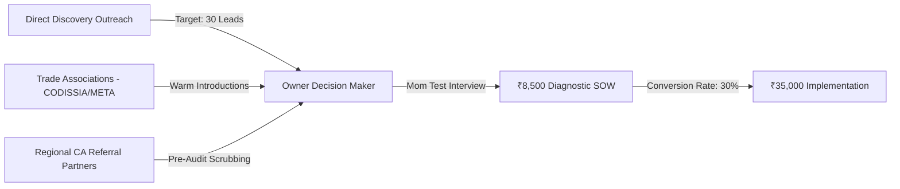

# Business Model Strategy & Canvas
## Business Data Consolidation & Reporting Automation Practice

**Market Focus:** India (Primary Beachhead: Coimbatore & Chennai, Tamil Nadu)  
**Target ICP:** Owner-managed industrial, electrical, and engineering wholesale distributors using TallyPrime & spreadsheets  
**Strategic Foundation:** Specialist Concierge B2B Service $\rightarrow$ Managed Retainer $\rightarrow$ Productized Engine  
**Effective Date:** 27 October 2026  

---

## Executive Recommendation: Service-First, SaaS-Never (For Now)

> [!IMPORTANT]
> **Start as a specialized, fixed-fee B2B service—not a venture-backed SaaS startup.**  
> 
> The fastest and most capital-efficient path to profitability is to solve an acute operational friction using the tools you already master (Python/pandas, Power Query, Excel). You do not need to build multi-tenant databases, front-end dashboards, or client login portals to validate whether distributors will pay to eliminate unbilled dispatches and month-end reconciliation lag.

### The 3-Tier Business Architecture
The business model evolves through three disciplined phases based entirely on observed customer behavior:



---

## 1. The Business Model Canvas (Specialist Practice)

| Canvas Building Block | Operational Specification for the Practice |
| :--- | :--- |
| **Value Proposition** | Turn messy, disconnected operational records (delivery challans, transporter LRs, bin cards) and Tally exports into **traceable, auditable reconciliation ledgers** and exception reports—without replacing Tally or disrupting daily operations. |
| **Customer Segments** | **Primary:** Owner-managed industrial/electrical wholesale distributors (10–75 FTEs, Gandhipuram, Ambattur, Guindy).<br>**Secondary:** Light engineering/textile manufacturers and export houses.<br>**Channel Intermediaries:** Chartered Accountants and Tally Certified Partners. |
| **Channels** | Direct owner outreach (*The Mom Test*), industrial trade association directories (CODISSIA, META, SIEMA), local CA referrals, and LinkedIn executive prospecting. |
| **Customer Relationships** | High-touch, direct consultative discovery; bounded 4-day delivery; 30-minute executive handover walkthrough; quarterly health check reviews. |
| **Revenue Streams** | 1. One-time Diagnostic Fees (₹8,500)<br>2. Fixed Implementation Sprints (₹25,000–₹50,000)<br>3. Recurring Monthly Ingestion Retainers (₹4,000–₹8,000/mo)<br>4. CA Partner White-Label Retainers |
| **Key Activities** | Schema profiling, automated data cleaning (Python/pandas), deterministic matching logic design, manual exception verification, PDF findings synthesis, client walkthroughs. |
| **Key Resources** | Technical proficiency in Python/pandas and Power Query; proprietary reconciliation rules and exception taxonomies; local credibility; 100% offline data security protocol. |
| **Key Partners** | Regional CA firms, local Tally Certified Partners, trade association secretariats (CODISSIA), independent tax/GST consultants. |
| **Cost Structure** | Founder/analyst delivery labor, prospecting/sales time, local transport/travel, offline encrypted storage hardware, professional legal/accounting compliance. |

---

## 2. Deep-Dive Comparison: Three Plausible Models

```
┌────────────────────────────────────────────────────────────────────────────────────────┐
│                        THREE PLAUSIBLE BUSINESS EVOLUTION MODELS                       │
├────────────────────────────┬────────────────────────────┬──────────────────────────────┤
│ MODEL A: SPECIALIST SERVICE│ MODEL B: MANAGED RETAINER  │ MODEL C: PRODUCTIZED TOOLKIT │
│ (Fixed Diagnostic + Sprint)│ (Monthly Close Ingestion)  │ (Self-Serve Software / SaaS) │
├────────────────────────────┼────────────────────────────┼──────────────────────────────┤
│ • Status: START HERE       │ • Status: TEST SECOND      │ • Status: DEFER              │
│ • Low upfront investment   │ • Recurring cash flow      │ • Infinite theoretical scale │
│ • Fast market feedback     │ • Deep client retention    │ • High upfront development   │
│ • Labor-constrained margin │ • Monthly deadline crunch  │ • Extreme customer churn risk│
└────────────────────────────┴────────────────────────────┴──────────────────────────────┘
```

### Detailed Dimensional Comparison

| Dimension | Model A: Specialist Service | Model B: Managed Retainer | Model C: Productized Toolkit / SaaS |
| :--- | :--- | :--- | :--- |
| **Primary Payer** | Managing Director or Finance Controller | Finance Head or Senior Accountant | Business Owner or Implementation Partner |
| **What They Purchase** | A specific reconciliation outcome & audit | Timely, recurring exception monitoring | A software license, template, or seat access |
| **Payment Cadence** | One-time project milestone billing | Monthly or quarterly advance billing | Annual/monthly subscription or perpetual license |
| **Capital Investment** | **Near Zero:** Existing laptop and scripts | **Low:** Automated monitoring infrastructure | **High:** Full-stack SaaS, UI/UX, database hosting |
| **Gross Margin Profile** | 60%–75% (Constrained by billable hours) | 70%–85% (Once pipelines are automated) | 80%–90% (Software margins, net of hosting) |
| **Cash-Flow Working Capital** | Protected via upfront 50% deposits | Highly predictable recurring cash inflow | High cash burn during customer acquisition |
| **Delivery Scalability** | Low: Directly tied to founder/staff time | Moderate: Semi-automated monthly runs | Very High: Zero marginal cost per new user |
| **Fatal Operational Risk** | Failing to close enough new pipeline projects | Scope creep: client treats you as 24/7 IT help | Building software for unrepeatable schemas |
| **Strategic Recommendation** | **Launch immediately (Days 1–30)** | **Test with first 2 happy pilot clients** | **Strictly defer until 5+ clients share schema** |

---

## 3. Revenue Stream Architecture & Indicative Pricing

The commercial architecture is structured to eliminate customer friction while preserving healthy agency unit margins:

| Commercial Tier | Indicative Fee | Payment Terms | Deliverable & Service Scope |
| :--- | :---: | :---: | :--- |
| **1. The Reconciliation Diagnostic** | **₹8,500 + GST** *(Hypothesis)* | 50% upfront, 50% on report delivery | Single workflow (e.g., Dispatches vs. Invoices), up to 2 workbooks, 100k rows, 4 business days SLA, complete exception ledger. |
| **2. The Implementation Sprint** | **₹25,000 – ₹50,000** | 40% advance, 40% working prototype, 20% sign-off | Reusable, locally executed Python/Power Query pipeline, automated data validation, master mapping table, staff handover. |
| **3. The Monthly Close Retainer** | **₹4,000 – ₹8,000 / mo** | Billed monthly in advance | Monthly ingestion run, exception isolation, unbilled dispatch tracking, and 1-hour monthly finance review. |
| **4. Additional Workflow Add-on** | **₹15,000 – ₹25,000** | 50% upfront, 50% delivery | Expanding scope to secondary workflows (e.g., *Inward PO vs. GRN* or *Customer Returns vs. Credit Notes*). |
| **5. CA Partner White-Label** | **₹5,000 – ₹10,000 / client** | Wholesale monthly retainer | Pre-audit reconciliation data cleaning delivered directly to CA firms for their SME client roster. |

> [!TIP]
> **The 100% Diagnostic Credit Mechanism:**  
> If the client approves the Implementation Sprint within 14 calendar days of receiving their diagnostic report, **100% of the ₹8,500 diagnostic fee is credited directly** toward the implementation cost. This eliminates buyer remorse and turns the diagnostic into a funded sales pitch.

---

## 4. Unit Economics: Labor Margin & Delivery Realization

The ultimate viability of this business depends on **Effective Hourly Realization (EHR)**. Because software licenses are near-zero, your primary cost is time.

$$\text{Effective Hourly Realization (EHR)} = \frac{\text{Collected Fee (₹)} - \text{Direct Expenses (₹)}}{\text{Total Founder / Analyst Labor Hours}}$$

### Diagnostic Economic Model (₹8,500 Fee)

```
┌────────────────────────────────────────────────────────────────────────┐
│                   DIAGNOSTIC DELIVERY SCENARIOS                        │
├────────────────────────────────┬───────────────────┬───────────────────┤
│ METRIC                         │ 10-HOUR BASELINE  │ 16-HOUR DRAG      │
├────────────────────────────────┼───────────────────┼───────────────────┤
│ Gross Revenue (Excl. GST)      │ ₹8,500            │ ₹8,500            │
│ Direct Project Expenses        │ ₹500              │ ₹500              │
│ Net Revenue                    │ ₹8,000            │ ₹8,000            │
│ Total Delivery Hours           │ 10.0 Hours        │ 16.0 Hours        │
│ Imputed Labor Cost (@ ₹500/hr) │ ₹5,000            │ ₹8,000            │
│ Net Economic Contribution      │ **₹3,000**        │ **₹0 (Break-Even)│
│ Contribution Margin            │ **35.3%**         │ **0.0%**          │
│ Effective Hourly Realization   │ **₹800 / hour**   │ **₹500 / hour**   │
└────────────────────────────────┴───────────────────┴───────────────────┘
```

### The Cash Flow & Working Capital Protocol
1. **Never Start Work on Verbal Approvals:** Collect a minimum 50% advance before ingesting raw files.
2. **Milestone-Based Implementation:** Structure ₹35,000 implementation sprints as:
   - ₹14,000 (40%) upon contract execution and input specification.
   - ₹14,000 (40%) upon delivery of the working pipeline prototype.
   - ₹7,000 (20%) upon final staff handover and written sign-off.
3. **Hard Scope Ceilings:** If client data arrives with unannounced column changes, missing primary keys, or unmapped branches, pause the delivery clock and issue a formal SOW scope addendum.

---

## 5. Go-To-Market Channels & Customer Acquisition



### Channel Evaluation Matrix

| Acquisition Channel | Target Audience | Primary Advantage | Channel Friction / Cost | Execution Priority |
| :--- | :--- | :--- | :--- | :--- |
| **Direct Founder Outreach** | 30 qualified Coimbatore electrical/industrial distributors. | Immediate market feedback; zero commissions; unfiltered pain discovery. | Highly time-intensive; requires cold calling and gatekeeper navigation. | **Priority 1 (Days 1–30)** |
| **Industrial Associations (CODISSIA / META)** | Members of local Coimbatore & Chennai manufacturing/trading bodies. | High trust environment; concentrated directory of owner-operators. | Membership fees; requires attending in-person networking meetings. | **Priority 2 (Days 15–45)** |
| **Chartered Accountant Partnerships** | Independent CA practitioners auditing 20–50 regional SMEs. | Borrowed institutional trust; steady stream of pre-qualified audit clients. | CAs may fear liability or see data engineering as their internal domain. | **Priority 3 (Days 30–60)** |
| **Tally Certified Partners** | Local Tally implementation and AMC providers. | Direct access to Tally users experiencing spreadsheet sprawl. | Partners may prioritize selling TDL customizations over external tools. | **Priority 4 (Days 45–90)** |
| **Freelance Marketplaces (Upwork/Fiverr)** | International clients seeking Python/Power Query automation. | Instant global transaction rails and verified client budgets. | Severe price competition; low margins; disconnect from local beachhead. | **Secondary / Fallback** |

---

## 6. Creating Recurring Revenue Without Forcing a SaaS Model

A subscription business model fails when forced upon customers who only have an occasional, episodic problem. To build sustainable recurring revenue without SaaS development, deploy these three service mechanisms:

### 1. The "Monthly Close Assurance" Retainer (₹5,000–₹8,000/mo)
* **The Problem:** Even with an automated pipeline, distributor accounting teams get overwhelmed during the first 5 days of every month. Staff get sick, column headers change, or edge-case errors halt the script.
* **The Offer:** We run the automated ingestion script for you on the 1st of every month, audit the exception ledger, verify that unbilled dispatches are flagged, and deliver an executive reconciliation report directly to the Managing Director by the 3rd.
* **Why Clients Retain:** It acts as an outsourced financial controller's assurance audit for a fraction of the cost of a full-time hire.

### 2. Maintenance & Schema Evolution SLA (₹3,000/mo or ₹25,000/yr)
* **The Problem:** Tally updates, new GST portal changes, or new e-commerce channels alter file schemas, causing Excel Power Query models to break.
* **The Offer:** Guaranteed 24-hour turnaround to update matching logic, fix corrupted column schemas, and support new reporting requirements.

### 3. The CA Partner Pool (₹15,000–₹25,000/mo)
* **The Problem:** CA firms spend September and October drowning in messy client spreadsheets preparing tax audit returns.
* **The Offer:** A dedicated monthly data-cleaning retainer where the CA sends raw client files, and we return reconciled, balanced ledgers ready for audit entry.

---

## 7. Critical Risk & Dependency Matrix

| Strategic Risk Category | Failure Mode / Vulnerability | Proactive Agency Safeguard |
| :--- | :--- | :--- |
| **Data Accessibility & Quality** | Client provides scanned paper challans or corrupted, unlinked CSV files. | Mandatory **24-Hour Feasibility Gate**: inspect sample files under NDA before confirming delivery turnaround. |
| **Capacity & Founder Bottleneck** | Delivery labor exceeds available founder hours as multiple diagnostics close. | Systematize and modularize Python ETL scripts; hire a junior data intern at ₹15k/mo once 3 retainers are active. |
| **Customer Concentration** | One large client accounts for $>60\%$ of total agency revenue and demands custom work. | Enforce standardized scope boundaries; limit single-client revenue contribution to $<30\%$ of total revenue. |
| **Data Privacy & Leakage** | Client fears competitive leakage of pricing, margins, or customer rosters. | Execute strict **1-Page Mutual NDA**; enforce **100% offline, local-only processing**; zero cloud AI tool exposure. |
| **Scope Creep & Margin Erosion** | Client demands general bookkeeping, software troubleshooting, or extra files. | Clearly bounded SOW deliverables; formal change-order fee schedule (₹1,200/hr for out-of-scope tasks). |

---

## 8. Validation Milestones: The 5-Gate Decision Framework

Do not invest capital in brand identity, legal incorporation, or software development until passing each sequential validation milestone:

```
[ Gate 1: First Paid Diagnostic ] ──► Validate that an owner will part with ₹8,500 for the audit.
             │
             ▼
[ Gate 2: Profitable Delivery ] ──► Complete pilot in <12 total hours; achieve EHR > ₹700/hr.
             │
             ▼
[ Gate 3: Second Paying Client ] ──► Prove demand is not an isolated one-off personal favor.
             │
             ▼
[ Gate 4: First Implementation ] ──► Client upgrades from ₹8.5k diagnostic to ₹35k pipeline sprint.
             │
             ▼
[ Gate 5: Productization Review ] ──► At least 5 clients share identical schemas; build SaaS tool.
```

### The Immediate 30-Day Execution Plan
1. **Week 1:** Complete 5 *Mom Test* discovery interviews with Coimbatore distributors using [customer_discovery_and_mom_test_playbook.md](file:///c:/Users/sukes/Downloads/business%20plan/customer_discovery_and_mom_test_playbook.md).
2. **Week 2:** Finalize the synthetic demo dataset and present the ₹8,500 diagnostic SOW to qualified prospects.
3. **Week 3:** Ingest Client A's data under the [legal_contract_pack_nda_and_sow.md](file:///c:/Users/sukes/Downloads/business%20plan/legal_contract_pack_nda_and_sow.md) and execute the 4-day audit.
4. **Week 4:** Conduct the executive walkthrough, present the findings report, and pitch the ₹35,000 Implementation Sprint using the 100% fee credit mechanism.
