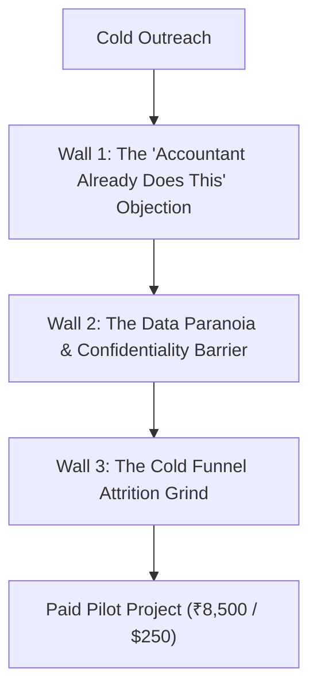
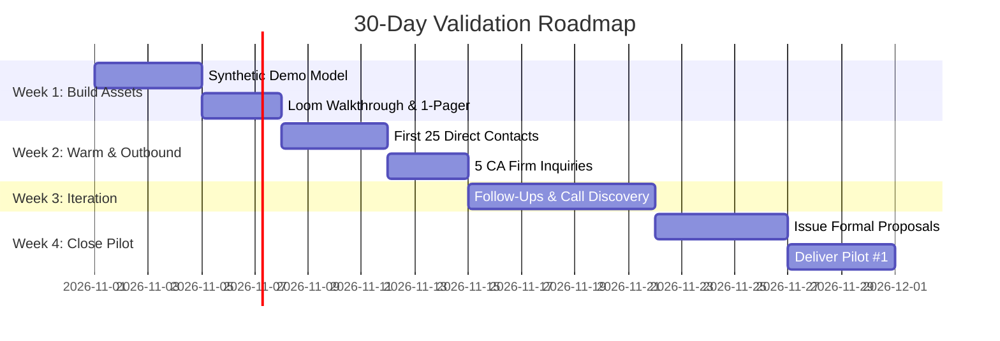

# Business Viability & Honest Reality Check
## An Unfiltered Assessment: Will This Excel & Data Automation Agency Work?

---

## Executive Overview: The Real Nature of the Opportunity

> [!IMPORTANT]
> **The Core Reality:**  
> This service idea **will work**, provided you sell it as **financial clarity and leak recovery** rather than "spreadsheet cleanup." Every growing business reaches a painful ceiling where accounting software (Tally, QuickBooks, Zoho) says one thing, operational trackers (inventory, Amazon/Shopify CSVs, factory production logs) say another, and nobody knows their true net margin until weeks after the month closes.

However, you must separate two fundamentally different challenges:
1. **Technical Delivery:** Having a high-utility skill set that solves a real operational problem.
2. **Customer Acquisition:** Proving that you can reliably find, convince, and close paying clients with positive unit economics.

---

## 1. Objective Opportunity Scorecard

```
┌────────────────────────────────────────────────────────────────────────┐
│ COMPREHENSIVE BUSINESS VIABILITY SCORE: 7.8 / 10                       │
├────────────────────────────────────────────────────────────────────────┤
│ • Real-World Problem Severity:       9.0 / 10 (Critical operational pain)│
│ • Profit Margin & Delivery Speed:     8.5 / 10 (High code leverage)     │
│ • Recurring / Retainer Potential:    8.0 / 10 (Sticky once entrenched)│
│ • Startup Capital Efficiency:        9.0 / 10 (Near-zero initial capex)│
│ • Market Differentiation:             5.0 / 10 (Generic Excel is crowded)│
│ • Ease of First 3 Clients:            4.0 / 10 (High trust barrier)    │
└────────────────────────────────────────────────────────────────────────┘
```

### Detailed Factor Analysis

| Assessment Dimension | Rating | Commercial Rationale |
| :--- | :---: | :--- |
| **Problem Severity** | **9 / 10** | Unreconciled spreadsheets directly conceal dead inventory, duplicate vendor invoices, unbilled dispatches, and negative-margin SKUs. |
| **Delivery Speed & Margin** | **8.5 / 10** | Work requiring 30 manual hours from an in-house accountant takes you 3 hours once reusable Python/pandas and Power Query scripts are built. |
| **Recurring Cash Flow** | **8.0 / 10** | Once you become the specialist who guarantees accurate management figures on the 5th of each month, firing you means returning to chaos. |
| **Startup Cost Efficiency** | **9.0 / 10** | Near-zero hardware/software barrier. Operates on existing machines, open-source libraries, and standard office tools. |
| **Market Differentiation** | **5.0 / 10** | Saturated with commodity freelancers offering basic data entry. Differentiation requires focusing on financial reconciliation and error prevention. |
| **First-Client Acquisition** | **4.0 / 10** | **The Hardest Hurdle:** You are an unproven solo operator asking strangers to trust you with confidential revenue, vendor costs, and margin records. |

---

## 2. How Tough Is It *Really* to Get Clients?

Getting early clients is **70% trust-building and 30% technical capability**. Expect to hit three specific psychological walls during your first 60 days:

### The Three Inevitable Acquisition Walls



#### 1. The "My Accountant / MIS Guy Already Does This" Wall
* **The Objection:** Factory owners and wholesale traders will say: *"I already pay an MIS clerk ₹18,000/month and have a retainer CA—why pay you ₹25,000?"*
* **The Reality:** The in-house clerk manually copy-pastes numbers without catching errors. The CA focuses on historical tax compliance, not operational leakages (e.g., matching machine scrap, fabric consumption, or Amazon 3PL storage fees against Tally).
* **How to Win:** Show them what their CA never touches: leak recovery, dead-stock capital, and automated discrepancy alerts.

#### 2. The Data Paranoia Wall
* **The Objection:** No prudent Managing Director or e-commerce founder will email years of vendor pricing, customer records, and ledger balances to an unverified stranger.
* **The "AI Hype" Pitfall:** If you pitch "AI-powered data cleaning," owners assume their private files are being fed into public AI servers.
* **How to Win:** Offer strict offline, local-environment processing under a formal mutual NDA.

#### 3. The Cold Outreach Funnel Attrition
Out of **100 well-researched, personalized outbound messages**, here is the realistic statistical breakdown:

```
100 High-Quality Researched B2B Contacts
├── 85 – 92: Ignore or never respond
└── 8 – 15: Respond
    ├── 5 – 7: Say "Not right now / we're fine"
    └── 3 – 5: Book a 15-minute Discovery Call
        └── 1 – 2: Close into a Paid Pilot (₹8,500 – ₹12,500 / $250 – $400)
```

> [!CAUTION]
> If you send generic, copy-pasted marketing spam, **100 messages will yield 0 clients**. Winning requires personalized, hypothesis-led outreach highlighting an operational bottleneck specific to that company.

---

## 3. Stepping into the Customer's Shoes: "Would I Hire You?"

*Scenario: Assume I run a ₹15 Crore ($1.8M) manufacturing/distribution business with 450 SKUs, Tally for accounting, and 15 messy Excel files managed by staff.*

### When I Would Say "NO" (Immediate Disqualification)
* **Pitching Tools Over Business Outcomes:**  
  * *"Hi, I offer AI-powered Excel cleaning, Python pandas automation, and Power BI dashboards."*  
  * **My Reaction:** Deleted in 3 seconds. I don't care about pandas, and I don't want another software license.
* **Zero Visual Proof of Complex Real-World Data:**  
  * Showing generic Titanic or Superstore portfolio charts instead of realistic GST mismatches, supplier PO reconciliations, and dead-stock aging tables.
* **Unprofessional Security Footprint:**  
  * Reaching out from a `@gmail.com` address, having no ready mutual NDA, and offering no explanation of how proprietary pricing stays offline.

---

### When I Would Say "YES" and Gladly Pay You
* **Demonstrating Trapped Capital:**  
  * *"Most 400+ SKU distribution businesses have 8%–12% of working capital trapped in dead stock and duplicate vendor bills across disconnected files. Here is a 60-second video of an automated Exception Tracker I built that catches those leaks in one click."*
* **Low-Risk, Frictionless Entry:**  
  * *"Don't pay me ₹35,000 today. Sign a 1-page mutual NDA, send me 200 masked rows from your two messiest sheets, and I’ll run a Data Health Audit in 24 hours. If I uncover real discrepancies, we do a ₹9,500 ($300) 4-day pilot. If you aren't impressed, we part ways."*
* **The Verdict:** **I would hire you under those exact terms.** For a multi-crore business, ₹9,500 ($300) is a rounding error if it saves 3 days of monthly closing panic and uncovers lakhs in trapped capital or unbilled shipments.

---

## 4. The 6-Point Customer Hiring Checklist

Before an owner or finance head signs a proposal, they evaluate these six objective criteria:

```
┌────────────────────────────────────────────────────────────────────────┐
│ THE BUYER'S EVALUATION CHECKLIST                                       │
├────────────────────────────────────────────────────────────────────────┤
│ [ ] 1. Operational Understanding: Do you clearly explain where my      │
│        current reporting workflow breaks down?                         │
│ [ ] 2. Concrete Proof: Do you have a realistic Before & After demo?    │
│ [ ] 3. Numerical Reliability: Are reconciliation formulas and audit    │
│        rules transparently documented?                                 │
│ [ ] 4. Freedom from Lock-In: Will my team receive clean files and an   │
│        SOP walkthrough they can own?                                   │
│ [ ] 5. Data Privacy & Safety: Do you guarantee local, offline data     │
│        processing under an NDA?                                        │
│ [ ] 6. Risk-Reversal Pilot: Can I test you on a small project before   │
│        committing to a large contract?                                 │
└────────────────────────────────────────────────────────────────────────┘
```

---

## 5. Five Golden Rules for Day 1 Execution

To transition this from an academic exercise into a cash-flowing business:

### 1. Drop "AI-Powered"—Sell "Deterministic Accuracy & Offline Privacy"
Use AI behind the scenes to accelerate your Python, DAX, and Power Query scripting by 5x. However, to the client, sell **100% deterministic mathematical accuracy and local, offline processing**. Telling a factory owner or CA that their data will never touch cloud AI models turns their primary objection into your competitive edge.

### 2. Keep Overhead Low: Start as a Sole Proprietorship
Do **not** spend ₹15,000–₹25,000 incorporating a private limited company or hiring retainers before earning your first rupee.
* Buy a clean domain (~₹800/yr).
* Set up a professional Google Workspace / Zoho email.
* Open a sole proprietorship bank account / Wise / Razorpay link.
* Draft a clean 1-page Mutual NDA and Scope of Work template.
* **Validate your first ₹2–3 Lakhs in revenue before adding administrative complexity.**

### 3. Build ONE Brutally Realistic Flagship Demo
Create a single end-to-end showcase:
* **The Input:** A folder with 12 messy, realistic monthly spreadsheets (inconsistent headers, spelling typos, missing SKU codes).
* **The Transformation:** A one-click automated Power Query or Python script.
* **The Deliverables:** A consolidated master table, an **Exception Alert Sheet** (flagging discrepancies), and an executive KPI dashboard.

### 4. Partner with Established Trust Centers (CAs & Bookkeepers)
Cold-prospecting factory owners closes one client at a time. Partnering with **two established Chartered Accountants or bookkeeping firms** that need white-label help cleaning clients' chaotic historical ledgers can feed you consistent, recurring projects without ongoing marketing spend.

### 5. Commit to the "Rule of 100" Before Judging the Concept
Promise yourself you will not quit, rebrand, or pivot until you have:
* Contacted **100 verified, qualified decision-makers** individually.
* Submitted **30 tailored, video-backed proposals** on freelance marketplaces.
* *Most freelancers quit at outreach #18 thinking "nobody wants this," right before discovering the winning pitch.*

---

## 6. Lean Capital Allocation & Budgeting

| Asset / Expense | Recommended Budget | Guidance |
| :--- | :---: | :--- |
| **Domain & Professional Email** | ₹1,500 – ₹2,500 / yr | Essential for credibility; avoid `@gmail.com`. |
| **Web Hosting & Portfolio** | ₹0 – ₹1,500 / yr | Host on GitHub Pages, Netlify, or Vercel using standard markdown or clean HTML/CSS. |
| **Demo Asset Development** | ₹0 (Your Time) | Build using synthetic, realistic datasets. |
| **Legal / Company Incorporation**| **₹0 initially** | Begin as an individual / sole proprietor; register once revenue is consistent. |
| **Paid Advertising (Google/Meta)**| **₹0** | Do not run ads until direct outreach confirms product-market fit. |
| **Marketplace Connects / Bids** | ₹1,500 – ₹3,000 | Purchase tokens only for tightly matched, high-budget opportunities. |

---

## 7. 30-Day Validation Sprint & Milestones



### The 4-Week Milestone Schedule:
* **Week 1 (Proof of Work):** Complete one realistic distributor or manufacturing demo; record a 60-second video walkthrough.
* **Week 2 (Market Testing):** Contact 25 targeted prospects and 5 CA firms; log objections and feedback.
* **Week 3 (Refinement):** Conduct discovery calls; adjust pitch based on specific pain points described by prospects.
* **Week 4 (Conversion):** Close **one paid pilot (₹8,500 / $250)**. If no deals close, audit the messaging and offer rather than purchasing ads.

---

## 8. Final Verdict: The Founder's Decision Matrix

| Strategic Question | Executive Assessment |
| :--- | :--- |
| **Is the business concept worth testing?** | **Yes.** The underlying operational pain is acute and recurring. |
| **Will technical ability alone guarantee clients?** | **No.** Trust, risk-reversal, and professional positioning dictate conversion. |
| **Can you start lean with minimal risk?** | **Yes.** Near-zero capital overhead beyond your time and dedication. |
| **Is recurring revenue realistic?** | **Yes.** Deliver monthly reporting as a service once initial trust is established. |
| **What is the true first milestone?** | **One paying client, one completed project, and one referenceable case study.** |

### The Critical Operating Question:
> **Are you building this full-time or part-time alongside current work/studies?**  
> * *If part-time:* Focus strictly on 5 personalized direct messages and 2 CA inquiries per week.  
> * *If full-time:* Run the full 100-prospect sprint over 30 days to establish proof of concept and cash flow rapidly.
