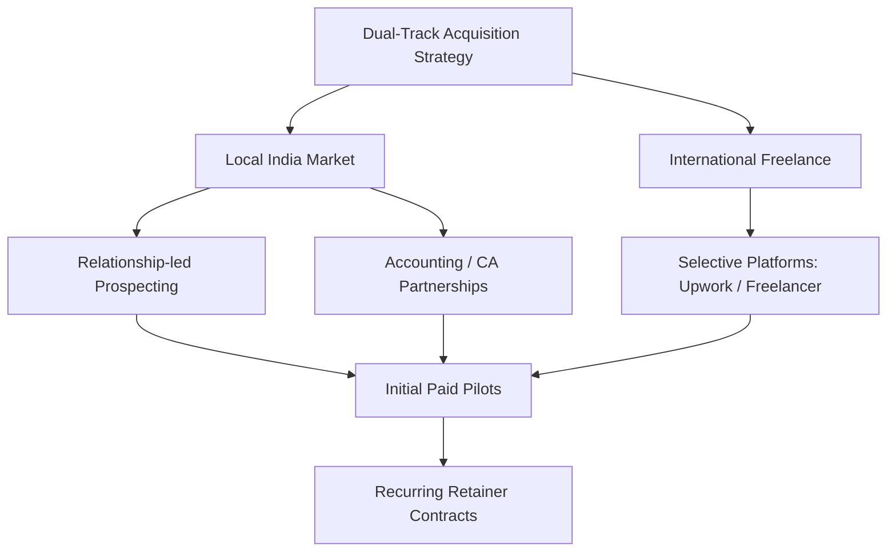
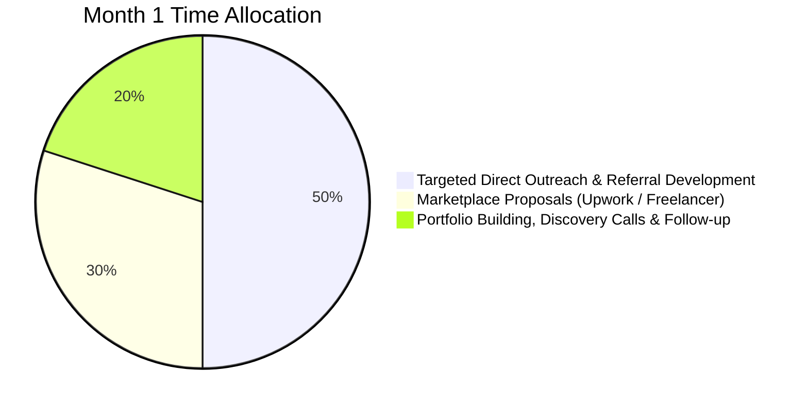
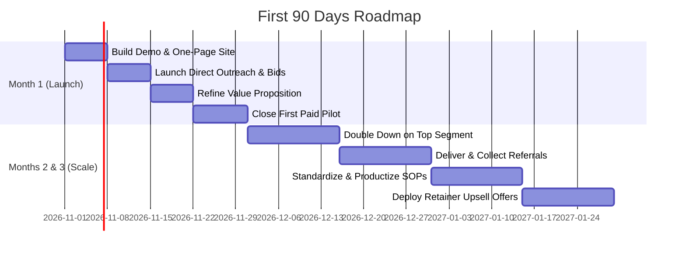

# Customer Acquisition Research: Spreadsheet Consolidation & Dashboard Services

**Research Date:** 27 October 2026  
**Target Markets:** India, US, UK, Australia, and Canada  

---

## Strategic Objective & Positioning

The core objective is not simply to find businesses that use Excel. It is to identify businesses that already experience **expensive, recurring reporting problems** and have a compelling commercial reason to pay an external specialist to resolve them.

Your strongest initial offer should combine **spreadsheet consolidation**, **data-quality checks**, and **automated reporting** into a clear, measurable business outcome. 

> **Key Rule:** Never sell "hours of Excel work." Sell a tangible business deliverable—such as a consolidated inventory report, a reliable monthly management dashboard, or a streamlined month-end reporting process.

### Framework of Conclusions
* **Observed Evidence:** Published listings, official platform policies, directories, and documented customer requirements.
* **Estimates:** Potential prices, sales conversion rates, and revenue scenarios requiring live market validation.
* **Recommendations:** Immediate customer acquisition strategies recommended for early-stage rollout based on current technical skills.

> [!WARNING]
> **Data Limitation Note:** Public freelance listings and directory data reflect point-in-time snapshots. Some platforms restrict visibility into budgets, proposal counts, or closed projects. Unverified listings must be treated as indicators rather than confirmed purchasing demand.

---

## Deliverable 1: Executive Summary & Action Plan

The recommended launch strategy blends **local, relationship-led prospecting in India** with a **curated, high-value pipeline of international freelance projects**. This dual-track approach protects against pure reliance on saturated marketplaces while testing higher-yield remote opportunities.



### Strategic Action Pillars

#### 1. Target Distributors and Manufacturers First
* **Operational Reality:** Inventory, purchasing, sales, production, and accounts records are frequently scattered across disconnected spreadsheets and software.
* **Offer Clarity:** A concrete deliverable like a *unified stock-and-sales reconciliation dashboard* is significantly easier to grasp and evaluate than generic "data analytics."

#### 2. Build Referral Partnerships with CA & Bookkeeping Firms
* **Compounding Value:** A single accounting firm managing reporting cycles for dozens of clients offers much higher lifetime value than an isolated customer.
* **Engagement Model:** Provide white-label consolidation and reporting services supported by clear confidentiality safeguards and client-approval workflows.

#### 3. Sell Business Outcomes, Not Technology Stacks
* **Pitch Messaging:** Lead with: *"Combine monthly sales and inventory files into one reliable, auto-refreshable report."*
* **Tool Realignment:** Excel, Power Query, Python, and Power BI are internal implementation tools—not the primary reason a client buys.

#### 4. Leverage Freelance Marketplaces as a Secondary Pipeline
* **Market Validation:** Examples include public postings such as a $50 Power BI construction-workforce dashboard on Upwork, alongside frequent Excel consolidation requests on Freelancer.com.
* **Pricing Caution:** These platforms validate genuine demand but carry aggressive price competition. Use them selectively to build case studies and international proof points.

#### 5. Convert Initial Fixes into Recurring Reporting Retainers
* **Retention Strategy:** After delivering a clean, consolidated dataset, offer an ongoing monthly service covering data refreshes, reconciliation checks, exception alerts, and executive summary packs.
* **Outcome:** Moves the engagement from a one-off gig into sticky, recurring monthly revenue.

---

## Recommended Starting Position

### Primary Offer
> **Historical Data Consolidation & Reporting Automation**  
> Consolidate scattered spreadsheets, standardize and validate records, and deliver an automated, refreshable business dashboard complete with documented data-quality checks.

### Target Pricing for Initial Pilots

| Market | Pilot Project Price Range | Scope Notes |
| :--- | :--- | :--- |
| **Indian Market Pilot** | **₹7,500 – ₹12,500** | Tightly defined pilot scope; unstandardized or massive data requires custom quotes. |
| **International Pilot** | **$150 – $300** | Initial test pricing to establish credibility and validate conversion rates. |

> [!TIP]
> **First-Month Milestone:** Focus on securing **one paid pilot** and generating concrete proof of repeatable demand. Do not spend time or capital on large social media campaigns, complex websites, or elaborate marketing funnels.

---

## Deliverable 2: Ranked Customer Segments

The ranking below serves as a reasoned baseline hypothesis. It evaluates operational reporting pain, work repeatability, ease of decision-maker access, and clarity of financial return.

### Scoring Methodology

Each segment is evaluated on a 1–5 scale across five weighted dimensions:

| Factor | Weight | Evaluation Rationale |
| :--- | :---: | :--- |
| **Frequency and urgency of reporting pain** | **30%** | How often delays or errors impact daily operations. |
| **Willingness and ability to pay** | **25%** | Budget availability and ROI justification for external help. |
| **Repeat or retainer potential** | **20%** | Potential for ongoing monthly or quarterly engagements. |
| **Ease of reaching the decision-maker** | **15%** | Accessibility of founders, partners, or ops heads. |
| **Fit with current technical skills** | **10%** | Immediate alignment with consolidation, Power Query, and BI workflows. |

$$\text{Priority Score} = (\text{Weighted Average}) \times 20 \quad (\text{Scale of } 0 - 100)$$

---

### Segment Priority Ranking

*Note: Scores represent analyst priority ratings based on the evaluation model, not probability percentages of closing.*

| Rank | Customer Segment | Primary Spreadsheet Pain | Likely Buyer | Repeat Potential | Priority Score |
| :---: | :--- | :--- | :--- | :---: | :---: |
| **1** | **Wholesale distributors & stockists** | Stock, sales, purchasing, and receivables reconciliation | Owner, Operations Head, Inventory Manager | Very High | **92** |
| **2** | **Small & medium manufacturers** | Production schedules, inventory, procurement, and unit cost reports | Operations Head, Finance Manager | Very High | **90** |
| **3** | **CA & bookkeeping firms** | Client workbooks, complex reconciliations, and recurring monthly close | Managing Partner, Practice Manager | Very High | **88** |
| **4** | **Importers, exporters & traders** | Multi-shipment tracking, SKU records, currency variances, and supplier terms | Owner, Finance Head, Export Manager | High | **85** |
| **5** | **Logistics & warehousing companies** | Fleet management, delivery status, route costs, and space utilization | Operations Manager | High | **83** |
| **6** | **Multi-location retailers** | Store-by-store sales, branch transfers, inventory, and margin tracking | Owner, Finance Head, Regional Ops Head | High | **81** |
| **7** | **E-commerce sellers** | Marketplace sales exports, returns, ad spend, and settlement reconciliation | Founder/Owner, Operations Lead | High | **80** |
| **8** | **Construction contractors** | Project cost tracking, labor hours, material procurement, and progress billing | Project Director, Commercial Manager | High | **78** |
| **9** | **Small businesses with finance teams** | Repetitive month-end reporting and manual copy-paste data entry | Business Owner, Finance Manager | High | **77** |
| **10** | **Independent consultants & analysts**| Rebuilding repetitive client reporting decks and data-prep pipelines | Consultant, Practice Principal | Med–High | **74** |
| **11** | **Educational institutions** | Student records, fee tracking, attendance, and administrative overhead | Administrator, Finance Head | Medium | **68** |
| **12** | **Healthcare clinics & diagnostic labs** | Operational scheduling, billing reconciliation, equipment utilization | Administrator, Operations Head | Med–High | **65** |

### Analytical Insights on the Rankings
* **Why the Top 3 Rank Highest:** Reporting problems recur constantly, outputs directly influence cash flow and operational decisions, and a single relationship can generate multiple engagements or client referrals.
* **Tiers 4 & 5 (Traders & Logistics):** Highly viable once transaction volume reaches a threshold where manual reconciliation creates measurable bottlenecks.
* **Retail & E-commerce:** Strong candidates if you can demonstrate rapid reconciliation across channels, marketplaces, and payment gateway settlements.
* **Healthcare De-prioritization:** Although reporting needs are substantial, stringent patient data privacy, HIPAA/compliance regulations, and sensitive operational data create unnecessary friction for early-stage engagements. Target non-clinical administrative reporting only if pursuing this vertical.

---

## Segment-by-Segment Validation Guide

| Segment | Evidence to Look for Before Contacting | Best First Offer | Main Obstacle / Objection |
| :--- | :--- | :--- | :--- |
| **Distributors** | Multiple product categories, several warehouse branches, frequent vendor POs | Stock & sales reconciliation dashboard | "Our existing ERP/accounting tool already generates reports." |
| **Manufacturers** | Multi-stage production, complex BOMs, frequent raw material procurement | Production & procurement reporting pack | Proprietary ERP silos and highly company-specific terminology. |
| **CA Firms** | Active bookkeeping, outsourced accounting, MIS packs, or month-end services | White-label data cleanup & reusable client reporting systems | Establishing trust, non-disclosure compliance, and tight client deadlines. |
| **Importers / Exporters**| Large SKU catalogs, overseas shipments, multiple currency transactions | Shipment, supplier & gross margin tracker | Complexity of customs duties, tariff codes, and FX variances. |
| **Logistics** | Fleet size, delivery logs, route costs, multi-hub operations | Fleet & warehouse operations KPI dashboard | Siloed data spread across GPS, TMS, and driver apps. |
| **Retail** | Multiple store locations, inter-branch stock transfers, multi-channel sales | Branch-wise sales, margin & inventory dashboard | Point-of-Sale (POS) system already offers standard reports. |
| **E-commerce** | Multi-channel presence (Amazon, Shopify, Flipkart), high return rates | SKU-level profitability & marketplace settlement reconciliation | Changing API/CSV export formats across selling platforms. |
| **Construction** | Multiple concurrent sites, subcontractor rosters, milestone billing | Project budget vs. actual cost tracking dashboard | Fragmented site-level inputs and informal field reporting habits. |
| **Other SMEs** | Recurring month-end spreadsheet panic and heavy manual data copying | Automated monthly management reporting package | Lower overall transaction volume or limited budget allocation. |
| **Consultants** | High volume of bespoke research or client audits requiring repetitive data manipulation | Standardized, reusable data cleaning & visualization pipeline | Project-based demand volatility and protective client ownership. |
| **Education** | Multiple departments, varied fee structures, recurring intake cycles | Student enrollment & fee collection tracking dashboard | Slower institutional procurement cycles and academic calendars. |
| **Healthcare** | Multiple diagnostic centers, outsourced billing, high equipment usage | Non-clinical billing, inventory, or operations dashboard | Data confidentiality guidelines and strict compliance mandates. |

---

## Prospect Discovery & Qualification Framework

During initial discovery conversations, ask the following 7 diagnostic questions to evaluate project viability:

1. **Input Sources:** *How many disparate files, systems, or software exports are required to assemble this report?*
2. **Time Investment:** *How many hours are spent every week or month compiling, formatting, and cross-checking these numbers?*
3. **Cost of Errors:** *What operational delays, stockouts, or financial inaccuracies have occurred due to broken formulas or outdated figures?*
4. **Reconciliation Responsibility:** *Who is currently tasked with verifying spreadsheet totals against primary source documents?*
5. **Reporting Frequency:** *How frequently does this entire reporting cycle need to be repeated?*
6. **Consequence of Delay:** *What happens internally if this report is delivered two days late or contains flawed data?*
7. **Procurement Authority:** *Who owns the decision and budget to approve a targeted pilot project to automate this?*

> [!IMPORTANT]
> **Qualification Rule:** Do not qualify a business simply because it matches an industry tag. Prioritize prospects that clearly articulate an **acute, recurring reporting pain point**, have an **identifiable business decision-maker**, and are willing to provide **sample data** to structure the pilot workflow.

---

## Deliverable 3: Customer Acquisition Channel Comparison

*Note: These rankings reflect operational suitability and early-stage ROI for an emerging solo consultant/freelancer, not universal conversion statistics.*

### Channel Evaluation Matrix

| Priority | Channel | Cost to Start | Speed to Feedback | Lead Quality | Competition Level | Strategic Suitability |
| :---: | :--- | :--- | :--- | :--- | :---: | :--- |
| **1** | **Warm introductions & referrals** | Very Low | Fast | Very High | Low | Highest close rate; begin with immediate network. |
| **2** | **Targeted local business outreach** | Low | Medium | High | Low–Med | High trust potential; easier to meet owners/ops heads. |
| **3** | **CA / bookkeeping partnerships** | Low | Medium | Very High | Medium | Multiplier effect: one partner feeds multiple client projects. |
| **4** | **Upwork targeted proposals** | Low–Med | Fast | High (if specific) | High | Great for early portfolio & proof, but proposal fees apply. |
| **5** | **LinkedIn targeted outreach** | Low | Medium | High (with filters) | Med–High | Essential for B2B decision-maker targeting. |
| **6** | **Freelancer.com targeted bidding** | Low–Med | Fast | Variable | High | High bid volume; bid selectively on well-defined scopes. |
| **7** | **Industry association events** | Low–Med | Medium | High | Low–Med | High-context networking in manufacturing/trade hubs. |
| **8** | **Contra & curated networks** | Low | Variable | Variable | Medium | Excellent for zero-fee portfolio & verified contracts. |
| **9** | **SEO & search-led inbound** | Low $ / High Time | Slow | High (long-term) | Variable | Valuable asset long-term, but will not yield quick pilots. |
| **10** | **Fiverr inbound gigs** | Low | Variable | Variable | High | Only viable with highly standardized, productized gigs. |
| **11** | **Paid search & social ads** | Med–High | Fast Traffic | Variable / Low | High | High cash burn with unpredictable ROI for services early on. |

---

### What the Marketplace Evidence Shows

Recent live marketplace job postings confirm strong, ongoing commercial demand for data consolidation and dashboard builds, while highlighting the danger of using arbitrary platform listings as price benchmarks:

* **Upwork ($50 Fixed Price):** Construction workforce dashboard requiring Excel, Power Query, SharePoint integration, training, and Power BI deliverable (20–50 proposals).
* **Freelancer.com (₹750 – ₹1,250/hr):** Consolidated financial master workbook, CSV ingestion, deduplication, dynamic dashboard with account/cost-centre filters, automated refresh, and a live walkthrough (28 proposals).
* **Freelancer.com (₹1,500 – ₹12,500 Fixed):** Data cleanup, interactive dashboards, KPI reporting, and documentation (only 1 proposal at capture time).

> [!WARNING]
> **Benchmark Warning:** Marketplace budgets and proposal numbers fluctuate drastically. A low budget ($50) on a complex job with 50 proposals demonstrates heavy price competition. Never price yourself by race-to-the-bottom postings—focus on clear scope, fast turnaround, and quality guarantees.

---

### Platform Fees & Engagement Rules

```
Upwork:          0% - 15% service fee per contract + $0.15 per Connect
Freelancer.com:  10% (or $5 min) fixed fee / 10% hourly fee + min balance requirements
Contra:          0% commission on freelance contracts; monetization via optional Pro tier
Fiverr:          Service fee on orders; success requires narrow, productized micro-packages
```

### Recommended Month-One Time Allocation



* **50% — Targeted Direct Outreach & Referral Development:** Reaching out directly to local manufacturers, distributors, and CA firms.
* **30% — Marketplace Proposals:** Submitting customized, value-first proposals to vetted Upwork and Freelancer projects.
* **20% — Discovery Calls, Portfolio Assets & Follow-Up:** Refining case studies, demo dashboards, and following up on active conversations.

---

## Deliverable 4: Prospecting Directory & Sourcing Framework

Directories are not job boards where clients ask for freelancers—they are **inventories of qualified businesses** that exhibit indicators of high data complexity.

### 1. India: Regional Manufacturing, Trading & SME Directories

#### Regional Hubs & Industrial Zones
* **CODISSIA (Coimbatore):**  
  * *Official Link:* [codissia.com](https://www.codissia.com/?utm_source=chatgpt.com) · [Association Information](https://intec.codissia.com/cod.html?utm_source=chatgpt.com)  
  * *Focus:* Broad MSME industrial base. Attend trade fairs/events (INTEC) and network with pump manufacturers, engineering units, textile machinery suppliers, and industrial distributors.
* **TANSIDCO (Tamil Nadu Industrial Estates):**  
  * *Official Directory:* [Industrial Estate List](https://tansidco.org/Home/industrial_estate_list?utm_source=chatgpt.com)  
  * *Focus:* Industrial clusters in Ambattur, Guindy, Thirumudivakkam, etc. Identify tenant companies through estate directories and verify via their websites.
* **SIPCOT (Tamil Nadu Industrial Parks):**  
  * *Official Portal:* [sipcotweb.tn.gov.in](https://sipcotweb.tn.gov.in/?utm_source=chatgpt.com)  
  * *Focus:* Major manufacturing parks (Sriperumbudur, Oragadam, Hosur). Ideal for mapping regional supplier clusters.
* **BCIC (Bangalore Chamber of Industry & Commerce):**  
  * *Directory Page:* [BCIC Member Directory](https://www.bcic.in/membership/directory?utm_source=chatgpt.com)  
  * *Focus:* Established Karnataka enterprises. Coordinate with the secretariat regarding networking events and directory policies.
* **Karur Textile & Home-Furnishing Export Cluster:**  
  * *Exploration:* [Search Karur Textile Exporters on Google Maps](https://www.google.com/maps/search/textile+manufacturers+Karur/?utm_source=chatgpt.com)  
  * *Focus:* Export-oriented manufacturing handling complex purchase orders, multi-country shipments, and fabric SKU variants.

#### B2B Portals & National Aggregators
* **IndiaMART:** [indiamart.com](https://www.indiamart.com/?utm_source=chatgpt.com)  
  * *High-Yield Queries:* `"industrial distributor Coimbatore"`, `"textile manufacturer Karur"`, `"electrical wholesaler Chennai"`, `"packaging manufacturer Bengaluru"`.  
  * *Filters:* Target vendors with multi-product catalogs, multiple branch listings, and visible sales teams.
* **TradeIndia:** [tradeindia.com](https://tradeindia.com/?utm_source=chatgpt.com)  
  * *Focus:* Filter by location and category (Suppliers, Exporters, Stockists) to source high-volume operations.
* **Kompass India & Global:** [kompass.com](https://www.kompass.com/?utm_source=chatgpt.com)  
  * *Focus:* Filter by industry branch, employee count, and company type.

---

### 2. International & Comprehensive Directory Reference (Channels 9 – 24)

| # | Source & Link | Primary Operational Value | Recommended Search & Filtering Strategy |
| :-: | :--- | :--- | :--- |
| **9** | [Google Maps](https://www.google.com/maps?utm_source=chatgpt.com) | Local business discovery | Search: `wholesale distributor [city]`, `precision manufacturer [city]`, `cold storage warehouse [city]`. |
| **10** | [LinkedIn](https://www.linkedin.com/?utm_source=chatgpt.com) | Direct decision-maker identification | Search query: `[Industry] + [City] + "Operations Manager"` or `"Finance Manager"` or `"Founder"`. |
| **11** | [LinkedIn Sales Navigator](https://www.linkedin.com/sales/?utm_source=chatgpt.com) | Precision B2B prospecting | Filter: 11–200 employees, B2B wholesale/manufacturing, geography, and specific seniority levels. |
| **12** | [Upwork Data Cleansing](https://www.upwork.com/freelance-jobs/data-cleansing/?utm_source=chatgpt.com) | Active project demand | Search tags: `Data cleaning`, `Excel`, `Power Query`, `Automated Dashboard`. |
| **13** | [Freelancer.com Data Analysis](https://www.freelancer.com/jobs/data-analysis?utm_source=chatgpt.com) | Active project demand | Filter: `Excel dashboard`, `financial consolidation`, `reporting automation`. |
| **14** | [Contra Opportunities](https://contra.com/features/find-freelance-jobs?utm_source=chatgpt.com) | Commission-free freelance projects | Search: `Analytics`, `Business Intelligence`, `Dashboard design`. |
| **15** | [Fiverr Marketplace](https://www.fiverr.com/?utm_source=chatgpt.com) | Productized service benchmarks | Research packages: `Excel financial dashboard`, `Power Query automation`. |
| **16** | [Thomasnet](https://sourcing.thomasnet.com/?utm_source=chatgpt.com) | US industrial suppliers & job shops | Filter by manufacturing capability, regional distributors, and catalog size. |
| **17** | [UK Companies House](https://company-information.service.gov.uk/?utm_source=chatgpt.com) | UK company verification | Cross-reference officer details, filing status, and official company size. |
| **18** | [Canada Business Registries](https://www.canada.ca/en/services/business/research/directoriescanadiancompanies.html?utm_source=chatgpt.com) | Canadian manufacturers & importers | Search importers, distributors, and mid-sized supply chain operators. |
| **19** | [Australian ASIC Registers](https://www.asic.gov.au/online-services/search-asic-registers/company-and-organisation-registers?utm_source=chatgpt.com) | Australian business verification | Search registered entities and cross-check operations websites. |
| **20** | [US Census County Business Patterns](https://www.census.gov/programs-surveys/cbp.html?utm_source=chatgpt.com) | Macro geographic research | Locate geographic counties with high densities of target-size manufacturing establishments. |
| **21** | [Manufacturer Association Directories](https://www.google.com/search?q=manufacturers+association+directory+India&utm_source=chatgpt.com) | Trade association rosters | Query: `[Industry] + [State/City] + "manufacturers association" + "directory"`. |
| **22** | [Indian Accounting Firm Directories](https://www.google.com/search?q=chartered+accountants+firms+directory+India&utm_source=chatgpt.com) | High-leverage referral partners | Query: `"Chartered Accountants" + [City] + "outsourced accounting" OR "MIS"`. |
| **23** | [Local SME Networking Events](https://www.google.com/search?q=SME+business+networking+events+Coimbatore&utm_source=chatgpt.com) | In-person relationship building | Search local chamber events, BNI chapters, and regional MSME expos. |
| **24** | [Power BI Partner Directory](https://www.google.com/search?q=Power+BI+consultants+partner+directory&utm_source=chatgpt.com) | Subcontracting & overflow work | Identify boutique BI consultancies needing data-prep and Excel-cleaning capacity. |

---

### Operational Prospecting Discipline

To prevent wasted effort, maintain a centralized CRM tracker recording the following 8 fields for each lead:

```
1. Company Name & Website
2. City & Industry Vertical
3. Observed Operational Complexity (SKU count, branch count, multi-channel presence)
4. Public Business Contact Channel (Email, phone, front desk)
5. Decision-Maker Name & Job Title (LinkedIn verified)
6. Concrete Reporting Hypothesis (e.g., "Reconciling daily sales with warehouse inventory across 3 depots")
7. Source Link & Verification Date
8. Outreach History, Response Status, and Next Step
```

> [!CAUTION]
> **Outreach Protocol:** Never scrape contact lists indiscriminately or blast generic sales messages. High-value B2B relationships are built on personalized, hypothesis-led outreach that demonstrates genuine understanding of the target's operational context.

---

## Deliverable 5: Real Market Opportunities Analysis

The following actual project postings from October 2026 demonstrate real customer pain points and illustrate what buyers explicitly value:

```
┌─────────────────────────────────────────────────────────────────────────────────┐
│ REAL-WORLD DEMAND EXAMPLES                                                      │
├─────────────────────────────────────────────────────────────────────────────────┤
│ • Opportunity A (Upwork): Power BI Construction Workforce Dashboard ($50)      │
│ • Opportunity B (Freelancer): Financial Spreadsheets Consolidation (₹750-₹1250) │
│ • Opportunity C (Freelancer): Interactive Excel Dashboard Pack (₹1500-₹12500)   │
│ • Opportunity D (Freelancer): Inconsistent Sheet Alignment & Analysis (₹400-₹750)│
│ • Opportunity E (Upwork): Reusable Financial Models for Consulting Firm         │
└─────────────────────────────────────────────────────────────────────────────────┘
```

### Detailed Case Analysis

#### Opportunity A: Power BI Construction Workforce Dashboard
* **Platform:** Upwork (Australia · Fixed Price)
* **Budget:** $50 | **Proposals:** 20–50
* **Scope Requested:** Raw data cleaning, Power Query data transformation, formula validation, automated connection to a SharePoint Excel file, a finished `.pbix` report, and interactive live user training.
* **Strategic Takeaway:** Clients don't just want visuals—they prioritize **automated refreshability, verified calculation accuracy, clear documentation, and user enablement**.
* [View Listing on Upwork](https://www.upwork.com/freelance-jobs/apply/Power-Dashboard-from-Excel-Report_~022111962792138829141/?utm_source=chatgpt.com)

#### Opportunity B: Financial Spreadsheet Master Consolidation
* **Platform:** Freelancer.com (Hourly Listing)
* **Budget:** ₹750 – ₹1,250 / hr | **Proposals:** 28
* **Scope Requested:** Build a master workbook for multi-year financial records, automate CSV ingestion, remove duplicates, generate dynamic dashboards filtered by month, account, and cost center, configure auto-refresh, and record a training walkthrough.
* **Strategic Takeaway:** Financial consolidation is the gold standard for your offering—it integrates data hygiene, ledger reconciliation, business logic, and automated presentation.
* [View Listing on Freelancer.com](https://www.freelancer.com/projects/data-visualization/excel-financial-data-dashboard?utm_source=chatgpt.com)

#### Opportunity C: Excel Dashboard & Data Analysis Solution
* **Platform:** Freelancer.com (India · Fixed Price)
* **Budget:** ₹1,500 – ₹12,500 | **Proposals:** 1 (at capture)
* **Scope Requested:** Data cleansing, advanced Excel formulas, pivot tables, KPI charts, an interactive summary dashboard, automated reporting triggers, and quick user documentation.
* **Strategic Takeaway:** Represents a quintessential entry-level project. Requires firm scope guardrails to prevent scope creep from eroding project margins.
* [View Listing on Freelancer.com](https://www.freelancer.com/projects/data-analysis/microsoft-excel-dashboard-data-analysis?utm_source=chatgpt.com)

#### Opportunity D: Worksheet Alignment, Comparative Analysis & Dashboard
* **Platform:** Freelancer.com (Fixed / Hourly)
* **Budget:** ₹400 – ₹750 / hr | **Proposals:** 15
* **Scope Requested:** Align multiple structurally inconsistent spreadsheets, cross-validate metrics, execute comparative variance analysis, consolidate into a clean master file, and deliver a decision-ready report.
* **Strategic Takeaway:** Buyers often title listings as simple "data entry" or "cleanup" when the underlying scope actually demands **structured data analysis and business intelligence modeling**.
* [View Listing on Freelancer.com](https://www.freelancer.com/projects/data-analysis/excel-data-entry-comparative-analysis-40600806?utm_source=chatgpt.com)

#### Opportunity E: Long-Term Financial Modeling & Reporting Pack Support
* **Platform:** Upwork (International Finance Consultancy)
* **Budget:** Custom Contract (Ongoing)
* **Scope Requested:** Design reusable Excel and Power Query templates, standardize reporting hierarchies, automate monthly client data ingestion, and assemble management-ready reporting packs.
* **Strategic Takeaway:** Partnering with an active consultancy provides compounding leverage: you build **reusable templates and workflows once**, serving multiple end clients with minimal ongoing friction.
* [View Listing on Upwork](https://www.upwork.com/freelance-jobs/apply/Financial-Modeling-Template-Engineer-Excel-Power-Query_~022106337793330253645/?utm_source=chatgpt.com)

---

### Core Marketplace Insights for Bidding & Execution

1. **Clients Specify Tangible Deliverables:** Buyers describe concrete artifacts: a master workbook, validated reconciliation formulas, an automated refresh trigger, an executive dashboard, and a video or SOP walkthrough.
2. **Advertised Price $\neq$ True Profitability:** A $50 gig requiring end-to-end data cleansing, SharePoint integration, and personal live training is fundamentally unviable unless treated strictly as a loss-leader to win a 5-star rating.
3. **High Proposal Counts Can Be Misleading:** 30+ proposals on an Upwork posting often reflect automated copy-paste bids. A tailored proposal highlighting a specific solution to their core bottleneck stands out instantly.
4. **Target Subcontracting & Template-Based Retainers:** Reusable models and white-label agency partnerships provide the highest revenue per invested hour.

---

## Deliverable 6: Decision-Maker & Outreach Matrix

### Target Persona & Hook Mapping

| Segment | Primary Buyer (Budget Owner) | Daily User / Internal Evaluator | Strategic Referral Partner | Core Lead-In Offer / Hook |
| :--- | :--- | :--- | :--- | :--- |
| **Distributor** | Owner, Operations Manager | Inventory or Accounts Manager | ERP implementer, local accountant | Stock & sales reconciliation dashboard |
| **Manufacturer** | Operations Head, Finance Manager | Production Planner, MIS Executive | ERP consultant, cost accountant | Production & procurement variance reporting |
| **CA / Bookkeeping Firm** | Managing Partner | Bookkeeping Lead, Reporting Senior | Other CA firms, Fractional CFOs | White-label client reporting & data cleanup |
| **Importer / Exporter** | Owner, Finance Manager | Export/Import or Purchase Executive| Customs broker, freight consultant | Shipment tracking & supplier margin analyzer |
| **Logistics Company** | Operations Director | Fleet or Warehouse Hub Manager | Transport TMS software vendor | Fleet route cost & delivery KPI tracker |
| **Multi-Location Retail** | Owner, Finance Head | Store Manager, Regional Ops Lead | POS system provider | Branch-wise sales, margins & stock transfers |
| **E-commerce Seller** | Founder, Operations Lead | Marketplace Analyst, Finance Lead | E-commerce agency consultant | Marketplace settlement & SKU profitability |
| **Construction Contractor**| Project Director | Project Accountant, Cost Controller | Project management / ERP consultant | Budget vs. actual project cost & progress report |
| **General SME** | Business Owner, Finance Lead | Accounts / MIS Executive | Local SME business advisor | Monthly automated management reporting pack |
| **Consulting Practice** | Principal, Practice Lead | Analyst, Project Manager | Non-competing strategy consultancies | Reusable client-reporting pipelines & models |
| **Education Institute** | Administrator, Finance Head | Accounts, Registrar / Admissions Lead| Educational ERP provider | Student enrollment & fee collection tracker |
| **Healthcare / Lab** | Hospital / Lab Administrator | Billing Lead, Operations Analyst | Healthcare IT vendor | Non-clinical billing & utilization dashboard |

---

### High-Precision LinkedIn Search Strings

Before subscribing to LinkedIn Sales Navigator, run targeted Boolean searches within the standard LinkedIn search engine using location, title, and industry filters:

```bash
# Distributors (Coimbatore / Regional Hubs)
("operations manager" OR "inventory manager") AND distributor AND Coimbatore

# Manufacturing (Chennai / Industrial Corridors)
("finance manager" OR "MIS manager") AND manufacturer AND Chennai

# Accounting & Bookkeeping Practices (India)
("managing partner" OR "practice manager") AND accounting AND India

# E-commerce Operators (Australia / International)
("founder" OR "operations manager") AND ecommerce AND Australia

# Fractional CFOs & Outsource Leads
("fractional CFO" OR "bookkeeping firm") AND Excel AND reporting

# ERP & BI Ecosystem Partners
("Power BI consultant" OR "ERP consultant") AND manufacturing AND India
```

> [!TIP]
> **Outreach Principle:** Target the individual who **owns the report** or **suffers through its manual compilation**—not simply anyone with "data" in their title. A small manufacturing owner approves the spend, but an overworked accounts manager can pinpoint exactly where the manual process breaks down each month.

---

### B2B Referral Partnership Strategy

Cultivate formal referral relationships across five high-leverage professional categories:

```
┌────────────────────────────────────────────────────────────────────────┐
│ 5 HIGH-LEVERAGE REFERRAL PARTNERS                                      │
├────────────────────────────────────────────────────────────────────────┤
│ 1. CA & Bookkeeping Firms   → Relieve recurring monthly client crunches│
│ 2. ERP Implementers         → Bridge gaps where ERPs fail custom needs │
│ 3. Fractional CFOs          → Deliver clean, validated board-level MIS │
│ 4. Power BI Consultants     → Handle messy Excel cleaning prior to BI  │
│ 5. Operational Consultants  → Implement data automation post-audit     │
└────────────────────────────────────────────────────────────────────────┘
```

#### Partnership Structuring Rules:
* Provide a formal **subcontracting agreement** that defines deliverables, turnaround deadlines, strict NDA/confidentiality clauses, and client ownership terms.
* Offer white-label delivery allowing partners to package your reporting directly under their existing brand.
* Avoid undefined or perpetual commission promises—use structured per-project margins or clear revenue-share milestones.

---

## Deliverable 7: Customer Acquisition Playbook & Outreach Templates

All outreach templates are engineered for brevity and focus. Always customize the bracketed fields with verifiable business observations.

### Outreach Message Templates

#### 1. Distributor Outreach (Email / InMail)
```text
Subject: Simplifying monthly stock and sales reporting

Hi [Name],

I noticed that [Company] handles [specific product categories or regional distribution channels].

I help distributors combine sales, purchase, and inventory spreadsheets into a single, automated, refreshable report—with stock discrepancies, dead inventory, and slow-moving items automatically flagged.

If preparing these reports is still manual for your team, would a quick conversation be worthwhile? I can demonstrate the approach using synthetic sample data without requiring your actual business files.

Regards,
[Your Name]
[Title / Contact Details]
```

#### 2. Manufacturer Outreach (Email)
```text
Subject: Production and procurement reporting

Hi [Name],

I came across [Company] while researching precision manufacturers in [location/industry].

I build automated reporting workflows that consolidate monthly purchase, production, and warehouse inventory files, cross-validate totals, and output a repeatable management KPI pack.

If your team spends days combining workbooks at month-end, I would be glad to learn how your current process works and demonstrate a small sample workflow using synthetic data.

Would a 15-minute introductory call next week work for you?

Regards,
[Your Name]
[Title / Contact Details]
```

#### 3. CA or Bookkeeping Firm (Subcontracting / Partnership)
```text
Subject: Support for recurring Excel and MIS client reporting

Hello [Name],

I provide spreadsheet consolidation, automated reconciliation, and Excel/Power BI dashboard reporting for growing businesses.

I am looking to establish subcontracting partnerships with accounting and bookkeeping firms that need dependable support handling repetitive client reporting or complex data cleanups during peak closing periods.

I can build directly to your existing templates, document data transformation logic, and adhere to strict confidentiality protocols.

Would you be open to a brief call to discuss a small, clearly scoped pilot project?

Regards,
[Your Name]
[Title / Portfolio Link]
```

#### 4. International Small Business (Email / LinkedIn)
```text
Subject: Reducing manual spreadsheet reporting

Hi [Name],

I noticed that [Company] operates across [specific product lines, retail channels, or service hubs].

I help small businesses convert fragmented Excel and CSV exports into clean, reconciled datasets and automated, refreshable management dashboards.

We can begin with a small, tightly scoped pilot covering a single recurring reporting workflow—complete with documented validation checks and an operational handover guide. I always demo using mock data and establish secure data protocols before onboarding.

Is there a recurring spreadsheet report your team would love to automate?

Best regards,
[Your Name]
[Website / Portfolio URL]
[Business Contact Details]
```

#### 5. ERP Consultant / Fractional CFO (Referral Partnership)
```text
Subject: Data preparation & reporting support for your client projects

Hello [Name],

I specialize in the reporting and data-transformation layer around existing business systems: reconciling Excel/CSV exports, verifying data hygiene, and building auto-refreshing management dashboards.

I am interested in collaborating with consultants whose clients require specialized reporting without the cost or disruption of replacing their existing ERP or accounting setup.

If this complements your client engagements, could we explore a small joint or subcontracted pilot? I am fully comfortable working white-label behind your brand with explicit client-ownership boundaries.

Regards,
[Your Name]
[Portfolio Link]
```

---

### Social & Marketplace Scripts

#### LinkedIn Connection Request (300 characters)
```text
Hi [Name], I came across your work in [industry/function]. I build practical spreadsheet consolidation and reporting workflows for SMEs. I’d be glad to connect and learn more about the operational reporting challenges businesses in your sector face.
```
*Rule: Follow up only after they accept, and only with a context-rich, value-additive message. Never blast canned pitches to unresponsive contacts.*

#### Freelance Marketplace Proposal Framework (Upwork / Freelancer)
```text
Hi [Client Name],

I would approach this project in three clear stages:
1. Audit the current workbook structure and establish cleaning, deduplication, and reconciliation rules.
2. Build a consolidated master dataset and an auto-refreshing dashboard, complete with verification checks against original source numbers.
3. Deliver the completed workbook/PBIX file, document data transformation steps, and record a concise handover walkthrough.

Before confirming a final price and timeline, I would clarify:
- Total number of files and average row counts
- Structural consistency across monthly files
- Exact KPIs required on the dashboard
- Preferred refresh method (Power Query / SharePoint / Python)

I have built similar reporting solutions and can share a quick demo using synthetic data upon request.

Regards,
[Your Name]
```

---

### WhatsApp & Phone Outreach Protocols

> [!CAUTION]
> **Regulatory Warning on Bulk Messaging:** Never use personal mobile numbers for bulk promotional blasts. Under TRAI regulations (India), unsolicited commercial communications (UCC) can lead to service blacklisting and legal penalties. Ensure all communications respect the Telecom Commercial Communications Customer Preference Regulations (TCCCPR).

* **Concise Phone Opener:**
  > *"Hello, my name is [Your Name]. I help businesses streamline Excel-based sales, stock, and monthly MIS reporting. Could you direct me to the person who manages financial reporting or operations data at your company? I would love to send a brief 2-minute demo if that would be relevant."*
* **Channel Policy:** Only initiate WhatsApp communication when the prospect has publicly displayed their business WhatsApp number for commercial inquiries or explicitly requested it.

---

### Multi-Touch Follow-Up Cadence

```mermaid
sequenceDiagram
    autonumber
    actor A as You
    actor B as Prospect
    A->>B: Day 0: Personalized initial outreach with verified observation
    Note over A,B: Wait 4-5 business days
    A->>B: Day 4-5: Value-add follow-up sharing a relevant mock dashboard/insight
    Note over A,B: Wait 5-7 business days
    A->>B: Day 10-12: Polite break-up message asking if priority has shifted
    Note over A,B: Stop outreach if no response; respect opt-outs immediately
```

| Cadence | Scheduled Action | Content / Objective |
| :--- | :--- | :--- |
| **Day 0** | Initial Outreach | Personalized pitch highlighting a verified operational observation. |
| **Day 4–5** | First Follow-Up | Short, helpful note attaching a relevant mock screenshot or brief case study. |
| **Day 10–12**| Final Follow-Up | Professional "break-up" email asking if reporting automation is currently a priority. |
| **Post Day 12**| Cease Outreach | Remove unresponsive contacts from active sequence; update CRM. |

---

### Global Privacy & Regulatory Compliance

* **India (DPDP Act & TRAI):** Comply with the Digital Personal Data Protection Act (notified Nov 2025 with phased rollout) and TRAI commercial communication rules. Maintain consent trails, allow immediate opt-outs, and never broadcast spam via mobile channels.
* **United States (CAN-SPAM):** Ensure B2B emails include accurate header/routing info, truthful subject lines, your physical postal mailing address, and an unambiguous, functioning unsubscribe mechanism.
* **United Kingdom (PECR / UK GDPR):** Corporate email outreach is permitted under PECR, but personal employee data remains protected under UK GDPR. Ensure legitimate interest justification and honor opt-out requests instantly.
* **Australia (Spam Act 2003):** Commercial electronic messages require verifiable consent, clear sender identification, and a functioning opt-out facility. Public display of an email does not automatically constitute consent.
* **Universal Standard:** Practice strict data minimization, store prospect records securely, never purchase scraped contact lists, and maintain an active suppression/do-not-contact database.

---

### The Free Diagnostic & Live Demo Workflow

Offer a **15-minute discovery call** followed by a **3–5 minute demonstration** built on **synthetic (mock) data**.

#### 5-Step Demo Script:
1. **The Messy Input:** Display 3 fragmented spreadsheets with mismatched column names, blank values, and conflicting date formats.
2. **Automated Transformation:** Run a Power Query / Python script showing automated consolidation into a single master table.
3. **Quality & Exception Checks:** Highlight automated flags for duplicates, negative quantities, and unmapped customer IDs.
4. **Interactive Dashboard:** Showcase an executive KPI dashboard (sales trends, dead stock, cost-center breakdowns).
5. **One-Click Refresh:** Drop a new month's synthetic file into the raw folder, click **Refresh All**, and watch the dashboard update dynamically while reconciliation totals match source data.

> [!IMPORTANT]
> **Scope Protection:** **Never clean or process a client's real production data for free.** Use synthetic datasets for demonstrations. If a client insists on a diagnostic of their actual files, package it as a **paid pilot project** (e.g., ₹7,500 / $150) that can be credited against a full implementation upon signing.

---

## Deliverable 8: Website & Promotional Video Blueprint

### High-Converting One-Page Landing Page Structure

```
┌────────────────────────────────────────────────────────────────────────┐
│ SECTION 01: HERO                                                       │
│ Headline: Turn Scattered Spreadsheets Into Reliable Business Reports.  │
│ Subheadline: Automate Excel, CSV & Google Sheets into auto-refreshing  │
│              management dashboards with verified calculation checks.   │
│ CTA: [ Book a 15-Minute Strategy Call ]   [ View Sample Dashboard ]   │
├────────────────────────────────────────────────────────────────────────┤
│ SECTION 02: THE OPERATIONAL BOTTLENECK                                 │
│ Visual comparison of broken formulas, copy-paste errors, and delays.  │
├────────────────────────────────────────────────────────────────────────┤
│ SECTION 03: BEFORE & AFTER TRANSFORMATION                              │
│ Side-by-side: Disconnected sheets vs. Unified refreshable dashboard.   │
├────────────────────────────────────────────────────────────────────────┤
│ SECTION 04: CORE SERVICE OFFERINGS                                     │
│ • Spreadsheet Consolidation      • Historical Cleanup & Validation     │
│ • Power BI / Excel Dashboards    • Monthly Retainer Maintenance        │
├────────────────────────────────────────────────────────────────────────┤
│ SECTION 05: ENGAGEMENT PROCESS & TRUST                                 │
│ Scope → Audit → Sanitize → Reconcile → Automate → Handover (NDAs & IP) │
├────────────────────────────────────────────────────────────────────────┤
│ SECTION 06: INDICATIVE PRICING & PROJECT INQUIRY                       │
│ Transparent pilot pricing ranges (₹7.5k / $150) + Discovery Form.      │
└────────────────────────────────────────────────────────────────────────┘
```

---

### Three Foundational Portfolio Assets to Build

1. **Distributor Stock & Sales Dashboard:**  
   * *Dataset:* 12 monthly synthetic files covering branch stock, vendor purchase orders, and sales invoices.  
   * *Features:* Reconciled SKU stock, aging inventory alerts, slow-moving SKU indicators, and branch transfer audit flags.
2. **Historical Financial Consolidation Model:**  
   * *Dataset:* 3 years of transactional ledger exports across multiple business units.  
   * *Features:* Normalized chart of accounts, automated duplicate checks, variance analysis, and cash flow trend summaries.
3. **Automated Multi-Source ETL Pipeline:**  
   * *Dataset:* A folder of heterogeneous CSV and Excel billing exports.  
   * *Features:* Automated Power Query ingestion, standardized date/currency parsing, error-logging table, and one-click refresh.

*Note: All demo models must use synthetic data and be explicitly marked as "Demonstration Prototypes" to protect prospective client confidentiality.*

---

### 60-Second Video Script & Storyboard

| Time Marker | Visual Scene | Audio Voiceover / Message |
| :---: | :--- | :--- |
| **0 – 5 sec** | Screen recording of a chaotic desktop with 15+ open Excel windows. | *"Still spending the first week of every month manually combining spreadsheets?"* |
| **5 – 15 sec**| Zoom in on broken `#REF!` and `#VALUE!` errors, mismatched column headers, and duplicated records. | *"Mismatched date formats, duplicate entries, and broken formulas don't just cost time—they delay critical business decisions."* |
| **15 – 30 sec**| Split screen showing Power Query / automation processing raw files in seconds, clearing duplicate rows, and running validation checks. | *"We consolidate your raw operational files into clean, automated data pipelines that reconcile every total back to source documents."* |
| **30 – 45 sec**| Sleek, interactive executive dashboard filtering by month, branch, and product category dynamically. | *"Giving your leadership team an interactive, refreshable dashboard that updates with a single click."* |
| **45 – 55 sec**| Clean presentation slide showing the deliverable: Master Workbook, Audit Trail, and Documentation Walkthrough. | *"No expensive software replacements. Just accurate data, verified totals, and complete documentation."* |
| **55 – 60 sec**| Clean closing card with Calendly link and contact details. | *"Visit [yourwebsite.com] to book a 15-minute consultation and see a live demonstration with sample data."* |

---

### Paid Advertising Readiness Checklist

* [ ] **Gate 5:** You have established a defined ad-spend testing budget that you can comfortably allocate without impacting operational runway.

---

## Deliverable 9: Pricing Architecture & First 90-Day Revenue Model

### Service Tiers & Strategic Packaging

The central pricing distinction lies in whether you are selling **commoditized data entry**, a **defined reporting deliverable**, or a **reusable automated reporting system**. These must carry distinct value propositions and pricing tiers:

| Service Package | Target Scope & Deliverables | India Test Price | International Test Price |
| :--- | :--- | :---: | :---: |
| **Spreadsheet Health Check** | Diagnostic audit of up to 3 workbooks, documented structural flaws, formula risk map & remediation blueprint. | **₹1,500 – ₹3,000** | **$40 – $75** |
| **Cleanup & Consolidation** | Up to 5 structurally consistent files, deduplication, standardized date/currency schemas & master workbook. | **₹3,500 – ₹7,500** | **$100 – $200** |
| **Consolidation + Dashboard** *(Recommended Pilot)* | Up to 10 files, consolidated dataset, data-validation exception checks, and one interactive KPI dashboard. | **₹7,500 – ₹15,000** | **$200 – $450** |
| **Historical Data Project** | Multi-year historical data ingestion, complex account mapping, variance analysis, trend models & full handover SOP. | **₹15,000 – ₹40,000+**| **$400 – $1,500+** |
| **Monthly Reporting Retainer** | Ongoing monthly dataset refresh, reconciliation checks, exception report, and executive summary pack. | **₹5,000 – ₹12,000 / mo** | **$150 – $500 / mo** |
| **Advanced Automation System** | Reusable Python / Power Query pipeline, automated API/SharePoint connections, error logs & fail-safes. | **₹20,000 – ₹60,000+**| **$600 – $2,000+** |

> [!WARNING]
> **Scope Guardrail:** Five files with identical structures represent an afternoon of automated Power Query ingestion; five files with differing schemas, broken headers, and merged cells represent days of manual normalization. Explicitly define schema consistency before quoting fixed prices.

---

### Pre-Quoting Risk Audit Checklist

Never provide a fixed-price quote until collecting the following 9 parameters:
1. Exact count of workbooks and underlying worksheets.
2. Estimated row counts per sheet (e.g., 5,000 rows vs. 500,000 rows).
3. Number of distinct, unaligned file schemas.
4. Specific data cleansing and entity-matching rules required.
5. Primary reconciliation source documents (e.g., bank statements, ERP GL exports).
6. Number of required interactive dashboard viewports and KPI count.
7. Required refresh mechanism (manual folder drop, Power Query refresh, or cloud gateway).
8. Target deliverable format (Excel, `.pbix`, Google Sheets), handover SOP, and revision limits.
9. Data security boundaries, NDA requirements, and permitted storage environments.

---

### First 90-Day Revenue Scenarios

*Assumes a solo practitioner with zero preexisting paying clients operating in the Indian SME & early international freelance market.*

| Operating Metric | Conservative Scenario | Moderate Scenario | Optimistic Scenario |
| :--- | :---: | :---: | :---: |
| **Qualified Prospects Contacted / mo** | 100 | 200 | 300 |
| **Positive Response Rate** | 5.0% | 8.0% | 10.0% |
| **Positive Responses Generated** | 5 | 16 | 30 |
| **Discovery Call Booking Rate** | 40% | 50% | 60% |
| **Discovery Calls Conducted** | 2 | 8 | 18 |
| **Paid Project Close Rate** | 25% | 25% | 33% |
| **New Paid Projects Closed** | **0 – 1** | **2** | **6** |
| **Average Initial Project Value** | ₹7,500 | ₹12,000 | ₹18,000 |
| **Active Ongoing Retainers** | 0 | 2 | 4 |
| **Average Monthly Retainer Value** | ₹5,000 | ₹8,000 | ₹12,000 |
| **Gross Monthly Revenue Run-Rate** | **₹7,500** | **₹40,000** | **₹1,56,000** |

---

### Operating Workload & Hourly Economics

| Monthly Financial & Time Metric | Conservative Scenario | Moderate Scenario | Optimistic Scenario |
| :--- | :---: | :---: | :---: |
| **Gross Monthly Revenue** | ₹7,500 | ₹40,000 | ₹1,56,000 |
| **Estimated Operating Expenses** *(Software, Connects, Comms)* | ₹2,000 | ₹5,000 | ₹15,000 |
| **Pre-Tax Operating Contribution** | **₹5,500** | **₹35,000** | **₹1,41,000** |
| **Total Monthly Working Hours** *(Sales, Admin & Delivery)* | 45 hrs | 90 hrs | 150 hrs |
| **Realized Contribution per Working Hour** | **₹122 / hr** | **₹389 / hr** | **₹940 / hr** |

*Note: Expenses are planning allowances covering software licenses (Power BI, Excel), proposal tokens (Upwork Connects), web hosting, and banking fees. Hourly figures account for total working time—including unpaid prospecting and client communications.*

---

### Conversion Sensitivity Analysis

For an outreach batch of 100 qualified prospects:
* A **5% response rate** generates 5 replies $\rightarrow$ 2 calls $\rightarrow$ **0.5 expected projects**.
* A **10% response rate** generates 10 replies $\rightarrow$ 4 calls $\rightarrow$ **1.0 expected project**.

> [!TIP]
> **Takeaway:** Conversion is non-linear. In practice, you might land zero clients in month one and three in month two. The key operational levers are **lead qualification accuracy**, **call-to-pilot conversion**, **retaining repeat retainers**, and **minimizing non-billable rework**.

---

### Platform Fee Impact on International Projects

| Gross International Project Value | Platform Commission Fee | Net Realized Revenue (Pre-Tax) | Strategic Recommendation |
| :---: | :---: | :---: | :--- |
| **$200 Project** *(Upwork 10%)* | $20 | **$180** | Factor fees into fixed-price bids; never absorb Connect losses. |
| **$200 Project** *(Upwork 15%)* | $30 | **$170** | Reserve bids for well-matched scopes with clear follow-on scope. |
| **$200 Project** *(Freelancer 10%)* | $20 | **$180** | Beware of hidden minimum withdrawal fees and currency spreads. |

---

### The 5 Repeatability Milestones

You have achieved a repeatable service business model when you satisfy:
1. **5 completed paid projects** across at least 3 distinct paying clients.
2. **At least 2 clients** have renewed into monthly maintenance retainers or provided direct referrals.
3. **Standardized production times** and revision counts are documented for each deliverable type.
4. **Positive net hourly contribution** achieved after factoring in all unpaid prospecting hours.
5. **A documented data-cleansing SOP** and pre-flight quality-control checklist is deployed across every engagement.

---

## Deliverable 10: 30-Day & 90-Day Tactical Execution Plan



### First 30 Days: Week-by-Week Operational Sprint

#### Week 1 (Days 1–7): Asset Creation & Pilot Packaging
* Build one complete distributor stock & sales demo model using synthetic data.
* Record a 60-second Loom/screen walkthrough showing data ingestion and one-click refresh.
* Launch a clean, single-page portfolio landing page.
* Scope and define the entry ₹7,500 pilot offering with clear delivery bounds.
* Set up a CRM spreadsheet tracker and outreach email templates.
* **Target Milestone:** 20 qualified targets mapped, core demonstration fully operational.

#### Week 2 (Days 8–14): Outbound Initiation & Market Testing
* Dispatch personalized outreach messages to 20–25 verified local businesses.
* Initiate partnership inquiries with 5 regional CA / bookkeeping firms.
* Submit 3–5 tailored proposals on Upwork / Freelancer.com for well-matched listings.
* Host initial discovery conversations; record prospect objections verbatim.
* **Target Milestone:** Minimum 2 discovery calls scheduled; validate real operational pain points.

#### Week 3 (Days 15–21): Proposition Iteration & Sequence Follow-Up
* Add 25–30 newly qualified B2B prospects to the CRM tracker.
* Execute Step-2 value follow-ups to Week-2 prospects with relevant mock screenshots.
* Submit another 3–5 tailored freelance marketplace proposals.
* Adjust pitch copy based on real customer feedback from initial calls.
* **Target Milestone:** 2–4 cumulative discovery conversations completed.

#### Week 4 (Days 22–30): Closing the First Paid Pilot & Funnel Audit
* Complete cumulative outreach across 75–100 qualified prospects.
* Issue formal written proposals specifying exact scope boundaries, timeline, and deliverables.
* Secure permission to use sanitized project results as a published case study.
* **Target Milestone:** **Close 1 paid pilot project (₹7,500 / $150).** Conduct a full funnel diagnostic if zero deals close before allocating any marketing budget.

---

### Days 31–90: Scale & Retainer Roadmap

| Timeframe | Core Strategic Focus | Quantifiable Operational Milestone |
| :--- | :--- | :--- |
| **Days 31–45** | **Niche Specialization** | Concentrate 80% of outreach on the single best-responding segment (e.g., Distributors). |
| **Days 46–60** | **Execution & Referral Engine** | Flawless delivery of pilot #1; obtain client testimonial and request 2 peer introductions. |
| **Days 61–75** | **Workflow Productization** | Codify reusable Power Query scripts, data cleaning SOPs, and automated error-checking formulas. |
| **Days 76–90** | **Retainer Conversion** | Pitch recurring monthly reporting retainers to all completed pilot clients; audit profit margins. |

---

### Weekly Operating Targets & Management Decision Points

#### Minimum Weekly Cadence:
* **25** New qualified prospects identified and researched.
* **5** Customized freelance marketplace proposals submitted (only on tightly matched projects).
* **5** Scheduled multi-touch follow-ups to prior warm contacts.
* **3 – 5** Direct inquiries to potential referral partners (CAs, ERP consultants).
* **1** Concrete asset or workflow improvement (new case study, improved dashboard template).

#### Critical Funnel Diagnostic Gates:
* **Day 14 Diagnostic:** Check response rates. If zero replies, your opening hook fails to identify an acute, recognizable problem.
* **Day 30 Funnel Audit:** Compare channel yield. If prospects reply but don't book calls, lower commitment friction (offer a 5-min mock demo). If calls happen but proposals stall, adjust pricing, scope clarity, or trust assurances.
* **Day 60 Operational Review:** Track actual delivery hours vs. quoted fees. Adjust pricing tiers to protect your target hourly contribution.
* **Day 90 Expansion Review:** Scale only the specific outreach channel and service tier that demonstrated confirmed profitability.

---

## Deliverable 11: The First 100 Prospecting Deployment Plan

### Geographic & Segment Allocation Matrix

```
Total Targets: 100
├── India Direct (75 Prospects)
│   ├── Coimbatore Precision Manufacturers : 15
│   ├── Chennai Distributors & Stockists  : 15
│   ├── Indian CA & Bookkeeping Practices  : 15
│   ├── Bengaluru High-Growth SMEs        : 10
│   ├── Karur Textile & Garment Exporters  : 10
│   └── Regional Traders & Logistics Hubs  : 10
└── International Remote (25 Prospects)
    ├── International SME Operations Leads : 15
    └── Boutique Finance Consultancies     : 10
```

---

### Segment Deployment Directory

| Prospect Group | Target Volume | Primary Sourcing Directory | Key Decision-Maker | Personalized Angle / Operational Hook |
| :--- | :---: | :--- | :--- | :--- |
| **Coimbatore Manufacturers** | 15 | CODISSIA, Google Maps, TANSIDCO | Owner, Operations Head | Reconciling machine production logs, scrap rates & procurement. |
| **Karur Textile Exporters** | 10 | Maps, TradeIndia, Exporter Associations | Owner, Export / Ops Lead | Multi-currency shipment tracking, fabric SKU variants & PO margins. |
| **Chennai Distributors** | 15 | TANSIDCO Guindy/Ambattur, IndiaMART | Owner, Finance / Inventory Lead| Multi-depot stock reconciliation, dead stock alerts & supplier terms. |
| **Bengaluru SMEs** | 10 | BCIC Directory, LinkedIn, Maps | Finance Manager, Ops Head | Automated month-end MIS packs, expense consolidations & KPIs. |
| **Traders & Logistics Hubs** | 10 | TradeIndia, IndiaMART, Transporters List| Operations Director | Fleet maintenance costs, route profitability & driver trip logs. |
| **Indian CA / Bookkeeping Firms**| 15 | ICAI Member Directory, LinkedIn | Managing Partner, Practice Lead| White-label monthly MIS reporting & client spreadsheet cleanup. |
| **International SMEs** | 15 | LinkedIn, Thomasnet, UK Companies House| Founder, VP Operations | Eliminating recurring spreadsheet friction with a single workflow pilot. |
| **Boutique Finance Consultancies**| 10 | LinkedIn, Upwork Enterprise, Clutch | Managing Principal, CFO Lead | Subcontracted data hygiene and reusable financial modeling pipelines. |

---

### Lead Qualification Scoring Rubric (Filter for Score $\ge 7/10$)

| Evaluation Dimension | Scoring Criterion (0 to 2 Points) | Points |
| :--- | :--- | :---: |
| **Operational Complexity** | Multi-branch, multi-warehouse, or extensive SKU portfolio. | 0 – 2 |
| **Reporting Frequency** | Demonstrates clear recurring weekly or monthly closing pain. | 0 – 2 |
| **Decision-Maker Accessibility**| Direct owner, VP Ops, or Finance Lead clearly identifiable on LinkedIn. | 0 – 2 |
| **Ability to Pay** | Established commercial presence with sufficient margin to fund external support. | 0 – 2 |
| **Problem Plausibility** | A concrete, believable reporting bottleneck can be hypothesized. | 0 – 2 |
| **Total Target Score** | *Prospects scoring 7+ advance to immediate outreach queue.* | **Max 10** |

---

### Comprehensive Lead Record Schema & Success Metrics

Record the following 8 verified data fields for every candidate before initiating contact:
1. Legal Entity Name & Official Website
2. Physical City & Industry Vertical
3. Observed Operational Complexity Signals
4. Verified Business Communication Channel (Direct email / phone)
5. Decision-Maker Name & LinkedIn URL
6. Specific Reporting Hypothesis Statement
7. Source Link & Verification Timestamp
8. Multi-Touch Sequence Log & Action Timestamps

#### Funnel Health Metrics to Monitor:
$$\text{Qualification Rate} = \frac{\text{Qualified Targets (Score} \ge 7\text{)}}{\text{Total Identified Targets}} \quad (\text{Target } \ge 60\%)$$
$$\text{Call Conversion} = \frac{\text{Discovery Calls Booked}}{\text{Positive Responses}} \quad (\text{Target } 40 - 50\%)$$
$$\text{Pilot Close Rate} = \frac{\text{Paid Pilot Projects Won}}{\text{Discovery Calls Held}} \quad (\text{Target } 25 - 33\%)$$

---

## Strategic Appendix: Search Intent & Community Acquisition Channels

### High-Intent Commercial Keyword Clusters

*Deploy these keyword strategies for dedicated landing pages and portfolio case studies once initial direct-outreach traction is established:*

| Keyword Cluster | Search Intent Profile | Recommended Architecture |
| :--- | :--- | :--- |
| **"Excel data consolidation service"** | High Commercial Intent (Ready to hire) | Dedicated core service landing page with live Calendly embed. |
| **"Clean multiple Excel files"** | Immediate Problem Resolution | Tactical service package page detailing cleaning protocols. |
| **"Excel reporting automation"** | Commercial & Systems-Oriented | B2B solution page emphasizing time-savings and ROI. |
| **"Power BI dashboard developer small business"**| Commercial Evaluation | Portfolio case-study page with interactive embedded `.pbix` demo. |
| **"Inventory dashboard consultant"** | Vertical Commercial Intent | Industry-specific page tailored to distributors and warehouse ops. |
| **"Monthly MIS reporting service"** | High-Value Retainer Intent | Dedicated recurring service page outlining monthly close deliverables. |
| **"Historical data analysis services"** | Project-Based Enterprise Intent | Detailed case study detailing multi-year ledger normalization. |
| **"Google Sheets automation freelancer"** | Platform-Specific Selection | Freelancer profile optimization and cloud-integration service page. |
| **"Excel duplicate detection"** | Informational / Self-Service | Educational walkthrough video/article establishing technical authority. |
| **"Power Query automation"** | Technical / Solution Research | In-depth technical tutorial driving inbound backlinks and trust. |
| **"Sales and inventory dashboard for distributors"**| High-Yield Niche Intent | **Highest Priority:** Dedicated landing page directly targeting distributors. |

---

### Community Engagement Channels

*Engage within these digital forums strictly to analyze client vocabulary, discover common spreadsheet pain points, and provide value-first technical solutions:*

* **Reddit B2B Communities:** [r/smallbusiness](https://www.reddit.com/r/smallbusiness/?utm_source=chatgpt.com) · [r/excel](https://www.reddit.com/r/excel/?utm_source=chatgpt.com) · [r/PowerBI](https://www.reddit.com/r/PowerBI/?utm_source=chatgpt.com) · [r/Entrepreneur](https://www.reddit.com/r/Entrepreneur/?utm_source=chatgpt.com)
* **Regional Industry Networks:** Regional MSME forums, CODISSIA trade networking groups, and local BNI circles.
* **Professional Ecosystems:** Fractional CFO communities, Microsoft Partner networks, and ERP consultancy groups.

> [!CAUTION]
> **Community Conduct:** Never spam community threads with unsolicited commercial advertisements. Build trust by answering technical questions thoroughly, diagnosing complex spreadsheet formulas, and showcasing anonymized problem-solving workflows.

---

## Deliverable 12: Final Recommendations & Master FAQ

Direct, actionable answers to the ten central strategic questions:

### 1. Which three customer segments should you target first?
**Wholesale distributors & stockists**, **small-to-medium manufacturers**, and **CA / bookkeeping firms**. Distributors and manufacturers have immediate, expensive inventory and production reconciliation pain points. CA firms serve as high-leverage referral partners who can feed you recurring monthly client overflow work.

### 2. Where exactly should you find them?
Source candidates from **[CODISSIA](https://www.codissia.com/?utm_source=chatgpt.com)**, **[TANSIDCO](https://tansidco.org/Home/industrial_estate_list?utm_source=chatgpt.com)**, **[SIPCOT](https://sipcotweb.tn.gov.in/?utm_source=chatgpt.com)**, **[IndiaMART](https://indiamart.com/?utm_source=chatgpt.com)**, **[TradeIndia](https://tradeindia.com/?utm_source=chatgpt.com)**, and **[Google Maps](https://www.google.com/maps?utm_source=chatgpt.com)**. Cross-reference prospective companies on **[LinkedIn](https://www.linkedin.com/?utm_source=chatgpt.com)** to identify owners, operations heads, finance managers, or managing partners.

### 3. Which acquisition channel should you prioritize in month one?
**Personalized direct outreach** supported by a relevant, working portfolio demonstration. Run freelance marketplace bids (Upwork / Freelancer.com) in parallel, but reserve proposals strictly for projects with clearly defined scopes, realistic budgets, and verified client history.

### 4. Local Indian businesses or international clients initially?
**Focus 75% of your outbound bandwidth on local Indian businesses for the first 30 days**, maintaining a 25% international test pipeline. Local direct conversations allow for rapid feedback loops, deeper operational discovery, and easier relationship-based trust building. Use international marketplaces to test premium pricing tiers once your delivery workflow is battle-tested.

### 5. What service deliverable should you sell first?
A **Consolidated Sales and Inventory Reporting System**. Ingest raw sales, inventory, and purchase files, sanitize schemas, eliminate duplicates, cross-reconcile stock balances, build a one-click refreshable dashboard, and deliver a documented quality-assurance handover guide.

### 6. What starting price should you test?
Test **₹7,500** for a tightly bounded domestic consolidation-and-dashboard pilot. Test **$200** for an equivalent international engagement. For clients requiring basic cleaning without visual dashboards, offer an entry **₹3,500 – ₹5,000 ($100)** package rather than forcing every client into higher tiers.

### 7. What should your free demonstration include?
A **5-minute synthetic demonstration** showing: (1) three messy source workbooks, (2) an automated Power Query / Python consolidation script, (3) automated duplicate and error flags, (4) an interactive executive dashboard, and (5) a live one-click refresh operation. **Never clean a prospect's real data for free.**

### 8. How do you convert initial projects into recurring retainers?
After successfully delivering the initial pilot, present a formal **Monthly Reporting Retainer** agreement specifying fixed refresh dates, source-file limits, validation checks, and SLA turnaround windows. Emphasize peace of mind, time saved, and error prevention.

### 9. What should you avoid spending money on before validating demand?
Avoid paid search/social advertising, premium lead database subscriptions, expensive agency website builds, high-cost video production, and bulk proposal credit packs. Wait until you have closed paying clients and verified positive unit economics.

### 10. What specific actions should you take tomorrow morning?
1. Finalize **one synthetic distributor dashboard model** and record a 60-second screen walkthrough.
2. Shortlist **10 qualified distributors or manufacturers** across Coimbatore, Chennai, or Karur.
3. Locate the decision-maker on LinkedIn and verify their contact channel.
4. Send **5 personalized outreach emails** using Template #1 or #2.
5. Inquire with **2 regional CA firms** regarding subcontracting overflow.
6. Submit **1 tailored proposal** on Upwork or Freelancer for a tightly scoped data-cleaning job.
7. Log every interaction in your CRM tracker.

---

## Executive Conclusion: Final Strategic Decision

> [!IMPORTANT]
> ### Core Strategic Positioning
> **Position the business as a Historical Data Consolidation & Reporting Automation Specialist for Distributors and Manufacturers**, with a targeted secondary offer for **CA and Bookkeeping Firms** requiring repeatable client reporting support.

### Strategic Rationale
This positioning is fundamentally stronger than a generic, commoditized low-cost Excel service because:
1. **Direct Operational Relevance:** It anchors the technical deliverables directly to a high-friction, recurring business workflow (inventory, purchasing, and sales reconciliation).
2. **Quality & Trust Signaling:** It allows you to demonstrate rigorous data-hygiene validation, exception logging, and mathematical accuracy rather than competing on low-cost billable hours.
3. **Built-in Retention Engine:** It creates an immediate, natural bridge from an initial one-time cleanup project into a sticky monthly recurring management reporting retainer.

---

### The Definitive First Milestone

```
┌─────────────────────────────────────────────────────────────────────────────────┐
│ THE TRUE FIRST MILESTONE                                                        │
├─────────────────────────────────────────────────────────────────────────────────┤
│ The first milestone is NOT 100 cold leads, an elaborate agency website, or a   │
│ polished personal brand.                                                        │
│                                                                                 │
│ IT IS:                                                                          │
│ 1. One paying customer with an acute, specific reporting bottleneck.            │
│ 2. A well-defined deliverable that you execute profitably with positive margin. │
│ 3. A clear, compelling operational reason for that customer to buy from you    │
│    again on a recurring basis.                                                  │
└─────────────────────────────────────────────────────────────────────────────────┘
```


