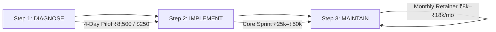
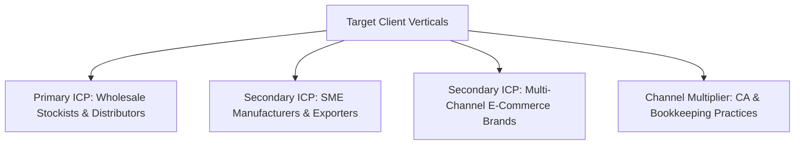
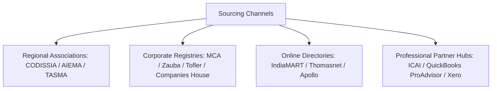
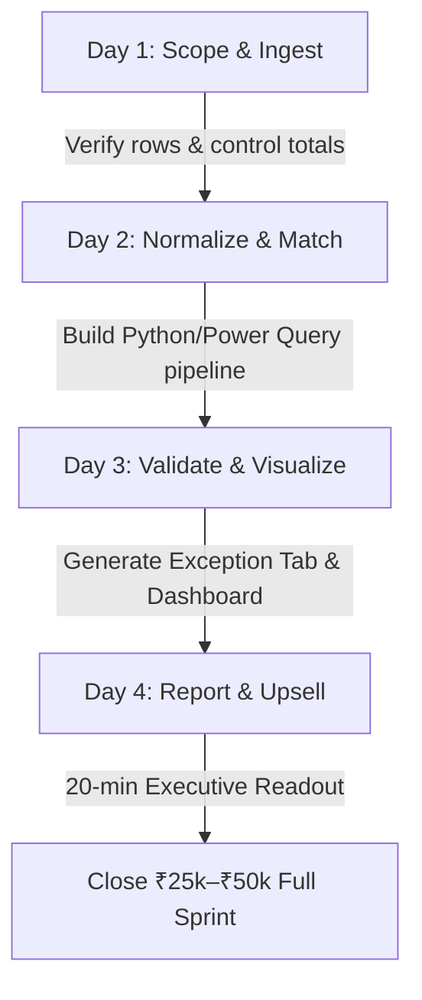

# Client Acquisition & ICP Master Playbook
## Business Data Consolidation & Reporting Automation · India, US, UK & Australia

---

## Executive Positioning & Delivery Framework

Your strongest commercial positioning is **not** “Excel automation” or “Power BI dashboards.” It is **operational-to-financial reconciliation and leakage detection**: connecting what a business shipped, sold, returned, invoiced, collected, and recorded in its accounts.

An owner will postpone a dashboard indefinitely, but will pay immediate attention when they suspect they are missing invoices, overpaying freight, carrying unexplained inventory differences, or waiting too long to establish their actual cash position.

### The 3-Step Delivery Engine



1. **Diagnose (4-Day Sprint):** Profile existing files, find and quantify discrepancies, and deliver an Exception Report with a 1-page summary dashboard.
2. **Implement (7–14 Day Sprint):** Build repeatable, locally processed Python/Power Query pipelines, automated exception rules, and executive KPI views.
3. **Maintain (Ongoing Retainer):** Deliver recurring exception monitoring, monthly reporting refreshes, and change-managed pipeline updates.

---

## 1. Who Are Our Exact Clients? (ICP Deep Dive)

### 1.1 The Three Core Target Segments



1. **Primary ICP — Wholesale Stockists & Distributors (Start Here):**
   * Businesses with recurring purchases, sales, returns, credit notes, multi-godown stock movements, customer outstanding balances, and freight invoices.
   * *Best entry problem:* Sales, dispatch, physical stock, returns, and Tally ledger entries failing to tie out.
2. **Secondary ICP — SME Manufacturers & Exporters:**
   * Units managing raw material consumption, batch production, subcontractor job-work, delivery challans, and costing.
   * *Best entry problem:* Dispatch-to-invoice gaps, subcontractor scrap exceeding BOM norms, and month-end reporting delays.
3. **Secondary ICP — Multi-Channel E-Commerce Brands (D2C):**
   * High-transaction sellers operating across Shopify, Amazon India, Flipkart, and multiple 3PLs (Shiprocket/Delhivery).
   * *Best entry problem:* Amazon MTR vs. Settlement V2 mismatch, courier volumetric weight-slab overcharges, and ghost returns.
4. **Channel Multiplier — CA & Bookkeeping Firms (White-Label Partners):**
   * Firms handling 20–150 SME clients where junior staff burn dozens of unbillable hours formatting messy client spreadsheets before audits.
   * *Best entry problem:* Repetitive manual cleanup of client bank CSVs, Tally registers, and marketplace reports.

---

### 1.2 Firmographic Qualification by Market

| Market | Best Initial Industries | Revenue Hypothesis | Headcount Hypothesis | Monthly Transaction Complexity |
| :--- | :--- | :--- | :--- | :--- |
| **India** | Industrial distributors, electricals, auto parts, packaging, textiles, engineering suppliers | ₹5 Cr – ₹100 Cr | 10 – 100 staff | 2,000 to 100,000+ transaction rows |
| **United States** | Wholesale distributors, multi-location retailers, e-commerce brands, 3PL-dependent sellers | $1M – $25M | 5 – 100 staff | 5,000 to 250,000+ transaction rows |
| **United Kingdom** | Wholesalers, importers, online retailers, bookkeeping clients | £500k – £15M | 5 – 75 staff | 3,000 to 150,000+ transaction rows |
| **Australia** | Importers, trade suppliers, distributors, multi-channel sellers | A$750k – A$20M | 5 – 75 staff | 3,000 to 150,000+ transaction rows |

#### Transaction-Volume Qualification Bands
* **< 300 rows/mo:** Too small. Manual Excel is adequate; automation lacks immediate ROI.
* **300 – 3,000 rows/mo:** Ideal Pilot Candidate. Manual pain is visible; pipeline scope is manageable.
* **3,000 – 30,000 rows/mo:** High-Yield Engagement. Repeated matching and exception detection deliver immediate ROI.
* **30,000 – 100,000 rows/mo:** Prime Implementation. Requires clean schema profiling and performance planning.
* **> 100,000 rows/mo:** Enterprise Scope. Requires multi-file architecture; never squeeze into a basic diagnostic.

---

### 1.3 The Buying Committee: Who Actually Matters?

| Role in Deal | Typical Person (India vs. Global) | What They Care About | Tactical Engagement Rule |
| :--- | :--- | :--- | :--- |
| **Economic Buyer** | Owner, MD, CFO, Managing Partner, Next-Gen Scion | Cash recovery, risk reduction, true net margins, staff cost | **Always initiate contact here.** Frame everything around trapped working capital and verified exceptions. |
| **Daily User** | Accounts Manager, Inventory Controller, Operations Head | Ending Sunday night VLOOKUPs, fewer manual steps, easier close | Involve them during the pilot to map workflows; show them how the Exception Tab makes them look good. |
| **Gatekeeper / Saboteur** | Senior Accountant, Tally Clerk, MIS Executive | Job security, avoiding exposure of past posting errors | **Disarm publicly.** State clearly: *"Our pipeline doesn't replace the accountant; it eliminates manual formatting so they can focus on tax compliance."* |
| **Technical Approver** | In-house IT Lead, ERP Administrator | Access security, data privacy, maintainability | Guarantee **local/offline processing**, zero cloud uploads, and zero public AI usage. |
| **External Influencer** | Statutory CA, Fractional CFO, ERP Reseller | Clean source records, fewer recurring audit adjustments | Position your service as pre-audit preparation that makes their audit faster. |

---

### 1.4 Technical-Fit Thresholds

| Signal | Strong Fit (Pursue) | Weak Fit (Disqualify) |
| :--- | :--- | :--- |
| **Source Records** | Digital Excel/CSV/XML exports from existing software | Paper-only, handwritten khata books, or inaccessible systems |
| **Core Systems** | TallyPrime, QuickBooks, Shopify, Amazon MTR, Bank CSVs, 3PL logs | Proprietary closed software with zero export capability |
| **Data Cadence** | Weekly, monthly, or close-related recurring cycles | One-time ad-hoc request with no recurring workflow |
| **Reconciliation Logic** | Two or more files must agree on defined keys (Order ID, Challan, UTR) | Subjective verbal agreements with no definable matching rules |
| **Buyer Access** | Speaking directly with Owner/CFO who can approve budget | Speaking with a junior clerk with zero budget or data authority |

---

## 2. Where Do We Find Them? (Direct Sourcing Channels)

### 2.1 Sourcing Directories & Databases



* **Indian Industrial Cluster Associations:**
  * **Coimbatore:** [CODISSIA](https://www.codissia.com) (6,600+ MSME engineering, pump, and manufacturing units), [Coimbatore Productivity Council](https://cpccbe.org).
  * **Chennai:** [AIEMA](https://aiema.net) (Ambattur Industrial Estate, 2,000+ active precision engineering and auto-ancillary units), [TANSTIA](https://www.tanstia.org).
  * **Karur & Tirupur:** [TASMA](https://www.tasma.in) (Textile mills), Tirupur Exporters' Association.
* **Corporate Registries & Intelligence:**
  * **India:** [MCA Company Master Data](https://www.mcacdm.nic.in/company-master-details), [Tofler](https://www.tofler.in), [Zauba Corp](https://www.zaubacorp.com) (Filter active companies with paid-up capital ₹50L–₹5Cr and active bank working-capital charges).
  * **UK:** [Companies House](https://find-and-update.company-information.service.gov.uk) (Active Ltd companies filing under SIC code 46 Wholesale or 25 Fabricated Metals).
  * **US:** [Thomasnet](https://www.thomasnet.com/suppliers), [National Association of Wholesaler-Distributors (NAW)](https://www.naw.org).
  * **Australia:** [ABN Lookup](https://abr.business.gov.au), [Freight & Trade Alliance (FTA)](https://www.ftalliance.com.au).
* **Partner Ecosystems:**
  * **India:** ICAI Regional Chapters (SIRC, WIRC, NIRC) and local CA study circles.
  * **Global:** [QuickBooks ProAdvisor Directory](https://quickbooks.intuit.com/find-an-accountant/), [Shopify Partner Directory](https://help.shopify.com/en/manual/partner-directory), [Xero Advisor Directory](https://www.xero.com/advisors/).

---

### 2.2 Copy-Paste Search Queries

#### A. LinkedIn Sales Navigator Boolean Queries
```text
// 1. Indian Distributor & Manufacturing Promoters
("Managing Director" OR Founder OR Owner OR "Executive Director" OR Partner) 
AND (distributor OR wholesale OR manufacturing OR "trading company") 
AND ("Tamil Nadu" OR "Coimbatore" OR "Chennai" OR "Bengaluru")

// 2. Finance Leaders at Mid-Market Units
("Finance Manager" OR "Head of Finance" OR CFO OR "Accounts Manager") 
AND (manufacturing OR engineering OR textiles OR components) 
AND ("Tally" OR "ERP" OR "reconciliation")

// 3. CA Firm Partners (Strategic Partner Channel)
("Managing Partner" OR Partner OR Principal) 
AND ("Chartered Accountant" OR "CA Firm" OR "Accounting Practice") 
AND ("Audit" OR "Taxation" OR "Advisory")

// 4. Global E-Commerce & Wholesale Founders (US/UK/AU)
(Founder OR Owner OR "Head of Operations" OR CFO) 
AND (Shopify OR ecommerce OR "wholesale distributor") 
AND ("QuickBooks" OR "Xero" OR "inventory")
```

#### B. Google Maps Cluster Scraping Strings
```text
industrial supplies distributor Coimbatore
engineering components manufacturer Coimbatore
wholesale electrical components Coimbatore
home textile exporter Karur
textile manufacturer Karur
industrial distributor Ambattur Chennai
packaging manufacturer Chennai
wholesale distributors Manchester UK
industrial supplies distributors Melbourne Australia
wholesale distributors Dallas Texas
```

#### C. Apollo.io Exact Filter Settings
* **Location:** Target state/region (e.g., Tamil Nadu, Greater Manchester, Texas, Victoria).
* **Headcount:** 11–50 and 51–200 employees.
* **Industry:** Wholesale, Machinery, Auto Components, Textiles, Electrical Equipment.
* **Keywords:** Distributor, inventory, manufacturing, wholesale, Tally, QuickBooks, 3PL.
* **Job Titles:** Managing Director, Owner, Partner, Finance Director, Controller, Operations Manager.
* **Active Intent Signal:** Filter companies hiring for *"MIS Executive"*, *"Tally Operator"*, or *"Data Entry"* (proves an immediate, funded reporting bottleneck).

---

## 3. What Do These Clients Really Care About?

### 3.1 Commercial Drivers vs. Daily Symptoms

| Core Business Driver | What It Looks Like Operationally | What They Expect You to Deliver |
| :--- | :--- | :--- |
| **Trapped Working Capital** | Cash Credit (CC) limit is maxed at 10.5% interest; receivables aging is murky. | A clear receivables ledger showing unallocated bank receipts and defaulting dealers. |
| **Inventory Black Hole** | Tally shows ₹2 Cr inventory, but ₹40L sits in dead stock untouched for 150+ days. | Stock aging breakdown separating **Active**, **Slow (90d)**, and **Dead Capital (180d+)**. |
| **Hidden Margin Bleed** | Dispatches leave on gate challans but invoices never get raised; courier slabs creep up. | Automated **Exception Sheets** flagging unbilled challans and shipping overcharges. |
| **Month-End Latency** | P&L takes until the 20th of the following month because staff manually stitch files. | Month-end close compressed from **20 days down to 3 days**. |
| **Key-Person Risk** | The entire business is paralyzed if the lone MIS clerk or accountant goes on leave. | Documented, push-button Python/Power Query ingestion pipeline. |

---

### 3.2 Addressing Critical Buyer Fears

| Prospect Fear | Why They Have It | Your Operational Neutralizer |
| :--- | :--- | :--- |
| **Data Privacy & Leaks** | Fear of client lists or pricing margins leaking to competitors. | Sign a **1-page Mutual Offline NDA**; execute all code locally with **Zero Public AI** uploads. |
| **Broken Spreadsheets** | Fear of being abandoned with complex Python code nobody understands. | Outputs delivered in clean Excel/Power BI tables with a documented runbook + monthly retainer option. |
| **Accountant Friction** | Fear of offending their family CA or senior accountant of 15 years. | Position as **read-only operational data preparation**: *"We never touch Tally vouchers; we help prepare cleaner files for audit."* |
| **Runaway Costs** | Fear of open-ended hourly billing and scope creep. | **Fixed-price, capped diagnostic pilot (₹8,500 / $250)** with frozen input schemas. |

---

## 4. Whom Can We Help vs. Whom Must We Disqualify?

### 4.1 Lead Qualification Scorecard (0 to 16 Points)

Score each factor from 0 to 2 based on evidence gathered during discovery:

| Qualification Dimension | 2 Points (Strong Signal) | 1 Point (Moderate) | 0 Points (Disqualify) |
| :--- | :--- | :--- | :--- |
| **1. Recurring Workflow** | Weekly/monthly close or repeated reporting cycle | Irregular reporting | One-off task with zero future recurrence |
| **2. Digital Source Data** | Standard Excel, CSV, or XML exports available | Exportable with effort | 100% paper slips, photos, or handwritten khatas |
| **3. Multi-System Gap** | 2+ disconnected sources (Tally + Gate Pass / Amazon) | 1 source with minor mess | Single clean ledger with zero outside files |
| **4. Measurable Pain** | >15 staff hours/mo or ₹50k+ potential leakage | Moderate inconvenience | Negligible impact; *"everything runs smoothly"* |
| **5. Decision-Maker Access** | Speaking directly with Owner, MD, or CFO | Influencer (Manager) | Junior clerk with zero spending authority |
| **6. Defined Success Criteria** | Clear agreement on matching rules and expected KPIs | Vague expectations | Client demands "guaranteed fraud discovery" |
| **7. Budget & Urgency** | Can fund ₹8,500 pilot and has immediate deadline | Budget exists, low urgency | Haggles on ₹8,500; demands free work upfront |
| **8. Security & Trust** | Agrees to standard NDA and offline sample sharing | Hesitant on data access | Paralyzed by data paranoia; refuses to share files |

* **13–16 Points:** Prime Pilot Prospect. Send NDA and SOW within 2 hours.
* **9–12 Points:** Nurture. Probe for missing evidence or decision-maker access.
* **0–8 Points:** Disqualify immediately. Do not invest delivery or sales time.

---

### 4.2 Absolute Red Flags (Walk Away Instantly)
* **Paper-Only Records:** Handwritten slips requiring manual data entry or OCR typing.
* **Dual-Book / Tax Evasion Requests:** Asking to manipulate invoices, hide sales, or alter GST numbers.
* **Mood-Based Accounting:** Pricing, discounts, or returns based on unwritten verbal side-deals.
* **Unreasonable Demands:** Demanding guaranteed fraud detection or unlimited revisions under a fixed fee.

---

## 5. How Do We Help Them? (Problem-to-Solution-to-ROI Matrix)

### 5.1 Ten Productized Operational Workflows

| # | Operational Breakdown | Ingested Data Sources | Technical Deliverable Built | Business Metric & ROI |
| :-: | :--- | :--- | :--- | :--- |
| **1** | **Unbilled Gate Dispatches** | Gate Pass Excel + Tally `Sales Register` | Outer-join Python script flagging unmatched challans >5 days old | **₹1.5L–₹5L** unbilled revenue recovered per quarter. |
| **2** | **Duplicate Supplier Bills** | GRN Log + Tally `Purchase Register` | Regex cleaner stripping punctuation; matching Vendor + Cleaned No + Amount ±1% | Prevents **₹50k–₹2L** in duplicate supplier payments. |
| **3** | **3PL Volumetric Overcharges** | SKU Master Weight + Courier Billing CSV | Comparison of billed freight slab vs. SKU volumetric weight | Cuts shipping spend by **4%–9%**; generates claim CSVs. |
| **4** | **Marketplace Ghost Returns** | Amazon MTR / Return CSV + Warehouse Scan Sheet | Outer-join on Order ID tracking unreturned units within SAFE-T claim window | Recovers **1%–2.5% of GMV** in lost e-commerce inventory. |
| **5** | **Unmatched Bank Receipts** | HDFC/ICICI Bank CSV + Tally Customer Ledger | Regex extraction of 12-digit UPI RRN / UTR matched to invoices | Clears unallocated cash; reduces DSO by **4–8 days**. |
| **6** | **Subcontractor Scrap Bleed** | Tally Material Out + Job-Worker Inward + BOM | Rolling material ledger: `Raw_Issued - (Finished_Qty × BOM + Allowed_Scrap)` | Stops **2%–4% raw material leakage** across job-workers. |
| **7** | **Dead Capital & Stock Aging** | Tally Stock Summary + Daily Sales Movement | Chronological ledger replay computing `Days_Since_Last_Sale` | Unlocks **₹10L–₹35L** in trapped working capital. |
| **8** | **GSTR-2B Blocked ITC** | Tally Purchase Register + Portal GSTR-2B CSV | Matching supplier GSTIN and invoice numbers against GSTR-2B | Protects **100% of 18% GST ITC** before paying vendors. |
| **9** | **Salesman Margin Leakage** | Approved Price List + Tally Sales & Credit Notes | Comparing realized line prices and credit notes against floor margins | Ranks sales reps by **Realized Net Margin**, not gross volume. |
| **10** | **Multi-Branch Month-End Lag** | 4–20 Branch Tally Exports + Transfer Logs | Standardized COA mapping + inter-branch transfer elimination | Compresses monthly close from **18 days to 2 days**. |

---

### 5.2 Defensible ROI Calculation (Without Inventing Numbers)

Do not promise inflated hypothetical savings. Use client-specific verified baselines:

$$\text{Monthly Labour Savings} = \text{Hours Saved} \times \text{Loaded Hourly Cost}$$

$$\text{First-Year Net Benefit} = (\text{Monthly Labour Savings} \times 12) + \text{Verified Recoveries} - \text{Implementation Fee}$$

*Example:* A distributor's staff spends 32 hours/month manually combining Tally and dispatch logs. Loaded cost = ₹400/hr.
* Monthly labour value released = $16 \text{ hrs saved} \times ₹400 = ₹6,400/\text{mo}$ ($₹76,800/\text{year}$).
* Against a ₹35,000 implementation fee, the project yields **₹41,800 net first-year benefit** on labor capacity alone, plus any recovered unbilled challans.

---

### 5.3 The 4-Day Data Diagnostic Pilot Architecture

* **Fixed Price:** **₹8,500 INR** (Domestic) / **$250 USD** (International).
* **Strict Input Boundary:** Up to **2 source workbooks / CSV exports**, maximum **100,000 combined data rows**.
* **Fixed Output:**
  1. Data Health & Profiling Audit.
  2. One agreed Reconciliation Engine.
  3. One Automated Exception Alert Tab.
  4. One Summary Executive Dashboard + 20-min Handover Walkthrough.
* **100% Full-Project Credit Guarantee:** If the client accepts the Full-Scale Implementation proposal within **14 calendar days**, the entire **₹8,500 / $250 fee is credited and deducted** from the final fee.

#### 4-Day Delivery SOP



---

## 6. How Do We Acquire Them? (Four-Channel Conversion Funnel)

### Recommended Channel Effort Allocation (First 30 Days)
* **50% Local Direct B2B Outreach** (Coimbatore, Karur, Chennai, Regional Hubs).
* **25% CA & Bookkeeping Firm Partnerships** (White-label multiplier).
* **15% Sniper Upwork Bidding** (Targeted high-intent global cash flow).
* **10% Value-in-Advance Content & Cold Email** (Loom demos and teardowns).

---

### Channel 1: Local B2B Warm & Cold Outreach

#### The 2-Sentence Mom Test Opener
> *"Hi [Name], I came across [Company Name] while researching [industry] businesses in [City]. I’m studying how growing units manage monthly reporting across sales, inventory, and accounts—especially where numbers must be reconciled across multiple Excel trackers. I’m not calling to pitch any software today; I’m trying to understand how teams currently handle this process. Would you be open to a 10-minute research chat next week?"*

#### The Phone Follow-Up Call (90 Seconds)
* **You:** *"Hello [Name], [Your Name] here. I sent a quick email Tuesday about how [textile/engineering] units in [City] bridge godown dispatch logs with Tally. Caught you at a bad minute?"*
* **Prospect:** *"Tell me quickly, what is this about?"*
* **You:** *"Not selling software. Just curious: when you closed last month, did Tally tie out cleanly on Day 1 with your physical dispatch and stock logs, or did your staff spend days cross-checking files by hand?"*
* **If friction is acknowledged ➔ Pivot:** *"That exact gap is all we solve. Instead of an expensive ERP project, we sign a 1-page offline NDA and run a 4-day ₹8,500 diagnostic on two of last month's exports to flag every rupee of mismatch. Should I send over the 1-page overview for you to review?"*

---

### Channel 2: Strategic CA Firm Partnerships (The Multiplier)

#### The Partner Proposition
Help CA practices eliminate unbillable article clerk hours spent cleaning client spreadsheets before audits.

```text
Subject: Behind-the-scenes help when SME clients send messy CSVs?

Hi [Partner Name],

Saw [Firm Name]'s focus on [SME advisory / audit] via the ICAI directory.

Quick question: when clients hand over messy Amazon MTR CSVs, broken bank statements, or multi-year Excel stock files right before audit deadlines, how many unbillable hours do your articles burn just cleaning and formatting rows?

I run an offline Python & Power Query data engineering studio. We work strictly white-label under NDA for CA practices—turning chaotic client exports into reconciled ledger-ready tables and exception packs within 48–72 hours at wholesale rates.

Open to a 10-minute intro call next week? Happy to clean one sample client file at 50% discount so you can judge our accuracy firsthand.

Best regards,
[Your Name] | [Phone] | [Website]
```

---

### Channel 3: Sniper Upwork & Marketplace Bidding

#### The Rules of Engagement
1. Bid strictly on jobs posted within **<4 hours** with **<15 proposals**.
2. Never submit generic AI text. Include a **custom 60-second video link in Line 2** demonstrating a synthetic spreadsheet solving their exact problem.

```text
Hi [Client Name],

Recorded a 60-second video showing how I solved this exact [Shopify-to-Stripe / multi-sheet inventory] reconciliation bottleneck without breaking when column orders shift: [Loom Link]

The real trap in reconciling [X and Y sources] isn't building charts—it's handling [cite 1 specific quirk: e.g., Shopify repeating order totals on Line 1 / mixed date formats / missing UTRs] without silently double-counting numbers.

How I will deliver this in 4 days:
1. Build an automated Power Query / Python ingestion pipeline—drop CSVs in, click Refresh.
2. Build an automated "Exception Tab" flagging missing rows or unmapped fees.
3. Connect the clean master table to your summary dashboard.

Could you confirm roughly how many rows are in a typical monthly file?

Best regards,
[Your Name]
```

---

### Channel 4: Value-in-Advance Content & Targeted Cold Email

#### 5 High-Impact Educational Content Topics (Using Synthetic Data)
1. *"How a ₹25 Cr distributor caught ₹3.2 Lakhs in unbilled delivery challans between gate logs and Tally."*
2. *"Why Shopify order exports double-count revenue if ingested blindly into Power BI."*
3. *"The 3PL Volumetric Creep: How 450g products get billed at the 1kg courier slab."*
4. *"Reconciling HDFC/ICICI Bank statement UTRs against Razorpay settlements in Python."*
5. *"The 5-step month-end stock reconciliation checklist for manufacturing plant heads."*

---

## 7. The 30-Day Execution Plan & Weekly Tracker

### 30-Day Launch Roadmap

```
DAYS 1–7: BUILD PROOF & ASSETS
- Assemble 1 synthetic demo dataset (Tally + Gate Pass + Exception Tab).
- Configure local Python scripts and Power Query templates.
- Prepare the 3-page Legal Pack (NDA + SOW + Schedule A).

DAYS 8–14: DISCOVERY INTERVIEWS
- Identify 30 local distributors/manufacturers in Coimbatore, Karur, or Chennai.
- Conduct 10–15 discovery calls using Mom Test principles.
- Identify the single most painful recurring workflow.

DAYS 15–21: OUTREACH & PARTNERSHIP SPRINT
- Launch direct outreach to 30 qualified accounts.
- Pitch 15 mid-sized CA firms on white-label data preparation.
- Submit 5 video-backed Sniper Upwork proposals.

DAYS 22–30: CLOSE & DELIVER PILOT #1
- Convert 1–2 qualified discovery leads into ₹8,500 / $250 Paid Pilots.
- Deliver in 4 business days with surgical exception reporting.
- Present implementation proposal crediting 100% of the pilot fee.
```

---

### Friday Weekly Operating Scorecard

Track these non-negotiable metrics every Friday at 5:00 PM:

| Operating Metric | Weekly Target | Actual (Week 1) | Actual (Week 2) | Actual (Week 3) | Actual (Week 4) |
| :--- | :---: | :---: | :---: | :---: | :---: |
| **New Qualified Accounts Added** | 30 | | | | |
| **Personalized Touches Sent** | 30 | | | | |
| **Discovery Calls Completed** | 4 – 6 | | | | |
| **Evidenced Pain Cases Identified** | 2 – 3 | | | | |
| **Paid Diagnostic Proposals Sent** | 2 | | | | |
| **₹8,500 / $250 Pilots Won** | 1 | | | | |
| **Pilot-to-Full-Sprint Conversions** | 1 | | | | |
| **Total Cash Collected** | ₹8,500+ | | | | |
