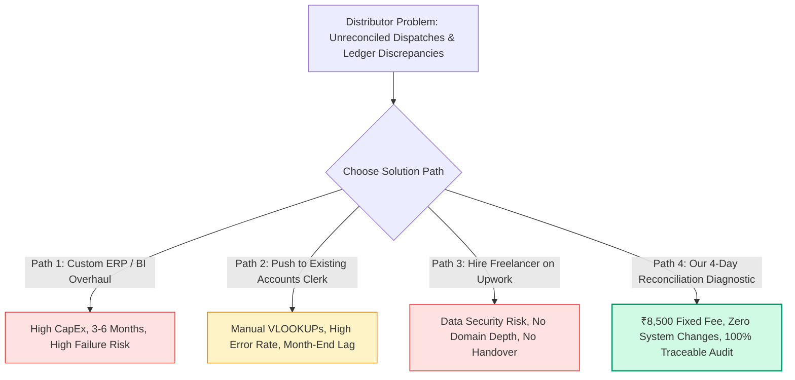

# Competitive Intelligence & Market Positioning Report
**Market Focus:** India (Primary Beachhead: Coimbatore & Chennai, Tamil Nadu)  
**Target ICP:** Owner-managed industrial, electrical, and engineering wholesale distributors using TallyPrime & spreadsheets  
**Strategic Domain:** Operational-to-Financial Reconciliation, Cross-System Data Consolidation & Audit-Ready Automation  
**Effective Date:** 27 October 2026  

---

## Executive Assessment: Where the Offer Fits

Your proposed business does not enter an empty market; rather, it enters a crowded arena dominated by:
1. **Core Accounting Incumbents:** TallyPrime, Zoho Books, Marg ERP.
2. **Business Intelligence Platforms:** Microsoft Power BI, Zoho Analytics, Tableau.
3. **Local IT & Automation Agencies:** Excelist, Kfold Data Solutions, Straightline Technologies, ITtoALL.
4. **Independent Service Providers:** Upwork/Fiverr Excel specialists, Tally Certified Partners, and Chartered Accountants (CAs).
5. **Internal Workarounds & Status Quo:** Dedicated accounts clerks using nested Excel formulas, copy-pasting CSVs, and doing nothing until year-end audit panic.

```
                              [ HIGH STRATEGIC VALUE / SPECIALIZED ]
                                                ▲
                                                │
                                                │          ★ OUR PROPOSED POSITION
                                                │          (Fixed-Scope Diagnostic:
                                                │           Cross-System Reconciliation &
                                                │           Traceable Leakage Detection)
                                                │
                  Tally Certified Partners      │      Custom ERP / BI Agencies
                  (Add-ons, TDL custom,         │      (Kfold, Straightline, ITtoALL -
                   deep ERP lock-in)            │       broad scope, expensive retainers)
                                                │
    ◄───────────────────────────────────────────┼───────────────────────────────────────────►
    [ LOW CUSTOMIZATION / COMMODITY ]           │                  [ HIGH TECHNICAL COMPLEXITY ]
                                                │
                  Freelance Automation          │      BI Reporting Tools
                  (Upwork, Excelist, Fiverr -   │      (Power BI, Zoho Analytics -
                   scripts, macros, one-offs)   │       self-serve, unvalidated logic)
                                                │
                  Internal Workarounds          │      Accounting Software
                  (Clerks, VLOOKUPs, manual     │      (TallyPrime, Zoho Books -
                   re-entry, status quo)        │       native ledgers & bank rec)
                                                │
                                                ▼
                              [ LOW STRATEGIC VALUE / ROUTINE ]
```

### The Strategic Hypothesis
> **Winning Position:**  
> Do not sell *"Excel automation,"* *"Power BI dashboards,"* or *"data consolidation."* Those are commoditized, easy-to-compare services where clients default to low-cost freelancers or internal clerks.  
> 
> Instead, position as a **Fixed-Scope Reconciliation & Operational Leakage Diagnostic**:  
> *"A fixed-price, 4-day forensic investigation for industrial distributors that identifies, matches, and documents unresolved discrepancies between physical dispatches, customer invoices, warehouse inventory, and Tally accounting exports—delivering a deterministic exception ledger and an automated, refreshable workflow."*

This positioning directly addresses executive urgency (hidden cash leakage, untracked dispatches, unbilled freight, and disputed credit notes) while bypassing the price sensitivity of routine spreadsheet maintenance.

---

## 1. Competitive Landscape Breakdown

| Category | Typical Players | Why They Compete | Competitive Vulnerability |
| :--- | :--- | :--- | :--- |
| **Direct Service Competitors** | Local Coimbatore agencies (Excelist, Kfold, Straightline), boutique MIS consultancies | Offer spreadsheet cleanup, Power BI reporting, and workflow automation. | Position broadly across industries; sell technical implementation rather than domain-specific financial control. |
| **Software Incumbents** | TallyPrime (Release 6.0+), Zoho Books, Marg ERP 9+ | Hold master ledgers, inventory balances, tax registers, and native bank statement reconciliation. | Poor handling of third-party operational records (transporter LR notes, physical delivery challans, vendor portal CSVs). |
| **BI & Analytics Platforms** | Microsoft Power BI, Zoho Analytics, Tableau | Enable interactive visual modeling, scheduled data refresh, and KPI monitoring. | Dashboards show *what happened*, not *why records disagree*. They cannot audit unstructured exceptions or rectify faulty source entries. |
| **Professional Substitutes** | Retainer CAs, outsourced bookkeeping firms, GST practitioners | Possess client trust, tax authority, and access to books of accounts. | Rarely audit operational logs (gate passes, dispatch challans); charge for compliance filing, not operational data engineering. |
| **Freelance Specialists** | Upwork, Freelancer, Fiverr Excel/Python/VBA contractors | Deliver custom scripts and macros at aggressive hourly rates ($15–$30/hr). | No local on-site accountability; lack domain depth in Indian GST (E-way bills, 2B matching) and TallyPrime XML structures. |
| **The Status Quo** | Internal accounts clerks, junior billing staff, "Do Nothing" | Cost is already absorbed into payroll; staff know existing quirks and unwritten workarounds. | High error rate, single-person dependency, 5-to-10 day month-end lag, and zero automated audit trail. |

---

## 2. Competitor Intelligence Matrix

| Competitor / Alternative | Category & Type | Publicly Documented Offering | Observed Pricing Evidence | Strategic Implication for Our Offer |
| :--- | :--- | :--- | :--- | :--- |
| **TallyPrime** | Installed Accounting / ERP Incumbent | Accounting, inventory tracking, e-invoicing, GST filing, and automatic bank reconciliation (145+ banks). | Silver (Single User): ₹750/mo rental or ₹22,500 lifetime (+18% GST). Gold: ₹2,250/mo or ₹67,500 lifetime. | **Never compete on core ledger or bank rec.** Position strictly on cross-system operational data that lives *outside* Tally. |
| **Zoho Books** | Cloud Accounting & Invoicing Substitute | Invoicing, banking feeds, automated reconciliation rules, inventory, and GST compliance. | Standard: ₹749/mo; Professional: ₹1,499/mo; Premium: ₹2,999/mo (billed annually). | Cloud alternative eliminates some multi-file mess, but migration from Tally is rare among legacy industrial distributors. |
| **Zoho Analytics** | Cloud BI & Data Blending Tool | 500+ connectors, automated sync, multi-table blending, SQL querying, and executive dashboards. | Free (2 users, 10k rows); Basic from ~$24/mo; Standard ~$60/mo. | Selling dashboards alone is fatal; distributors buy resolution of operational mismatches, not pretty charts. |
| **Microsoft Power BI** | Enterprise BI & Visualization Platform | Data modeling (DAX/Power Query), visual KPI tracking, cloud sharing, and automated gateway refresh. | Desktop free; Pro: ₹1,165/user/month; Premium Per User: ₹1,995/user/month (+GST). | Visualization does not solve data integrity. If dispatch challan references are missing, Power BI merely visualizes bad data. |
| **Microsoft Excel & Power Query** | Installed Desktop Spreadsheet Standard | In-memory ETL, file merging, unpivoting, cross-table lookups, and refreshable queries. | Included with Microsoft 365 Business (₹660–₹1,800/user/month). Zero marginal software cost. | The primary competitor. The client asks: *"Why can't my senior accountant do this?"* The answer must be deterministic rules and automated audit integrity. |
| **Excelist** *(Coimbatore)* | Direct Local Service Competitor | Spreadsheet automation, Power Query models, MIS reporting, and customized dashboards for SMBs. | Quote-based per project; no standard public rate card for diagnostics. | Proves local demand in Coimbatore. Differentiate by guaranteeing an operational leakage audit rather than generic "MIS automation." |
| **Kfold Data Solutions** *(Coimbatore)* | Direct / Adjacent Analytics Consultancy | Python workflow automation, Power Platform, BI consulting across supply chain, sales, and finance. | Custom quote; oriented toward mid-market enterprise contracts. | Enterprise scope creates an opening for a nimble, 4-day, fixed-price (₹8,500) SME diagnostic. |
| **Straightline Technologies** *(Coimbatore)* | Direct / Adjacent BI Consultancy | Power BI, Tableau, and Looker implementation; KPI framework definition and data warehousing. | Quote-driven; focuses on medium-to-large business intelligence projects. | Over-engineered for 20-person distributors. We win by requiring zero software migration and operating on flat files. |
| **ITtoALL** *(Coimbatore)* | Adjacent IT & Custom ERP Integrator | Custom ERP modules, Tally integration, database bridging, and bespoke software development. | Custom scoping; typically high CapEx (₹1L–₹5L+). | High upfront cost and multi-month timelines drive owners to our low-risk, 4-day pilot. |
| **Tally Certified Partners** | Ecosystem System Integrators | TDL (Tally Definition Language) customizations, TCP plugins, remote access setup, and annual maintenance contracts (AMCs). | AMCs typically ₹5,000–₹15,000/yr; custom TDL quoted at ₹10,000–₹50,000 per module. | Deeply trusted incumbents. Position as a complementary partner or subcontractor, not a rival. We handle the messy upstream operational files TDL cannot easily parse. |
| **Upwork / Freelance Specialists** | Marketplace Technical Contractors | Scripting (Python/VBA), Power Query transformations, automated web scraping, and custom financial modeling. | $15–$50/hour; fixed projects ₹5,000–₹30,000. Widely variable quality. | High friction for non-technical owners: no data privacy assurances, no local presence, and no post-delivery accountability. |
| **Retainer CA / Bookkeeping Firms** | Accounting & Compliance Substitutes | Monthly transaction entry, statutory GST/TDS filings, financial statements, and periodic audit recs. | Market examples range from ₹1,500/mo (up to 100 entries) to ₹15,000/mo for full-service accounting. | CAs focus on statutory compliance (GST 2B vs Books, Bank vs Cash Book). They do not audit warehouse bin cards against transport delivery receipts. |
| **Internal Accounts Staff** | Status Quo Workaround | Manual copy-pasting, VLOOKUPs, cross-checking paper gate passes, and WhatsApp coordination. | Embedded payroll cost (₹18,000–₹35,000/month per accountant). | Perceived as "free," but hides massive payroll waste, delayed billings, duplicate payments, and unrecovered credits. |

---

## 3. Feature, Benefit, and Switching-Cost Comparison



### Comparative Dynamics

| Solution Alternative | Primary Value Proposition | Fatal Operational Flaw | Switching Barrier / Friction |
| :--- | :--- | :--- | :--- |
| **Native TallyPrime** | Robust ledger integrity, GST compliance, trusted by 90%+ of Indian industrial distributors. | Cannot ingest disparate, unformatted transporter delivery notes, physical gate passes, or vendor portal CSVs. | **Very High:** Migrating away from Tally causes severe operational disruption. (Strategy: *Complement, do not replace*). |
| **Power BI / Zoho Analytics** | Interactive visual dashboards, executive summaries, automated cloud refresh. | Merely visualizes errors if underlying data contains missing or duplicate records; cannot reconcile transactions. | **Moderate:** Requires cloud licenses, tenant configuration, and staff training. |
| **Excel Power Query (Internal)** | Zero software cost, natively supported within Microsoft 365, highly flexible. | Dependent on brittle, undocumented formulas. If the creator leaves or column headers change, the workflow collapses. | **Low:** Low friction to build, but high vulnerability to ongoing maintenance failures. |
| **Tally Certified Partners** | Deep TDL expertise, established vendor trust, direct integration with Tally schema. | Reluctant to handle messy non-Tally data files (PDF transporter challans, unstructured logistics manifests). | **High:** Existing partner contracts and relationship inertia. |
| **Retainer CA Firms** | Legally binding statutory compliance, tax optimization, trusted financial advisory. | Reactive (quarterly/annual); does not police day-to-day warehouse dispatch slips or freight overcharges. | **High:** High relationship trust; owners will not displace their tax auditor. |
| **Our 4-Day Diagnostic** | **Zero disruption:** Ingests raw exports, executes deterministic rules, isolates discrepancies, leaves working pipeline. | Must earn trust rapidly on Day 1 without an established local brand name. | **Extremely Low:** Flat ₹8,500 commitment, strict NDA, local processing, and no software changes. |

---

## 4. Public Review Realities vs. Distributor Market Evidence

### What Public Reviews Prove (G2, Capterra, SoftwareSuggest)
- **TallyPrime (G2 Score: 4.4/5, 300+ reviews):** Highly praised for speed, keyboard shortcuts, accounting reliability, and statutory GST compliance. Users consistently report frustration with rigid reporting templates, legacy UI, and difficulty integrating data from outside systems without expensive custom TDL programming.
- **Zoho Analytics (Capterra Score: 4.4/5, 360+ reviews):** Praised for multi-source connectors and clean UI. Common complaints cite a steep learning curve for non-technical users, frequent sync failures with on-premise databases, and high latency when querying tables exceeding 100,000 rows.
- **Freelance Platforms (Upwork/Fiverr):** Over 10,000+ listings for "Excel automation" and "Power BI dashboards." Client feedback indicates satisfaction with isolated technical tasks (e.g., *"fixed my VBA macro"*), but high dissatisfaction regarding business context, messy data cleanup, and post-delivery maintenance.

### What Public Reviews DO NOT Prove (The Critical Evidence Gap)
> [!WARNING]  
> **Do not mistake general software complaints for validated willingness to pay.**  
> Public reviews do **not** prove that an electrical goods distributor in Gandhipuram, Coimbatore, or an auto-parts wholesaler in Ambattur, Chennai:
> 1. Suffers measurable, bottom-line financial leakage due to unreconciled dispatches.
> 2. Is actively searching for an external data consultant to fix it.
> 3. Considers the problem painful enough to spend ₹8,500 on an audit and ₹35,000 on an automated pipeline.
> 
> This validation can only be obtained through direct, unvarnished customer discovery (*The Mom Test*).

---

## 5. Unmet Needs: The Four Testable Hypotheses

| Hypothesis | The Operational Bottleneck | Current Flawed Workaround | Measurable Metric / Proof Point | Beachhead Priority |
| :--- | :--- | :--- | :--- | :--- |
| **H-A: Dispatch-to-Invoice Leakage** | Goods depart warehouse via physical Delivery Challan (DC) or transporter LR. Billing team generates invoice in Tally later. Partial dispatches and returns get lost. | Accounts clerk matches paper DCs against Tally sales registers at month-end. Unbilled dispatches slip through. | Unbilled dispatches aging >7 days; value of missing invoices identified per quarter. | **Priority 1 (Primary Beachhead)** |
| **H-B: Sales Returns & Credit Note Discrepancies** | Customers return damaged/excess electrical goods. Warehouse receives stock; accounts team issues credit note weeks later without matching itemized serials. | Periodic physical inventory count reveals discrepancies; write-offs logged to general inventory loss ledger. | Unlinked credit notes, value of stock discrepancy write-offs at year-end audit. | **Priority 2** |
| **H-C: Multi-File Monthly MIS Consolidation** | Management requires a consolidated MIS combining Tally sales, bank collection statements, salesman order apps, and open quotes. | Senior accountant spends 3–5 working days each month downloading CSVs, cleaning headers, and running VLOOKUPs. | Days to close monthly books; number of clerical hours wasted on repetitive consolidation. | **Priority 3** |
| **H-D: 3-Way Inward PO-GRN-Invoice Matching** | Inward shipments from major industrial manufacturers (e.g., Schneider, Polycab, L&T) differ in price, discounts, or delivered quantity from initial PO. | Accounts clerk compares vendor invoice against goods receipt note (GRN) line by line before approving payment. | Unclaimed vendor purchase rebates, duplicate vendor bill entries, freight overcharges paid. | **Priority 4** |

---

## 6. How Incumbents Could Respond & How to Counter

| Competitor Type | Plausible Retaliatory Action | Probability | Strategic Counter-Measure |
| :--- | :--- | :--- | :--- |
| **Tally Solutions** | Releases more robust out-of-the-box Excel import templates and automated reconciliation plugins. | Medium | Focus entirely on **upstream operational records** (scanned lorry receipts, custom warehouse bin cards, logistics APIs) that Tally cannot natively interpret. |
| **Tally Certified Partners** | Introduce their own fixed-fee "Reconciliation & Audit" add-on package using their existing client access. | High | Position as an **independent analytical partner**, not a software seller. Offer to subcontract messy multi-source data wrangling that TDL developers avoid. |
| **Local BI Consultancies (Excelist, etc.)** | Slash prices or introduce an ₹8,000 "Dashboard Audit" to capture leads. | Medium | Shift focus from *dashboards* to **recovered cash leakage and auditable exception registers**. A chart cannot dispute a missing dispatch; a reconciled exception table can. |
| **Freelance Marketplaces** | Freelancers offer to write Python/VBA matching scripts for ₹3,000–₹5,000. | Very High | Win on **governance, local presence, and trust**: offline local processing, zero cloud data transfer, signed NDAs, and a formal handover warranty. |
| **Retainer CA Firms** | Advise client that their in-house staff or article clerks can handle reconciliation as part of routine audit. | High | Propose a **CA Partner Program**: offer CAs a clean, pre-reconciled data feed that reduces their audit hours, positioning our service as an asset to the auditor. |
| **Internal Accounts Staff** | Claim they already reconcile everything manually and that software automation is unnecessary or inaccurate. | High | Reframe our diagnostic as a **clerical assistant, not a replacement**: *"We eliminate the soul-crushing copy-paste work so your team can focus on collections and supplier negotiations."* |

---

## 7. Strategic Moats: What Is Easy to Copy vs. What Lasts

```
[ EASY TO IMITATE ]                                          [ HIGHLY DURABLE MOATS ]
─────────────────────────────────────────────────────────────────────────────────────
• Python / Power Query scripts     • Reusable data cleansing    • Trusted Local Referral
• Generic Excel dashboard templates  pipelines for regional       Ecosystem (Coimbatore CAs,
• Public fixed-price diagnostic      distributor schemas          CODISSIA, META networks)
  offer (₹8,500)                   • Standardized exception     • Proprietary Exception
• Basic VLOOKUP / XLOOKUP matching   taxonomies (GST, logistics)  Taxonomy & Discrepancy Rules
• Broad claims of "AI Automation"  • Verified before-and-after  • Embedded Client Workflows &
                                     quantified case studies      Direct Institutional Trust
```

### The Anatomy of Our Long-Term Moat
1. **Domain-Specific Reconciliation Engine:** Reusable Python/Power Query libraries tailored specifically to standard Indian distributor exports (Tally XML/Excel schemas, E-way bill portal CSVs, GST 2B JSONs, and regional logistics manifests).
2. **Deterministic Exception Taxonomy:** A standardized classification code system for discrepancies (e.g., `ERR-01: Dispatched but Uninvoiced`, `ERR-02: Quantity Variance > Tolerance`, `ERR-03: Rate Mismatch vs Purchase Contract`).
3. **Distribution Moat:** Strong referral ties with local Coimbatore Chartered Accountants and trade associations (CODISSIA, SIEMA, META) who actively pass messy client data to us for pre-audit scrubbing.

---

## 8. Four Empirical Validation Experiments

Do not build complex software or invest in branding before validating these four experiments in the field:

### Experiment 1: Problem & Alternative Discovery (*The Mom Test*)
- **Target:** 10–12 Coimbatore-based industrial/electrical distributors (10–75 employees).
- **Core Script:** *"Walk me through the last time your warehouse dispatch notes did not match your Tally sales ledger or customer statement. How did you find it? Who fixed it? How long did it take?"*
- **Success Gate:** At least 6 of 10 owners cite a specific, recent incident resulting in delayed billing, unrecovered inventory, or wasted staff days.

### Experiment 2: Value-Proposition A/B Messaging Test
- **Method:** Test two cold/warm outreach introductions across 30 target companies:
  - **Option A (Tool-Led):** *"We build automated Power BI dashboards and Power Query models to consolidate your business data."*
  - **Option B (Outcome-Led):** *"We run a 4-day diagnostic that identifies missing dispatches, unbilled delivery challans, and unreconciled Tally entries across your spreadsheets."*
- **Success Gate:** Option B achieves >3x higher conversation conversion and direct referral to the Managing Director or Finance Head.

### Experiment 3: Willingness-to-Pay Diagnostic Test
- **Offer:** Present the standardized ₹8,500 Fixed-Scope Diagnostic (4-day turnaround, up to 100k rows, signed NDA, complete exception ledger).
- **Success Gate:** Secure at least 2 paid diagnostic commitments from qualified prospects. If prospects refuse:
  - Is it price? (Would they do it for ₹5,000?)
  - Is it trust? (Unwilling to share sensitive sales data?)
  - Or is it low pain? (They simply don't care enough to spend money).

### Experiment 4: The Incumbent Partner Test
- **Target:** 3 local Tally Certified Partners and 3 independent CA practitioners in Coimbatore.
- **Inquiry:** *"When your clients struggle with reconciling dispatch spreadsheets, warehouse stock cards, and Tally exports, how do you handle it? Is there an opportunity for us to clean and reconcile that data upstream?"*
- **Success Gate:** At least 2 partners confirm that multi-source spreadsheet reconciliation is an ongoing bottleneck that they would prefer to outsource or refer.

---

## 9. Comprehensive Evidence Ledger & Research Gaps

| Area | Established Facts (Public Research) | Critical Unknowns (Requires Field Discovery) | Action Required to Close Gap |
| :--- | :--- | :--- | :--- |
| **Market Incumbents** | TallyPrime holds dominant accounting share; supports basic bank rec and e-invoicing natively. | What percentage of Coimbatore distributors maintain dispatches outside Tally (in Excel or paper)? | Inspect operational workflows across 5 target distributor warehouses. |
| **Competitor Pricing** | Tally software starts at ₹750/mo; Power BI at ₹1,165/user/mo; CA monthly retainers start at ₹1,500–₹5,000. | What do local agencies (Excelist, Kfold) charge for custom 1-week data cleanup projects? | Request anonymous proposal/rate card or gather intelligence via CA partners. |
| **Leakage Frequency** | Dispatch-to-invoice discrepancies occur in supply chains. | Does this happen weekly, monthly, or only during annual audit counts in small distributor setups? | Ask: *"When was the last time an unbilled dispatch note was found in your warehouse?"* |
| **Willingness to Pay** | Distributors spend money on hardware, Tally renewals, and staff salaries. | Will an owner spend ₹8,500 on an external diagnostic without prior personal recommendations? | Pitch the formal 1-page SOW to 5 qualified leads following a discovery session. |
| **Delivery Feasibility** | Power Query and Python can merge 100k rows in seconds. | How dirty are the actual source files? (Handwritten notes, missing GSTINs, merged Excel cells). | Require sample anonymized files prior to confirming diagnostic feasibility. |

---

## 10. Final Strategic Recommendations & Next Actions

1. **Adopt the Outcome-Based Wedge:** Brand and market your initial service strictly as a **Fixed-Scope Reconciliation Diagnostic**, not an automation agency or dashboard design firm.
2. **Keep Tally as the System of Record:** Never suggest replacing TallyPrime. Position our pipeline as the intelligent "feeder" that cleans, verifies, and reconciles external operational records *before* they corrupt the master accounts.
3. **Execute Discovery Immediately:** Use the structured templates in [customer_discovery_and_mom_test_playbook.md](file:///c:/Users/sukes/Downloads/business%20plan/customer_discovery_and_mom_test_playbook.md) and [customer_acquisition_plan_coimbatore_distributors.md](file:///c:/Users/sukes/Downloads/business%20plan/customer_acquisition_plan_coimbatore_distributors.md) to initiate the first 10 distributor conversations.
4. **Deploy the Legal Pack:** Use [legal_contract_pack_nda_and_sow.md](file:///c:/Users/sukes/Downloads/business%20plan/legal_contract_pack_nda_and_sow.md) to assure prospects that their financial and customer records are processed 100% offline and remain strictly confidential.
