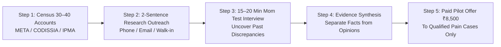
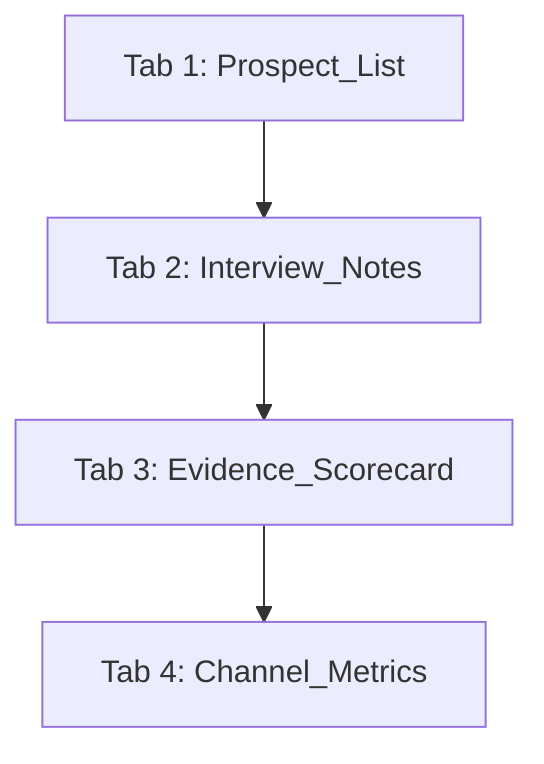

# Customer Acquisition & Discovery Execution Plan
## Beachhead: Industrial & Electrical Wholesale Distributors (Coimbatore & Chennai)

---

## Executive Objective

The objective of this customer acquisition plan is **not** to collect compliments about automation, pitch dashboards, or convince distributors that they need modern software. 

It is to identify **30–40 real, owner-managed industrial and electrical wholesale distributors** in Coimbatore and Chennai, conduct **10–15 structured discovery conversations**, and empirically verify whether **dispatch-to-invoice reconciliation and unallocated payment friction** are painful enough to justify a paid pilot.



---

## 1. Where to Find Real Prospects: Primary Sourcing Channels

### 1.1 Highest-Priority Trade Associations

1. **Madras Electric Traders Association (META) — Chennai (Priority 1):**
   * *Profile:* Represents electrical wholesalers, stockists, and traders with a public directory of over 1,800 trade members.
   * *Website:* [metachennai.in](https://www.metachennai.in) | [Member Directory](https://www.metachennai.in/members)
   * *How to use:* Approach the association office; request introductions to owner-managed trading businesses or attend open meetings. Never scrape for mass spam.
2. **CODISSIA — Coimbatore (Priority 1):**
   * *Profile:* Over 6,600 MSME members spanning industrial manufacturing, pump trading, and engineering supply.
   * *Website:* [codissia.com](https://www.codissia.com) | [Trade Fair Complex Events](https://www.codissiacomplex.com/news%26events.php)
   * *How to use:* Attend industrial exhibitions (INTEC) and buyer-seller meets to establish in-person contact with trading members.
3. **Indian Chamber of Commerce and Industry (ICCI) — Coimbatore:**
   * *Profile:* 1,670+ members across trade and industry in Coimbatore.
   * *Website:* [iccicbe.in](https://iccicbe.in/member/)
4. **Chinnavedampatti Industries Association (CIA) — Coimbatore:**
   * *Profile:* Directory categorized by pumps, motors, fabrication, and electrical goods.
   * *Website:* [cianext.com](https://www.cianext.com)
5. **Indian Electrical and Electronics Manufacturers' Association (IEEMA):**
   * *Profile:* National directory with a dedicated "Traders" category filterable by Tamil Nadu and turnover slabs.
   * *Website:* [ieema.org/member-directory](https://www.ieema.org/member-directory/)

---

### 1.2 Physical Trading Hubs (Direct Local Walk-Ins)

* **Coimbatore:**
  * **Ram Nagar / Cox Street & Palaniappan Street:** Core hub for wholesale electrical distributors, switchgear traders, and industrial supplies.
  * **Town Hall & Oppanakara Street:** High-density wholesale machinery and electrical trading belt.
* **Chennai:**
  * **George Town & Sowcarpet:** Audiappa Naicken Street, Govindappa Naicken Street, and Kasi Chetty Street (the undisputed heart of wholesale electrical and industrial distribution in South India).

---

### 1.3 Verified Candidate Companies to Investigate (Public Leads)

These are public directory listings to screen as starting leads (verify operational size and digital workflow before outreach):

| Candidate Business Name | Location | Primary Product Category | Public Source Reference |
| :--- | :--- | :--- | :--- |
| **Sri Oswal Enterprises** | Coimbatore | Industrial Pumps & Motors | [Pumps India Distributor Directory](https://pumpsindia.com/distributors-of-pumps/) |
| **Ganga Engineering Corporation** | Coimbatore | Engineering Spares & Pumps | [Pumps India Distributor Directory](https://pumpsindia.com/distributors-of-pumps/) |
| **Kirtan Distributors Pvt. Ltd.** | Coimbatore | Industrial Pumps & Flow Equipment | [Pumps India Distributor Directory](https://pumpsindia.com/distributors-of-pumps/) |
| **Shabis Enterprise** | Coimbatore | Industrial Pumps & Valves | [Taha Pumps Dealer Locator](https://www.tahapumps.com/dealer_locator.html) |
| **Industrial Pumps & Instruments Co.** | Coimbatore | Instrumentation & Industrial Pumps | [Taha Pumps Dealer Locator](https://www.tahapumps.com/dealer_locator.html) |
| **Manmal Mahendra & Sons** | Ram Nagar / Cox St, Coimbatore | Wholesale Electrical Products | Public Business Directory (Coimbatore) |
| **Matrix Electricals** | Sathy Rd, Siddhapudur, Coimbatore | Industrial Automation & Electricals | Public Business Directory (Coimbatore) |
| **Trishla Trading Company** | Cox St, Ram Nagar, Coimbatore | Electrical & Building Supplies Wholesaler | Public Business Directory (Coimbatore) |
| **Thirumala Electrical Company** | Sowcarpet / George Town, Chennai | Wholesale Electrical Distributor | META / Public Directory (Chennai) |
| **Metro Agencies** | Kasi Chetty St, Sowcarpet, Chennai | Electrical Wholesale & Distribution | META / Public Directory (Chennai) |
| **Marudhar Electricals** | Govindappa Naicken St, Chennai | Electrical Supplies & Switchgear | META / Public Directory (Chennai) |

---

## 2. Who to Contact Inside a Distributor

| Internal Role | What You Learn From Them | Priority in Discovery |
| :--- | :--- | :---: |
| **Accounts Manager / Senior Accountant** | Actual month-end close steps, unbilled challan frequency, bank recon delays, unallocated credits. | **Highest** (Workflow Truth) |
| **Inventory / Dispatch In-Charge** | How gate delivery challans, physical bin cards, and vehicle dispatches are tracked outside Tally. | **Highest** (Operational Truth) |
| **Owner / Managing Director** | Business consequences, cash flow anxiety, bank CC limits, and spending authority for a pilot. | **Highest** (Buying Truth) |
| **Finance Controller / Operations Head** | Multi-branch friction, recurring reporting latency, previous failed software attempts. | **High** |
| **External CA / Bookkeeper** | Pre-audit reconciliations, missing GSTR-2B ITC, client reporting habits. | **High** (Channel Partner) |

---

## 3. Outreach Scripts (Ethical, Non-Sales Research Framing)

> [!NOTE]
> **Outreach Rule:** Disclose that your background is in data engineering, but make it explicit that you are conducting **research on existing workflows** and not pitching a product today. Never ask to see confidential financial numbers during discovery.

### A. Direct Email Script
```text
Subject: Request for a brief research conversation on [Product Category] distribution workflows

Hello [Name],

I found [Company Name] through [CODISSIA / META / Public Directory] while researching wholesale industrial and electrical distributors in [Coimbatore / Chennai].

I’m currently studying how regional trading businesses handle monthly reporting and reconcile dispatches, invoices, returns, and bank receipts across Tally and outside spreadsheets.

I’m trying to understand how these workflows operate in practice—including what already works smoothly and where, if anywhere, teams encounter manual bottlenecks. I am not calling to pitch or sell any software.

Would you be open to a brief 15–20 minute conversation sometime next week? I will not ask for confidential figures or financial files; the discussion is purely at a process level.

If someone else in your business manages accounts and monthly close, I would appreciate being pointed in their direction.

Thank you for your time,
[Your Name]
[Phone Number] | [LinkedIn Profile / Trade Name]
```

---

### B. LinkedIn Connection Note & Follow-Up
* **Connection Request (Under 300 Chars):**
  > *"Hello [Name], I’m researching how industrial and electrical distributors in [City] manage monthly reporting across dispatch, invoices, and Tally. Looking to understand real workflows rather than pitch a product. Would be glad to connect."*
* **Follow-Up Message (After Acceptance):**
  > *"Thanks for connecting, [Name]. I’m speaking with a few owner-managers in [Coimbatore / Chennai] to understand how month-end reports are compiled and where manual reconciliation takes time. Would you be open to a 15-minute research chat? No confidential files needed, and zero sales pitch."*

---

### C. Direct Phone Call Opener (Reception to Decision-Maker)
* **To Reception / Operator:**
  > *"Hello, my name is [Your Name]. I’m conducting research on how electrical and industrial distributors in [City] handle dispatch records and monthly Tally reporting. Could you tell me who manages accounts or warehouse operations? I’d like to request a 15-minute research conversation—I’m not calling to sell software."*
* **When Decision-Maker Answers:**
  > *"Hello [Name], [Your Name] here. I’m researching how distributors in [City] bridge warehouse delivery challans with month-end Tally sales. Caught you at a bad time? I'm not selling software today—I just wanted to ask 3 quick questions about how your team handles month-end close."*

---

### D. Follow-Up Protocol
* **Day 0:** Send personalized email / LinkedIn invite.
* **Day 4–5:** Send one polite follow-up (*"Just following up in case my note was buried; no worries at all if you're busy"*).
* **Day 10–12:** Final check-in. If no reply, **stop**. Never spam or harass.

---

## 4. The 15–20 Minute Customer Interview Run-Sheet

```
TOTAL TIME: 18 MINUTES
├─ [0–2 Min]   Opening & Permission (Disarm sales pressure; confirm note-taking)
├─ [2–6 Min]   Reconstruct Workflow (Trace last month-end from gate pass to Tally)
├─ [6–11 Min]  Explore Actual Incidents (Last discrepancy, unbilled challan, stock gap)
├─ [11–15 Min] Current Alternatives & Costs (Hours spent, Excel templates, CA help)
└─ [15–18 Min] Decision Authority & Close (Who decides, what triggers action)
```

### The 8 Core Interview Questions

1. **Reconstruct the Workflow:**
   > *"Could you walk me through how your team prepared its most recent monthly report—from collecting warehouse dispatches to finalizing accounts?"*
2. **Identify Multi-File Systems:**
   > *"Which specific spreadsheets, software screens, or physical logs had to be pulled together to make sure those figures matched?"*
3. **Isolate a Recent Incident:**
   > *"Can you recall the last time two records or reports showed different figures—like goods dispatched vs. invoiced, or physical stock vs. Tally?"*
4. **Trace the Resolution:**
   > *"What happened in that specific case, who had to investigate it, and how long did it take to close the difference?"*
5. **Understand Real Consequences:**
   > *"What actually happened while that mismatch remained unresolved? Was an invoice delayed, a payment held up, or an order put on hold?"*
6. **Learn Past Workarounds:**
   > *"What have you already tried to make this reconciliation easier—like custom Excel macros, hiring an extra clerk, or asking your CA?"*
7. **Quantify Current Resources:**
   > *"Roughly how many hours did your accounts or inventory team spend last month just checking and cross-referencing files?"*
8. **Map Authority & Urgency:**
   > *"If someone came up with a way to eliminate that manual checking, who in the business would decide whether to try it, and what would they need to see first?"*

---

## 5. 4-Tab Evidence Tracking Structure (Excel / Google Sheets)

Maintain one master workbook: `Coimbatore_Discovery_Tracker.xlsx` containing these 4 tabs:



### Tab 1: `Prospect_List`
* Columns: `Prospect_ID`, `Business_Name`, `City_Cluster`, `Product_Category`, `Public_Source_URL`, `Contact_Name`, `Contact_Role`, `Channel_Used`, `Personalization_Angle`, `ICP_Fit_Rating`, `Outreach_Status`, `Next_Action_Date`.

### Tab 2: `Interview_Notes`
* Columns: `Interview_ID`, `Prospect_ID`, `Interview_Date`, `Interviewee_Role`, `Systems_Identified`, `Recent_Incident_Reported`, `Frequency_Monthly`, `Staff_Hours_Burned`, `Confirmed_Business_Consequence`, `Current_Workaround`, `Previous_Tools_Tried`, `Decision_Maker_Identified`, `Verbatim_Quotes`.

### Tab 3: `Evidence_Scorecard`
* Evaluates factual proof using **Yes / No / Unknown**:
  - [ ] Specific incident within the last 90 days?
  - [ ] Recurring workflow (>1x/month)?
  - [ ] Staff time quantified (>15 hrs/mo)?
  - [ ] Financial consequence evidenced (unbilled challans / overcharges)?
  - [ ] Existing Tally/Excel workaround inadequate?
  - [ ] Decision-maker reached?
  - [ ] Willingness to test ₹8,500 pilot?

### Tab 4: `Channel_Metrics`
* Weekly tracking: `Accounts Researched`, `Personalized Touches`, `Replies Received`, `Interviews Completed`, `Evidenced Pain Cases`, `Pilot Offers Extended`, `Paid Pilots Won`.

---

## 6. The 30-Day Discovery-to-Pilot Sprint

```
WEEK 1: BUILD THE 30-ACCOUNT CENSUS
- Identify 15 distributors in Coimbatore (Ram Nagar, Kurichi) and 15 in Chennai (Sowcarpet).
- Verify public business status, product category, and Owner/Accounts Manager names.

WEEK 2: CONDUCT INITIAL 6 DISCOVERY CALLS
- Reach out to the first 15 prospects using email, LinkedIn, and direct phone calls.
- Complete 4–6 Mom Test discovery calls; log verbatim quotes.

WEEK 3: DEEPEN INTERVIEWS & PATTERN MATCHING
- Complete remaining 6–8 interviews.
- Analyze evidence: Did at least 3 distributors report the exact same unbilled delivery challan or stock mismatch problem?

WEEK 4: TEST WILLINGNESS TO PAY (THE ₹8,500 PILOT PIVOT)
- To the 2–3 distributors with the most acute, verified pain:
  "We sign a strict 1-page offline NDA first. You send 2 exported files from last month. In 4 days, for a flat ₹8,500, I give you a clean dataset, an automated Exception Sheet catching every mismatch, and a 1-page summary dashboard—100% credited against full implementation."
- Send the 3-page Legal Pack (NDA + SOW + Schedule A) via Zoho Sign.
```

---

## 7. The Evidence Hierarchy: Filtering False Positives

| Evidence Level | What the Prospect Says or Does | How You Must Treat It |
| :--- | :--- | :--- |
| **Level 1 (False Positive)** | *"That sounds like a great tool; send me your brochure."* | **Ignore.** Polite brush-off; zero buying intent. |
| **Level 2 (General Complaint)** | *"Month-end is always a headache in Excel."* | **Weak.** Ask for a recent specific date and consequence. |
| **Level 3 (Quantified History)** | *"Last month, two clerks burned 14 hours matching Tally against gate delivery challans."* | **Strong Problem Signal.** Acknowledge and probe current workarounds. |
| **Level 4 (Workflow Inspection)** | Agrees to share a masked 200-row sample or walk through the reconciliation screen. | **High Technical Feasibility.** Ready for pilot evaluation. |
| **Level 5 (Commercial Commitment)** | Signs 1-page NDA and pays **₹8,500 upfront** for the 4-day diagnostic. | **Verified Commercial Demand.** Proceed to delivery. |

---

### Final Operational Takeaway

> **Your only goal in the next 30 days is to get ONE Coimbatore distributor to pay ₹8,500 for a 4-day diagnostic.**  
>
> If 15 distributors tell you their current Tally/Excel setup works fine, you have successfully saved months of wasted software engineering and can pivot to manufacturers or CA firms immediately. If 3 of them describe the exact same unbilled challan nightmare, you have your million-dollar beachhead.
