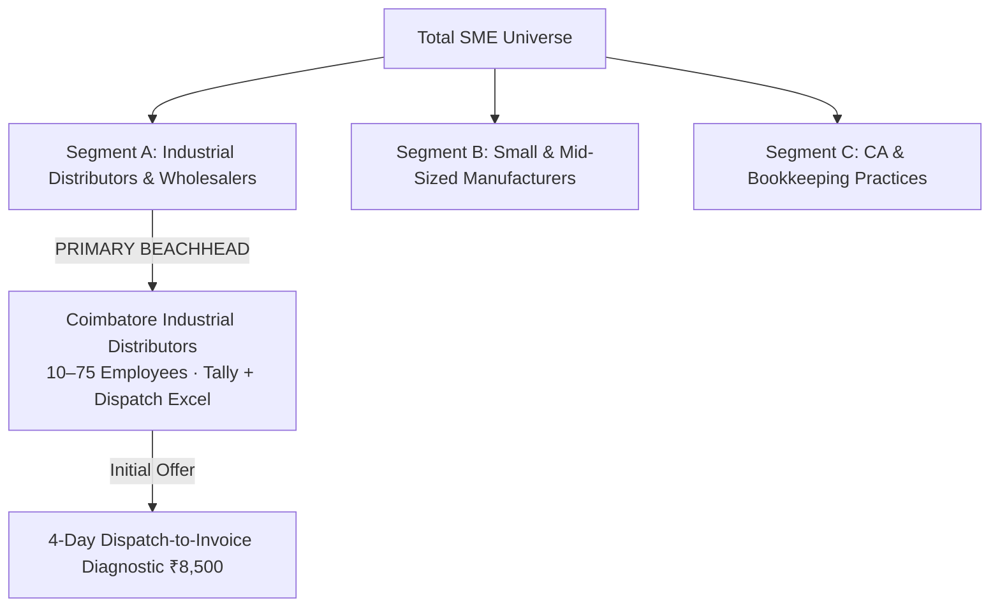
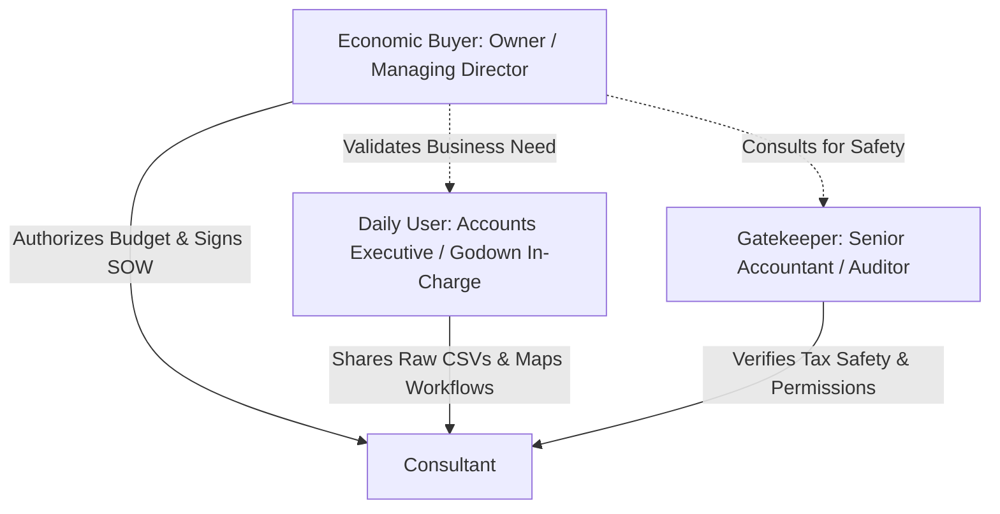

# Customer Segmentation & Beachhead Strategy
## Business Data Consolidation & Reporting Automation · India-First GTM

---

## Executive Recommendation: The Coimbatore Beachhead

Start with **owner-managed industrial distributors and wholesalers in Coimbatore, Tamil Nadu**, with approximately 10–75 employees, digital sales and inventory records, and a recurring monthly reconciliation problem.

Your initial offer should focus on **one narrow job**: reconciling dispatches, invoices, returns, and collections across operational spreadsheets and Tally exports.

> [!IMPORTANT]
> **Do not initially target every manufacturer, e-commerce seller, and CA firm with the same pitch.**  
> They have different workflows, buying processes, and definitions of value. This recommendation is a working hypothesis based on market research so far. The next step is to compare three segments and test which one has the strongest combination of pain, access, purchasing authority, and willingness to pay.



### Why Start With Coimbatore Industrial Distributors?
1. **Concrete, Bounded Workflow:** Comparing dispatches, invoices, inventory movements, and receipts follows a clean transaction lifecycle (Order ➔ Dispatch ➔ Invoice ➔ Return ➔ Receipt).
2. **Identifiable & Reachable Buyer:** The Managing Director or Owner sits on the factory/warehouse premises and can be approached directly through regional trade bodies (CODISSIA, SIEMA).
3. **No Heavy ERP Interventions:** Works purely off existing digital exports (Tally visual/XML + warehouse dispatch `.xlsx`), avoiding costly API integrations.
4. **Focused Geographic Concentration:** Coimbatore provides dense industrial clusters (Kurichi, Malumichampatti, Peelamedu, Ganapathy), enabling rapid discovery without traveling across multiple states.

---

## 1. Segmentation Dimensions: How Customers Actually Operate

The most useful segmentation variables are not simply industry and revenue. They are the characteristics that make your service deliverable and commercially viable:

| Segmentation Dimension | High-Priority Characteristic | Why It Matters for Delivery & Sales |
| :--- | :--- | :--- |
| **Business Model** | Distributor or wholesaler handling physical goods | Dispatches, challans, stock, invoices, and collections create linked records to reconcile. |
| **Operating Complexity** | Multi-branch, multi-godown, or 300+ active trade SKUs | Increases the number of independent files that must agree. |
| **Digital Maturity** | TallyPrime / Tally.ERP 9 + Excel/CSV working files | Usable structured inputs without requiring full ERP re-implementation. |
| **Reporting Frequency** | Weekly operational tracking or monthly close | Creates recurring pain and an ongoing reason to automate. |
| **Problem Severity** | Repeated manual matching, unbilled challans, delayed reports | Gives the business owner a quantifiable reason to fund a fix. |
| **Purchasing Authority** | Owner or MD can approve ₹25,000–₹50,000 directly | Eliminates multi-layered enterprise procurement friction. |
| **Data Readiness** | Exportable files, stable keys (Challan No, Order ID), agreed rules | Makes a fixed-scope 4-day diagnostic technically feasible. |
| **Financial Health** | Profitable business with bank CC/OD limits | Can easily fund an ₹8,500 pilot and sees the value of stopping cash leakage. |

---

## 2. Comparing the Three Most Promising Segments

### Segment Comparison Matrix

| Strategic Factor | Segment A: Industrial Distributors | Segment B: Small Manufacturers | Segment C: CA & Bookkeeping Firms |
| :--- | :---: | :---: | :---: |
| **Pain Severity Hypothesis** | **High** (Unbilled challans, stock gaps) | **High** (Yield, scrap, costing) | **Medium–High** (Unbillable staff hours) |
| **Ease of Identifying Prospects** | **High** (Trade directories, CODISSIA) | **High** (Industrial estates) | **High** (ICAI directories) |
| **Access to Economic Buyer** | **High** (Direct access to MD/Owner) | **Medium–High** (Plant Head / MD) | **Medium** (Partner access requires trust) |
| **Ability to Demonstrate Value** | **High** (Clear monetary leakage) | **Medium–High** (Complex BOM costing) | **High** (Hours saved per client) |
| **Scope Predictability** | **Medium–High** (Standard transaction flow) | **Medium–Low** (Specialized BOM/scrap) | **Medium** (Varies client by client) |
| **Potential Project Value** | **Medium** (₹25k–₹45k) | **Medium–High** (₹35k–₹75k) | **Medium** (₹15k–₹30k per firm/client) |
| **Recurring Revenue Potential** | **Medium–High** (Monthly close retainer) | **Medium–High** (Monthly MIS pack) | **High** (Multiple client files monthly) |
| **Sales-Cycle Simplicity** | **Low–Medium** (7–14 days) | **Medium** (14–30 days) | **Medium** (Trust-based evaluation) |
| **Competitive Threat** | Tally native bank recon, Excel, internal staff | ERP/MRP systems, internal cost accountants | Internal article clerks, existing macros |
| **Best Initial Offer** | **Dispatch-to-Invoice & Stock Recon** | **Production Yield & Scrap Recon** | **White-Label Client Data Normalization** |
| **Strategic GTM Role** | **PRIMARY BEACHHEAD (Priority 1)** | **SECONDARY CANDIDATE (Priority 2)** | **CHANNEL PARTNER (Priority 3)** |

> [!NOTE]
> **Why Distributors Win Initially:** A distributor’s transaction flow is linear: Order ➔ Dispatch ➔ Invoice ➔ Return ➔ Payment. Manufacturers introduce scrap percentages, machine downtime, and multi-tier bills of materials (BOM), which require deep domain discovery before a pipeline can be built.

---

## 3. Ideal Customer Profiles (ICPs)

### ICP 1: The Owner-Led Industrial Distributor (Primary Beachhead)

```
Target Region: Coimbatore (Kurichi, Ganapathy, Peelamedu, SIDCO) & Chennai (Ambattur)
Headcount: 10 – 75 employees | Revenue: ₹5 Cr – ₹50 Cr
Transaction Volume: 2,000 – 30,000 rows/month across exports
Tech Stack: TallyPrime + Excel Godown/Dispatch Trackers
```

* **Target Sub-Sectors:** Industrial spare parts, electrical switchgear/cables, pumps and motors, hardware, fasteners, packaging supplies.
* **Core Pain Points:** Dispatches leave the godown on manual Delivery Challans; accounts clerks fail to raise GST invoices on time; Tally stock does not match warehouse bin cards; customer credit balances carry forward unresolved.
* **Target Account Checklist:**
  - [ ] B2B business selling to dealers, factories, or contractors (not walk-in retail).
  - [ ] Maintains separate dispatch or inventory trackers outside Tally.
  - [ ] Uses TallyPrime with export permissions enabled.
  - [ ] Can identify the staff member who spends 10+ hours/month cross-checking files.
  - [ ] Decision-maker (Owner/MD) is on-site and reachable.

---

### ICP 2: The Production-to-Finance Manufacturer (Secondary Candidate)

```
Target Region: Karur (Textiles) & Coimbatore (Engineering/Foundry)
Headcount: 20 – 150 employees | Revenue: ₹10 Cr – ₹100 Cr
Transaction Volume: 5,000 – 100,000+ rows/month
Tech Stack: Tally / Small ERP + Shop-Floor & Job-Work Excel
```

* **Target Sub-Sectors:** Precision CNC machining, textile spinning/weaving, fabrication, auto-components.
* **Core Pain Points:** Subcontractors receive raw materials (yarn, steel) and return finished goods across multiple partial lots over months, hiding excess scrap; purchase orders do not tie out to goods-received notes (GRN).
* **Delivery Pre-requisites:** Must establish authoritative source records, agreed scrap/wastage tolerances, and unit conversion rules before quoting fixed fees.

---

### ICP 3: The SME-Focused Accounting Practice (Strategic Partner)

```
Target Region: Tamil Nadu (ICAI SIRC Chapters)
Firm Size: 5 – 30 staff (Articles & Paid Assistants) | Client Book: 20 – 150 SME clients
Workflow: Recurring monthly bookkeeping, GST filing, and audit prep
Tech Stack: TallyPrime, Computax, Excel
```

* **Core Pain Points:** Junior article assistants burn 30+ unbillable hours per client manually cleaning bank CSVs and sales registers before statutory audit or GST returns can be prepared.
* **Commercial Model:** White-label technical data preparation at flat wholesale rates (e.g., ₹5,000–₹10,000 per client file), freeing the CA to bill high-margin advisory fees.

---

## 4. Buying Committee Architecture: Who Decides in a Distributor?

In a mid-sized Indian distributor (₹10 Cr–₹50 Cr), roles are concentrated but distinct:



| Role | Typical Person | What They Care About | How to Handle Them |
| :--- | :--- | :--- | :--- |
| **Economic Buyer** | Owner, MD, Partner, Next-Gen Scion | Cash recovery, stopping pilferage, reducing bank CC interest | Lead with unbilled challans, dead stock, and 4-day time-to-value. |
| **Daily User** | Accounts Executive, Inventory Coordinator | Ending Sunday night manual VLOOKUPs, fewer errors | Show them how the Exception Tab removes repetitive copy-pasting. |
| **Gatekeeper** | Senior Accountant, Tally Operator | Job security, avoiding blame for past clerical errors | **Disarm publicly:** *"We don't replace the accountant; we eliminate CSV formatting so they can focus on tax compliance."* |
| **External Influencer** | Statutory CA, ERP Consultant | Reliable source records, audit-friendly trails | Emphasize read-only data extraction and traceable audit logs. |

---

## 5. Overcoming the Critical Competitive Objection: "Tally Already Does This"

> [!CAUTION]
> **The Tally Trap:** TallyPrime Release 6.0 supports bank statement imports, auto-reconciliation, and unreconciled transaction reports. If you approach a distributor saying *"I automate bank reconciliation in Tally"*, they will dismiss you immediately.

### How to Differentiate Your Offer
Your offer is **cross-system operational reconciliation**, which Tally cannot perform natively:

| What TallyPrime Does Natively | What Tally CANNOT Do (Your Paid Offer) |
| :--- | :--- |
| Matches bank statement dates to entered bank payment vouchers. | Cross-checks warehouse gate-pass delivery challans against sales invoices to flag dispatches >5 days old unbilled. |
| Tracks inventory balances based on entered purchase/sales vouchers. | Reconciles physical warehouse bin card Excel logs against Tally stock to uncover pilferage vs. late voucher entries. |
| Reports sales by ledger and customer outstanding balances. | Regex-extracts 12-digit UPI RRN / NEFT UTRs from messy bank narrations to match unallocated customer credits. |
| Generates statutory balance sheets and GSTR-1 summaries. | Cross-reconciles supplier invoices against portal GSTR-2B CSVs to produce an automated "Hold Vendor Payment" list. |

---

## 6. The Initial Beachhead Offer: "4-Day Dispatch-to-Invoice Diagnostic"

Instead of selling an abstract "Business Data Consolidation & Reporting Automation" project, brand your pilot with extreme operational specificity:

### Offer Name: **The 4-Day Dispatch-to-Invoice Reconciliation Diagnostic**

* **Price:** **₹8,500 INR** (100% credited against full implementation).
* **Target Inputs:**
  1. Factory / Warehouse Gate Pass Dispatch Register (`.xlsx` or `.csv`).
  2. Tally `Sales Register` Detailed Export (`.xlsx` or `.xml`).
* **Deliverables Delivered in 96 Hours:**
  1. **Unbilled Dispatch Alert Sheet:** Every delivery challan older than 5 days with no matching GST invoice number.
  2. **Quantity & Rate Variance Log:** Shipments where billed quantities or prices differ from gate dispatch records.
  3. **Executive Summary KPI View:** 1-page dashboard highlighting unbilled exposure, monthly dispatch velocity, and average invoicing latency.
  4. **Full-Implementation Roadmap:** A fixed-price proposal (₹25,000–₹45,000) to automate the workflow permanently.

---

## 7. Your 14-Day Beachhead Execution Plan

```
DAYS 1–3: TARGET PROSPECT CENSUS
- Pull 30–40 industrial distributors in Coimbatore (Kurichi, Ganapathy, Peelamedu).
- Verify company name, website, product category, and Owner/MD name on LinkedIn or MCA.

DAYS 4–8: CONDUCT 8–10 MOM TEST DISCOVERY CALLS
- Reach out with the 2-sentence disarming opener: "I'm researching how Coimbatore distributors bridge godown dispatch logs with Tally..."
- Ask the 8 core discovery questions. Do NOT pitch software or dashboards.

DAYS 9–11: ANALYZE RECURRING FAILURE PATTERNS
- Review notes: Are at least 3 distributors reporting unbilled challans, dead stock, or unallocated bank receipts?
- Demonstrate your synthetic showcase dataset on a 15-minute screen share.

DAYS 12–14: CLOSE & INITIATE PILOT #1
- Offer the 4-Day ₹8,500 Dispatch-to-Invoice Diagnostic to the 2 prospects with the most acute pain.
- Send the 3-page Legal Pack (NDA + SOW + Schedule A) via Zoho Sign.
- Collect payment upfront and execute Day 1 of the pilot.
```

---

### Final Beachhead Rule

> **Do not expand to multiple customer segments, build generalized software, or prospect overseas until you have won, delivered, and collected payment on ONE repeatable reconciliation workflow for a Coimbatore distributor.**  
>
> Proving that one business owner will pay ₹8,500 for a diagnostic and convert to a ₹35,000 implementation gives you the empirical foundation to scale across all of Tamil Nadu and beyond.
