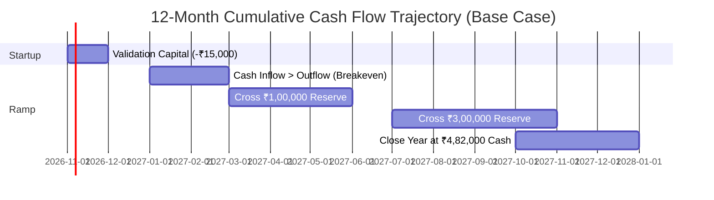

# Financial Feasibility Model & 12-Month Projections
## Business Data Consolidation & Reporting Automation Practice

**Market Focus:** India (Primary Beachhead: Coimbatore & Chennai, Tamil Nadu)  
**Operating Structure:** Solo Technical Consultancy (Bootstrap / Zero External Capital)  
**Tooling Infrastructure:** Local Python/pandas, Microsoft Excel / Power Query, Air-Gapped Local Storage  
**Effective Modeling Date:** 27 October 2026  

---

## Executive Assessment: The Solo Practice Financial Reality

> [!IMPORTANT]
> **This business is financially feasible to launch with near-zero upfront capital, but its economic viability is governed entirely by delivery labor discipline and client conversion—not software or infrastructure costs.**
> 
> Because we operate as a service (not a SaaS product), there are no cloud server bills, multi-tenant database hosting fees, or software engineering payrolls. However, the business faces a distinct financial trap: **if delivery labor expands uncontrolled, an apparently profitable ₹8,500 project yields sub-minimum-wage hourly returns.**

```
                              [ THE FINANCIAL REALITY TRIANGLE ]
                                              
                                     Gross Revenue (Cash In)
                                               ▲
                                              / \
                                             /   \
                                            /     \
                                           /       \
                                          /  MARGIN \
                                         /   HEALTH  \
                                        /             \
                                       ▼               ▼
           Acquisition Drag (CAC) ◄─────────────────────────► Delivery Drag (Labor Time)
           (Cold outreach time,                              (Data sanitization, edge cases,
            unpaid scoping calls)                             rework, client meetings)
```

### Key Financial Hypotheses Carried Forward
* **The Diagnostic:** ₹8,500 fixed fee *(Hypothesis: 1 workflow, 2 files, 4-day SLA)*.
* **The Implementation Sprint:** ₹35,000 midpoint *(Range: ₹25,000–₹50,000)*.
* **The Monthly Retainer:** ₹6,000–₹7,500/month midpoint *(Tested only after recurring need is proven)*.
* **Founder Labor Imputation:** Valued at **₹500 / hour** to determine true *economic profitability* (preventing the illusion of profit by treating founder time as free).

---

## 1. Startup Budget & Monthly Fixed Operating Costs

### One-Time Validation Budget (The ₹15,000 Cap)
The capital required to validate this business through the first paid client is strictly capped at **₹15,000**:

| Expense Category | Itemized Allocation | Conservative Cap | Purpose & Notes |
| :--- | :--- | :---: | :--- |
| **Local Travel & Meetings** | Bus/fuel for client meetings in Gandhipuram, Ambattur, Guindy | ₹4,000 | In-person *Mom Test* interviews and executive diagnostic handovers. |
| **Data Security & Storage** | Dedicated hardware encrypted SSD + local backup drive | ₹3,000 | Enforcing 100% offline, air-gapped data hygiene for client records. |
| **Domain & Portfolio Page** | Domain name (.in / .com) + clean static markdown hosting | ₹2,000 | Professional email address and simple, unbloated landing page. |
| **Legal & Compliance** | 1-page NDA review, GST filing advice, and stamp paper | ₹3,000 | Basic local legal review and initial tax compliance setup. |
| **Validation Contingency** | Unforeseen project-specific transport or administrative fees | ₹3,000 | Buffer to absorb initial unexpected discovery expenses. |
| **Total Validation Cap** | **Zero External Debt / Bootstrapped** | **₹15,000** | **Maximum capital committed prior to first cash collection.** |

> [!TIP]
> **The Capital Preservation Rule:**  
> If you have not secured your first paying diagnostic client within the ₹15,000 validation budget, **stop spending**. The barrier to closing clients in this market is never branding or paid tools—it is acute problem validation and trust.

---

### Monthly Fixed Operating Costs (Run-Rate Overhead)

| Monthly Operating Expense | Monthly Estimate | Annualized Drag | Operational Notes |
| :--- | :---: | :---: | :--- |
| **Software & Office Suite** | ₹1,000 | ₹12,000 | Microsoft 365 Business Basic (Excel, OneDrive, Outlook). |
| **Communications & Internet** | ₹1,000 | ₹12,000 | High-speed fiber broadband + dedicated business mobile SIM. |
| **Local Travel & Association Dues** | ₹2,500 | ₹30,000 | CODISSIA/META event attendance and local client visits. |
| **Banking, Accounting & Admin** | ₹1,500 | ₹18,000 | Professional CA retainer for GST filing and bank account maintenance. |
| **Total Monthly Fixed Overhead** | **₹6,000 / mo** | **₹72,000 / yr** | **Extremely lean fixed cost baseline.** |

---

## 2. 12-Month Financial Scenarios: Conservative, Base & Optimistic

```
┌────────────────────────────────────────────────────────────────────────────────────────┐
│                        12-MONTH FINANCIAL PERFORMANCE PROJECTIONS                      │
├────────────────────────────┬────────────────────────────┬──────────────────────────────┤
│ CONSERVATIVE (Low Volume)  │ BASE CASE (Realistic Ramp) │ OPTIMISTIC (Growth Agency)   │
├────────────────────────────┼────────────────────────────┼──────────────────────────────┤
│ • Diagnostics: 9 / year    │ • Diagnostics: 24 / year   │ • Diagnostics: 42 / year     │
│ • Implementations: 2 / year│ • Implementations: 8 / year│ • Implementations: 18 / year │
│ • Active Retainers: 1      │ • Active Retainers: 3      │ • Active Retainers: 6        │
│ • Revenue: ₹1,82,500       │ • Revenue: ₹6,44,000       │ • Revenue: ₹15,12,000        │
│ • Economic Profit: -₹8,500 │ • Economic Profit: ₹1,52k  │ • Economic Profit: ₹6,84k    │
│ • Closing Cash: ₹68,500    │ • Closing Cash: ₹4,82,000  │ • Closing Cash: ₹12,45,000   │
└────────────────────────────┴────────────────────────────┴──────────────────────────────┘
```

### Detailed 12-Month Annual Projections

| Annual Performance Metric | Conservative Scenario | Base Case Scenario | Optimistic Scenario |
| :--- | :---: | :---: | :---: |
| **Diagnostic Engagements Sold** | 9 projects @ ₹7,500 | 24 projects @ ₹8,500 | 42 projects @ ₹10,000 |
| **Implementation Sprints Sold** | 2 projects @ ₹25,000 | 8 projects @ ₹35,000 | 18 projects @ ₹45,000 |
| **Active Retainer Client-Months** | 6 client-months @ ₹5,000 | 24 client-months @ ₹6,500 | 48 client-months @ ₹8,000 |
| **Gross Annual Revenue** | **₹1,82,500** | **₹6,44,000** | **₹15,12,000** |
| Direct Project Expenses (₹500/project) | ₹5,500 | ₹16,000 | ₹30,000 |
| Customer Acquisition Spend (CAC) | ₹18,000 | ₹36,000 | ₹63,000 |
| Imputed Founder Labor (@ ₹500/hr) | ₹95,000 | ₹3,68,000 | ₹6,63,000 |
| Total Direct Operating Variable Costs | **₹1,18,500** | **₹4,20,000** | **₹7,56,000** |
| **Gross Economic Contribution** | **₹64,000** | **₹2,24,000** | **₹7,56,000** |
| Fixed Annual Overhead (₹6,000/mo) | ₹72,000 | ₹72,000 | ₹72,000 |
| **Net Economic Operating Profit / (Loss)** | **-₹8,000** | **₹1,52,000** | **₹6,84,000** |
| **Net Cash Flow (Excl. Imputed Labor)** | **₹87,000** | **₹5,20,000** | **₹13,47,000** |

> [!NOTE]
> **Economic Profit vs. Cash In Hand:**  
> In the Base Case, the business generates **₹5,20,000 in net liquid cash inflow** before founder withdrawals. The *economic profit* is ₹1,52,000 because it factors in ₹3,68,000 of the founder's time (736 hours over the year @ ₹500/hr). Even when economic profit is modest, cash flow is robust because founder labor is not an external cash outflow.

---

## 3. Unit Economics, Break-Even & Payback Analysis

### The Diagnostic Unit Economic Model

$$\text{Diagnostic Price: ₹8,500} \quad\longrightarrow\quad \text{Variable Cost: ₹5,700} \quad\longrightarrow\quad \text{Contribution: ₹2,800 (32.9\%)}$$

* **Gross Diagnostic Fee:** ₹8,500
* **Direct Labor (10.0 Hours @ ₹500/hr):** ₹5,000
* **Direct Project Expenses (Drive, travel allowance):** ₹500
* **Bank / Payment Transaction Cost (2%):** ₹200
* **Total Variable Cost per Diagnostic:** **₹5,700**
* **Net Contribution per Diagnostic:** **₹2,800**

---

### Break-Even Quantity Formulation

To cover the **₹6,000 monthly fixed operating expenses**, calculate how many diagnostics must be sold each month if no implementations or retainers occur:

$$Q^* = \frac{\text{Fixed Monthly Overhead}}{\text{Contribution per Unit}} = \frac{₹6,000}{₹2,800} \approx \mathbf{2.14 \text{ Projects / Month}}$$

$$\text{Monthly Break-Even Diagnostic Revenue} = 2.14 \times ₹8,500 = \mathbf{₹18,190 / \text{month}}$$

* **Interpretation:** Closing **one diagnostic every 14 days** covers all business operating overhead, software, phone, and accounting fees.
* **If Factoring in ₹1,500 CAC per Client:**  
  $$\text{Net Contribution after CAC} = ₹2,800 - ₹1,500 = ₹1,300$$
  $$Q^*_{\text{with CAC}} = \frac{₹6,000}{₹1,300} \approx \mathbf{4.6 \text{ Diagnostics / Month}}$$

---

### The Implementation Sprint Unit Economics (The True Profit Engine)
* **Gross Implementation Fee:** ₹35,000
* **Direct Delivery Labor (25 Hours @ ₹500/hr):** ₹12,500
* **Direct Expenses & Client Handover Costs:** ₹1,500
* **Total Variable Cost:** **₹14,000**
* **Net Contribution per Implementation:** **₹21,000 (60.0% Margin)**

> [!IMPORTANT]
> **The Diagnostic is a Customer Acquisition Tool:**  
> The ₹8,500 diagnostic is designed to break even and fund customer acquisition. **The real profits of the agency live in the ₹35,000 Implementation Sprint.** Closing just **one implementation every 6 weeks** covers 3.5 months of agency fixed overhead.

---

## 4. 12-Month Cash Flow & Collections Ramp (Base Case)

### The Working Capital & Payment Terms Assumption
Distributors rarely pay 100% on Day 1. The cash flow model assumes realistic Indian B2B payment terms:
* **Advance Collection:** 50% collected in Month $M$ upon contract execution.
* **Delivery Balance:** 50% collected in Month $M+1$ upon executive handover.
* **Collections Delay Buffer:** Modeled at 30 days for milestone balances.



### Monthly Cash Flow Statement (Base Case in ₹)

| Month | Diagnostics (Units) | Implem. (Units) | Retainers (Active) | Billed Revenue | Cash Collected | Operating Expenses | Net Monthly Cash | Cumulative Cash Balance |
| :---: | :---: | :---: | :---: | :---: | :---: | :---: | :---: | :---: |
| **M01** | 1 | 0 | 0 | ₹8,500 | ₹4,250 | ₹8,500 | -₹4,250 | ₹25,750 *(From ₹30k start)* |
| **M02** | 1 | 0 | 0 | ₹8,500 | ₹8,500 | ₹7,500 | +₹1,000 | ₹26,750 |
| **M03** | 2 | 1 | 0 | ₹52,000 | ₹30,250 | ₹9,500 | +₹20,750 | ₹47,500 |
| **M04** | 2 | 0 | 1 | ₹23,500 | ₹37,750 | ₹8,000 | +₹29,750 | ₹77,250 |
| **M05** | 2 | 1 | 1 | ₹58,500 | ₹41,000 | ₹10,500 | +₹30,500 | ₹1,07,750 |
| **M06** | 2 | 1 | 2 | ₹65,000 | ₹61,750 | ₹11,000 | +₹50,750 | ₹1,58,500 |
| **M07** | 2 | 0 | 2 | ₹30,000 | ₹47,500 | ₹8,500 | +₹39,000 | ₹1,97,500 |
| **M08** | 2 | 1 | 2 | ₹65,000 | ₹47,500 | ₹11,000 | +₹36,500 | ₹2,34,000 |
| **M09** | 2 | 1 | 3 | ₹71,500 | ₹68,250 | ₹12,000 | +₹56,250 | ₹2,90,250 |
| **M10** | 3 | 1 | 3 | ₹80,000 | ₹75,750 | ₹13,000 | +₹62,750 | ₹3,53,000 |
| **M11** | 2 | 1 | 3 | ₹71,500 | ₹75,750 | ₹12,000 | +₹63,750 | ₹4,16,750 |
| **M12** | 3 | 1 | 3 | ₹80,000 | ₹75,750 | ₹13,000 | +₹62,750 | **₹4,79,500** |

---

## 5. Stress Tests: What Breaks the Model?

```
┌────────────────────────────────────────────────────────────────────────────────────────┐
│                                STRESS TEST SCENARIOS                                   │
├────────────────────────────┬────────────────────────────┬──────────────────────────────┤
│ STRESS 1: RUNAWAY LABOR    │ STRESS 2: PIPELINE DROUGHT │ STRESS 3: 60-DAY PAYMENT LAG │
│ Delivery expands to 16 hrs │ Diagnostics drop by 50%    │ Collections slip to 60 days  │
│ Result: EHR drops to ₹500  │ Result: Economic loss      │ Result: M3 cash drops to     │
│ Margin drops to 0.0%       │ Net annual loss -₹28,000   │ ₹14,200 (Runway crunch)      │
└────────────────────────────┴────────────────────────────┴──────────────────────────────┘
```

### Detailed Impact & Agency Safeguards

| Downside Scenario | Financial Impact | Operating Breakeven Consequence | Immediate Agency Safeguard |
| :--- | :--- | :--- | :--- |
| **Delivery Labor Expands to 16 Hours** | Direct labor jumps from ₹5,000 to ₹8,000 per diagnostic. | Diagnostic contribution drops to ₹0; agency works for free. | **24-Hour Scope Lock:** Enforce strict file structure templates; reject unstandardized files without a fee adder. |
| **Implementation Conversion Drops to Zero** | Agency sells 24 diagnostics but zero clients upgrade to ₹35k sprint. | Annual revenue drops by ₹2,80,000; cash accumulation stalls. | **Package the 100% Credit:** Re-pitch diagnostic findings with a clear ROI roadmap showing exact unbilled rupees. |
| **Clients Delay Payment by 60 Days** | Milestone balances are collected 2 months late. | Creates temporary cash dip in Months 2–3; liquidity tightens. | **Enforce Advance Policy:** Collect 50% upfront before opening a single file; withhold final code until final 50% clears. |
| **Client Dispute & Rework Demand** | Client rejects exception categorization; demands rework. | Consumes 8 unpaid hours; wipes out project margin completely. | **Signed Acceptance Criteria:** SOW defines an exception as an unlinked record, not a guarantee of recovered cash. |
| **Customer Acquisition Cost Doubles** | CAC jumps from ₹1,500 to ₹3,500 per paying client. | Annual cash flow decreases by ₹48,000. | **Pivot to Trade Associations:** Cease cold calling; focus exclusively on CODISSIA member referrals and CA networks. |

---

## 6. The Personal Financial Runway Rule

Before embarking on this business full-time, calculate your personal survival runway independently from the business balance sheet:

$$\text{Personal Runway (Months)} = \frac{\text{Liquid Personal Savings} - \text{Emergency Fund Reserves}}{\text{Essential Personal Monthly Living Expenses}}$$

> [!CAUTION]
> **Never Mix Personal Expenses with Business Working Capital:**  
> A common founder failure mode is drawing business revenue to pay personal household bills before the agency reaches cash-flow break-even.  
> 1. Maintain a dedicated, separate **Business Current Bank Account**.
> 2. Keep at least **3 to 6 months of personal living expenses** fully isolated in a personal emergency fund.
> 3. Draw personal compensation **only as a monthly owner transfer** once the business bank account maintains a minimum ₹50,000 working capital buffer.

---

## 7. The 5 Financial Gates to Scale

Do not increase fixed costs, rent office space, or hire assistants until passing these sequential financial milestones:

```
[ Gate 1: First Collected Diagnostic ] ──► Deposit ₹8,500 into business account.
             │
             ▼
[ Gate 2: Net Cash Positive Month ] ──► Monthly cash collections exceed ₹6,000 fixed overhead.
             │
             ▼
[ Gate 3: First ₹35,000 Implementation ] ──► Prove client upgrades from diagnostic to sprint.
             │
             ▼
[ Gate 4: ₹1,00,000 Cash Reserve ] ──► Business holds 12+ months of fixed overhead in reserve.
             │
             ▼
[ Gate 5: Hire Junior Data Intern ] ──► Hire intern (@ ₹15k/mo) to take over cleaning when 
                                         MRR exceeds ₹30,000/month.
```

---

## 8. Final Financial Summary & Immediate Action

1. **Cap Setup Capital at ₹15,000:** Spend only on local travel, encrypted storage, and essential compliance. Do not buy software subscriptions upfront.
2. **Treat the First Diagnostic as a Break-Even Validation:** The goal of the first ₹8,500 pilot is **not** high profit; it is to time every minute of delivery and prove that a distributor will authorize external data access.
3. **Target 10 Hours Maximum Delivery Envelope:** Keep diagnostic labor at or below 10 hours to maintain an **Effective Hourly Realization $\ge$₹800/hour**.
4. **Enforce 50% Cash Advance:** Never start work without a signed SOW and a cleared bank transfer in your account.
