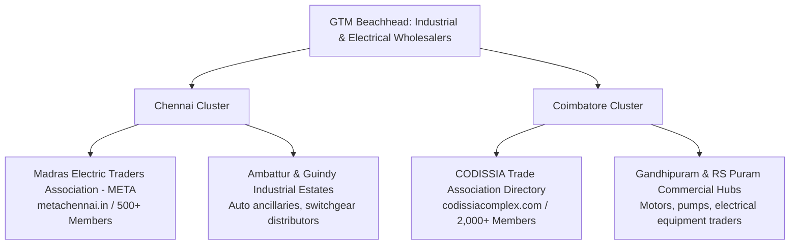
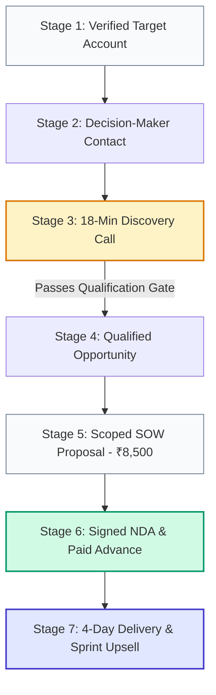
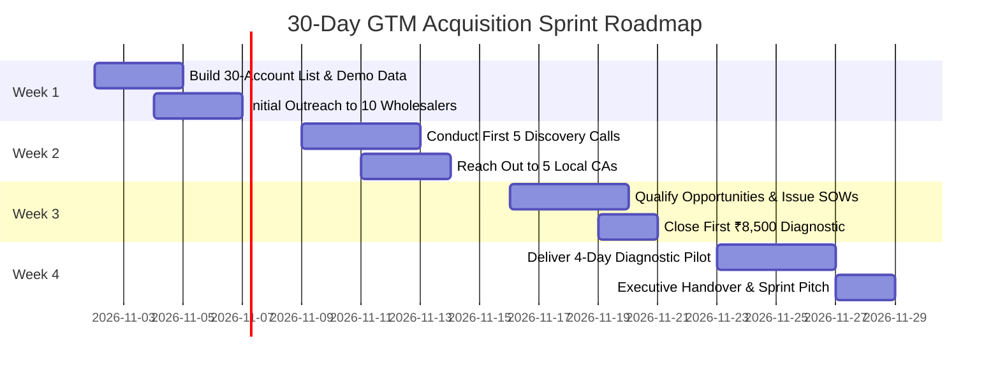

# Go-to-Market Strategy & Execution Playbook
## Business Data Consolidation & Reporting Automation Practice

**Market Focus:** India (Primary Beachhead: Coimbatore & Chennai, Tamil Nadu)  
**Target ICP:** Owner-managed industrial, electrical, and engineering wholesale distributors using TallyPrime & spreadsheets  
**Strategic Methodology:** Problem-Led Outreach · Channel Bounded Testing · Founder-Led Discovery  
**Effective Date:** 27 October 2026  

---

## Executive Summary: The Non-Scalable Validation Play

> [!IMPORTANT]
> **Your immediate goal is not to scale customer acquisition or build an automated funnel. It is to prove that owner-managed industrial and electrical wholesalers in Coimbatore and Chennai have a recurring reconciliation problem, that existing tools do not adequately solve it, and that someone will pay you to diagnose it.**
> 
> The fastest and most capital-efficient path to market proof is **personalized direct outreach** combined with **referral partnerships** (Chartered Accountants and Tally Certified Partners). Both channels allow direct access to key decision-makers with zero paid ad spend and zero reliance on pre-existing social media brand equity.

```
                              [ THE 30-DAY GTM FOUNDATION ]
                                              
                                    Direct Outreach
                               (30 Targeted Wholesalers)
                                           ▲
                                          / \
                                         /   \
                                        /     \
                                       /  GTM  \
                                      / TRIANGLE\
                                     /           \
                                    ▼             ▼
       Trade Associations ◄─────────────────────────► Referral Partners
       (CODISSIA & META Directories)                  (CAs & Tally Partners)
```

---

## 1. Positioning and Value Proposition

### Official Positioning Statement
> **"For owner-managed industrial and electrical distributors using TallyPrime and Excel, I provide a fixed-scope reconciliation diagnostic that identifies and documents unresolved discrepancies between physical dispatches, sales invoices, inventory, and accounting exports.**  
> **Unlike generic dashboard designers or broad ERP integrators, I deliver an audit-ready exception ledger and a repeatable local workflow within four business days—without requiring software changes or cloud data transfer."**

### Lead with Operational Pain, Not Implementation Tools
Never open a cold conversation with *"I build Python scripts," "I automate Excel,"* or *"I design Power BI dashboards."* Wholesale distributors buy business control, cash protection, and staff sanity—not programming languages.

| What the Buyer Cares About (The Friction) | How to Frame Your Value Proposition |
| :--- | :--- |
| **"Goods leave the warehouse, but billing lags behind."** | Reconcile physical delivery challans (DCs) against Tally sales registers to isolate unbilled dispatches. |
| **"Customer returns and credit notes create constant friction."** | Track goods return slips against issued credit notes to eliminate duplicate deductions and unlinked claims. |
| **"Senior accounts staff burn 3 days every month on VLOOKUPs."** | Build a 1-click local ingestion pipeline that highlights unresolved records in seconds. |
| **"Management reports arrive on the 20th of the following month."** | Shorten month-end close by transforming raw exports into an auditable exception summary within 48 hours. |
| **"We cannot risk exposing our customer pricing or margins."** | Guarantee 100% offline, local processing on an air-gapped machine with a legally binding Mutual NDA. |

> [!CAUTION]
> **Never Promise "Guaranteed Revenue Recovery" Upfront:**  
> Avoid claims like *"I will find ₹2,00,000 in lost profits."* An unmatched record is an **operational exception to investigate**, not proof of fraud or financial loss. Promise **100% auditable certainty and complete exception traceability**, not speculative cash windfalls.

---

## 2. Where to Find Buyers: The Primary Clusters & Directories

Focus initial acquisition on a single geographic cluster for the first 30 days (Coimbatore or Chennai). Do not divide attention across regions until conversion mechanics are proven.



### Verified Target Sources & Trade Associations
1. **Madras Electric Traders Association (META) Directory ([metachennai.in](https://www.metachennai.in/members)):**  
   *Target Profile:* Dedicated electrical equipment, cable, and switchgear distributors in Broadway and Parrys, Chennai.  
   *Why It Works:* High transaction velocity, high SKU count, heavy manual dispatch paperwork.
2. **CODISSIA Trade Fair & Member Directory ([codissiacomplex.com](https://www.codissiacomplex.com)):**  
   *Target Profile:* Engineering spares, industrial hardware, electric motor, and pump distributors in Coimbatore.  
   *Why It Works:* Owner-managed businesses with 10–50 employees operating on TallyPrime and shadow Excel trackers.
3. **Indian Electrical & Electronics Manufacturers’ Association (IEEMA) ([ieema.org](https://ieema.org/member-directory/)):**  
   *Target Profile:* Registered electrical traders and authorized distributor members.  
   *Why It Works:* Mid-sized firms with multi-brand distribution rights (L&T, Schneider, Polycab) facing heavy vendor rebate reconciliation issues.

---

## 3. Channel Comparison Matrix & Initial Focus

| Acquisition Channel | Direct Cost | Time to Signal | Scalability | Strategic Recommendation |
| :--- | :---: | :---: | :---: | :--- |
| **Direct Founder Outreach (Calls/Visits)** | **Low (<₹3,000)** | **1–3 Weeks** | Low | **Priority 1: Start here.** Fastest path to unfiltered customer discovery. |
| **Local Referral Introductions** | **Zero** | **1–2 Weeks** | Low | **Priority 1: Leverage immediately.** Borrow trust from business networks. |
| **CA & Tally Partner Alliances** | **Low (<₹2,000)** | **2–4 Weeks** | Moderate | **Priority 2: Run in parallel.** CAs provide pre-qualified audit clients. |
| **In-Person Association Meetings** | **Event fees** | **2–4 Weeks** | Moderate | **Priority 2: Attend selectively.** Network with owners at CODISSIA/META meets. |
| **Organic LinkedIn Prospecting** | **Zero** | **3–6 Weeks** | Moderate | **Priority 3: Secondary.** Target Finance Controllers and Operations Heads. |
| **Content Marketing & SEO** | **Time-heavy** | **3–6 Months** | High | **Defer.** Too slow for early-stage validation. |
| **Paid Ads (Google / Meta / LinkedIn)** | **High** | **Uncertain** | High | **Strictly Defer.** Never spend on ads before validating messaging organically. |

---

## 4. High-Converting Messaging Scripts & Objection Handling

### Touchpoint 1: Cold Discovery Invitation (Phone / WhatsApp / Email)
Use a peer-to-peer research frame. Never pitch automation on the first touch:

```
Subject: Research: Tally & warehouse dispatch reconciliation in Coimbatore

Hello [Name],

I am conducting field research on how electrical and industrial distributors in [Coimbatore/Chennai] manage reconciliation between their Tally sales accounts and warehouse dispatch registers.

I am specifically studying workflows where staff still manually cross-check delivery challans, customer returns, or transporter LRs against final Tally sales invoices.

I am not selling accounting software or ERP overhauls. I am trying to understand:
1. How your accounts team handles this month-end cross-check today.
2. Where, if anywhere, unbilled dispatches or timing discrepancies typically occur.

Would you be open to a brief 15-minute conversation this week? If this is already fully automated in your setup, no problem at all.

Regards,
[Your Name]
[Your Phone Number]
```

---

### Touchpoint 2: Post-Discovery Diagnostic Proposal
Send this only after the owner or finance head has confirmed a specific, recurring reconciliation bottleneck:

```
Subject: Proposed Scope: 4-Day Reconciliation Diagnostic for [Company Name]

Hello [Name],

Thank you for walking me through your month-end process yesterday. 

Based on our discussion, the key bottleneck is verifying that all physical delivery challans from your warehouse tie out cleanly to sales invoices in Tally without unbilled dispatches slipping through.

I can conduct a fixed-scope Reconciliation Diagnostic to audit this exact workflow for [Month/Quarter]:
• Inputs: Your Tally Sales Register export + Warehouse Dispatch Excel log (up to 100k combined rows).
• Turnaround: 4 business days from receipt of clean files.
• Deliverables: A complete Excel Exception Register (source references for every unbilled or mismatched challan), an Executive Summary Report, and a 30-minute handover session.
• Fee: ₹8,500 + GST (50% upfront, 50% upon delivery).
• Data Security: 100% offline, local processing under our signed Mutual NDA.

If you decide to automate this pipeline permanently within 14 days, the entire ₹8,500 fee is credited directly toward implementation.

Would you like me to send over our standard 1-page SOW and NDA for review?

Regards,
[Your Name]
```

---

### The 6 Critical Objections & Field Responses

| Objection | Underlying Buyer Hesitation | High-Converting Response Script |
| :--- | :--- | :--- |
| **"Tally already does this."** | Believes ERP handles all internal checks. | *"Tally handles your master accounts and bank rec brilliantly. But when goods leave the warehouse on a manual Delivery Challan or transporter LR, Tally cannot know if a challan went unbilled unless someone manually cross-checks it. That cross-system gap is what we audit."* |
| **"My staff already handles it."** | Fears outside intervention or high cost. | *"Your accounts team does a great job. The real question is: do you want them spending 3 full days every month doing manual VLOOKUPs, or would you prefer an automated check so they can focus on debt collection and vendor margins?"* |
| **"Send me your company profile."** | Polite brush-off; lacks context. | *"I'd be glad to. Rather than sending a generic company deck, I'll send our 1-page synthetic demo report showing the exact format of the exception register we produce. Which email should I send it to?"* |
| **"₹8,500 is too expensive."** | Unclear ROI or low urgency. | *"Understood. We can reduce the scope to audit just your top 15 customer accounts for last month at ₹5,000, or we can credit the entire ₹8,500 directly toward our implementation sprint if you decide to automate the workflow."* |
| **"We cannot share financial data."** | Fear of competitive pricing leak. | *"We take confidentiality seriously. We sign a legally binding Mutual NDA prior to intake. All processing is executed 100% locally on an offline machine—zero cloud AI or external APIs—and raw files are permanently purged 14 days post-handover."* |
| **"Can you guarantee savings?"** | Expects contingency or cash bounty. | *"We do not guarantee financial leakage because your operations may be running cleanly. What we guarantee is 100% auditable certainty: every single dispatch will either tie out to an invoice or be documented with exact source references."* |

---

## 5. The 7-Stage Sales Funnel & Qualification Gates



### The Hard Qualification Gate
Never issue a written proposal unless the prospect passes all five criteria:
1. **Specific Incident:** Can describe an actual recent discrepancy or billing delay.
2. **Monthly Recurrence:** The process repeats at least once every month.
3. **Data Availability:** Source data exists in digital format (Excel, CSV, Tally XML) with at least one common identifier (Challan No, PO No, Invoice Ref).
4. **Authority:** The conversation includes the person who can sign a ₹10,000 cheque or bank transfer.
5. **Timeline:** The business is willing to provide test files within 7 calendar days.

---

## 6. Funnel Modeling & Acquisition Cost (First 30 Days)

### The 30-Day Conversion Funnel Targets

| Funnel Stage | 30-Day Target Volume | Conversion Rate Assumption | Metric Purpose |
| :--- | :---: | :---: | :--- |
| **1. Target Accounts Researched** | 50 Accounts | 100% | Pre-qualified via CODISSIA/META directories. |
| **2. Decision-Makers Reached** | 35 Contacts | 70% | Direct phone, verified mobile, or warm intro. |
| **3. Substantive Replies Received** | 14 Replies | 40% of reached | Prospect confirms or denies reconciliation pain. |
| **4. Discovery Interviews Held** | 10 Interviews | 71% of replies | 18-minute structured *Mom Test* session. |
| **5. Qualified Opportunities** | 4 Opportunities | 40% of interviews | Passes all 5 qualification criteria. |
| **6. Scoped SOWs Presented** | 3 Proposals | 75% of qualified | Formal 1-page diagnostic SOW issued. |
| **7. Paid Diagnostic Closed** | **1–2 Paid Clients** | **33%–50% of proposals** | **Cleared ₹8,500 bank advance payment.** |

---

### Cash CAC vs. Economic CAC Formulations

$$\text{Cash CAC} = \frac{\text{Out-of-Pocket Cash Spend}}{\text{New Paying Clients}} = \frac{₹3,500 \text{ (Travel + Phone + Admin)}}{1 \text{ Paid Client}} = \mathbf{₹3,500}$$

$$\text{Economic CAC} = \frac{\text{Cash Spend} + \text{Valued Prospecting Time}}{\text{New Paying Clients}} = \frac{₹3,500 + (25 \text{ hrs} \times ₹500/\text{hr})}{1 \text{ Paid Client}} = \mathbf{₹16,000}$$

* **Takeaway:** At ₹8,500 revenue, the first diagnostic operates at an economic loss if factoring in 25 hours of founder prospecting time. **However, this is expected during market validation.** The economic model turns highly profitable once:
  1. The client upgrades to the **₹35,000 Implementation Sprint** (LTV expands to ₹43,500 against ₹16,000 CAC).
  2. Referral partners (CAs) begin sending pre-qualified leads, reducing prospecting hours from 25 to 3 hours per client.

---

## 7. Weekly Review Cadence & Operating KPIs

Dedicate 45 minutes every Friday evening to review these operational metrics:

```
┌────────────────────────────────────────────────────────────────────────────────────────┐
│                                WEEKLY KPI REVIEW DASHBOARD                             │
├───────────────────────────────┬────────────────────────────┬───────────────────────────┤
│ METRIC                        │ WEEKLY TARGET              │ DIAGNOSTIC SIGNAL         │
├───────────────────────────────┼────────────────────────────┼───────────────────────────┤
│ New Researched Accounts Added │ 10 Accounts                │ List velocity healthy     │
│ Decision-Makers Reached       │ 8 Contacts                 │ Outreach effectiveness    │
│ Discovery Interviews Held     │ 2–3 Completed              │ Problem resonance rate    │
│ SOW Proposals Sent            │ 1 Proposal                 │ Pipeline qualification    │
│ Cleared Cash Payments         │ ₹4,250 – ₹8,500            │ Ultimate market truth     │
│ Total Prospecting Hours       │ <6 Hours / Week            │ Acquisition efficiency    │
└───────────────────────────────┴────────────────────────────┴───────────────────────────┘
```

### The 5 Friday Retrospective Questions
1. *Which prospect type articulated the sharpest operational pain this week?*
2. *What was the single most common objection heard from owners?*
3. *Did any prospect share sample data, and was the schema structured enough to parse?*
4. *How many hours were spent on non-revenue prospecting vs. technical delivery?*
5. *What single variable in the outreach script needs to change for next Monday?*

---

## 8. The 30-Day Day-by-Day Execution Roadmap



* **Week 1 (Days 1–7): List Building & Showcase Prep**  
  Extract 30 verified distributor leads from META/CODISSIA directories. Finalize the synthetic demonstration spreadsheet showing unbilled dispatch challans.
* **Week 2 (Days 8–14): Problem Discovery Sprint**  
  Execute 15 phone/in-person touches. Complete 4–6 *Mom Test* discovery calls. Identify the dominant reconciliation bottleneck (e.g., *Challan vs. Invoice*).
* **Week 3 (Days 15–21): The Scoped Offer Sprint**  
  Issue the ₹8,500 diagnostic proposal to the 2 strongest qualified prospects. Follow up on data access and legal NDA sign-offs.
* **Week 4 (Days 22–30): Pilot Delivery & Upsell**  
  Ingest raw files for Client A. Execute data cleaning and matching pipeline. Deliver the findings report on Day 4. Pitch the ₹35,000 Implementation Sprint using the 100% fee credit mechanism.

---

## 9. Diagnosing Channel Failures & Stopping Rules

Do not abandon an outreach channel prematurely, but do not fund a dead channel indefinitely:

| Observed Symptom | Underlying Failure Mode | Corrective Action / Pivot Rule |
| :--- | :--- | :--- |
| **$<10\%$ response rate after 20 contacts** | Wrong contact role, weak subject line, or cold email blocked. | Switch immediately to direct phone calls or in-person visits to Gandhipuram/Parrys trade clusters. |
| **Prospects take calls but report zero pain** | Target segment has already solved this in Tally, or volume is too small. | Disqualify micro-distributors ($<10$ employees); target higher-volume firms ($>25$ employees). |
| **Prospects acknowledge pain but refuse to book calls** | Low urgency; perceived as sales pitch rather than peer research. | Shorten message; frame as a 10-minute research inquiry on regional Tally practices. |
| **Prospects love the diagnostic but refuse to pay ₹8,500** | Lack of perceived financial consequence or lack of trust. | Offer a single-file, 1-month sanity check for ₹5,000, or require warm introduction from their CA. |
| **Partner CAs fail to send referrals** | Partner fears client liability or sees you as software competition. | Clarify that you operate as a technical data engineer, not a tax advisor; offer to co-brand findings. |

---

## 10. Post-Day-30 Strategic Evaluation Framework

At Day 30, evaluate empirical evidence against these three explicit paths:

1. **PATH A: PROCEED (Validated Demand):**  
   *Condition:* $\ge$1 client paid ₹8,500; delivery took $\le$12 hours; client verified actionable leakage and requested an implementation quote.  
   *Action:* Formalize the Python pipeline, expand outreach to 50 new wholesalers, and onboard 2 CA referral partners.
2. **PATH B: ITERATE (Pain Confirmed, Packaging Flawed):**  
   *Condition:* 6+ owners confirmed unbilled dispatches, but resisted the 4-day timeline or data access terms.  
   *Action:* Offer an on-premise, 1-day guided audit or narrow the scope to an ₹5,000 single-ledger reconciliation.
3. **PATH C: PIVOT (Zero Commercial Pain):**  
   *Condition:* 15 discovery calls confirm that TallyPrime's built-in features and internal clerks handle dispatches adequately.  
   *Action:* Cease distributor outreach. Pivot the reconciliation engine to multi-channel e-commerce (Amazon/Flipkart settlement reconciliation) or hospital vendor reconciliation.
