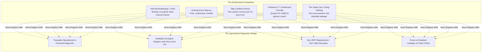
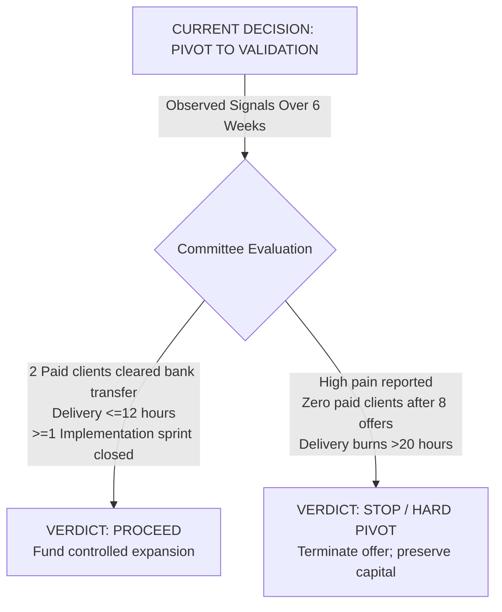

# Independent Startup Investment Committee Review & Pivot Mandate
## Business Data Consolidation & Reporting Automation Practice

**Proposed Launch Market:** Coimbatore & Chennai, Tamil Nadu, India  
**Reviewing Body:** Independent Seed Investment Committee & Enterprise Risk Panel  
**Review Date:** 27 October 2026  
**Planning Horizon:** 6-Week Validation Gate $\rightarrow$ 24-Month Risk Horizon  
**Investment Decision:** **PIVOT — From Broad Service Concept to a Narrowly Defined Paid-Pilot Validation Practice**  

---

## Executive Investment Verdict: PIVOT TO VALIDATION

> [!CAUTION]
> **The investment committee refuses approval for a full software product build, SaaS platform development, or scale-up marketing expenditure today.**  
> The committee authorizes a **strictly capped, time-limited validation effort (₹15,000 maximum cash ceiling over 6 weeks)** focused exclusively on one customer segment, one reconciliation workflow, and verifiable paid customer commitments.
> 
> **This is NOT a decision to abandon the business.** It is an executive mandate to change what you do next: **Pivot from planning an unvalidated enterprise to generating empirical buyer evidence.**

```
                              [ THE COMMITTEE'S MANDATE ]
                                              
    CURRENT STATE: Unvalidated Broad Concept
    • Extensive desk research, TAM models, pricing matrices, and GTM plans.
    • 0 customer interviews reported · 0 paid pilots · 0 verified unit economics.
                          │
                          ▼
    DECISION: PIVOT (Do not proceed to scale; do not terminate)
    • Freeze all software development, branding, entity incorporation, and ads.
    • Shift 100% of bandwidth to empirical customer discovery & paid pilots.
                          │
                          ▼
    TARGET STATE: Validated Specialist Niche
    • 1 narrow customer segment: Owner-managed industrial wholesalers in Coimbatore.
    • 1 painful workflow: Dispatch Challans vs. Tally Sales Registers.
    • 1 entry offer: ₹8,500 fixed-scope diagnostic with 4-day delivery.
    • Proof threshold: 2 independent paying clients clearing bank transfer.
```

### Committee Summary: Strengths vs. Scale Blockers

```
┌────────────────────────────────────────────────────────────────────────────────────────┐
│                                 THE INVESTMENT BALANCE SHEET                           │
├─────────────────────────────────────────────────────────┬──────────────────────────────┤
│ WHAT SUPPORTS THE IDEA                                  │ WHAT PREVENTS SCALE APPROVAL │
├─────────────────────────────────────────────────────────┼──────────────────────────────┤
│ 1. A specific, plausible operational problem.           │ 1. Zero documented customer  │
│ 2. Delivers value immediately using existing tools      │    interviews or verified    │
│    (Python/pandas, Excel, Power Query).                 │    pain incidents.           │
│ 3. Low initial capital requirements; tests demand       │ 2. Zero confirmed paid pilots│
│    before writing software code.                        │    or sales conversions.     │
│ 4. Clear commercial bridge to implementation revenue    │ 3. Untested delivery hours & │
│    if the diagnostic uncovers actionable leakage.       │    reconciliation accuracy.  │
│ 5. Specific industrial cluster beachhead (Coimbatore).  │ 4. Unverified real CAC.      │
└─────────────────────────────────────────────────────────┴──────────────────────────────┘
```

> **What the Committee Would Fund:**  
> A tightly capped validation experiment—not a SaaS build—with a defined customer profile, a specific reconciliation workflow, a real paid offer, measured delivery economics, and explicit stop-loss conditions.

---

## 1. Evidence Assessment Across 11 Investment Dimensions

Evidential grading standard applied:
* **Strong:** Directly supported by relevant, verified empirical evidence.
* **Moderate:** Supported by some credible secondary data or technical logic; important empirical gaps remain.
* **Weak:** Plausible but mainly indirect, modeled, or assumption-based.
* **Missing:** No decision-grade evidence available in the review corpus.

| # | Dimension | Evidence Rating | Investment Committee Assessment |
| :-: | :--- | :---: | :--- |
| **1** | **Problem Severity & Demand** | **Weak** | The operational reconciliation gap is plausible, but no documented customer discovery interviews, quantified clerical drag, or verified financial leakages exist in the corpus. |
| **2** | **Customer Definition & Accessibility** | **Moderate** | Owner-managed industrial/electrical wholesalers in Coimbatore/Chennai are well-defined. However, practical access to actual economic buyers and their willingness to share data is unproven. |
| **3** | **Market Size & Attainable Share** | **Missing** | Directory membership counts (e.g., CODISSIA, META) provide prospect lists, not market demand. No validated count of target-fit businesses or attainable SOM exists. |
| **4** | **Competition & Defensibility** | **Moderate** | Competitor pricing and alternatives (Excel, Tally partners, local IT firms) are visible. A distinctive, durable moat for this practice has not been demonstrated. |
| **5** | **Solution Feasibility & Adoption** | **Moderate** | Python/pandas matching is technically sound. Real customer schema heterogeneity, edge-case accuracy, and customer adoption friction remain untested. |
| **6** | **Willingness to Pay & Sales Evidence** | **Missing** | Pricing hypotheses exist (₹8,500 diagnostic, ₹35,000 sprint), but zero paid pilots, signed contracts, or cleared bank transfers have been reported. |
| **7** | **Business Model & Unit Economics** | **Weak** | A transparent financial model exists, but profitability depends on unverified delivery labor ($\le$10 hrs), zero rework, and unmeasured acquisition costs. |
| **8** | **Acquisition Strategy & Sales Cycle** | **Weak** | Direct outreach and accounting referral paths are proposed. There are zero measured conversion rates, response rates, or observed sales cycles. |
| **9** | **Capital, Working Capital & Runway** | **Moderate** | A low-overhead service-first structure is viable. However, founder personal runway, household cash floor, and collection timing are unconfirmed. |
| **10**| **Legal, Regulatory & Operational Readiness** | **Moderate** | Key compliance areas (DPDPA 2023, Section 44ADA, GST, NDAs) are mapped, but actual legal agreements and air-gapped processing remain to be executed with live clients. |
| **11**| **Critical Assumptions & Downside Risks** | **Strong** | The enterprise risk register and pre-mortem are exceptionally thorough. **Note:** This represents *strong risk analysis*, not *market validation*. |

> [!CRITICAL]
> **Committee Heuristic:**  
> A missing willingness-to-pay signal cannot be compensated for by strong Python coding skills or a detailed financial spreadsheet. Evidence must be bought in the real world.

---

## 2. Competitive Reality: What Actually Makes This Business Different?

The service does not merely compete with other automation consultancies. Its primary competitors are **already entrenched inside the distributor's business**:



### Competitor Landscape & Public Pricing Benchmarks

Publicly advertised competitors demonstrate that generic reporting is already commoditized:
* **HVRPL:** Advertises Excel/report automation from **₹12,000**, data pipelines from **₹40,000**, and maintenance retainers from **₹3,000/month** ([hvrpl.in](https://hvrpl.in)).
* **FinSyncora:** Advertises automated Tally-to-Google-Sheets sync from **₹15,000** and management reporting dashboards from **₹10,000**.
* **CommandDeck:** Advertises custom Google Sheets dashboards from **₹4,999** and maintenance from **₹1,999/month**.

### Your Viable Differentiation Opening
You cannot win by pitching *"I automate Excel"* or *"I build dashboards."*  
Your only defensible positioning is:
> **"A fixed-scope reconciliation diagnostic that deterministically links warehouse dispatches to accounting invoices, proves unbilled goods with source-row audit logs, and quantifies profit leakage—without touching your Tally configuration."**

---

## 3. Market Opportunity Reality Check: Directories $\neq$ Market Size

A defensible market opportunity requires three verified variables:
$$\text{Annual Addressable Revenue} = \text{Qualified Target Accounts} \times \text{Observed Purchase Rate} \times \text{Observed Annual Spend}$$

```
┌────────────────────────────────────────────────────────────────────────────────────────┐
│                         THE BOTTOM-UP FUNNEL FALLACY                                   │
├────────────────────────────────────────────────────────────────────────────────────────┤
│ 1. CODISSIA Directory: 6,600+ MSME Members in Coimbatore                               │
│    └── Fallacy: Most are job-work machine shops, foundries, or tiny fabrication units. │
│ 2. META Directory: 1,800+ Electrical Traders in Chennai                                │
│    └── Fallacy: Over 70% are micro-retailers without separate dispatch workflows.      │
│ 3. Realistic Initial Qualified Beachhead Pool: ~100–150 Regional Distributors          │
│    └── If 5% buy an ₹8,500 diagnostic: 5–7 Clients = ₹42,500–₹59,500 Revenue.          │
└────────────────────────────────────────────────────────────────────────────────────────┘
```

> [!WARNING]
> Do not cite TAM figures of ₹9.5–₹141.9 crore or SAM figures of ₹1.9–₹56.8 crore to justify software development. For a solo consultancy, the first-year revenue ceiling is dictated by **founder delivery capacity (max 2 diagnostics/week = 8/month = ₹68,000/month)**, not statistical TAM models.

---

## 4. Financial Assessment & Delivery Labor Realities

The base-case financial model assumptions must be treated as **untested hypotheses**:

| Financial Parameter | Proposed Planning Hypothesis | Investment Committee Audit Status |
| :--- | :---: | :--- |
| **Diagnostic Fee** | ₹8,500 | Unvalidated price hypothesis |
| **Implementation Sprint** | ₹35,000 | Unvalidated price hypothesis |
| **Monthly Retainer** | ₹6,000 | Retention demand unproven |
| **Diagnostic Delivery Labor** | 10 Hours | Untested on messy real-world files |
| **Implementation Labor** | 35 Hours | Untested |
| **Founder Labor Allocation** | ₹600/Hour | Internal accounting assumption |
| **Cash Acquisition Cost (CAC)** | ₹1,000 | Zero observed customer conversion data |

### The Real Unit Economics of an ₹8,500 Diagnostic

Evaluating the project with founder labor valued at a conservative professional rate:
* Gross Client Fee: **₹8,500**
* Founder Labor (10 hours $\times$ ₹600/hr): **−₹6,000**
* Direct Project Expenses (Travel, Comms): **−₹500**
* Rework & Clarification Allowance (2%): **−₹170**
* **Net Contribution Before CAC:** **₹1,830**
* Estimated Cash Acquisition Cost (CAC): **−₹1,000**
* **Net Retained Cash Margin:** **₹830**

> [!CAUTION]
> **The Razor-Thin Margin Warning:**  
> A net margin of **₹830 per diagnostic** leaves zero room for messy file formats, extended client meetings, scope creep, or payment delays.  
> If delivery labor expands from **10 hours to 15 hours**, the engagement yields **−₹1,170 in economic loss**.

### The Personal Runway Formula

Before spending validation funds, the founder must formally calculate:
$$\text{Available Validation Cash} = \text{Total Liquid Savings} - \text{Essential Personal Living Obligations (6 Mos)} - \text{Emergency Reserves}$$

If this result is below **₹15,000**, use the lower amount. Under no circumstances should credit cards, debt, or emergency family funds be deployed for validation.

---

## 5. The Concise Conditional Business Plan

This is the only operating plan authorized for execution during the validation phase:

```
┌────────────────────────────────────────────────────────────────────────────────────────┐
│                     CONDITIONAL BUSINESS PLAN: SPECIALIST DIAGNOSTIC                   │
├─────────────────────┬──────────────────────────────────────────────────────────────────┤
│ TARGET BEACHHEAD    │ Owner-managed electrical & industrial wholesale distributors in  │
│                     │ Coimbatore/Chennai (10–75 FTEs) using TallyPrime & Excel.        │
├─────────────────────┼──────────────────────────────────────────────────────────────────┤
│ CORE PROBLEM        │ Unbilled dispatches, delayed invoicing, and unaccounted customer │
│                     │ returns creating month-end reconciliation lag and cash leakage.  │
├─────────────────────┼──────────────────────────────────────────────────────────────────┤
│ ENTRY PRODUCT       │ 4-Day Fixed-Scope Reconciliation Diagnostic (1 workflow, up to   │
│                     │ 2 files / 100,000 rows, 100% auditable exception register).     │
├─────────────────────┼──────────────────────────────────────────────────────────────────┤
│ PRICING STRUCTURE   │ • Diagnostic: ₹8,500 + GST (100% upfront advance)                │
│                     │ • Implementation Sprint: ₹25,000–₹50,000 (separately scoped)     │
│                     │ • Monthly Retainer: ₹4,000–₹8,000/mo (only if recurring need)    │
├─────────────────────┼──────────────────────────────────────────────────────────────────┤
│ ACQUISITION CHANNELS│ 1. Targeted direct outreach (30 META/CODISSIA leads)             │
│                     │ 2. Trusted referral alliances (10 practicing CAs & Tally partners)│
├─────────────────────┼──────────────────────────────────────────────────────────────────┤
│ DELIVERY STACK      │ Local air-gapped Python/pandas scripts, Power Query, BitLocker   │
│                     │ encrypted NVMe storage; zero third-party cloud AI processing.    │
├─────────────────────┼──────────────────────────────────────────────────────────────────┤
│ STOP-LOSS LIMITS    │ • Max Cash Spend: ₹15,000                                        │
│                     │ • Max Delivery Hours: 12 Hours per Diagnostic                    │
│                     │ • Max Validation Window: 6 Weeks (30-day initial review)         │
└─────────────────────┴──────────────────────────────────────────────────────────────────┘
```

---

## 6. The Three Prioritized Actions (Next 14 Days)

```
  ACTION 1: Problem Discovery           ACTION 2: Paid Diagnostic Offer
  • Interview 8-12 qualified buyers    • Present 1-page SOW @ Rs 8,500
  • Identify last unbilled incident    • Require cleared bank transfer
  • Pass Gate: >=5 confirm acute pain  • Pass Gate: >=1-2 clear payment
                 │                                    │
                 ├────────────────────────────────────┘
                 ▼
  ACTION 3: Pilot Delivery & Hour Audit
  • Deliver in 4 business days
  • Enforce 10-12 hour labor ceiling
  • Pass Gate: 100% traceable exceptions; Net margin > 0
```

### Action 1: Interview 8–12 Qualified Buyers
* **Timeline:** Week 1 (Days 1–7) | **Budget:** ₹0–₹1,000
* **Execution:** Reach out to verified distributors from META Coimbatore. Conduct 20-minute *Mom Test* interviews with owners and chief accountants. Document the exact events, wasted hours, and rupee consequences of their last reconciliation failure.
* **Decision Gate:** If $<5$ interviewees describe a recent, acute reconciliation problem, pivot the target workflow immediately before touching code.

### Action 2: Secure Real Data Access & Present Paid Offer
* **Timeline:** Weeks 2–3 (Days 8–18) | **Budget:** ₹0–₹1,500
* **Execution:** Execute the 1-page NDA from [legal_contract_pack_nda_and_sow.md](file:///c:/Users/sukes/Downloads/business%20plan/legal_contract_pack_nda_and_sow.md). Inspect 3 sample file schemas. Present the formal **₹8,500 Diagnostic SOW** to 5 qualified prospects.
* **Decision Gate:** Seek **two (2) unrelated paying customers**. If zero prospects buy after 8 qualified proposals, audit customer objections; do not build software to compensate.

### Action 3: Deliver Pilot & Measure Real-World Economics
* **Timeline:** Weeks 3–4 (Days 19–28) | **Budget:** Within overall cap
* **Execution:** Deliver the diagnostic within 4 business days. Reconcile control totals. Tag every exception with row IDs. Log every minute of data cleaning, scripting, and meetings. Conduct a 30-minute executive findings walkthrough.
* **Decision Gate:** If direct delivery labor exceeds 15 hours, pause the practice, enforce strict input templates, or re-price to ₹15,000.

---

## 7. Evidence That Will Flip the Committee's Verdict



### Conditions to Upgrade to "PROCEED" (Authorize Expansion)
1. **Verifiable Problem Severity:** $\ge$5 independent distributors describe the same recurring operational mismatch and quantify wasted hours ($\ge$15 hrs/mo).
2. **Paid Conversion:** At least **two (2) unrelated paying clients** clear full bank transfers for the ₹8,500 diagnostic without discounts.
3. **Profitable Delivery:** Diagnostic completed in $\le$12 direct hours with 100% control-total accuracy and zero false matches.
4. **Economic CAC:** Client acquisition cost demonstrated to be less than the gross margin of the engagement.
5. **Follow-On Expansion:** At least one diagnostic client willingly commissions the **₹35,000 Implementation Sprint**.

### Conditions to Mandate "STOP" (Terminate Offering)
1. **Low Operational Urgency:** Distributors confirm that dispatches match invoices cleanly, or existing Tally routines resolve discrepancies adequately.
2. **Zero Commercial Demand:** Zero paying clients after 8 qualified proposals, with objections citing price or lack of need.
3. **Data Access Blockade:** Entrenched accountants or Tally partners refuse to authorize file exports under NDA.
4. **Delivery Labor Quagmire:** Real-world files require $>20$ hours of bespoke data cleaning, resulting in negative hourly returns.
5. **Capital Stop-Loss Breached:** Cumulative cash expenditure reaches ₹15,000 with zero cleared client revenue.

---

## Final Committee Position: Evidence Over Features

> **"Your next investment should buy evidence, not features."**
> 
> You have performed sufficient desk research to structure a disciplined, low-risk experiment. You have not established that a viable business exists.  
> Until paying customers authorize data access and clear bank transfers, additional business plans, branding, and software architecture are liabilities.  
> 
> **Execute the 6-week validation plan. Let empirical customer behavior dictate whether this company deserves to scale.**

---

*Related Documentation:*
* [lean_startup_validation_experiments_guide.md](file:///c:/Users/sukes/Downloads/business%20plan/lean_startup_validation_experiments_guide.md) — 8-Experiment Protocols, Thresholds & 5-Tab Measurement Ledger.
* [startup_pre_mortem_and_risk_register.md](file:///c:/Users/sukes/Downloads/business%20plan/startup_pre_mortem_and_risk_register.md) — 24-Month Failure Simulation, 12-Risk Register & Labor Downside Table.
* [customer_discovery_and_mom_test_playbook.md](file:///c:/Users/sukes/Downloads/business%20plan/customer_discovery_and_mom_test_playbook.md) — 18-Minute Mom Test Protocol.
* [legal_contract_pack_nda_and_sow.md](file:///c:/Users/sukes/Downloads/business%20plan/legal_contract_pack_nda_and_sow.md) — 1-Page Offline NDA & 4-Day SOW Contract.
