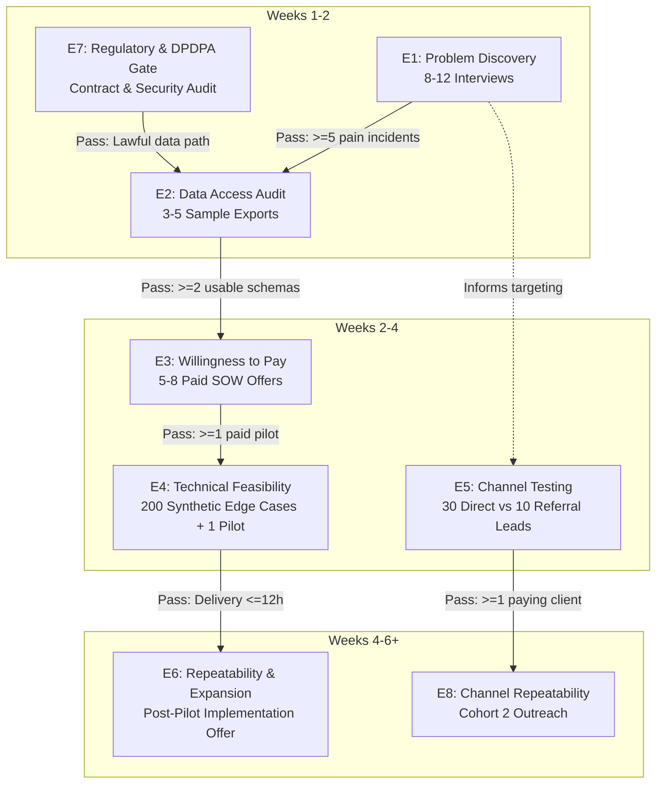

# Lean Startup Validation Plan & Empirical Experiment Guide
## Business Data Consolidation & Reporting Automation Practice

**Market:** Industrial, Electrical, and Engineering Wholesalers & Distributors  
**Target Beachhead:** Coimbatore & Chennai, Tamil Nadu, India  
**Validation Horizon:** 6 Weeks (30 days for initial evidence; 60–90 days for commercial commitment)  
**Budget Ceiling:** ₹15,000 cash allowance (strictly subject to affordability and capital preservation)  
**Methodology:** Concierge Service-as-a-Software (SaaS-less MVP) · *The Mom Test* · Pre-Registered Decision Thresholds  
**Assessment Date:** 27 October 2026  

---

## Executive Decision: The "Service-First" Imperative

> [!IMPORTANT]
> **Do not build a SaaS product, software platform, or client portal yet. Validate a paid, narrowly scoped concierge service first.**
> 
> The current business thesis is plausible but unproven. The riskiest assumptions are that distributors have a sufficiently costly recurring reconciliation problem, will share the relevant financial/operational data with a new provider, and will pay enough for a reliable solution to cover customer acquisition and delivery time.
> 
> The proposed **₹8,500 diagnostic**, **₹25,000–₹50,000 implementation**, and **₹4,000–₹8,000 monthly retainer** are price hypotheses, not established market prices for your exact offering.

```
                              [ THE 6-STAGE VALIDATION SEQUENCE ]
                                              
    ┌────────────────────────────────────────────────────────────────────────┐
    │  STAGE 1: PROBLEM VALIDATION                                           │
    │  Does a recent, consequential, poorly solved problem actually exist?   │
    └──────────────────────────────────┬─────────────────────────────────────┘
                                       │ Pass: >=5/12 confirm recent pain
                                       ▼
    ┌────────────────────────────────────────────────────────────────────────┐
    │  STAGE 2: ACCESS & READINESS                                           │
    │  Can a qualified buyer share usable operational & accounting data?     │
    └──────────────────────────────────┬─────────────────────────────────────┘
                                       │ Pass: >=2 provide usable sample exports
                                       ▼
    ┌────────────────────────────────────────────────────────────────────────┐
    │  STAGE 3: WILLINGNESS TO PAY                                           │
    │  Will a qualified buyer pay ₹8,500 for a fixed-scope diagnostic?        │
    └──────────────────────────────────┬─────────────────────────────────────┘
                                       │ Pass: >=1-2 clients clear bank transfer
                                       ▼
    ┌────────────────────────────────────────────────────────────────────────┐
    │  STAGE 4: TECHNICAL & DELIVERY FEASIBILITY                             │
    │  Can you produce accurate, auditable results within the 10-hr cap?     │
    └──────────────────────────────────┬─────────────────────────────────────┘
                                       │ Pass: Delivery <=12 hrs; 0 false matches
                                       ▼
    ┌────────────────────────────────────────────────────────────────────────┐
    │  STAGE 5: ACQUISITION CHANNEL REPEATABILITY                            │
    │  Can you repeatably find and convert buyers at sustainable CAC?        │
    └──────────────────────────────────┬─────────────────────────────────────┘
                                       │ Pass: >=1 channel yields paying clients
                                       ▼
    ┌────────────────────────────────────────────────────────────────────────┐
    │  STAGE 6: REPEATABILITY & EXPANSION                                    │
    │  Will customers buy follow-on implementation sprints or retainers?     │
    └────────────────────────────────────────────────────────────────────────┘
```

The six-week plan is an **experiment schedule, not a guarantee of product-market fit**. If a critical gate fails, stop or revise the hypothesis rather than progressing automatically.

---

## 1. Prioritized Experiment Backlog (E1 to E8)

Priority is determined by three variables:
1. **Business Impact:** How damaging the assumption would be if proven false ($1 = \text{Low}$, $5 = \text{Fatal}$).
2. **Current Uncertainty:** How little empirical evidence currently supports it ($1 = \text{Known}$, $5 = \text{Pure Assumption}$).
3. **Cost of Learning:** Cash and founder time required to run the test ($1 = \text{Cheap/Fast}$, $5 = \text{Expensive/Slow}$).

| Priority | ID | Experiment Name | Focus Area | Cash Budget | Effort (Hours) | Decision Unlocked |
| :---: | :---: | :--- | :--- | :---: | :---: | :--- |
| **P0** | **E1** | **Problem Validation** | Problem | ₹0–₹1,000 | 8–12 h | Is there a real, painful, recurring problem worth solving? |
| **P0** | **E7** | **Regulatory & Compliance Feasibility** | Compliance | ₹0–₹3,000 | 3–6 h | Can you legally, safely, and securely handle client data? |
| **P0** | **E2** | **Customer Data Access & Readiness** | Data Access | ₹0–₹1,000 | 4–6 h | Can clients legally authorize and export usable source files? |
| **P0** | **E3** | **Willingness-to-Pay Diagnostic Test** | Payment | ₹0–₹1,500 | 5–8 h | Will an independent buyer clear an ₹8,500 payment? |
| **P0** | **E4** | **Technical Feasibility & QA** | Technical | ₹0–₹2,000 | 8–15 h/dataset | Can you deliver accurate, reproducible reports within 10–12 h? |
| **P1** | **E5** | **Acquisition Channel Feasibility** | Distribution | ₹1,000–₹3,000 | 6–10 h | Can you reach decision-makers at an acceptable economic CAC? |
| **P1** | **E6** | **Repeatability & Retainer Expansion** | Retention | Minimal | 2–4 h/client | Does the diagnostic create follow-on implementation demand? |
| **P1** | **E8** | **Acquisition Channel Repeatability** | Scale | ₹1,000–₹3,000 | 8–12 h | Can the winning channel convert a second distinct cohort? |

> [!NOTE]
> Cash budget estimates overlap because customer interviews in E1 directly inform E2 (data access) and E5 (acquisition). The cumulative validation expenditure must not exceed the hard cap of **₹15,000**.

---

## 2. Deep-Dive Experiment Protocols



---

### E1 — Problem Validation (Problem Urgency & Recurrence)

* **Hypothesis:** At least a meaningful subset of owner-managed industrial/electrical wholesalers experiences recurring, consequential mismatches between operational records (dispatch challans, transporter LR notes, warehouse spreadsheets) and accounting records (TallyPrime sales registers), and existing workarounds consume measurable clerical time or cause material revenue leakage.
* **Why It Matters:** Without an urgent, high-priority problem, prospects will compliment the concept but never buy. This test must precede any coding.
* **Existing Evidence & Uncertainty:** We know target distributors use Tally and spreadsheets. However, no verified interviews or documented incidents have established how often mismatches occur, what they cost, or how urgently owners want them fixed.
* **Experiment Design:**
  * *Participants:* 8–12 distinct industrial distributors/wholesalers in Coimbatore and Chennai; prioritize businesses with separate dispatch, sales, collections, or accounts workflows.
  * *Recruitment:* Direct outreach and warm introductions; interview the person who performs the reconciliation and, where possible, the owner/MD who approves spending.
  * *Sample Rationale:* Sufficient to detect patterns across several independent firms without excessive travel or recruitment overhead. Not intended to calculate industry-wide percentage prevalence.
  * *Interview Protocol (*The Mom Test*):*
    1. *"When was the last time you had a mismatch between goods dispatched and invoices raised?"*
    2. *"What triggered you to investigate, and what exact records did you have to cross-check?"*
    3. *"Who performed the investigation, and how many hours did it consume?"*
    4. *"What was the tangible outcome? Were unbilled goods discovered, delayed payments resolved, or did you write off the difference?"*
    5. *"What existing Tally reports, Excel macros, or accountants currently handle this?"*
    6. *"Have you ever paid an external consultant or IT vendor to solve this before?"*
* **Pre-Registered Decision Thresholds:**
  * **Success ($\ge$5 of 12):** At least 5 of 8–12 interviewees describe a specific, recent reconciliation failure, and at least 3 provide credible evidence of material clerical drag ($\ge$15 hrs/month) or financial leakage.
  * **Failure ($\le$2 of 12):** Two or fewer describe a recent consequential problem, and the majority state existing internal routines are entirely adequate.
  * **Inconclusive (3–4 of 12):** Conduct 4–6 targeted follow-up interviews with a refined sub-segment (e.g., multi-branch distributors).
* **Bias Controls:** Never pitch the solution upfront. Do not count multiple employees from the same company as independent confirmations. Avoid leading questions like *"Wouldn't it be great to automate your Excel sheets?"*
* **Action on Pass:** Select the single most recurring, painful workflow (e.g., Unbilled Dispatch Challans) and advance to E7 and E2.

---

### E7 — Regulatory & Compliance Feasibility (P0 Launch Gate)

* **Hypothesis:** The practice can legally, safely, and economically deliver an offline reconciliation diagnostic within Indian jurisdiction (Tamil Nadu) using standard contractual protections, tax compliance, and local data-governance safeguards.
* **Why It Matters:** Handling commercial invoices and customer master files carries confidentiality and regulatory obligations. Customer procurement friction or privacy non-compliance can stall sales.
* **Existing Evidence & Uncertainty:** Software services do not require physical manufacturing licenses, but GST registration thresholds, Section 44ADA eligibility, DPDPA 2023 applicability, and NDA terms must be verified.
* **Experiment Design:**
  1. Audit operating setup with a qualified Chartered Accountant (CA): Confirm Sole Proprietorship vs. LLP structure, MSME Udyam registration, and GST composition/regular threshold.
  2. Implement the standardized legal pack from [legal_contract_pack_nda_and_sow.md](file:///c:/Users/sukes/Downloads/business%20plan/legal_contract_pack_nda_and_sow.md): 1-page offline NDA, 4-Day SOW, and Limitation of Liability (capped at fees paid).
  3. Map the data architecture: 100% air-gapped local processing (BitLocker-encrypted NVMe drive), zero third-party cloud uploads, zero public AI model inputs, and automated 30-day cryptographic data purging (`shred -u`).
* **Pre-Registered Decision Thresholds:**
  * **Success:** Documented, affordable operating structure established; clean 1-page NDA and SOW approved; clear data-flow policy verified.
  * **Failure:** Prospective clients require ISO 27001 certification, heavy enterprise cyber liability insurance, or legal terms that make low-ticket diagnostics unviable.
  * **Inconclusive:** CA raises specific tax-treatment questions regarding inter-state supply (Tamil Nadu to other states); resolve before crossing state lines.
* **Action on Pass:** Authorize live client intake under signed NDA and SOW.

---

### E2 — Customer Data Access & Readiness

* **Hypothesis:** Qualified prospects can legally authorize access to a minimal set of operational and accounting exports, and those exports contain sufficient identifiers (DC numbers, dates, SKU codes, quantities) to execute automated reconciliation.
* **Why It Matters:** A customer may experience severe pain but be blocked by internal IT friction, restrictive accounting software locks, or unreadable, handwritten records.
* **Existing Evidence & Uncertainty:** The diagnostic relies on standard Tally XML/Excel/CSV exports. Real-world client file cleanliness, missing join keys, and export authorization paths remain unverified.
* **Experiment Design:**
  * *Participants:* 3–5 qualified prospects from E1 who confirmed acute reconciliation pain.
  * *Protocol:* Request a structured 20-minute data-readiness walkthrough under signed NDA. Where authorized, obtain a historical closed-month export sample (e.g., last month's Dispatch Register and Tally Sales Register).
  * *Inspection Checklist:* File format (.xlsx, .csv), row volume, presence of common join keys (Challan No, PO No, Invoice No), date format consistency, duplicate rate, and percentage of nulls in primary fields.
* **Pre-Registered Decision Thresholds:**
  * **Success ($\ge$3 of 5):** At least 3 prospects can legitimately authorize data access, and at least 2 supply sample exports with $<5\%$ corrupted or missing join keys.
  * **Failure ($<2$ of 5):** Prospects cannot secure permission from owners/accountants, or exports lack join keys and require manual data re-entry.
  * **Inconclusive:** Owner approves in principle, but the external CA or internal clerk refuses or delays providing exports.
* **Bias Controls:** Do not confuse receiving a file with receiving a usable file. Verify row counts and join keys before marking complete.
* **Action on Pass:** Use sample files to configure the matching pipeline and proceed to E3.

---

### E3 — Willingness-to-Pay Diagnostic Test (Commercial Gate)

* **Hypothesis:** Qualified business owners will pay **₹8,500 + GST** for a fixed-scope diagnostic that produces an auditable exception register and executive findings report, rather than demanding free analysis or relying solely on their CA.
* **Why It Matters:** Cleared bank payments are the only valid proof of commercial demand. Polite compliments, survey responses, and LOIs carry zero predictive validity.
* **Existing Evidence & Uncertainty:** ₹8,500 is a planned price benchmark based on financial feasibility modeling. It has never been tested against live buyer resistance.
* **Experiment Design:**
  * Present a written, fixed-scope proposal to 5–8 qualified prospects who completed E1 and E2.
  * *Contractual Scope:* One workflow (e.g., Dispatch vs. Invoice), up to 2 workbooks, combined ceiling of 100,000 rows, 4-business-day delivery, 100% upfront payment, 30-minute executive handover walkthrough.
  * Enforce standard payment terms: NEFT/RTGS bank transfer prior to data ingestion.
* **Pre-Registered Decision Thresholds:**
  * **Success ($\ge$1–2 of 5–8):** At least 1 (target 2) independent business owner signs the SOW and clears full payment without discounts or unpaid scope expansion.
  * **Failure (0 of 8):** Zero paying clients after 8 qualified proposals where the decision-maker had budget authority and clearly understood the deliverable.
  * **Inconclusive (1 payment with friction):** 1 client pays, but required 4+ in-person visits or renegotiated price. Re-examine sales messaging.
* **Bias Controls:** Never offer discounts to friends or family to manufacture a "win." Record every stated objection verbatim in the outreach log.
* **Action on Pass:** Deliver the pilot immediately and measure delivery economics in E4.

---

### E4 — Technical Feasibility & Delivery Economics

* **Hypothesis:** The reconciliation workflow can produce 100% auditable, accurate results across diverse client exports within **10–12 total direct hours**, maintaining an effective realization rate $\ge$**₹700–₹850/hour**.
* **Why It Matters:** If messy exports force 25 hours of manual data wrangling per project, the diagnostic becomes an unsustainable, loss-making freelance trap.
* **Existing Evidence & Uncertainty:** Core Python/pandas matching logic is straightforward, but real-world edge cases (split dispatches, partial billings, retroactive returns, altered invoice numbering) can derail delivery timelines.
* **Experiment Design:**
  1. *Synthetic Stress Test:* Run the pipeline against a synthetic test suite of **200 engineered edge cases** (duplicate invoice numbers, whitespace discrepancies, date format inversions, rate variances). Verify 100% deterministic detection.
  2. *Live Paid Pilot:* Ingest real client exports. Preserve raw source copies. Execute automated cleaning, deterministic join logic, and control-total reconciliation.
  3. *Hour Tracking:* Log all minutes spent across 6 categories: Intake & Schema Check, Cleaning & Prep, Script Configuration, Quality Assurance & Control Totals, Executive Report Writing, and Handover Meeting.
* **Pre-Registered Decision Thresholds:**

| Performance Metric | Success Target | Failure Threshold | Action if Failed |
| :--- | :---: | :---: | :--- |
| **Total Delivery Labor** | $\le$10–12 Hours | $>$15–20 Hours | Re-scope deliverable or enforce strict intake schemas |
| **Audit Traceability** | 100% Exceptions linked to row IDs | Any unlinked / orphan exception | Re-engineer pipeline; suspend delivery |
| **Control Total Accuracy** | 0% Unexplained variance | Any unexplained discrepancy | Audit intake; rerun control totals |
| **False Positive Rate** | $<5\%$ of flagged exceptions | $>15\%$ rejected by client as normal | Tighten matching rules; distinguish probable from exact |
| **Script Reuse** | $\ge$60% code reused for Client B | $<30\%$ code reuse across clients | Standardize modular ETL functions |

* **Bias Controls:** Do not stop the timer during frustrating data-cleaning steps. Value founder time at ₹400/hour minimum in all internal margin calculations.
* **Action on Pass:** Formalize the intake template and advance to E5 and E6.

---

### E5 — Customer Acquisition Channel Feasibility

* **Hypothesis:** At least one scalable acquisition channel (Personalized Direct Outreach vs. Accounting/Tally Partner Referrals) can generate qualified discovery meetings and paying diagnostic clients at an economic CAC below the gross contribution of the engagement.
* **Why It Matters:** A profitable diagnostic is worthless if acquiring a single client requires ₹20,000 of travel, advertising, or unpaid sales effort.
* **Existing Evidence & Uncertainty:** Both channels are plausible in Coimbatore/Chennai industrial corridors, but response rates, meeting conversion rates, and acquisition costs have not been measured.
* **Experiment Design:**
  * Build a targeted list of 30–40 verified industrial distributors using the META and CODISSIA directories from [customer_acquisition_plan_coimbatore_distributors.md](file:///c:/Users/sukes/Downloads/business%20plan/customer_acquisition_plan_coimbatore_distributors.md).
  * *Test Cohort A (Direct Outreach):* 20 personalized, two-step phone/in-person touches to business owners using the 18-minute discovery script.
  * *Test Cohort B (Referral Network):* 10 personalized approaches to local practicing Chartered Accountants and Tally Certified Partners offering a collaborative diagnostic model.
* **Pre-Registered Decision Thresholds:**
  * **Success:** At least one channel generates $\ge$4 qualified discovery meetings and $\ge$1 paying client from its initial test cohort.
  * **Failure:** Neither channel yields a paying client or qualified pipeline after 30 direct attempts and 10 partner discussions, and objections cite lack of problem relevance.
  * **Inconclusive:** Conversations occur, but buyers delay decisions due to seasonal inventory audits (e.g., March/September close).
* **Metrics Calculated:**
  $$\text{Cash CAC} = \frac{\text{Outreach Cash Spend}}{\text{New Paying Clients}}$$
  $$\text{Economic CAC} = \frac{\text{Cash Spend} + (\text{Sales Hours} \times ₹400/\text{hr})}{\text{New Paying Clients}}$$
* **Action on Pass:** Double down on the winning channel; pause the underperforming channel.

---

### E6 — Repeatability, Retention & Retainer Expansion

* **Hypothesis:** Delivering a successful diagnostic creates a natural, funded bridge to an **Implementation Sprint (₹25,000–₹50,000)** or a **Monthly Reconciliation Retainer (₹4,000–₹8,000/month)**.
* **Why It Matters:** Solo consultancies cannot survive on ₹8,500 one-off tickets alone. Sustainable business economics require client lifetime value ($LTV$) to exceed ₹35,000–₹75,000.
* **Existing Evidence & Uncertainty:** Post-diagnostic conversion rates are currently theoretical assumptions.
* **Experiment Design:**
  * At the conclusion of the 30-minute diagnostic handover walkthrough, ask the client:
    1. *"How will your team ensure this specific mismatch does not recur next month?"*
    2. *"Would you prefer us to train your staff, or automate this into a 1-click refreshable routine?"*
  * Present a fixed-scope Implementation SOW to any client that confirms a recurring operational need.
* **Pre-Registered Decision Thresholds:**
  * **Success:** At least 1 of the first 2–3 pilot clients commissions a paid implementation sprint or recurring monthly refresh within 30 days of diagnostic handover.
  * **Failure:** Clients consistently state that the one-off diagnostic resolved their historical uncertainty, and internal staff will handle future months manually.
  * **Inconclusive:** Client expresses strong interest in automation but defers capital commitment to the next financial quarter.
* **Action on Pass:** Begin productizing modular ETL scripts for recurring deployment; transition to managed service models.

---

### E8 — Acquisition Channel Repeatability

* **Hypothesis:** The winning acquisition channel from E5 can consistently produce qualified opportunities and paid engagements when executed against a second independent cohort of prospects.
* **Why It Matters:** A single sale can be an anomaly driven by personal affinity or lucky timing. True commercial repeatability requires converting cold prospects who have no prior connection to the founder.
* **Experiment Design:**
  * Deploy the proven outreach template against a fresh batch of 30 qualified industrial distributors or 10 new accounting partners.
  * Track conversion rates across every step of the funnel and compare them against Cohort 1.
* **Pre-Registered Decision Thresholds:**
  * **Success:** Cohort 2 yields $\ge$1 additional paying client and $\ge$3 qualified opportunities, with Economic CAC remaining within $\le$₹4,500.
  * **Failure:** Cohort 2 produces zero qualified conversations despite identical targeting and script execution.
* **Action on Pass:** Formalize the customer acquisition engine as a predictable, weekly operational routine.

---

## 3. The 6-Week Practical Validation Timeline

```
  WEEK 1: Problem & Compliance         WEEK 2: Access & Synthetic Demo
  • Run CA legal/tax audit (E7)        • Complete 12-15 interviews total (E1)
  • Ingest META/CODISSIA leads (E5)    • Inspect 3-5 sample schemas (E2)
  • Conduct first 5-8 interviews (E1)  • Build synthetic demo dataset (E4)
  • Decision Gate: Problem proof       • Decision Gate: Usable data access
                 │                                    │
                 ▼                                    ▼
  WEEK 3: Paid Proposals               WEEK 4: Pilot Delivery & Economics
  • Present 5-8 diagnostic SOWs (E3)   • Deliver Client A diagnostic (E4)
  • Require full upfront payment       • Track direct labor hours strictly
  • Test objection handling scripts    • Execute executive handover meeting
  • Decision Gate: Cleared payment     • Decision Gate: Labor <=12 hours
                 │                                    │
                 ▼                                    ▼
  WEEK 5: Expansion & Repeatability    WEEK 6: Investment Decision Gate
  • Pitch implementation upsell (E6)   • Comprehensive audit of all ledger tabs
  • Launch Cohort 2 outreach (E8)      • Calculate realized hourly margin
  • Deliver Client B pilot if ready    • Final Go / Revise / Stop verdict
  • Decision Gate: Repeatability proof • Decision Gate: Full commercial review
```

### Detailed Day-by-Day Execution Plan

* **Week 1 (Days 1–7): Problem Evidence & Compliance Clearance**
  * *Day 1–2:* Review tax/legal setup with a practicing CA. Finalize 1-page NDA and SOW templates. Configure encrypted local NVMe storage.
  * *Day 3–5:* Extract 30 verified distributor leads from industrial directories (META Coimbatore). Begin phone outreach.
  * *Day 6–7:* Conduct the first 5 substantive Mom Test discovery interviews. Document specific mismatch incidents.
  * *Gate Check 1:* If $<2$ of 5 interviewees describe acute reconciliation problems, pause and pivot interview targeting before spending more time.
* **Week 2 (Days 8–14): Data Access & Synthetic Showcase**
  * *Day 8–10:* Complete interviews 6 through 12. Confirm the single most painful recurring workflow.
  * *Day 11–12:* Request data-readiness audits from 3 qualified prospects. Inspect sample exports under NDA.
  * *Day 13–14:* Construct a pristine synthetic demonstration workbook (1,200 rows, 5 engineered discrepancy scenarios) showcasing the exact diagnostic output.
  * *Gate Check 2:* Do not pitch paid SOWs until you have verified that real distributor exports contain usable join keys.
* **Week 3 (Days 15–21): Willingness-to-Pay Testing**
  * *Day 15–17:* Issue formal 1-page SOWs (₹8,500 + GST) to 5 qualified prospects.
  * *Day 18–20:* Follow up on commercial objections. Test whether friction is driven by price, trust, or lack of urgency.
  * *Day 21:* Secure signed SOW and advance bank transfer for Pilot Project #1.
  * *Gate Check 3:* Zero paid conversions after 8 qualified proposals triggers an immediate diagnostic review of the offer, not an automatic product build.
* **Week 4 (Days 22–28): Delivery Execution & Time Auditing**
  * *Day 22:* Ingest raw client exports. Verify control totals and file hashes.
  * *Day 23–24:* Execute Python cleaning and deterministic join pipeline. Log all time by the minute.
  * *Day 25:* QA top 10 discrepancies. Draft Executive Reconciliation PDF and color-coded Exception Register.
  * *Day 26:* Conduct 30-minute executive handover walkthrough with owner and head accountant.
  * *Gate Check 4:* If delivery exceeds 15 hours, pause intake and re-engineer data ingestion templates before accepting Client B.
* **Week 5 (Days 29–35): Repeatability & Channel Testing**
  * *Day 29–31:* Present Implementation Sprint proposal to Pilot #1. Launch Cohort 2 outreach (E8) across 20 new distributors.
  * *Day 32–35:* Onboard Pilot Project #2. Benchmark script reuse percentage against Pilot #1.
  * *Gate Check 5:* Confirm whether Client B requires totally bespoke code or allows $\ge$60% reuse of the ETL pipeline.
* **Week 6 (Days 36–42): Master Evaluation & Capital Decision**
  * *Day 36–39:* Consolidate financial ledgers: calculate total cash spent, founder hours invested, revenue collected, and realized gross margin.
  * *Day 40–42:* Convene formal investor-style review. Execute Go / Revise / Stop decision framework.

---

## 4. The 5-Tab Measurement System

To ensure all validation data is preserved with audit-grade integrity, maintain a single workbook (`validation_experiment_ledger.xlsx`) across five synchronized tabs:

```
┌────────────────────────────────────────────────────────────────────────────────────────┐
│                        VALIDATION EXPERIMENT LEDGER (5 TABS)                           │
├───────────────────┬───────────────────┬───────────────────┬───────────────────┬────────┤
│ TAB 1:            │ TAB 2:            │ TAB 3:            │ TAB 4:            │ TAB 5: │
│ Hypotheses        │ Discovery         │ Outreach          │ Paid Project      │ Legal  │
│ Register          │ Interviews        │ Funnel            │ Economics         │ & QA   │
└───────────────────┴───────────────────┴───────────────────┴───────────────────┴────────┘
```

### Tab 1: Hypothesis Register
* `Hypothesis_ID` (E1 to E8)
* `Strategic_Category` (Problem, Payment, Feasibility, Channel, Expansion)
* `Current_Belief_State` (Hypothesized, Testing, Validated, Disproven, Inconclusive)
* `Pre_Registered_Threshold` (Explicit quantitative condition)
* `Empirical_Result` (Measured outcome)
* `Decision_Status` (Advance, Revise, Terminate)
* `Last_Reviewed_Date`

### Tab 2: Customer Discovery Interviews
* `Company_ID` (Anonymized: DIST-001, DIST-002)
* `Industry_Vertical` (Electrical, Pumps, Industrial Fasteners, Bearings)
* `Employee_Count` & `Annual_Turnover_Band`
* `Interviewee_Role` (Managing Director, Head Accountant, Dispatch Manager)
* `Primary_Accounting_System` (TallyPrime, Busy, Custom ERP)
* `Reconciliation_Workflow_Described` (e.g., DC vs. Invoice, Bank vs. Ledger)
* `Last_Incident_Date` & `Frequency` (Weekly, Monthly, Ad-hoc)
* `Estimated_Hours_Wasted_Per_Month`
* `Quantified_Financial_Consequence` (Rupees unbilled, discounts lost, write-offs)
* `Current_Workaround` (Manual VLOOKUP, physical chit checking, none)
* `Evidence_Grade` (Level A, B, C, D)
* `Verbatim_Quotes` & `Follow_Up_Permitted` (Yes/No)

### Tab 3: Outreach & Conversion Funnel
* `Contact_ID` & `Company_Name`
* `Acquisition_Channel` (Direct Phone, In-Person Cold Touch, CA Referral, Tally Partner)
* `Decision_Maker_Verified` (Yes/No)
* `Touch_History` (Date, Channel, Response)
* `Qualification_Status` (Qualified, Disqualified, Timing Delay)
* `Mom_Test_Meeting_Completed` (Date)
* `Paid_Diagnostic_Offered` (Date, Price Offered)
* `Proposal_Outcome` (Paid, Rejected, Ghosted, Negotiated)
* `Stated_Objection_Category` (No Need, Price Too High, CA Does It, Trust/Security)
* `Cash_Outreach_Spend` & `Founder_Sales_Hours`

### Tab 4: Paid Project Unit Economics
* `Project_ID` & `Client_ID`
* `Contracted_Fee` (₹8,500 standard) & `Invoice_Date`
* `Payment_Clearance_Date` (UTR Reference)
* `Intake_Feasibility_Passed` (Yes/No)
* `Total_Rows_Processed` & `Files_Ingested`
* `Direct_Labor_Hours_Logged` (Breakdown: Intake, Cleaning, Logic, QA, Report, Meeting)
* `Direct_Project_Expenses` (Travel, Printouts, Phone)
* `Gross_Contribution_Rupees` = $\text{Fee} - \text{Expenses} - (\text{Hours} \times ₹400/\text{hr})$
* `Realized_Hourly_Rate` = $(\text{Fee} - \text{Expenses}) / \text{Total Hours}$
* `Flagged_Exception_Count` & `Actionable_Discrepancies_Verified_By_Client`
* `Follow_On_Offer_Made` & `Follow_On_Revenue_Collected`

### Tab 5: Compliance, Security & Quality Assurance
* `Requirement_ID` (DPDPA, GST, NDA, Data Retention)
* `Client_ID` & `Signed_NDA_Date`
* `Signed_SOW_Date` & `Liability_Cap_Confirmed`
* `Local_Storage_Encryption_Verified` (BitLocker active)
* `Control_Totals_Reconciled` (100% match between source files and report)
* `Data_Purge_Date` (Scheduled 30 days post-handover)
* `Cryptographic_Wipe_Log` (`shred` exit code recorded)

---

## 5. Evidence Grading Standards

To prevent wishful thinking and cognitive bias from contaminating business decisions, tag all recorded evidence with these strict evidential tiers:

```
[ LEVEL A: OBSERVED BEHAVIOR ] (Gold Standard - Highest Weight)
• Cleared bank transfers, signed legal contracts, authorized data exports provided.
• Real historical time logs, verified operational records.
       │
       ▼
[ LEVEL B: CONCRETE PAST BEHAVIOR ] (High Weight)
• Specific past reconciliation incidents described with dates, roles, and rupee losses.
• Documented existing software/consulting fees paid in the past 12 months.
       │
       ▼
[ LEVEL C: STATED INTENTIONS & OPINIONS ] (Low Weight - Discount Heavily)
• "We would definitely buy this if you built it."
• "₹8,500 sounds like a very fair price."
• Survey ratings, verbal compliments, expressions of enthusiasm.
       │
       ▼
[ LEVEL D: FOUNDER ASSUMPTIONS ] (Zero Weight - Untested Hypothesis)
• Internal financial model projections, imagined market sizes, unvalidated savings claims.
```

> [!CAUTION]
> **The Cardinal Validation Rule:**  
> Never allow ten Level C statements ("This sounds amazing!") to override one Level A failure (zero cleared payments after 8 proposals). Stated enthusiasm is polite; paid commitment is commercial proof.

---

## 6. Ten Mandatory Bias Controls

1. **Pre-Register Thresholds:** Success and failure thresholds must be committed to the ledger *before* talking to prospects or collecting data.
2. **Never Describe Your Solution First:** Conduct the entire discovery interview around their past workflow before revealing your diagnostic offer.
3. **Only Count Independent Entities:** Multiple interviews at the same distributor count as one data point. Friends, relatives, and past coworkers are excluded from paid validation metrics.
4. **Isolate Test Variables:** Do not change price, scope, messaging, and target segment simultaneously. Modify only one variable per outreach cohort.
5. **Treat Objections as Data:** Document every rejection, ghosting, and price objection verbatim. Do not explain away customer hesitation as "they didn't understand."
6. **Log All Delivery Minutes:** Never pause the project timer during frustrating data wrangling or script debugging. Hidden labor is the primary killer of service margins.
7. **Value Founder Labor Economically:** Always evaluate contribution margin after subtracting founder time valued at ₹400/hour minimum.
8. **Distinguish Algorithmic Matches from Ground Truth:** Do not assume a Python script match is correct until reconciled against source control totals and client operational reality.
9. **No Unpaid Data Recovery Consulting:** Never perform free data cleaning under the guise of an "audit" to win a reluctant client.
10. **Preserve Audit Provenance:** Every flagged exception must trace deterministically to source file line numbers (`SourceA_RowID`, `SourceB_RowID`).

---

## 7. Delivery Unit Economics & Labor Sensitivity

The planning model assumes an ₹8,500 diagnostic fee, 10 hours of direct delivery, ₹400/hour founder labor allocation, and ₹700 other direct delivery expenses:

$$\text{Gross Contribution} = ₹8,500 - (10 \text{ hrs} \times ₹400) - ₹700 = ₹3,800 \quad (44.7\% \text{ margin})$$

### Labor Sensitivity Matrix: The Downside Trap

```
  Delivery Hours:  10 Hours      15 Hours      20 Hours      25 Hours
  Founder Labor:  -₹4,000       -₹6,000       -₹8,000      -₹10,000
  Direct Costs:     -₹700         -₹700         -₹700         -₹700
  Contribution:   +₹3,800       +₹1,800         -₹200       -₹2,200
  Margin (%):      44.7%         21.2%          -2.4%        -25.9%
  Verdict:        VIABLE      ACCEPTABLE     LOSS-MAKING   DISASTROUS
```

> [!WARNING]
> At **20 delivery hours**, the diagnostic fee fails to cover basic labor and direct costs—even before accounting for customer acquisition and overhead.  
> **Operational Rule:** If data cleaning for a pilot project exceeds **6 hours by Day 2**, pause delivery, review input corruption, and re-scope or invoke the 12-hour stop-loss limit.

---

## 8. Master Go / Revise / Stop Decision Framework

At the conclusion of the 6-week validation cycle, use this empirical decision matrix:

| Observed Evidence at Week 6 | Strategic Verdict | Required Action |
| :--- | :---: | :--- |
| **$\ge$5 Pain incidents, $\ge$2 paid diagnostics, delivery $\le$12 hrs, $\ge$1 implementation upsell** | **FULL GO** | Proceed with controlled expansion. Standardize modular ETL scripts. Scale the winning acquisition channel. |
| **High problem pain, but prospects refuse to share data due to CA/internal friction** | **PIVOT MODEL** | Redesign delivery as a customer-side desktop script or packaged Excel template; eliminate external file transfer. |
| **High problem pain & data access, but zero paid conversions at ₹8,500 (objection: "too costly")** | **REVISE OFFER** | Test a stripped-down ₹4,500 automated reconciliation check with 48-hr turnaround and zero custom rules. |
| **Diagnostics close easily, but delivery consistently burns $>$18–20 hours per project** | **REPRICE / NARROW** | Increase diagnostic fee to **₹15,000**, enforce strict input schema requirements, or reject complex multi-ERP cases. |
| **$\ge$2 Paid diagnostics delivered profitably, but zero clients need recurring monthly retainers** | **SPECIALIST SERVICE** | Position as a premium, one-off operational audit practice; recalculate CAC economics without assuming retainer LTV. |
| **$<2$ Pain incidents across 15 interviews; prospects report existing Tally routines are completely fine** | **STOP OFFER** | Terminate this offering. Do not spend capital on software, marketing, or branding. Pivot to a different operational problem. |
| **Total validation spend reaches ₹15,000 or 6 weeks elapse with zero cleared client payments** | **HARD STOP** | Halt all commercial activity. Preserve capital. Conduct formal post-mortem on market demand. |

---

## 9. Immediate Next Actions (Next 48 Hours)

1. **Action 1 (Lead Tracker Setup):** Open `validation_experiment_ledger.xlsx` and populate Tab 3 with the first **10 verified electrical and industrial wholesale leads** from the META Coimbatore directory.
2. **Action 2 (Outreach Launch):** Execute the 18-minute discovery interview protocol from [customer_discovery_and_mom_test_playbook.md](file:///c:/Users/sukes/Downloads/business%20plan/customer_discovery_and_mom_test_playbook.md) with the first 5 distributor leads. Focus exclusively on identifying their last unbilled dispatch incident.
3. **Action 3 (Synthetic Test Suite):** Assemble the synthetic dataset with 200 engineered edge cases to ensure the Python reconciliation pipeline handles missing join keys and duplicate references deterministically.

---

*Related Documentation:*
* [startup_pre_mortem_and_risk_register.md](file:///c:/Users/sukes/Downloads/business%20plan/startup_pre_mortem_and_risk_register.md) — 24-Month Failure Simulation, 12-Risk Register, and Weekly Risk Review.
* [customer_discovery_and_mom_test_playbook.md](file:///c:/Users/sukes/Downloads/business%20plan/customer_discovery_and_mom_test_playbook.md) — 18-Minute Discovery Interview Protocol and Script.
* [legal_contract_pack_nda_and_sow.md](file:///c:/Users/sukes/Downloads/business%20plan/legal_contract_pack_nda_and_sow.md) — 1-Page Offline NDA and 4-Day Diagnostic SOW.
* [financial_feasibility_and_cash_flow_model.md](file:///c:/Users/sukes/Downloads/business%20plan/financial_feasibility_and_cash_flow_model.md) — 12-Month Cash Flow Model and Break-Even Sensitivity.
