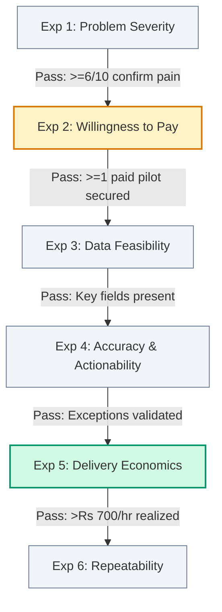

# Lean Validation Plan & MVP Roadmap
## Business Data Consolidation & Reporting Automation Practice

**Market:** India (Primary Beachhead: Coimbatore & Chennai, Tamil Nadu)  
**Target ICP:** Owner-managed industrial, electrical, and engineering wholesale distributors using TallyPrime & spreadsheets  
**Strategic Methodology:** Service-as-a-Software (SaaS-less MVP) · Lean Validation · The Mom Test  
**Effective Date:** 27 October 2026  

---

## Executive Recommendation: The "Service-First" Imperative

> [!IMPORTANT]
> **Do not build a software product, SaaS platform, or customer portal yet. Sell and deliver the outcome manually first.**
> 
> The fastest and cheapest path to market viability is delivering a **concierge diagnostic service** using Python/pandas, Excel/Power Query, and a standardized reporting framework. Building software before proving recurring commercial willingness to pay is premature optimization that burns capital and clouds customer signals.

```
                              [ THE LEAN VALIDATION LADDER ]
                                             
    ┌────────────────────────────────────────────────────────────────────────┐
    │  STAGE 4: SCALABLE AUTOMATION (Defer until 3+ paying clients repeat)  │
    │  • Custom Python ETL connectors, client-facing portal, automated sync  │
    └──────────────────────────────────▲─────────────────────────────────────┘
                                       │
    ┌──────────────────────────────────┴─────────────────────────────────────┐
    │  STAGE 3: REPEATABLE CONCIERGE PILOTS (Week 3–4)                       │
    │  • 1–2 paying clients @ ₹8,500; track hours; prove margin & accuracy   │
    └──────────────────────────────────▲─────────────────────────────────────┘
                                       │
    ┌──────────────────────────────────┴─────────────────────────────────────┐
    │  STAGE 2: SYNTHETIC PROTOTYPE & PAID SOW (Week 2)                      │
    │  • 2 synthetic files, traceable exception report demo, ₹8,500 SOW offer │
    └──────────────────────────────────▲─────────────────────────────────────┘
                                       │
    ┌──────────────────────────────────┴─────────────────────────────────────┐
    │  STAGE 1: PROBLEM DISCOVERY (Week 1)                                   │
    │  • 12–15 "Mom Test" interviews; verify recurring unbilled dispatches   │
    └────────────────────────────────────────────────────────────────────────┘
```

---

## 1. Core Customer Outcome & Value Proposition

### The Single Measurable Outcome
> **"Know what doesn't reconcile, why it doesn't reconcile, and what to do next."**

We help owner-managed distributors transform unformatted, disconnected accounting and operational exports into an **auditable, traceable exception ledger** that isolates operational discrepancies—without modifying or replacing their existing TallyPrime system.

### What the Customer Is Actually Buying
1. **Elimination of Non-Billable Clerical Drag:** Reclaiming 20–40 hours of monthly clerical time wasted on manual VLOOKUPs and copy-pasting.
2. **Deterministic Exception Isolation:** Pinpointing missing invoices, partial dispatches, rate variances, and disputed returns before month-end close.
3. **Traceable Source Evidence:** Providing direct row-level references to source files for every flagged item, eliminating subjective guesswork.
4. **A Repeatable Monthly Routine:** Handing over a documented, refreshable workflow that the internal team can run for subsequent periods.

---

### The Proposed First Offer: The 4-Day Reconciliation Diagnostic

| Parameter | Diagnostic Terms |
| :--- | :--- |
| **Fixed Price** | **₹8,500 + GST** *(Full upfront payment prior to intake)* |
| **Delivery Turnaround** | **Four (4) business days** from receipt of clean, agreed inputs |
| **Permitted Ingestion** | Up to **two (2) agreed source workbooks or CSV exports** |
| **Volume Ceiling** | Up to **100,000 combined rows** across both workbooks |
| **Workflow Scope** | **One (1) clearly bounded reconciliation workflow** *(e.g., Dispatch vs. Invoice)* |
| **Core Deliverables** | 1. Traceable Excel Exception Register<br>2. Executive Findings & Leakage Summary (PDF)<br>3. Standardized Matching Rule Documentation<br>4. 30-minute Management Walkthrough & Handover Session |
| **Explicit Exclusions** | Manual bookkeeping, source ledger edits, live API integration, multi-source ERP overhauls |

> [!TIP]
> **Scope Discipline:** Bind the diagnostic to **one defined reconciliation question** (e.g., *"Did every physical dispatch between 01-Aug and 31-Aug result in a corresponding sales invoice?"*). Never promise to *"find all forms of financial leakage across your entire business."*

---

## 2. Riskiest Assumptions Matrix

Assumptions are ranked strictly by their potential to invalidate the entire business model:

| Rank | Assumption | Why It Is Dangerous | Required Empirical Evidence | Validation Tool / Method |
| :---: | :--- | :--- | :--- | :--- |
| **1** | **Problem Recurrence & Severity** | If dispatches and invoices match cleanly or errors are negligible, automation is a luxury. | Specific recent incidents, monthly frequency, clerical hours burned, and quantifiable rupee impact. | Structured Discovery Interviews (*The Mom Test*). |
| **2** | **Willingness to Pay External Specialist** | An owner may acknowledge the headache but refuse to spend money, leaving it to internal staff or their CA. | Cleared bank transfer for the ₹8,500 diagnostic from an unrelated business. | Fixed-Scope Diagnostic SOW Offer. |
| **3** | **Data Accessibility & Usability** | If source data consists of unstandardized paper chits, handwritten delivery notes, or mangled CSVs, delivery is uneconomic. | Receipt of complete, readable exports with at least one common join key (DC No, PO No, Item Serial). | 24-Hour Intake Feasibility Review. |
| **4** | **Delivery Economics & Labor Margin** | If data cleaning and rule debugging take >15 hours, an ₹8,500 diagnostic yields sub-freelancer hourly returns. | Direct delivery labor <10 hours per engagement, yielding >₹850/hr effective realization. | Detailed Toggl/Clockify Time Tracking. |
| **5** | **Result Actionability & Accuracy** | If matching logic yields false positives, client trust is destroyed. Unmatched rows are not automatically fraud. | Client successfully investigates and verifies >80% of flagged exceptions without rejecting rules. | Joint Client Exception Walkthrough. |
| **6** | **Process Repeatability Across Clients** | If every distributor requires bespoke, one-off ETL logic, the business remains low-margin consulting. | Reusing >60% of data cleaning and matching transformation code across Client A and Client B. | Code Modularization & Library Reuse. |
| **7** | **Expansion into Retainers / Implementation** | If clients treat the diagnostic as a one-off cleanup, customer lifetime value (LTV) cannot support paid acquisition. | Client commits to a ₹25k–₹45k implementation sprint or an ₹8k–₹15k/mo recurring reconciliation retainer. | Post-Diagnostic Upsell SOW. |

---

## 3. Cheapest Credible Experiment for Each Assumption



### Experiment Breakdown
1. **Problem Severity (Discovery):**  
   - *Cost:* 15 hours of phone/in-person meetings.  
   - *Protocol:* Interview 12–15 owners/controllers. Ask them to reconstruct the exact events of the last completed month-end close.  
   - *Pass Gate:* $\ge$6 interviewees describe an identical, recurring matching failure; $\ge$4 quantify wasted time ($\ge$15 hrs/mo) or delayed billing.
2. **Willingness to Pay (Fixed-Scope SOW):**  
   - *Cost:* 1-page SOW generation.  
   - *Protocol:* Present the ₹8,500 diagnostic to qualified prospects who showed acute pain during discovery.  
   - *Pass Gate:* At least **one (1)** client signs the SOW and pays upfront; target **two (2)** independent clients.
3. **Data Feasibility (24-Hr Sample Audit):**  
   - *Cost:* 2 hours of Python/Power Query schema profiling.  
   - *Protocol:* Profile sample exports under NDA. Check null percentages, primary keys, date formats, and numeric types.  
   - *Pass Gate:* Matching logic can link records with $<5\%$ unmatchable records due to corrupted identifiers.
4. **Accuracy & Actionability (Concierge Delivery):**  
   - *Cost:* 8–10 hours of hands-on data wrangling.  
   - *Protocol:* Run the matching pipeline; categorize exceptions into 4 distinct buckets; review top 10 discrepancies with client.  
   - *Pass Gate:* Client confirms that flagged exceptions represent genuine discrepancies requiring operational follow-up.
5. **Delivery Economics (Hour Auditing):**  
   - *Cost:* Time tracking software.  
   - *Protocol:* Log all billable and non-billable time: intake call, cleaning, script writing, manual verification, report design, walkthrough.  
   - *Pass Gate:* Total engagement time $\le$12 hours (effective gross realization $\ge$₹708/hr).
6. **Repeatability (Second Paid Engagement):**  
   - *Cost:* 6–8 hours delivery.  
   - *Protocol:* Run Client B's diagnostic using the modular transformation scripts developed for Client A.  
   - *Pass Gate:* $\ge$50% reduction in initial script development time; core matching pipeline runs with configuration tweaks only.

---

## 4. Minimum Viable Product (MVP) Architecture

```
                  ┌──────────────────────────────────────────┐
                  │          CLIENT EXPORTS (CSV/XLSX)       │
                  │  • Source A: Tally Sales/Purchase Reg    │
                  │  • Source B: Warehouse Dispatch / Gate   │
                  └────────────────────┬─────────────────────┘
                                       │
                                       ▼
                  ┌──────────────────────────────────────────┐
                  │       INGESTION & DATA QUALITY ENGINE    │
                  │  (Local Python/pandas or Power Query)    │
                  │  • Schema audit & null checks            │
                  │  • Date format standardizer (ISO-8601)   │
                  │  • Reference key normalization (RegEx)   │
                  └────────────────────┬─────────────────────┘
                                       │
                                       ▼
                  ┌──────────────────────────────────────────┐
                  │       DETERMINISTIC MATCHING ENGINE      │
                  │  • Level 1: Exact Key (DC No == Ref No)  │
                  │  • Level 2: Composite (GSTIN + Date + Amt│
                  │  • Level 3: Tolerance (Qty match ±0.5%)  │
                  └────────────────────┬─────────────────────┘
                                       │
                                       ▼
                  ┌──────────────────────────────────────────┐
                  │           STRUCTURED DELIVERABLES        │
                  │  1. Excel Exception Register (Traceable) │
                  │  2. Executive Reconciliation PDF Summary │
                  │  3. Refreshable ETL Pipeline & Handover  │
                  └──────────────────────────────────────────┘
```

### What to Build Now, Do Manually, and Defer

| Category | Build Immediately (Code / Assets) | Execute Manually (Concierge MVP) | Strictly Defer (Do Not Build) |
| :--- | :--- | :--- | :--- |
| **Data Cleaning** | Reusable Python/pandas string-cleaning scripts (whitespace, leading zeros, GSTIN validator). | Mapping customer column names to standardized schema names. | Automated column-mapping AI or fuzzy auto-discovery algorithms. |
| **Matching Logic** | Standardized 3-tier matching script (Exact Key $\rightarrow$ Composite $\rightarrow$ Tolerance Range). | Reviewing edge-case exceptions and borderline variances. | Autonomous machine learning matching or self-learning neural nets. |
| **Output / Reporting** | Formatted Excel output template with standard columns and conditional formatting. | Writing executive findings summary and annotating operational context. | Web-based SaaS dashboard, user logins, or custom mobile apps. |
| **Security & Intake** | Standardized 1-page Mutual NDA and encrypted local processing folder structure. | Manual file receipt via encrypted Google Drive / corporate email. | Self-serve upload portals, S3 bucket auto-sync, or API gateways. |
| **Billing & Legal** | Standardized SOW contract and GST invoice template. | Manual payment tracking via bank NEFT/RTGS UTR verification. | Stripe/Razorpay automated subscription billing integrations. |

---

## 5. The 7-Step Service Customer Journey

```
[ Step 1: 20-Min Qualification ] ──► [ Step 2: Scope & SOW Sign-off ] ──► [ Step 3: Secure File Intake ]
                                                                                   │
                                                                                   ▼
[ Step 6: Findings Walkthrough ] ◄── [ Step 5: QA & Manual Verification ] ◄── [ Step 4: Python Pipeline Run ]
           │
           ▼
[ Step 7: Commercial Expansion Offer (Implementation / Retainer) ]
```

1. **Problem Qualification (20 Mins):** Verify that the client has a recurring, high-volume workflow ($>1,000$ transactions/month), digital source files, and a decision-maker who acknowledges the pain.
   - *Hard Stop Gate:* If transactions are recorded on physical paper only, disqualify immediately.
2. **Scoping & Mutual Agreement:** Define the exact matching question, identify the two source files, establish row caps, and collect ₹8,500 upfront.
3. **Secure Intake & 24-Hr Feasibility Check:** Inspect files for corruption, missing identifiers, or structural failure. If files are unusable, pause the delivery clock and request clean exports.
4. **Automated Pipeline Execution:** Run data through normalized cleaning and deterministic matching scripts. Preserve original source line numbers (`SourceA_RowID`, `SourceB_RowID`).
5. **Quality Assurance & Verification:** Manually inspect the top 10 largest monetary variances and 10 random matches. Verify totals match source bank/sales registers exactly.
6. **Executive Handover Walkthrough (30 Mins):** Present the findings to the owner and head accountant. Categorize every exception into: *Confirmed Error*, *Timing Difference*, or *Missing Source Record*.
7. **Commercial Expansion Pitch:** If the diagnostic uncovered actionable discrepancies, present the **Implementation Sprint SOW (₹25,000–₹45,000)** to automate the workflow permanently.

---

## 6. Prototype & Paid Pilot Execution Plan

### Prototype A: The Synthetic-Data Showcase (Week 1–2)
Build a demonstration dataset using completely synthetic but realistic Indian distributor data:
- **File 1:** `Dispatch_Register_August.xlsx` (1,200 rows: DC Number, Date, Customer Name, Item SKU, Dispatched Qty, Transporter LR).
- **File 2:** `Tally_Sales_Register_August.xlsx` (1,150 rows: Invoice Number, Date, Buyer GSTIN, Item SKU, Billed Qty, Total Amount).

**Engineered Discrepancy Scenarios to Showcase:**
1. *Exact Match:* DC-1001 matches INV-2001 on SKU, Date, and Quantity (Clean control).
2. *Unbilled Dispatch (Leakage):* DC-1045 has no invoice in August or September (Cash risk).
3. *Quantity Shortage:* DC-1080 dispatched 50 units; INV-2050 billed 40 units (Disputed bill).
4. *Timing Lag:* DC-1110 dispatched on 31-Aug; INV-2100 billed on 05-Sep (Legitimate timing difference).
5. *Duplicate Reference:* Two separate invoices referencing the same dispatch challan.

*Deliverable:* A pristine, color-coded Excel Exception Register and a 1-page sample executive report used exclusively to visually communicate the diagnostic deliverable during discovery conversations.

---

### Pilot B: The First Paid Client Engagement (Week 3)
Execute the live pilot strictly within the contractual boundaries:
- Signed 1-page NDA and Diagnostic SOW.
- Client provides their actual historical month (e.g., last closed month).
- Deliver strictly on Day 4.
- Do not guarantee savings; guarantee **100% auditable traceability of all discrepancies**.

---

## 7. 4-Week Validation Cycle & Experiment Scorecard

```
  WEEK 1: Problem Discovery           WEEK 2: Synthetic Demo & Offers
  • Complete 6–8 Mom Test interviews  • Reach 12–15 interviews total
  • Identify core recurring workflow  • Present synthetic demo
  • Draft diagnostic scope template   • Pitch ₹8,500 SOW to 3–5 qualified leads
                 │                                   │
                 ▼                                   ▼
  WEEK 3: Paid Pilot Delivery         WEEK 4: Verification & Decision
  • Ingest Client A real data         • Client review & exception audit
  • Run Python/Power Query pipeline   • Measure actual delivery hours
  • Deliver findings in 4 days        • Pitch implementation upsell; decide next move
```

### Quantitative Scorecard & Decision Thresholds

| Validation Metric | Target / Success Threshold | Warning / Pivot Signal | Fatal / Kill Signal |
| :--- | :--- | :--- | :--- |
| **Discovery Interviews** | 12–15 completed | 8–11 completed | $<8$ completed (Insufficient reach) |
| **Recurring Problem Rate** | $\ge$6 interviewees report identical pain | 3–5 report identical pain | $<3$ (Isolated edge cases) |
| **Quantifiable Business Drag** | $\ge$4 quantify hours/financial impact | 2–3 quantify impact | $<2$ (Mild inconvenience only) |
| **SOW Proposals Requested** | $\ge$3 qualified prospects | 1–2 prospects | 0 prospects |
| **Paid Diagnostic Conversions** | **$\ge$1 paid client (Target: 2)** | 1 verbal agreement (no cash) | 0 paid commitments |
| **Delivery Time Envelope** | $\le$12 total hours per engagement | 13–18 total hours | $>20$ hours (Negative unit economics) |
| **Audit Accuracy Rate** | 100% traceable; zero false claims | Minor edge-case classification bugs | Systematic false positive claims |
| **Client Actionability** | Client acts on $\ge$1 flagged finding | Client acknowledges findings but delays | Client dismisses report as useless |
| **Follow-on Upsell Conversion** | $\ge$1 implementation or retainer pitch accepted | Client requests minor unpaid tweaks | Complete rejection of ongoing support |

---

## 8. Delivery Economics Math: Unit Realization Model

Tracking all labor hours is essential to ensure this service does not devolve into low-wage freelance data cleaning:

$$\text{Effective Hourly Realization (EHR)} = \frac{\text{Fixed Diagnostic Fee (₹8,500)}}{\text{Total Delivery Hours (Intake + Cleaning + QA + Handover)}}$$

### Delivery Time Scenarios

| Activity | Optimized Pilot (Target) | Average Pilot (Expected) | Runaway Pilot (Danger) |
| :--- | :---: | :---: | :---: |
| Intake & Scope Alignment | 1.0 hr | 1.5 hrs | 3.0 hrs |
| Data Ingestion & Sanitization | 2.0 hrs | 4.0 hrs | 8.0 hrs |
| Script Configuration & Matching | 2.5 hrs | 4.0 hrs | 7.0 hrs |
| Exception Verification & QA | 1.5 hrs | 2.5 hrs | 5.0 hrs |
| Report & PDF Generation | 1.0 hr | 1.5 hrs | 3.0 hrs |
| Client Handover Presentation | 0.5 hr | 1.0 hr | 2.0 hrs |
| **Total Billable Effort** | **8.5 Hours** | **14.5 Hours** | **28.0 Hours** |
| **Effective Gross Hourly Rate** | **₹1,000 / hr** | **₹586 / hr** | **₹303 / hr** |
| **Commercial Verdict** | Highly Profitable | Acceptable for Pilot | **Unviable (Scope Creep)** |

> [!CAUTION]
> If a pilot drifts past 15 hours due to dirty client data or missing identifiers, **invoke the SOW scope change clause immediately**. Never absorb uncontrolled data cleaning without adjusting terms.

---

## 9. Data Safety, Privacy & Reliability Guardrails

Because the diagnostic handles raw sales, pricing, customer lists, and financial records, rigorous data hygiene is mandatory:

1. **Zero Cloud AI Processing:** Under no circumstances should raw client financial records be pasted into public LLM interfaces (ChatGPT, Claude, public APIs). All data wrangling must execute locally using deterministic Python/pandas or Excel.
2. **Encrypted Offline Storage:** Client data must reside exclusively on an encrypted local storage volume with automated deletion 14 business days after handover sign-off.
3. **Statutory Neutrality:** Contractually establish that our report is an **operational data diagnostic**, not a statutory tax audit, financial certification, or fraud investigation.
4. **Read-Only Ingestion:** We never write directly to the client's production Tally database or operational ERP. We process exported flat files only.
5. **DPDPA 2023 Compliance:** Adhere strictly to India's Digital Personal Data Protection Act by securing explicit written consent for data processing and providing complete audit trails for all processed records.

---

## 10. The Decision Logic: Proceed, Iterate, Pivot, or Pause

At the conclusion of the 4-week experiment, evaluate the evidence against this decision framework:

```
                                [ 4-WEEK EVALUATION ]
                                          │
                  ┌───────────────────────┴───────────────────────┐
                  ▼                                               ▼
      [ At least 1–2 Clients Paid ]                  [ Zero Paid Clients ]
      [ & Reconciled Accurately   ]                               │
                  │                                               ▼
                  ▼                                    ┌───────────────────────┐
        DO ECONOMICS WORK?                             │ WHY DID PROSPECTS     │
        (EHR >= ₹600/hr)                               │ REFUSE TO PAY?        │
        ┌─────────┴─────────┐                          └───────────┬───────────┘
        ▼                   ▼                                      ▼
     [ YES ]              [ NO ]                     ┌─────────────┼─────────────┐
        │                   │                        ▼             ▼             ▼
        ▼                   ▼                   [ No Pain ]   [ Bad Scope ]  [ No Trust ]
    PROCEED TO         ITERATE SCOPE:                │             │             │
   IMPLEMENTATION     Tighten data intake,           ▼             ▼             ▼
   SPRINT LAUNCH      increase automation,      PIVOT ICP OR    REPRICE OR    PARTNER WITH
                      raise price to ₹12.5k     WORKFLOW        REFOCUS SOW   LOCAL CAS
```

1. **PROCEED (Scale Concierge Service):** $\ge$2 clients paid ₹8,500; delivery took $\le$12 hours; client verified actionable leakage; client interested in recurring monthly pipeline.
   - *Action:* Systematize the Python pipeline, package the ₹35,000 Implementation Sprint, and hire a junior data analyst.
2. **ITERATE (Refine Offer & Scope):** Strong interest during discovery, but prospects hesitated on the 4-day timeline or data access requirements.
   - *Action:* Offer an on-premise 1-day audit or narrow the scope to an ₹5,000 single-file sanity check.
3. **PIVOT (Change Segment or Workflow):** Industrial distributors handle dispatches cleanly, but multi-channel e-commerce sellers or healthcare distributors show acute payment reconciliation pain.
   - *Action:* Reposition the core matching engine to Amazon/Flipkart settlement reconciliation or vendor hospital billing.
4. **STOP / PAUSE (Exit Market):** Target distributors show zero recurring pain, existing Tally features and CAs adequately resolve mismatches, and no one pays despite 15+ discovery pitches.
   - *Action:* Cease investment before burning capital on software development or marketing retainers.

---

## 11. Immediate Action Checklist (Next 7 Days)

- [ ] **Step 1: Finalize the Synthetic Showcase Dataset**
  - Generate fictional `Dispatch_Register_August.xlsx` and `Tally_Sales_Register_August.xlsx` (1,000+ rows).
  - Build the corresponding `Sample_Exception_Ledger.xlsx` showcasing exact matches, unbilled challans, and quantity variances.
- [ ] **Step 2: Assemble the Prospect Call List**
  - Extract 30 verified distributor leads from CODISSIA and META directories using [customer_acquisition_plan_coimbatore_distributors.md](file:///c:/Users/sukes/Downloads/business%20plan/customer_acquisition_plan_coimbatore_distributors.md).
- [ ] **Step 3: Execute First 5 Discovery Calls**
  - Run the 18-minute *Mom Test* interview script from [customer_discovery_and_mom_test_playbook.md](file:///c:/Users/sukes/Downloads/business%20plan/customer_discovery_and_mom_test_playbook.md). Do not pitch. Record past incidents and clerical hours.
- [ ] **Step 4: Present First ₹8,500 Diagnostic SOW**
  - To the first prospect who admits to losing $>10$ hours/month or having unbilled delivery notes, present the 1-page SOW from [legal_contract_pack_nda_and_sow.md](file:///c:/Users/sukes/Downloads/business%20plan/legal_contract_pack_nda_and_sow.md).
- [ ] **Step 5: Track Every Hour & Review Delivery Feasibility**
  - Log discovery and delivery time in an experiment audit sheet to calculate real unit economics.
