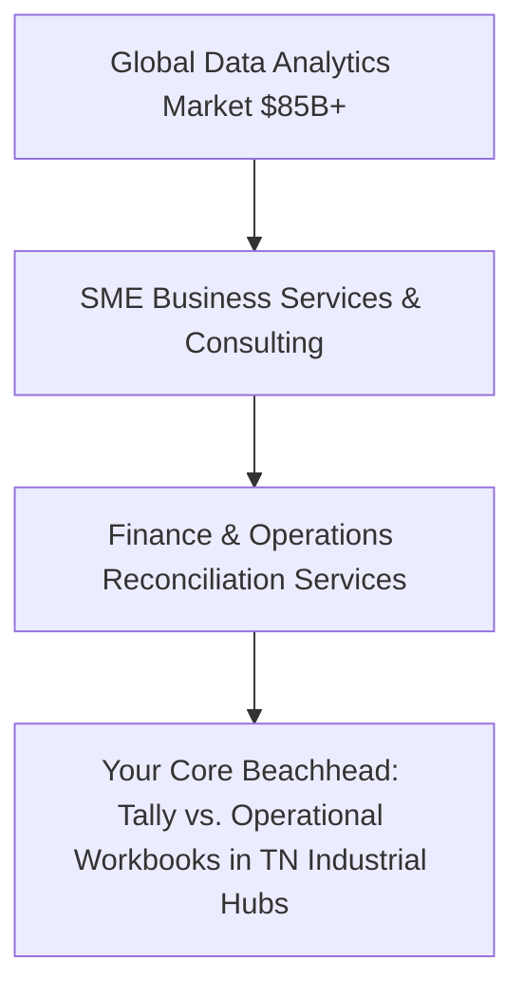
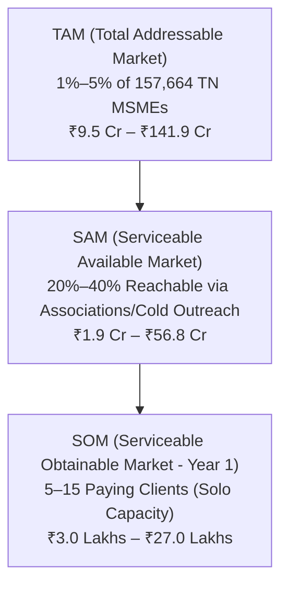

# Market Definition & Bottom-Up Sizing (TAM, SAM, SOM)
## Business Data Consolidation & Reporting Automation Practice

---

## Executive Assessment

My recommendation is to **continue validation, but not yet to invest heavily or treat this as a proven market.**

There is a plausible market for helping small and midsize businesses consolidate operational data, reconcile financial records, and automate reporting. The empirical evidence supports the existence of a massive registered SME base, established cross-system data integration demand, and ongoing digitalization. However, it does not yet establish how many businesses will buy your specific service at your proposed prices.

Your best initial strategy is to estimate the opportunity **from the bottom up**:
1. Identify businesses in a small, concentrated geographic area (Tamil Nadu: Coimbatore, Karur, Chennai).
2. Filter for the exact cross-system reconciliation workflow you can solve (e.g., Tally vs. Dispatch Challans/Bank UTRs).
3. Estimate realistic annual spending based on the 3-step ladder.
4. Constrain your obtainable market by your actual delivery and sales capacity.

---

## 1. Market Definition: What Market Are You Actually Entering?

You are entering the **SME Data Reconciliation, Reporting Automation, and Business Intelligence Implementation Services** market—specifically project-based and managed services connecting operational records with accounting and financial ledgers.

This is fundamentally different from selling generic "business intelligence software" or SaaS subscriptions. You are initially selling **expert data engineering and deterministic reconciliation services**.

### Market Boundary Dimensions

| Dimension | Initial Definition for This Practice |
| :--- | :--- |
| **Industry Category** | Business data services, reporting automation, and operational analytics. |
| **Primary Category** | SME operational-to-financial data integration and reconciliation services. |
| **Adjacent Categories** | BI consulting, finance operations (FinOps), CA/audit preparation support, data quality assurance. |
| **Primary Customers** | Wholesale distributors and industrial stockists (300+ SKUs, multi-godown). |
| **Secondary Customers** | SME batch/job-work manufacturers, multi-channel D2C e-commerce sellers. |
| **Distribution Channel** | CA firms, bookkeeping practices, outsourced CFO teams (white-label). |
| **Initial Geography** | Coimbatore, Karur, and Chennai (Tamil Nadu, India). |
| **Expansion Geography** | Bengaluru, Mumbai/Pune, then selected US, UK, and Australian SME segments. |
| **Revenue Model** | Paid diagnostic (₹8,500), fixed-fee implementation (₹25k–₹50k), optional monthly retainer (₹8k–₹18k/mo). |

---

## 2. Empirical Government Baseline: District Business Counts

The following data is extracted from the official **2024–25 Annual Report of the MSME Development and Facilitation Office (MSME-DFO), Chennai**:

### Registered Micro & Small Enterprises in Initial Geography

| District | Registered Micro MSMEs | Registered Small MSMEs | Combined District Count | Primary Industrial Profile |
| :--- | :---: | :---: | :---: | :--- |
| **Chennai** | 88,146 | 499 | **88,645** | Auto-ancillaries, precision machining, wholesale trade, electronics. |
| **Coimbatore** | 58,054 | 198 | **58,252** | Pumps, motors, foundries, CNC machining, textile machinery, stockists. |
| **Karur** | 10,739 | 28 | **10,767** | Home textiles, spinning mills, garment processing, export trading. |
| **Total Universe** | **156,939** | **725** | **157,664** | **Combined Candidate Pool (3 Districts)** |

> [!WARNING]
> **Critical Data Limitation:** These 157,664 registrations span all sectors (including informal trade, neighborhood services, and micro-traders). Many are too small, lack digital exports, or would never hire an external consultant. Treat this table as a **geographic starting universe**, not your qualified pipeline.

---

## 3. Bottom-Up TAM, SAM, and SOM Calculations

### Model Assumptions
* **Customer Value:** 
  * *Single Project Scenario:* ₹43,500 (₹8,500 Diagnostic + ₹35,000 Implementation).
  * *Annual Customer Spend Scenario:* ₹60,000–₹1,80,000 (Initial implementation + 4–8 months of basic retainer support).
* **Base Case Spend Assumption:** ₹1,20,000/year per retained client.

---

### 3.1 TAM — Total Addressable Market (Three Tamil Nadu Districts)

Assuming between **1% and 5%** of registered MSMEs have sufficient volume, digital records, and reconciliation pain:

| Scenario | Qualification Rate | Candidate Eligible Firms | Annual Customer Spend | Annual TAM Opportunity Pool |
| :--- | :---: | :---: | :---: | :---: |
| **Low Case** | 1.0% | 1,577 firms | ₹60,000 | **₹9.46 Crore** |
| **Base Case** | 3.0% | 4,730 firms | ₹1,20,000 | **₹56.76 Crore** |
| **High Case** | 5.0% | 7,883 firms | ₹1,80,000 | **₹141.90 Crore** |

*(Note: If calculated strictly on a one-time project basis at ₹43,500, the one-time TAM pool across a broader 5%–15% eligibility band is **₹34.3 Crore to ₹102.9 Crore**).*

---

### 3.2 SAM — Serviceable Available Market (Reachable in 2–3 Years)

Your SAM is constrained by how many of these firms you can realistically identify, contact, and pitch via regional associations (CODISSIA, AIEMA, TASMA), direct outreach, and CA partnerships:

| Scenario | Candidate Base (from TAM) | Assumed Reachable Share | Serviceable Accounts | Annual SAM Revenue |
| :--- | :---: | :---: | :---: | :---: |
| **Conservative** | 1,577 firms | 20% | 315 accounts | **₹1.89 Crore** |
| **Base Case** | 4,730 firms | 30% | 1,419 accounts | **₹17.03 Crore** |
| **Upper Scenario** | 7,883 firms | 40% | 3,153 accounts | **₹56.75 Crore** |

---

### 3.3 SOM — Serviceable Obtainable Market (First 12 Months Capacity)

As an independent specialist / solo practice, your SOM is constrained by **sales conversion speed and technical delivery bandwidth**, not by the size of Tamil Nadu.

Assuming a solo consultant can realistically deliver **1 to 2 diagnostic pilots and 1 full implementation per month**:

| First-Year Scenario | Total Paid Clients | Average First-Year Spend | Gross Service Revenue (SOM) | Monthly Run-Rate |
| :--- | :---: | :---: | :---: | :---: |
| **Conservative** | 5 clients | ₹60,000 (Diagnostic + Starter Sprint) | **₹3.00 Lakhs** | ₹25,000 / mo |
| **Base Target** | 10 clients | ₹1,20,000 (Pilot + Full Sprint + Retainer) | **₹12.00 Lakhs** | ₹1,00,000 / mo |
| **Stretch Target** | 15 clients | ₹1,80,000 (Pilot + Deep Multi-Source Sprint) | **₹27.00 Lakhs** | ₹2,25,000 / mo |

*(Note: On a pure project-by-project basis at ₹43,500 flat with zero retainers, 10 projects = **₹4.35 Lakhs**, and 20 projects = **₹8.70 Lakhs**).*

---

## 4. International Market Context (Future Expansion Reserves)

Official government census figures demonstrate vast international pools of inventory-heavy businesses, but they should **not** be blended into your initial TAM without localized conversion evidence:

| Country | Official Census / Statistics Source | Total Relevant Enterprise Universe | Relevance to Your Practice |
| :--- | :--- | :--- | :--- |
| **India** | Ministry of MSME / Udyam Dashboard (Feb 2026) | **7.83 Crore+** registered enterprises (includes informal micro-units) | Huge general pool; overstates your qualified B2B ICP. |
| **United States** | US Census Bureau (2022 Economic Census & SUSB) | **US$11.6 Trillion** wholesale trade sales; 300,000+ wholesale establishments | Massive transaction volume and complex 3PL/chargeback friction. |
| **United Kingdom** | UK DBT Business Population Estimates (Oct 2025) | **5.69 Million** private sector businesses (38,435 medium-sized) | High digital accounting maturity (Xero/QBO) and strict MTD compliance. |
| **Australia** | Australian Bureau of Statistics (ABS, June 2026) | **2,814,778** active businesses (**996,203 employing businesses**) | Excellent target for trade distributors and freight/customs reconciliation. |

> [!TIP]
> **International Rule:** Do not add all 4 countries into a single inflated TAM. Expand internationally only after establishing delivery SOPs and proof of retention in your home market.

---

## 5. Market Demand Drivers vs. Real Barriers to Entry

### Primary Growth & Demand Drivers
1. **Proliferation of Disconnected SaaS & ERPs:** Businesses adopt Shopify, Amazon, Shiprocket, and modern bank portals while keeping core books in Tally or QuickBooks, widening the reconciliation gap.
2. **Working-Capital & Interest Rate Sensitivity:** High commercial bank borrowing rates (10.5%–12% on Cash Credit/OD limits) make business owners acutely aware of cash tied up in dead stock or unbilled dispatches.
3. **Statutory Scrutiny & E-Invoicing Mandates:** Tightening GST DRC-01 notices and e-invoicing thresholds force SMBs to reconcile books with portal GSTR-2B monthly.

### Real Barriers to Entry (The Operational Moat)
* **The Trust Barrier:** Business owners will not share sales margins or bank statements with an unknown entity. (Solved by the **1-Page Mutual Offline NDA** and **Local/Offline Processing** guarantee).
* **Business-Rule Idiosyncrasies:** Unlike software development, data reconciliation requires understanding trade discounts, rate differences, and industry norms.
* **Scope Creep & Schema Drift:** Upstream Excel tampering can break automated scripts. (Solved by the **Frozen Schema Baseline SOW Clause**).

---

## 6. Market Sizing Confidence Matrix

| Metric | Estimate / Range | Underlying Methodology | Confidence Rating | Main Operational Risk |
| :--- | :---: | :--- | :---: | :--- |
| **TN 3-District MSME Universe** | 157,664 firms | Official MSME-DFO Chennai 2024–25 Report | **Medium–High** | Includes non-digital and micro entities. |
| **Local TAM Scenario** | ₹9.5 Cr – ₹141.9 Cr | 1%–5% qualification × ₹60k–₹1.8L spend | **Low** | Unverified customer eligibility percentage. |
| **Local SAM Scenario** | ₹1.9 Cr – ₹56.8 Cr | 20%–40% reachable via associations | **Very Low** | Channel reach and conversion rates unproven. |
| **First-Year SOM** | ₹3.0 L – ₹27.0 Lakhs | 5–15 clients × capacity limits | **Low–Medium** | Depends strictly on sales execution and delivery hours. |
| **Global Data Integration Market** | $17.9B in 2025 (GVR) | Third-party commercial research | **Medium** | Dominated by enterprise software; low relevance to solo consulting. |

---

## 7. The 8 Critical Metrics to Track to Validate This Model

Over the next 30 days, replace these assumptions with verified numbers by measuring:

1. **Local ICP Density:** Count how many active wholesale distributors and batch manufacturers can be identified in CODISSIA, AIEMA, and local directories.
2. **Reconciliation Pain Prevalence:** How many out of 15 discovery calls confirm a recurring, cross-system mismatch.
3. **True Loaded Labor Cost:** Actual staff hourly rate and hours burned on monthly reconciliation inside prospect businesses.
4. **Willingness to Pay (WTP):** How many qualified prospects pay the **₹8,500 upfront diagnostic fee**.
5. **Diagnostic-to-Implementation Conversion Rate:** What percentage of pilot clients convert to the **₹25,000–₹50,000 full implementation sprint**.
6. **Delivery Bandwidth:** Exact hours required to complete a 4-day pilot (target: <15 hours) and full sprint (target: <40 hours).
7. **Monthly Retainer Retention:** Whether clients retain your services for ongoing monthly exception monitoring at **₹8,000–₹18,000/month**.
8. **Effective Hourly Rate:** Contribution margin divided by total delivery and rework hours (target: >₹1,500/hr).

---

### Final Strategic Takeaway

The market is **large enough to build a highly profitable specialist practice**, but small enough that unfocused execution will waste time. 

Do not attempt to capture "0.01% of the $85 Billion global analytics market." Focus entirely on capturing **10 to 15 paying distributors and manufacturers in Tamil Nadu** who will pay you ₹40,000 to ₹1,20,000 annually to protect their margins and automate their reporting.
