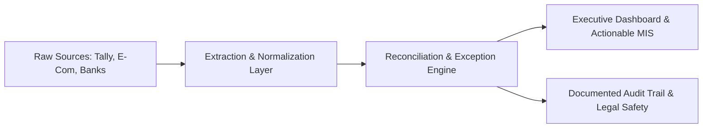
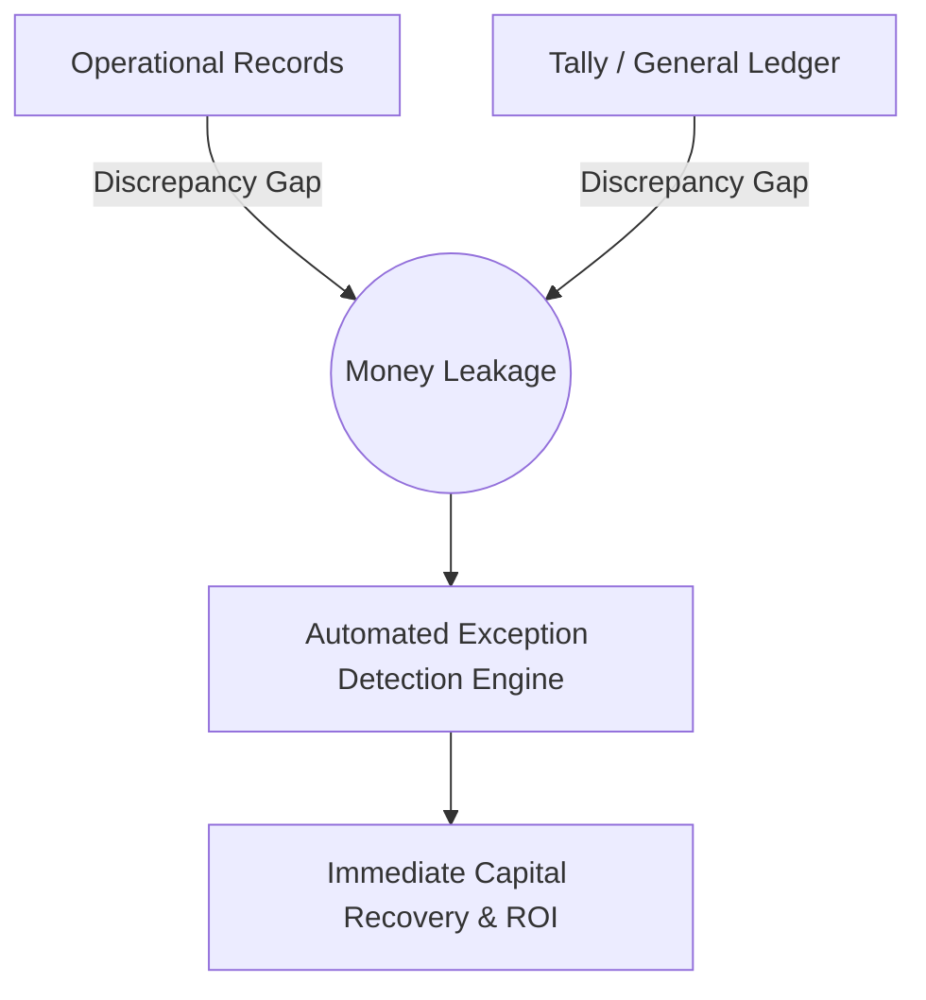

# Operational, Technical & Regulatory Playbook
## Business Data Consolidation & Reporting Automation Agency
**Target Markets:** India, United States, United Kingdom, and Australia  
**Framework Date:** October 2026 Edition

---

## Executive Overview & Strategic Mandate

Your agency must position itself as a **Business Data Reconciliation and Reporting Automation Specialist**, not merely an open-ended Excel or Power BI development shop. 

Clients rarely buy dashboards for their visual aesthetics alone. They buy **confidence** that the numbers on their screen agree with their accounting software (Tally, QuickBooks, Xero), physical warehouse inventories, e-commerce channels, and actual bank settlement credits—with a repeatable way to detect financial leakages before they compound into expensive losses.



### The 4 Core Delivery Pillars:
1. **Source-Data Extraction & Standardization:** Ingest Tally exports, e-commerce CSVs, and bank statements into a normalized, version-controlled relational model.
2. **Reconciliation & Anomaly Detection:** Match invoices, purchase orders, inventory movements, settlements, and bank credits; systematically isolate exceptions rather than blindly forcing totals.
3. **Automated Management Reporting:** Deliver auto-refreshable dashboards, KPI monitors, exception logs, and a repeatable month-end closing workflow.
4. **Controlled Delivery & Legal Protection:** Freeze project boundaries, source schemas, file caps, and liability waivers in written Statements of Work (SOWs).

> [!CAUTION]
> **The Non-Audit Disclaimer:** Your agency provides data engineering, reconciliation, and business intelligence automation. You do **not** provide statutory accounting, tax audits, or formal CPA/CA opinions unless certified. Always frame deliverables as *operational decision aids* based strictly on client-provided records.

---

## Pillar 1: ERP & Spreadsheet Schemas (India & Commerce)

To price fixed-scope projects profitably and engineer resilient Python (`pandas` / `polars`) and Power Query pipelines, you must master the structural quirks baked into Indian ERPs, marketplaces, and banking portals.

---

### 1.1 TallyPrime & Tally.ERP 9 Export Architecture

In TallyPrime, pressing `Alt+E` (or `Ctrl+E` in report mode) exports the active on-screen report. **Crucial Rule:** Visual Excel exports are structured for *human printing*, whereas XML exports are designed for *machine interchange*.

#### A. Data-Cleaning Bottlenecks in Tally Visual Excel Exports (`.xlsx`)

| Tally Report | Physical Layout & Structure | Cleaning Bottlenecks | Python / Power Query Remediation Strategy |
| :--- | :--- | :--- | :--- |
| **Stock Summary** | Rows 1–6 contain company metadata, date ranges (`1-Apr-25 to 31-Mar-26`). Grouped columns: `Opening Balance`, `Inwards`, `Outwards`, `Closing Balance`, each split into `Quantity \| Rate \| Value`. | 1. **Mixed Column Hierarchy:** Stock Groups (categories) and Stock Items (SKUs) share the same `Particulars` column, differentiated **only by font bolding and leading whitespace**.<br>2. **Embedded UOM Strings:** Quantities export as text strings (`"140.50 Kgs"`, `"12 Nos"`, or compound `"10 Box of 12 Pcs"`).<br>3. **Negative Stock Signs:** Negative values often carry `(-)` or red formatting, breaking float casting.<br>4. **Grand Total Row:** Blindly summing the column doubles the true balance. | Export Stock Masters separately to create a leaf-level SKU lookup; inner-join against `Particulars` to automatically strip bolded group headers. Use regex to split quantity into `numeric_qty` and `uom_string`. Strip grand total rows during ingestion. |
| **Sales Register** *(Detailed Mode via `Alt+F1`)* | Interleaved parent-child rows. Row $N$ holds the Voucher header (`Date`, `Party [Customer]`, `Voucher Type`, `Voucher No.`, `Gross Total`). Rows $N+1$ to $N+k$ contain indented SKU line items, GST ledgers (`CGST @ 9%`), freight, and narration. | 1. **Sparse / Null Keys:** `Date`, `Voucher Type`, and `Voucher No.` are populated *only* on the parent row and are `NaN` on child item/tax rows.<br>2. **Dr/Cr Suffixes:** Amounts export as `"1,18,000.00 Dr"` or `"18,000.00 Cr"`.<br>3. **Cancelled Vouchers:** Cancelled invoices appear in sequence with `(Cancelled)` in `Particulars` and blank values, skewing invoice counts. | Assign a monotonic `Voucher_ID` when `Voucher No.` is non-null. Forward-fill (`ffill`) parent keys down to child rows. Split into normalized `Fact_Invoices` (header) and `Fact_Invoice_Lines` (line items). Filter out cancelled vouchers. |
| **Day Book** | Chronological dump of *all* voucher types (`Sales`, `Purchase`, `Receipt`, `Payment`, `Contra`, `Journal`, `Credit Note`, `Stock Journal`) in one sheet. | 1. **Sign Ambiguity:** `Debit` and `Credit` columns hold conflicting accounting meanings depending on `Voucher Type`.<br>2. **Filter Contamination:** If a clerk left an active date/voucher filter open before pressing `Alt+E`, Tally exports an incomplete dataset.<br>3. **Locale Date Inversion:** Excel flips `04-10-2026` into April 10 while leaving `15-10-2026` as an unparsed text string. | Cross-reconcile Day Book voucher counts by type against Tally's **Statistics Screen** (`Gateway of Tally -> Display More Reports -> Statements of Accounts -> Statistics`). Always parse dates explicitly with `dayfirst=True`. |

---

#### B. The Superior Alternative: Tally XML Interchange & Local HTTP Port `9000`

Whenever permitted, bypass Excel exports and request **Tally XML** (`Alt+E -> XML`) or connect directly to Tally's local HTTP server on `http://localhost:9000`:

* **Relational Integrity Preserved:** Tally XML exposes internal keys (`<GUID>`, `<MASTERID>`, `<ALTERID>`). Storing `<ALTERID>` allows your Python script to query *only modified/new vouchers* on daily runs instead of re-extracting years of data.
* **Core XML Voucher Schema:**

```xml
<ENVELOPE>
  <BODY>
    <DATA>
      <TALLYMESSAGE xmlns:UDF="TallyUDF">
        <VOUCHER REMOTEID="..." VCHTYPE="Sales" ACTION="Create">
          <DATE>20261014</DATE> <!-- Standardized YYYYMMDD format -->
          <GUID>8a4b2f10-e832-4411-92b1-00000045</GUID>
          <ALTERID>14982</ALTERID>
          <VOUCHERNUMBER>GST/26-27/0412</VOUCHERNUMBER>
          <PARTYLEDGERNAME>Sri Amman Textiles Pvt Ltd</PARTYLEDGERNAME>
          <ALLLEDGERENTRIES.LIST>
            <LEDGERNAME>Sales Domestic @ 18%</LEDGERNAME>
            <ISDEEMEDPOSITIVE>No</ISDEEMEDPOSITIVE>
            <AMOUNT>100000.00</AMOUNT>
          </ALLLEDGERENTRIES.LIST>
          <ALLINVENTORYENTRIES.LIST>
            <STOCKITEMNAME>Cotton Yarn 40s Combed</STOCKITEMNAME>
            <RATE>250.00/Kg</RATE>
            <ACTUALQTY>400.00 Kg</ACTUALQTY>
            <AMOUNT>100000.00</AMOUNT>
          </ALLINVENTORYENTRIES.LIST>
        </VOUCHER>
      </TALLYMESSAGE>
    </DATA>
  </BODY>
</ENVELOPE>
```

> [!WARNING]
> **Tally XML Encoding Trap:** Tally routinely encodes XML exports in `UTF-16 LE` and fails to sanitize ASCII control characters (`&#4;` or unescaped `&` in clerk narrations). Standard parsers will crash.  
> **Fix:** Read raw bytes in Python, decode `utf-16` or `utf-8-sig`, clean invalid entities via `re.sub(r'&#x?[0-9a-fA-F]+;', '', raw_text)`, and parse with `lxml.etree.XMLParser(recover=True)`.

---

### 1.2 E-Commerce & Payment Gateway Schemas

#### A. Amazon India MTR (Merchant Tax Report) vs. Settlement V2 Flat-File

Amazon Seller Central India generates three distinct monthly MTR files by the **6th of each month**: **MTR B2C**, **MTR B2B**, and **MTR Stock Transfer**.

* **Core MTR Columns:** `Seller GSTIN`, `Invoice Number`, `Invoice Date`, `Transaction Type` (`Shipment`, `Refund`, `Cancel`), `Order Id`, `Shipment Id`, `Shipment Item Id`, `Quantity`, `Asin`, `Sku`, `Hsn/sac`, `Ship From State`, `Ship To State`, `Invoice Amount`, `Tax Exclusive Gross`, `Cgst Tax`, `Sgst Tax`, `Igst Tax`, `Shipping Amount`.
* **The 3 Critical Reconciliation Traps:**
  1. **Excel Scientific Notation Destruction:** Opening `MTR.csv` directly in Excel permanently corrupts `Shipment Id` (`5.69E+12` loses its final 4 digits) and strips leading zeros from HSN and pin codes. **Mandate raw unedited CSV/ZIP uploads and ingest all IDs as `str`.**
  2. **FBA Inter-State Stock Transfers:** When Amazon shifts inventory from Bengaluru (KA) to Bhiwandi (MH), it appears on the Stock Transfer MTR as an IGST-taxable transaction between the seller's own GSTINs. Untrained accountants record this as external revenue, artificially inflating top-line sales.
  3. **MTR vs. Settlement Report Timing Drift:** MTR records *tax liability dates*, while the **Settlement Report** is an event-driven cash ledger where **one Order ID splits into 6–12 deduction rows** (`Principal`, `Commission`, `FixedClosingFee`, `PickPackFee`, `WeightHandlingFee`, `TCS-IGST 1%`, `TDS 0.1%`, `Reserve`). March orders settle in April, and returns claw back in May.

---

#### B. Shopify Orders vs. Payment Gateway Payouts (Razorpay / Stripe)

| Analytical Dimension | Shopify Orders CSV (`orders_export.csv`) | Razorpay Combined Settlement Recon CSV | Stripe Payout / Balance Transactions CSV |
| :--- | :--- | :--- | :--- |
| **Row Granularity** | **1 row per Line Item** (multi-item orders repeat Order `Name` across $N$ rows). | **1 row per financial event** (`payment`, `refund`, `transfer`, `adjustment`). | **1 row per balance transaction** (`charge`, `refund`, `payout`, `fee`). |
| **Duplication Trap** | `Subtotal`, `Taxes`, `Shipping`, and `Total` appear **ONLY on line 1** of an order. Filling down `Total` triples reported revenue! | `amount` (gross), `fee` (MDR), `tax` (18% GST on fee!), `credit`, `debit` per event. | `Amount`, `Fee`, `Net`, `Currency`, `Exchange Rate` (multi-currency presentment). |
| **Primary Join Key** | `Name` (`#1024`), `Id`, `Payment Reference` (requires Transactions export). | `order_receipt` / `notes[shopify_order_id]`, `entity_id` (`pay_xxx`), `settlement_utr`. | `Metadata[order_id]`, `Source` (`ch_xxx`), `Transfer` (`po_xxx`). |
| **Recon Bottlenecks** | 1. **COD Remittance Lag:** COD orders show `paid` on delivery, but cash arrives via courier remittances 7–14 days later.<br>2. **Historical Order Edits:** Edited orders alter historical exports retroactively. | **Net-Batch Deductions (`T+2`):** Monday's bank credit equals Saturday's captures *minus* gateway fees *minus* 18% GST *minus* older customer refunds. | Rolling reserve holdbacks, FX conversion spreads, and dispute fees ($15/chargeback) deducted directly from upcoming payout batches. |

---

#### C. Indian Private Bank Statement Exports (HDFC & ICICI CSV/XLS Quirks)

1. **Pseudo-Excel Files with Heavy Metadata:** HDFC NetBanking and ICICI CIB export `.xls` or `.csv` files containing **15–25 metadata header rows** (IFSC, branch, account limits, delimiter stars). Pipelines must dynamically scan lines until matching the canonical header signature (`["Date", "Narration", "Chq./Ref.No."]` for HDFC; `["Transaction Date", "Value Date", "Transaction Remarks"]` for ICICI).
2. **Amount Formatting & Sign Inversion:**
   * **HDFC CSV:** Separate `Withdrawal Amt.` and `Deposit Amt.` columns, frequently padded with whitespace (`"Withdrawal Amt. "`) and comma strings (`"1,25,000.00"`).
   * **ICICI CSV:** Single unsigned `Transaction Amount(INR)` column paired with a separate `Cr/Dr` column, requiring conditional sign logic: `np.where(df['Cr/Dr'].str.strip() == 'DR', -amt, amt)`.
3. **Mixed Date Formats:** HDFC statements notoriously mix `DD/MM/YY` and `DD/MM/YYYY` in the same column. Parse explicitly with `pd.to_datetime(col, dayfirst=True)`.
4. **Regex Extraction of UTR and RRN Identifiers:**
   * *HDFC NEFT/UPI:* `NEFT CR-ICIC0000104-KUMAR DISTRIBUTORS-ICICN5202610148821` or `UPI-628719283741-NAME-paytmqr...`
   * *ICICI IMPS/NEFT:* `MMT/IMPS/628714552109/INV 44/RAMESH/...`
   * *Value Engine:* Writing regex to extract the **12-digit UPI RRN** or **16–22 character NEFT/RTGS UTR** and matching it automatically to Razorpay `settlement_utr` or Tally `Instrument No.` eliminates days of manual reconciliation.

---

## Pillar 2: Cross-Border Taxation, FEMA & Banking Compliance (India — Oct 2026 Framework)

Billing clients in the US, UK, and Australia from India is 100% legal, tax-efficient, and zero-GST when executed under proper **GST**, **FEMA (RBI)**, and **Income Tax** guidelines.

### 2.1 Entity Setup & Invoicing Rules for a Solo Consultant

1. **Entity Structure (Sole Proprietorship):**
   * Map to your personal PAN. This grants access to **Section 44ADA of the Income Tax Act** (presumptive taxation for IT/technical/management consulting up to ₹75 Lakhs gross receipts with <5% cash receipts), allowing you to declare **50% of gross revenue as taxable net profit** with minimal bookkeeping overhead.
   * Obtain a free **Udyam Registration Certificate** (`udyamregistration.gov.in` under NIC code `6202` Computer Consultancy or `6311` Data Processing) to open a dedicated **Current Account** in your trade name.
2. **GST Registration Threshold (₹20 Lakhs):**
   * Under **Notification No. 10/2017 – Integrated Tax**, service exporters are **exempt from mandatory GST registration until aggregate all-India turnover exceeds ₹20 Lakhs** in a financial year.
   * *Recommendation:* Take voluntary GST registration once you approach ₹10–₹15 Lakhs or start billing Indian corporate clients, allowing you to file an LUT for 0% export invoicing and claim Input Tax Credit (ITC) on hardware, servers, and software.
3. **US Tax Shield (`Form W-8BEN`):**
   * When onboarding US clients, sign and provide a 1-page **IRS Form W-8BEN**. Enter your **Indian PAN on Line 6a** (*Foreign tax identifying number*). This certifies you are an offshore independent contractor performing work outside the US, ensuring **0% US IRS withholding tax** (preventing 30% backup withholding).
4. **Export Invoice Essentials:**
   * Sequential numbering (`EXP/26-27/001`) and invoice date.
   * Your Legal Name, Trade Name, Address, PAN, and GSTIN (if registered).
   * Client Business Name, Full Overseas Address, and 2-letter Country Code.
   * **Mandatory SAC Code:** Use **`998313`** (*IT consulting & support*) or **`998314`** (*IT design & development / data pipelines*). Keep this identical across GST and FEMA filings.
   * Currency (`USD`, `GBP`, `AUD`) and exact total.
   * **Zero-Rated LUT Endorsement:** *"Supply meant for export under Letter of Undertaking without payment of Integrated Tax — LUT ARN: [Your_ARN_Number]."*

---

### 2.2 GST Letter of Undertaking (LUT) Workflow

Under **Section 2(6) of the IGST Act**, your work qualifies as a **Zero-Rated Export of Services** when: (1) you are in India, (2) the client is abroad, (3) place of supply is outside India, (4) payment arrives in **convertible foreign exchange**, and (5) parties are distinct legal entities.

#### Filing Form GST RFD-11:
1. Log into `gst.gov.in` -> `Services` -> `User Services` -> **Furnish Letter of Undertaking (LUT)**.
2. Select the Financial Year (renewed every April).
3. Undertake to realize foreign exchange within statutory RBI timelines (otherwise liable for 18% IGST + interest).
4. Enter details of **two independent witnesses** (no stamp paper or physical notary needed).
5. Sign digitally via **Aadhaar EVC (OTP)**. The generated ARN must be placed on every foreign invoice and reported in **GSTR-1 Table 6A** and **GSTR-3B Table 3.1(b)**.

---

### 2.3 Oct 2026 FEMA Mandate: Monthly Export Declaration Form (EDF)

> [!IMPORTANT]
> **Major Regulatory Update (Effective October 1, 2026):**  
> Under the **Foreign Exchange Management (Export and Import of Goods and Services) Regulations, 2026 (`Notification No. FEMA 23(R)/2026-RB`)**:
> * The legacy `SOFTEX` form is abolished.
> * Exporters of software and commercial B2B data services must submit a consolidated monthly **Export Declaration Form (EDF)** to their Authorised Dealer (AD Category-I) bank within **30 days from the end of the invoice month**.
> * Export proceeds must be realized within **9 months** from the invoice date and matched in RBI's **EDPMS** system to close out open EDF entries.

---

### 2.4 FIRC / e-FIRA, RBI Purpose Codes & Banking Rails

#### A. Purpose Code Classification
Every cross-border remittance requires an RBI Purpose Code:
* **`P0802`:** *Software consultancy and implementation* (Best for Python pipelines, Power BI, and automation).
* **`P0803`:** *Data processing and database management* (Exact fit for spreadsheet consolidation retainers).
* **`P1006` / `P1007`:** *Business and management consultancy services*.
* **Never use `P1302` (Gift) or `P0102` (Goods):** A physical goods code freezes funds pending custom shipping bills!

#### B. Cross-Border Inward Payment Rails (2026 Comparison)

| Platform | Entity Eligibility | Effective Cost (Fees + FX) | e-FIRA / FIRC Workflow | Operational Notes |
| :--- | :--- | :---: | :--- | :--- |
| **Wise Business India** | Sole Proprietors & Freelancers | **~1.65%–1.8%** total (mid-market FX) | Paid in-app: **~$2.00–$2.50 (~₹235)** per e-FIRA. | Capped at **₹25 Lakh (~$30k)** per inbound transfer under RBI PA-CB. Auto-converts to INR. |
| **Skydo / Mulya** *(PA-CB)* | Sole Prop, LLP, Pvt Ltd | Flat **$19** (<$2k) or **$29** ($2k–$10k) + 0% FX spread | **Free instant digital FIRA** + built-in monthly EDF reporting. | Provides local US (ACH), UK, and AU bank routing numbers. **Best margins for invoices >$800.** |
| **PayPal Business** | Sole Prop & Companies | **~7.5%–8.5% total** (4.4% + fixed fee + 3.5% FX spread) | **Free Weekly Digital FIRA** (via Citibank portal integration). | Expensive; vulnerable to 180-day buyer disputes. Use only as last-resort fallback. |
| **Direct SWIFT Wire** | Current Account with AD Bank | $15–$35 intermediary deduction + **1.5%–3% FX markup** | Manual request via branch RM; banks charge **₹200–₹500 per FIRC**. | Excellent for enterprise contracts ($10k+), but slow (3–5 business days). |

---

## Pillar 3: Competitor Benchmarking & Scope-of-Work Guardrails

Top-tier analytics consultants survive on one iron principle: **A fixed price can be fixed ONLY against a frozen data schema.** If client spreadsheets drift during implementation, an uncapped project will destroy your effective hourly rate.

### 3.1 The 2-Gate Project Framework
1. **Gate 1: Paid Data Audit & Schema Specification (15%–20% of fee, 3–4 days):** Inspect raw sample files, document dirty edge cases, freeze column headers, and cap KPIs (e.g., max 8 KPI cards + 5 visuals across 2 dashboard views).
2. **Gate 2: Transformation Pipeline, Exception Tab & Delivery (80%–85% of fee, 7–10 days):** Built strictly against the approved Gate 1 specification.

---

### 3.2 Five Copy-Ready SOW Protection Clauses

```
┌────────────────────────────────────────────────────────────────────────┐
│ 5 MANDATORY SCOPE-CREEP CONTRACTUAL CLAUSES                            │
├────────────────────────────────────────────────────────────────────────┤
│ 1. Source File & Schema Baseline Cap                                   │
│ 2. Upstream Schema Drift & Manual Tampering Exclusion                  │
│ 3. Read-Only ERP Architecture & Non-Audit Disclaimer                   │
│ 4. Structured Revision Cap & Deemed Acceptance (7-Day UAT)             │
│ 5. Staged IP Release & Source-Code Transfer                            │
└────────────────────────────────────────────────────────────────────────┘
```

#### Clause 1: Source File, Row Volume & Schema Baseline Cap
> *"The fixed project fee covers the ingestion and consolidation of up to **[X] distinct source file templates** (as itemized in Schedule A), up to **[Y] historical workbooks**, and a maximum combined volume of **[500,000] rows**. All column headers, data types, and sheet naming conventions supplied during Gate 1 constitute the **Frozen Schema Baseline**. The addition of newly introduced data sources, historical archives prior to [Year], or unmapped external systems requires a formal written Change Order."*

#### Clause 2: Upstream Schema Drift & Tampering Exclusion
> *"Consultant warrants that all delivered Python scripts, Power Query (`M`) transformations, and DAX measures will execute accurately against the Frozen Schema Baseline for a **14-day Warranty Window** post-handover. Errors, broken refreshes, or reconciliation variances caused by **Upstream Schema Drift**—including internal staff renaming/deleting columns, inserting merged header rows, altering file paths, or third-party platforms (Amazon, Shopify, banks) changing CSV export schemas—are expressly excluded from warranty support and shall be billed at **[₹1,800 / $55] per hour** or covered under an active **Monthly Managed MIS Retainer**."*

#### Clause 3: Read-Only ERP Integration & Non-Audit Disclaimer
> *"All integrations with Client’s accounting systems (including TallyPrime, QuickBooks, or Xero) are strictly **Read-Only**. Consultant shall never programmatically write, alter, or delete financial vouchers inside Client’s accounting database. Furthermore, Consultant provides operational data engineering and management reporting automation, **not** statutory accounting, tax filing, or Chartered Accountant / CPA audit opinions. Client retains sole responsibility for verifying source ledger completeness and statutory GST/tax filings."*

#### Clause 4: Structured Revision Cap & "Silent Client" Deemed Acceptance
> *"Deliverables include up to **two (2) consolidated rounds** of visual layout, filter, or formatting adjustments submitted in writing within a **seven (7) business-day User Acceptance Testing (UAT) window** following staging delivery. Requests introducing new business logic, unmapped commission formulas, or unscheduled data sources constitute new scope. If Client provides no written feedback within seven (7) business days of staging delivery, the deliverables shall be **deemed accepted** and final milestone payment shall become immediately due."*

#### Clause 5: Staged IP Release & Code Transfer
> *"Milestone Schedule: **50% mobilization deposit** prior to commencement; **30% staging milestone** upon live demonstration of the working dashboard on Consultant's staging environment; and **20% final settlement** prior to transferring unlocked `.pbix` files, unencrypted Python `.py` source repositories, or master Excel Power Query workbooks. Upon 100% payment settlement, Client receives perpetual ownership of custom deliverables, while Consultant retains rights to reuse generic data-cleaning algorithms and non-confidential utility code."*

---

## Pillar 4: 10 Real-World "Money Leakage" Scenarios (Pitch Playbook)

Business owners resist buying "dashboards," but they sign contracts immediately when you expose **where bottom-line cash is quietly draining between operational trackers and accounting software**.



### The 10 High-Yield Leakage Scenarios

| # | Leakage Scenario & Vertical | Conflicting Data Sources | How Money Leaks Silently | Automated Exception Logic | High-Impact Pitch Script |
| :-: | :--- | :--- | :--- | :--- | :--- |
| **1** | **Unbilled Gate Dispatches**<br>*(Manufacturing & Wholesale)* | Factory Gate-Pass Excel / Weighbridge Log **vs.** Tally `Sales Register` | Urgent orders leave on manual delivery challans at month-end; clerks forget to raise GST tax invoices. | Outer-join Gate `Challan_No` against Tally `Challan Ref`; flag dispatches older than **5 days** with `Invoice_Status == Null`. | *"In 7 out of 10 factories doing 300+ shipments a month, even 2 missed challans a quarter leak ₹1.5–₹4 Lakhs of pure profit."* |
| **2** | **Duplicate Vendor Invoices**<br>*(Manufacturing, Retail, FMCG)* | Warehouse GRN Excel **vs.** Tally `Purchase Register` | Supplier emails invoice `INV/26-27/084` and sends a physical copy later; clerk enters `084` or `INV-084`, bypassing Tally's duplicate check. | Python regex strips non-digits (`084`) and flags matches on: `Same Vendor GSTIN + Cleaned_Inv_Digits + Amount ±₹5`. | *"Tally only flags exact string matches—if a clerk types a hyphen instead of a slash, you pay the same bill twice."* |
| **3** | **Marketplace Ghost Returns**<br>*(Amazon / Flipkart / D2C Brands)* | Amazon MTR `Refund` CSV **vs.** Warehouse Physical Return Barcode Log | Customer is refunded, courier marks return "Delivered to Seller," but the item never arrives (or arrives damaged)—and the 30-day SAFE-T claim window lapses. | Match every `Refunded Order_ID` against Warehouse Scan Sheet within **12 days**; output ready-to-file reimbursement claims. | *"Most e-commerce sellers lose 1.5%–3% of gross turnover on refunded orders where stock never actually made it back to clean inventory."* |
| **4** | **Courier Volumetric Weight Creep**<br>*(Shopify & D2C Sellers)* | Master SKU Weight List **vs.** Courier Billing CSV (Shiprocket/Delhivery) | A 450g product gets auto-billed in the **1.0 kg or 1.5 kg freight slab** due to courier dimension scan errors across 2,000 orders. | Compare SKU Master `Expected_Weight_Slab` against actual `Billed_Shipping_Fee`; flag orders with >₹15 fee variance. | *"You calculate margins assuming a 500g shipping fee, while your 3PL silently bills 20% of your parcels at the 1kg rate."* |
| **5** | **Subcontractor Scrap & Yield Leakage**<br>*(Textiles, CNC Machining, Auto)* | Tally `Material Out` Challans **vs.** Job-Worker Return Excel + BOM Sheet | Factory issues 5,000 kg yarn/steel; job-worker returns finished goods across 18 partial lots over 3 months, hiding **8.5% scrap** vs. **4% BOM norm**. | Track cumulative vendor `Material_Issued - (Finished_Qty * BOM_Weight + Agreed_Scrap)` across rolling multi-month contracts. | *"Because job-work trickles back in partial lots across months, subcontractors quietly pocket lakhs of excess raw material."* |
| **6** | **Tally Negative Stock Distortions**<br>*(Distributors & Stockists)* | Tally `Stock Summary` **vs.** Warehouse Physical Bin Cards | Clerks record sales on the 10th before punching purchase bills on the 18th. Tally allows negative stock (`-45 Pcs`), corrupting weighted-average COGS. | Chronological ledger replay in Python; isolate every SKU-date where running inventory drops below zero and flag missing GRNs. | *"Whenever Tally shows negative stock, your profit margin report is broken—and nobody can distinguish late bills from warehouse theft."* |
| **7** | **COD Remittance Black Hole**<br>*(Shopify Brands using Couriers)* | Shopify `Delivered COD Orders` **vs.** 3PL COD Remittance CSV **vs.** Bank UTRs | Courier collects COD cash, deducts return penalties from payout batches, and leaves older orders permanently "In Reconciliation." | Three-way join: `Shopify Order -> Courier AWB Status -> Bank UTR Credit`; age all delivered COD orders unpaid past **10 days**. | *"Shopify marks COD orders 'Paid' the day they deliver, tricking founders into thinking cash actually reached HDFC Bank."* |
| **8** | **Off-Sheet Salesman Discounts**<br>*(Industrial Distributors & FMCG)* | Approved Price Tier Master **vs.** Tally Sales + Credit Note Vouchers | Field reps bill below floor price or issue quiet back-ended "rate difference" Credit Notes 45 days later to hit volume quotas. | Join invoice lines and linked Credit Notes against `Approved_Price_Master`; rank sales reps by **Realized Net Margin**, not gross sales. | *"Your top volume rep on paper is often your lowest-profit rep once you subtract off-sheet credit notes issued 6 weeks later."* |
| **9** | **Dead Capital Trapped in Inventory**<br>*(400+ SKU Distributors & Pharma)* | Tally `Stock Summary` **vs.** SKU Last-Sale Date & Batch Expiry Log | Tally shows ₹1.5 Crore total inventory—looking healthy—while ₹38 Lakhs sits in 110 SKUs with **zero sales in 150 days** or near expiry. | Calculate SKU-level `Days_Since_Last_Sale` and `Sell_Through_Rate`; bucket stock into `Active`, `Slow (90d)`, and `Dead Capital (180d+)`. | *"Tally tells you how much stock you own, not how much working capital is rotting on the bottom shelf while you pay 11% CC bank interest."* |
| **10** | **Unclaimed GST ITC & TCS Balances**<br>*(All Indian SMBs & Traders)* | Tally `Purchase Register` **vs.** Portal GSTR-2B CSV & Marketplace Reports | Vendors collect 18% GST but fail to file GSTR-1, blocking your ITC; or sellers forget to claim accumulated Amazon/Flipkart **Section 52 TCS**. | Monthly vendor-wise `Tally Purchase vs. GSTR-2B` matching that generates an automated **"Hold Payment"** list for defaulting vendors. | *"Paying a supplier's invoice before checking if their last bill appeared in your GSTR-2B means funding their GST default out of your cash."* |

---

## Pillar 5: Standard Operating Procedure (SOP) for Project Delivery

Follow this standardized 6-step project delivery lifecycle across every engagement:

```
01. DISCOVERY & MASKED AUDIT
    Review reporting workflows and obtain masked sample files (200 rows).
02. GATE 1: SCHEMA BLUEPRINT
    Freeze column definitions, KPIs, reconciliation tolerance, and issue SOW.
03. INGESTION & PIPELINE SCRIPTING
    Build Python / Power Query extractors with regex sanitizers and schema checks.
04. EXCEPTION & RECONCILIATION ENGINE
    Execute automated cross-reconciliation rules and generate exception logs.
05. DASHBOARD & REPORT STAGING
    Assemble interactive KPI views (Excel / Power BI) on secure staging environment.
06. GATE 2: UAT & HANDOVER
    Execute 7-day acceptance testing, receive final settlement, and deliver SOP.
```

---

### Master Pre-Launch Technical Checklist

* [ ] **Python Ingestion Core:** Build and test `tally_xml_parser.py` (with UTF-16 sanitizer), `amazon_mtr_recon.py`, `shopify_gateway_matcher.py`, and `bank_utr_regex.py`.
* [ ] **Legal & Contract Pack:** Prepare your 1-page Offline Privacy Mutual NDA and Master SOW featuring the 5 scope-guardrail clauses.
* [ ] **Banking Rails:** Set up a dedicated Current Account, configure **Skydo / Wise Business** with Purpose Codes `P0802`/`P0803`, and store your Form W-8BEN template.
* [ ] **Tax & GST:** Confirm zero-rated export status, prepare your GST LUT ARN (if registered), and establish a recurring calendar reminder for monthly **FEMA EDF** filings.
* [ ] **Synthetic Demonstration:** Build one end-to-end showcase combining a messy sales/inventory folder, an automated Exception Alert tab, and an interactive executive dashboard.
