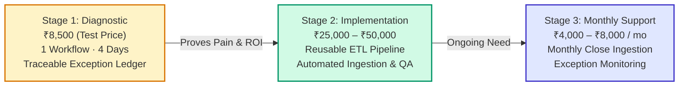

# Pricing Strategy & Unit Economic Model
## Business Data Consolidation & Reporting Automation Practice

**Market Focus:** India (Primary Beachhead: Coimbatore & Chennai, Tamil Nadu)  
**Target ICP:** Owner-managed industrial, electrical, and engineering wholesale distributors using TallyPrime & spreadsheets  
**Strategic Methodology:** Value-Based Packaging · Contribution Margin Modeling · Staged Behavioral Pricing Experiments  
**Effective Date:** 27 October 2026  

---

## Executive Recommendation: Pricing as an Empirical Hypothesis

> [!IMPORTANT]
> **Keep your proposed ₹8,500 four-day diagnostic as a test price—not a confirmed market standard.**  
> Market data indicates that accounting software is available for ₹750–₹2,250/month, whereas outsourced accounting, custom ERP integrations, and enterprise BI consultancies charge anywhere from ₹25,000 to ₹1,50,000.  
> 
> Because software licenses, routine bookkeeping, and cross-system data engineering represent entirely different value propositions, public price points provide *context*, not *proof* of what Coimbatore distributors will pay.

### The Staged Commercial Sequence
Do not attempt to sell a subscription or an enterprise automation contract on Day 1. Deploy three offers in sequence:



1. **Offer 1 — The Reconciliation Diagnostic (₹8,500):** A tightly bounded, 4-business-day investigation of one specific operational-financial question (e.g., *Dispatch vs. Invoice*).
2. **Offer 2 — The Implementation Sprint (₹25,000–₹50,000):** A fixed-price project to build a permanent, locally executed, refreshable data pipeline—quoted *only* after the diagnostic reveals actual data quality and business rules.
3. **Offer 3 — Monthly Close & Refresh Retainer (₹4,000–₹8,000/month):** An ongoing support retainer to run and maintain the monthly ingestion pipeline, verify exceptions, and update management summaries.

---

## 1. Competitive Pricing Benchmarks & Market Context

The table below outlines publicly documented pricing across the Indian SME ecosystem. These benchmarks illustrate the budget categories your target distributor already encounters:

| Alternative / Competitor | Published Market Pricing | Deliverable / Service Scope | Strategic Implication for Our Offer |
| :--- | :--- | :--- | :--- |
| **TallyPrime Silver** | ₹750/mo rental; ₹8,100/yr; ₹22,500 lifetime (+18% GST) | Single-user accounting, inventory, statutory GST, and native bank reconciliation. | Low software cost means clients expect core accounting to be inexpensive. We must prove our value sits *outside* Tally's native capabilities. |
| **TallyPrime Gold** | ₹2,250/mo rental; ₹24,300/yr; ₹67,500 lifetime (+18% GST) | Multi-user accounting and warehouse inventory management. | Even multi-user ERP software costs less annually than a single custom consultancy project. |
| **Zoho Books** | Free plan; Standard ₹749/mo; Professional ₹1,499/mo (annual) | Cloud accounting, bank feeds, recurring invoices, and basic inventory. | Prospects will ask why an external consultant is needed when modern software advertises automated reconciliation. |
| **Microsoft Power BI Pro** | ₹1,165 / user / month (billed annually + GST) | Interactive data modeling, DAX queries, visual dashboards, cloud sharing. | A license is not a solution. Buying Power BI does not define matching logic or fix broken warehouse delivery notes. |
| **Zoho Analytics** | Basic plan starts at ~$24/mo (~₹2,000/mo) | Cloud data connectors, scheduled sync, SQL querying, reporting dashboards. | Self-service BI is cheap; clients fail at data preparation, transformation, and business rule governance. |
| **Upwork Freelancers (India)** | $14–$29 / hour (~₹1,200–₹2,500/hr) | Ad-hoc Excel macros, Python scripting, Power Query fixes, dashboard charts. | Technical labor is abundant. Our ₹8,500 diagnostic is within this range, but must be sold as a **business control outcome**, not hourly scripting. |
| **Custom Automation (e.g., Quensulting)** | ₹30,000 – ₹1,50,000 per workflow | Bespoke business process automation, CRM/ERP integration, script deployment. | Validates that Indian SMEs will spend ₹30k+ for comprehensive workflow automation once trust and scope are proven. |
| **Outsourced Bookkeeping (e.g., iBACT)** | ₹2,499/mo (up to 100 entries); ₹4,999/mo (up to 300 entries) | Routine transaction entry, ledger maintenance, statutory GST, bank rec. | Competes directly for monthly finance budget. However, bookkeepers do not perform cross-system operational audits. |
| **Outsourced MIS (e.g., Prime Core)** | ₹5,999 / month (Growing Business Package) | Monthly P&L, balance sheet compilation, basic management MIS decks. | Confirms willingness to pay ₹5,000–₹8,000/month for reliable monthly financial visibility. |

### The Critical Distinctions
1. **Software Price $\ne$ Service Price:** A ₹750/month Tally license gives the customer a blank ledger. It does not ingest messy transporter delivery challans or detect missing sales invoices.
2. **Advertised Price $\ne$ Closed Transaction:** Public rate cards do not indicate client churn, negotiation discounts, or delivery scope creep.
3. **Routine Bookkeeping $\ne$ Forensic Reconciliation:** Bookkeeping records what is handed over; our diagnostic discovers what was *lost, delayed, or unbilled* between the warehouse gate and the ledger.

---

## 2. Customer Value Perception: Four Economic Lenses

Distributors in Coimbatore and Chennai do not buy Python, pandas, or Power Query for their own sake. They evaluate investments through four distinct economic lenses:

```
                          ┌───────────────────────────────────────────────┐
                          │         FOUR ECONOMIC VALUE LENSES            │
                          └──────────────────────┬────────────────────────┘
                                                 │
         ┌───────────────────────┬───────────────┴───────────────┬───────────────────────┐
         ▼                       ▼                               ▼                       ▼
 ┌───────────────┐       ┌───────────────┐               ┌───────────────┐       ┌───────────────┐
 │ 1. RECOVERED  │       │ 2. FASTER     │               │ 3. EXECUTIVE  │       │ 4. CASH       │
 │    TIME       │       │    RESOLUTION │               │    CONFIDENCE │       │    LEAKAGE    │
 └───────┬───────┘       └───────┬───────┘               └───────┬───────┘       └───────┬───────┘
         │                       │                               │                       │
         ▼                       ▼                               ▼                       ▼
 20–40 clerical hrs     Catching billing lags           Zero unexplained        Actual unbilled
 saved per month at     within 48 hours vs.             audit discrepancies     dispatches or
 ₹250–₹400/hr loaded    at month-end close              at tax filing time      overpaid freight
```

### The Economic Value Formulation
For every qualified prospect, quantify economic value using verifiable customer data:

$$\text{Total Economic Value } (V) = V_{\text{time}} + V_{\text{speed}} + V_{\text{confidence}} + V_{\text{cash}} - C_{\text{ongoing}}$$

Where:
* **$V_{\text{time}}$ (Verified Clerical Capacity):**
  $$\text{Hours Spent / Month} \times \text{Loaded Hourly Cost (₹/hr)} \times 12 \text{ Months}$$
  *Example:* 15 hours/month $\times$ ₹300/hour = ₹4,500/month (₹54,000/year in unlocked operational capacity).
* **$V_{\text{speed}}$ (Faster Exception Resolution):** Detecting an unbilled dispatch within 3 days instead of at quarterly stock count prevents disputed debt and customer friction.
* **$V_{\text{confidence}}$ (Traceable Governance):** Clear source references eliminate management stress, internal disputes between sales and accounts, and year-end audit adjustments.
* **$V_{\text{cash}}$ (Direct Leakage Recovery):** Recovering unbilled delivery challans or overcharged freight. *(Must only be counted after the client validates the finding; never promise this upfront).*

---

## 3. Pricing Model Evaluation

| Pricing Model | Operational Suitability | Primary Advantage | Fatal Risk / Drawback | Recommendation |
| :--- | :--- | :--- | :--- | :--- |
| **Fixed-Fee Diagnostic** | Highly bounded scope (1 workflow, 2 files, 4 days). | Low friction, rapid approval, clear deliverables, minimal buyer risk. | Severe data messiness or scope creep can destroy margins. | **Primary Beachhead Offer (Start Here).** |
| **Fixed-Fee Implementation** | Automating a diagnostic-validated workflow. | Substantial project fee (₹25k–₹50k), clear value milestone. | Scope creep if source schemas change during development. | **Offer immediately following successful diagnostic.** |
| **Monthly Support Retainer** | Recurring monthly close and exception review. | Highly predictable cash flow and high lifetime value (LTV). | Client may treat you as their on-call general IT helpdesk. | **Test only after client repeats 2+ monthly cycles.** |
| **Hourly / Daily Consulting** | Unclear scope, exploratory R&D, or forensic data cleanup. | Completely protects the agency against unknown effort. | Clients resist open-ended, ticking-clock invoices. | **Use only for out-of-scope data repair (₹1,200/hr).** |
| **Usage-Based (Per Row)** | Large-scale, standardized data ingestion. | Scales directly with client transaction volume. | Row volume does not correlate with data complexity or messiness. | **Do not use.** |
| **Pure SaaS Subscription** | Multi-tenant automated cloud platform. | High software margins and enterprise valuation multiples. | Requires massive upfront CapEx; distributors refuse to upload data. | **Do not build yet.** |
| **Contingency / % of Savings** | Fee tied to financial leakage discovered. | Sounds compelling to skeptical prospects. | Constant disputes over attribution, cash realization, and timing. | **Avoid.** Never tie fees to unverified "savings." |

---

## 4. Minimum Viable Price & Unit Margin Modeling

The minimum viable price must cover direct labor (valuing your own time) and operating overhead while guaranteeing a healthy contribution margin.

$$\text{Minimum Viable Price} = \frac{\text{Delivery Labor Cost} + \text{Direct Expenses}}{1 - \text{Target Contribution Margin}}$$

### Cost Breakdown: The 4-Day Diagnostic Model
*Assumptions for planning (10-Hour Total Engagement Envelope):*

| Activity | Allocated Time | Imputed Hourly Rate | Cost Subtotal |
| :--- | :---: | :---: | :---: |
| Data Sanitization, Script Run & Matching | 5.0 hrs | ₹500 / hr | ₹2,500 |
| Exception Verification, QA & Source Checking | 2.5 hrs | ₹500 / hr | ₹1,250 |
| Findings Report Assembly & Walkthrough Prep | 1.5 hrs | ₹500 / hr | ₹750 |
| Intake Call, Client Communications & Handover Call | 1.0 hr | ₹500 / hr | ₹500 |
| **Total Direct Labor** | **10.0 Hours** | **—** | **₹5,000** |
| Direct Project Expenses (Local drive, templates) | — | — | ₹500 |
| Payment Gateway / Bank Administration Fee | — | — | ₹200 |
| **Total Variable Delivery Cost** | — | — | **₹5,700** |

### Margin Analysis at ₹8,500 Test Price
* **Gross Revenue:** ₹8,500 *(Excluding 18% GST)*
* **Variable Cost:** ₹5,700
* **Economic Contribution:** **₹2,800**
* **Contribution Margin:** **32.9%**

```
┌────────────────────────────────────────────────────────────────────────┐
│               DIAGNOSTIC CONTRIBUTION MARGIN SENSITIVITY               │
├───────────────────┬───────────────────┬────────────────────────────────┤
│ TOTAL LABOR TIME  │ VARIABLE COST     │ MARGIN AT ₹8,500 FIXED PRICE   │
├───────────────────┼───────────────────┼────────────────────────────────┤
│ 6 Hours           │ ₹3,700            │ 56.5%  (Highly Profitable)     │
│ 8 Hours           │ ₹4,700            │ 44.7%  (Healthy Pilot Margin)  │
│ 10 Hours          │ ₹5,700            │ 32.9%  (Baseline Target)       │
│ 12 Hours          │ ₹6,700            │ 21.2%  (Squeezed Margin)       │
│ 16 Hours          │ ₹8,700            │ -2.4%  (Loss-Making Job)       │
│ 20 Hours          │ ₹10,700           │ -25.9% (Severe Operational Loss)│
└───────────────────┴───────────────────┴────────────────────────────────┘
```

> [!WARNING]
> **The 10-Hour Delivery Ceiling:** If data cleaning and exception verification exceed 12 hours, the ₹8,500 price point fails. You must enforce strict input formatting standards and invoke the SOW scope change clause if raw data is corrupted.

### Minimum Viable Price Across Delivery Scenarios (Target: 35% Margin)
$$\text{Required Fee} = \frac{\text{Variable Cost}}{1 - 0.35} = \frac{\text{Variable Cost}}{0.65}$$

* **6-Hour Clean Dataset:** ₹3,700 / 0.65 = **₹5,692** *(Supports a ₹6,500 entry price)*
* **10-Hour Standard Scope:** ₹5,700 / 0.65 = **₹8,769** *(Validates our ₹8,500–₹9,000 baseline)*
* **14-Hour Complex Dataset:** ₹7,700 / 0.65 = **₹11,846** *(Requires a ₹12,000 complex tier)*

---

## 5. Experimental Pricing Ladder for the Field

Test three price points across comparable prospects using disciplined, staged experiments:

```
[ ENTRY EXPERIMENT: ₹6,500 ] ──► Low-friction pilot; strictly 1 file / 50k rows.
[ BASELINE HYPOTHESIS: ₹8,500 ] ──► Standard offer; 2 files / 100k rows / 4 days.
[ EXPANDED VALUE: ₹12,000 ] ──► Complex multi-branch / 3-way matching workflow.
```

### Protocol for Fair Price Testing
1. **Never discount randomly:** If a prospect hesitates on ₹8,500, do not drop the price for the same scope. Narrow the scope (e.g., test 1 month of dispatches instead of a full quarter at ₹6,500).
2. **Standardize the pitch:** Maintain identical positioning across all test calls: focus on *traceable exception reporting* and *reclaimed clerical hours*.
3. **Record actual financial commitments:** A prospect saying *"₹8,500 sounds very reasonable"* counts as zero evidence. Only signed SOWs and cleared bank transfers count.

---

## 6. Objection Handling & Procurement Scripts

| Objection | Root Cause to Probe | High-Converting Response Script |
| :--- | :--- | :--- |
| **"Our accountant already handles this."** | Does the accountant cross-reference warehouse delivery chits against sales ledgers? | *"Your CA does an excellent job with statutory tax filings and bank reconciliation. Our diagnostic doesn't touch statutory accounting—we audit the gap between physical warehouse dispatches and billing records to ensure no goods left the gate unbilled."* |
| **"We can do this in Excel ourselves."** | How many hours does it take, and what remains unresolved? | *"Your team certainly has the spreadsheet skills. The question is: do you want your senior accountant spending 3 days every month doing repetitive VLOOKUPs, or would you prefer a refreshable pipeline that highlights unresolved mismatches in seconds?"* |
| **"₹8,500 is too expensive for a test."** | Is it budget, low perceived pain, or lack of trust? | *"Understood. We can reduce the scope to audit just your top 20 customer accounts for last month at ₹5,000, or we can credit the entire ₹8,500 directly toward our implementation sprint if you decide to automate the workflow."* |
| **"Send a free sample using our data first."** | Buyer wants risk elimination; risk of unpaid labor. | *"Because client data is strictly confidential, we never process live data without a formal NDA and engagement. However, I can walk you through our synthetic demonstration dataset right now so you can inspect the exact exception register format."* |
| **"Can you guarantee we will find savings?"** | Unrealistic ROI expectations. | *"We do not guarantee financial leakage because your operations may be running cleanly. What we guarantee is 100% auditable certainty: every single dispatch will either tie out to an invoice or be documented with exact source references."* |
| **"We cannot share sensitive pricing data."** | Data privacy and competitive leak concerns. | *"We sign a legally binding Mutual NDA prior to intake. All processing occurs 100% locally on an offline, air-gapped machine with zero cloud AI tools, and files are permanently deleted 14 business days post-handover."* |

---

## 7. The Standard Market Offer Sheet

Use this standardized, 1-page commercial offer during sales discovery:

```
========================================================================================
                      OPERATIONAL RECONCILIATION DIAGNOSTIC
========================================================================================

PURPOSE:
To identify, match, and document unresolved discrepancies between physical dispatch 
records and TallyPrime sales accounting exports, delivering an audit-ready exception ledger.

ENGAGEMENT SCOPE:
• One (1) bounded reconciliation question (e.g., August Dispatches vs. August Invoices).
• Up to two (2) source workbooks (Excel or CSV format).
• Maximum volume: 100,000 combined transaction rows.
• Turnaround SLA: Four (4) business days from receipt of verified inputs.

CORE DELIVERABLES:
1. Master Reconciliation Summary (Total Records, Matched %, Exception Value).
2. Traceable Excel Exception Register (Row-level source references for every discrepancy).
3. Exception Classification Report:
   - Category A: Dispatched but Unbilled (Cash Leakage Risk)
   - Category B: Quantity / Unit-of-Measure Mismatches
   - Category C: Legitimate Timing Lags & Returns
4. 30-Minute Management Walkthrough & Handover Session.

FIXED PROFESSIONAL FEE:
₹8,500 + 18% GST (Total: ₹10,030)
Terms: 50% advance upon contract signing; 50% upon delivery of final report.
Credit Clause: 100% of the diagnostic fee is credited toward our Implementation Sprint.

DATA SECURITY GUARANTEE:
• 100% Local Processing — Zero cloud AI or public API exposure.
• Formal 1-Page Mutual Non-Disclosure Agreement (NDA) executed prior to file transfer.
• Complete permanent data purge 14 days following project sign-off.
========================================================================================
```

---

## 8. The 5-Level Pricing Evidence Ladder

Evaluate your pricing strategy against this empirical evidence hierarchy:

```
[ LEVEL 5: EXPANSION & REPEAT REVENUE ] ──► Client pays for ₹35k implementation or monthly retainer.
[ LEVEL 4: VERIFIED UNIT MARGINS ] ──► Realized delivery labor <10 hours; EHR > ₹850/hr.
[ LEVEL 3: CLEARED CASH TRANSACTIONS ] ──► At least 2 independent clients pay ₹8,500 upfront.
[ LEVEL 2: DOCUMENTED CLIENT SPENDING ] ──► Verified spend on CAs, clerks, and past software fixes.
[ LEVEL 1: PUBLIC RATE BENCHMARKS ] ──► Competitor websites, Tally pricing, and Upwork guides.
```

### The Pricing Decision Dashboard: Metric Tracking Table

| Prospect Name | Segment & Employee Count | Quoted Fee (₹) | Scope Bounded | SOW Status | Realized Delivery Hours | Effective Hourly Realization | Client Action Taken | Next Offer Accepted |
| :--- | :--- | :---: | :---: | :---: | :---: | :---: | :--- | :--- |
| *Lead 01: Ind. Spares* | Electrical / 25 FTE | ₹8,500 | 2 Files / 45k rows | **Paid** | 9.5 hrs | ₹894 / hr | Billed ₹42k in unbilled DCs | Implementation (₹35k) |
| *Lead 02: Auto Ancillary* | Fasteners / 40 FTE | ₹8,500 | 2 Files / 80k rows | **Declined** | — | — | Objection: "CA handles this" | None |
| *Lead 03: Cable Wholesaler*| Electrical / 15 FTE | ₹6,500 | 1 File / 20k rows | **Paid** | 6.0 hrs | ₹1,083 / hr | Resolved credit note dispute | Monthly Retainer (₹5k/mo) |
| *Lead 04: Hardware Trader* | Tools / 50 FTE | ₹12,000 | 3 Files / 95k rows | Pending | — | — | Awaiting Director Sign-off | — |

---

## 9. Final Strategic Summary & Immediate Actions

1. **Test ₹8,500 as the Standard Entry Fee:** It provides a low psychological hurdle for owners while yielding a 33%–45% economic contribution margin if delivered within 10 hours.
2. **Strictly Guard Delivery Time:** Never allow manual data cleanup to turn an ₹8,500 project into a 25-hour ordeal. Inspect sample schemas within 24 hours of intake.
3. **Use the 100% Credit Mechanism:** Position the diagnostic as an investment, not an expense: *"If our diagnostic proves valuable and you commission our automated pipeline within 14 days, the entire ₹8,500 fee is credited toward implementation."*
4. **Transition to SOW Execution:** Use the formal contract templates in [legal_contract_pack_nda_and_sow.md](file:///c:/Users/sukes/Downloads/business%20plan/legal_contract_pack_nda_and_sow.md) to close your first 2 paying discovery clients.
