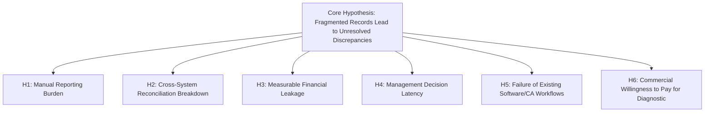
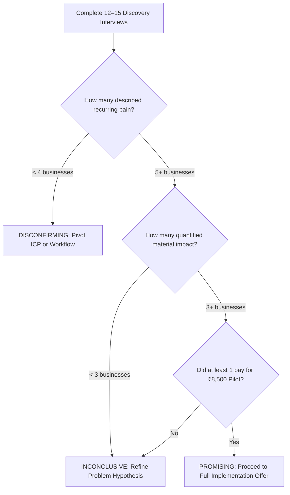

# Problem Validation & Hypothesis Testing Guide
## Business Data Consolidation & Reporting Automation Practice

---

## Executive Summary

The central question is **not** whether businesses use spreadsheets. They clearly do. It is whether a sufficiently specific group of businesses experiences a **recurring, costly reporting or reconciliation problem** that they cannot solve adequately with their existing staff, accounting software, or outside accountant—and whether they will pay an independent specialist to address it.

> [!IMPORTANT]
> **Current Status: Plausible Problem, Unvalidated Commercial Demand.**  
> Public research establishes that manual finance work and spreadsheet use are common. However, public evidence does **not** prove that distributors and manufacturers in Coimbatore, Karur, or Chennai have the specific problems we hypothesize, that those problems cause material losses, or that they will pay ₹8,500 for an external diagnostic.  
> This guide outlines how to rigorously test this hypothesis in 14 days before investing in software, branding, or full-time delivery.

---

## 1. The Core Problem Hypotheses

Our business idea spans several distinct operational failure modes. We must separate them into testable hypotheses rather than assuming they represent a single uniform market:



### The 6 Independent Hypotheses

| Hypothesis | What It Asserts | Concrete Observable Example | What Must Be Empirically Proven |
| :--- | :--- | :--- | :--- |
| **H1: Manual Reporting Burden** | Staff burn excessive unbillable hours copying and merging files. | Staff spend 2 days every month manually combining Tally and warehouse Excel files. | Verified hours, monthly recurrence, and actual staff involved. |
| **H2: Cross-System Breakdown** | Dispatches do not match invoices, returns, or bank credits. | Factory gate dispatches leave on challans but don't tie out to Tally sales registers. | Recent specific mismatches, their causes, and how staff resolved them. |
| **H3: Financial Leakage** | Inconsistencies result in real unbilled dispatches or overcharges. | Unbilled challans >5 days old, duplicate vendor bills, or courier slab overcharges. | Confirmed, documented monetary losses—not just theoretical exceptions. |
| **H4: Decision Latency** | Management receives figures too late to act on margins or dead stock. | Monthly P&L and stock valuation arrive on the 20th of the following month. | Actual reporting date and a specific business decision compromised by the delay. |
| **H5: Inadequate Existing Fixes** | Tally, Excel macros, and CAs leave a recurring operational gap. | Tally handles statutory tax, but leaves warehouse/job-work tracking in shadow Excel sheets. | Past tools or consultants tried, why they failed, and why alternatives fall short. |
| **H6: Willingness to Pay** | The business owner will pay ₹8,500 ($250) for a 4-day diagnostic. | Owner signs a 1-page NDA and pays upfront for a 2-file reconciliation. | A cleared bank payment, not verbal enthusiasm or compliments. |

---

## 2. Public Evidence: What It Supports vs. What It Does Not Prove

| Source & Survey Finding | What It Supports (Context) | What It Does NOT Prove (The Gap) |
| :--- | :--- | :--- |
| **India — ICRIER MSME Survey:**<br>2,365 MSMEs surveyed across 12 states and 20+ clusters studying digitalization. | Digitalization and technology adoption are high-priority concerns for Indian MSMEs. | Does not prove how many Tamil Nadu units have reconciliation pain or will hire an external consultant. |
| **US — Intuit QuickBooks Business Solutions Survey (2024):**<br>54% cited manual/repetitive tasks; 45% cited inadequate reporting; average 25 hrs/week on manual data entry across apps. | Disconnected systems and manual data entry are recognized pain points. | Vendor-commissioned survey. Does not prove willingness to pay an independent data engineer. |
| **UK — Department for Business & Trade Survey (2024):**<br>46% of small businesses use spreadsheets for record keeping; 69% use web software. | Spreadsheets and software coexist in real-world accounting workflows. | Spreadsheet use does not mean the workflow is broken or that an external specialist is needed. |
| **Australia — Institute of Certified Bookkeepers (2024):**<br>Bank reconciliation, AP, and data entry are common recurring responsibilities with heavy non-billable time. | Finance professionals spend massive time on recurring reconciliation tasks. | Survey reflects bookkeeper tasks, not representative demand for external Python automation. |

> [!WARNING]
> **The Competitive Constraint:** TallyPrime already includes built-in bank reconciliation and export tools. An offer positioned simply as *"I automate bank reconciliation in Tally"* has weak differentiation. Our positioning must strictly focus on **cross-system reconciliation** (e.g., Warehouse Gate Logs vs. Tally vs. Bank UTRs) that native Tally cannot perform automatically.

---

## 3. Measuring Frequency, Severity, Consequences & Urgency

Never rely on vague statements like *"reporting is a headache."* Use this framework to quantify reality:

| Dimension | Evidence to Collect | Strong Evidence (Pursue) | Weak Evidence (Disqualify) |
| :--- | :--- | :--- | :--- |
| **Frequency** | How often the task occurs or breaks | Recurring weekly or monthly event with documented examples | *"Sometimes it happens when someone makes a typo."* |
| **Severity** | Hours, staff count, or monetary variance | Named employees spend 18 hours/mo on a specific file | *"It's just irritating to deal with."* |
| **Consequences** | Actual business impact | A payment was delayed, a challan went unbilled, or an order was missed | A hypothetical fear (*"We might lose money someday"*). |
| **Urgency** | Event forcing immediate action | An upcoming tax audit, an active bank dispute, or repeated stockouts | *"We should probably modernize this sometime next year."* |
| **Past Investment** | Resources already spent trying to fix it | Hired an extra MIS clerk, bought an add-on, or paid overtime | General claim that they would consider automation. |
| **Decision Authority** | Access to the person who signs the check | Speaking with MD/Owner who can approve budget on the call | Speaking with a junior clerk who cannot authorize software. |

### The Impact Baseline Formulas

$$\text{Monthly Labour Cost} = \text{Hours Spent per Cycle} \times \text{Cycles per Month} \times \text{Loaded Hourly Cost}$$

*Example:* If a distributor's accounts clerk spends 18 hours/month reconciling dispatches at a loaded cost of ₹350/hr:
$$\text{Monthly Labour Cost} = 18 \times ₹350 = ₹6,300/\text{month}$$

#### The Three Categories of Discrepancies (Never Conflate Them)
1. **Potential Exposure:** A raw data mismatch that *might* be a problem (e.g., an unbilled challan that might just be a sample).
2. **Confirmed Discrepancy:** A mismatch verified against physical records as a genuine operational error.
3. **Realized Benefit:** Cash actually recovered, prevented from overpayment, or hours demonstrably redeployed.

---

## 4. How Customers Solve This Today (The Real Competition)

Our real competition is rarely other consultants; it is the existing workarounds:

| Current Alternative | Why the Owner Chooses It | Its Hidden Failure Mode | Our Differentiating Wedge |
| :--- | :--- | :--- | :--- |
| **Manual Excel & Copy-Paste** | Cheap, familiar, zero new software to learn. | Fragile, VLOOKUP crashes, formula errors, key-person risk. | Replaces manual copy-pasting with a 1-click refresh without changing staff software. |
| **Tally Native Features** | Already paid for, trusted for GST and statutory tax. | Cannot cross-reconcile external files (courier CSVs, gate logs). | Bridges the gap between outside operational trackers and Tally. |
| **External CA / Bookkeeper** | Trusted relationship, handles compliance and audit. | CAs charge for audit, not daily operational reconciliation. | Positions as pre-audit preparation that saves the CA unbillable hours. |
| **Internal Macros / Templates** | Built in-house, low incremental cash outlay. | Breaks permanently when column headers change or creator resigns. | Robust Python/Power Query pipelines with error handling and runbooks. |
| **Full ERP Overhaul** | Centralized, enterprise-grade promises. | Costs ₹5L–₹25L, takes 6–12 months, high staff failure rate. | Delivers 80% of ERP visibility in 4 days at 2% of the cost. |
| **Do Nothing / Tolerate It** | Zero immediate cash outlay. | Silent margin leakage, unresolved inventory errors. | Exposes exact cash lost to inertia (e.g., unbilled challans). |

---

## 5. The Neutral Customer Discovery Interview Script

Conduct **12–15 discovery interviews**: 6 distributors/manufacturers, 3 finance/MIS staff, and 3 CA managing partners.  
*Rule: 20 minutes maximum. Never pitch software, never demo, never ask "Would you buy a dashboard?"*

### The 8 Core Questions

1. **Reconstruct the Workflow:**
   > *"Could you walk me through how your team prepared its most recent monthly report—from collecting the first numbers to the final version?"*
2. **Identify the Real Sources:**
   > *"What specific files, spreadsheets, or software screens did your team have to pull together to finalize those figures?"*
3. **Find a Recent Failure:**
   > *"Can you recall the last time two reports or records showed different numbers for the same thing—like physical stock vs. Tally, or dispatches vs. invoices?"*
4. **Measure Frequency & Effort:**
   > *"How often does that happen, and what did your team have to do to track down the difference?"*
5. **Understand Consequences:**
   > *"What actually happened as a result of that mismatch? Did it delay a payment, hold up a decision, or require a correction?"*
6. **Learn What They Tried:**
   > *"What have you or your team already tried to make this process easier or faster in the past?"*
7. **Understand Current Spending:**
   > *"How many staff hours or overtime did that work consume last month, and who had to get involved?"*
8. **Establish Priority:**
   > *"What other urgent business priorities compete for attention when this reporting bottleneck comes up?"*

---

## 6. Riskiest Assumptions & Cheapest Experiments

| Riskiest Assumption | Cheapest Useful Experiment | Validation Signal (Pass) | Invalidation Signal (Fail) |
| :--- | :--- | :--- | :--- |
| **Target businesses have recurring manual reporting pain.** | Conduct 12–15 neutral discovery interviews. | Multiple businesses independently describe similar recurring bottlenecks. | Most report that existing processes and Tally work fine. |
| **The problem has material financial/time impact.** | Ask for specific hours, delayed decisions, and past incidents. | Measurable recurring time (>15 hrs/mo) or verified financial exposure. | Inconvenience is minor (<2 hrs/mo); no measurable consequences. |
| **Existing tools do not solve the gap.** | Review current workflows and previous automation attempts. | Specific cross-system gaps remain after Tally and Excel macros. | Current Tally features or bookkeeper already resolve it adequately. |
| **Clients will trust an external specialist with data.** | Propose the 1-page offline NDA with zero public AI usage. | Prospect agrees to share a 200-row sample under NDA. | Prospect refuses to share files or discuss data under any terms. |
| **Clients will pay ₹8,500 ($250) for a diagnostic.** | Offer the fixed-scope pilot to qualified prospects. | At least 1 prospect pays upfront for the diagnostic. | Prospects offer polite compliments but refuse to pay ₹8,500. |

---

## 7. Problem Validation Decision Scorecard (15 Interviews)

Evaluate interview results strictly against these pre-set criteria:



* **Promising (Proceed to Paid Sprints):**
  * At least **5 of 15** interviewees describe a recent, specific breakdown in a similar cross-system workflow.
  * At least **3** can provide a credible estimate of recurring time cost (>15 hrs/mo) or financial leakage.
  * At least **2** request a formal SOW.
  * At least **1 pays the ₹8,500 / $250 upfront fee**.
* **Inconclusive (Narrow the Hypothesis):**
  * Problems exist, but every business describes a completely different workflow (no pattern).
  * Staff complain, but business owners don't consider the problem worth spending money on.
* **Disconfirming (Stop Pursuing This Angle):**
  * Most interviewees report their existing Excel/Tally setup works adequately.
  * Qualified buyers repeatedly decline a ₹8,500 diagnostic even when the pain is acknowledged.

---

## 8. Practical 14-Day Validation Action Plan

```
DAYS 1–2: NARROW HYPOTHESIS & TARGET LIST
- Focus on one narrow workflow: Wholesale distributors using Tally + dispatch/stock Excel trackers.
- Build a list of 25 local distributors in Coimbatore / Chennai / Karur.

DAYS 3–6: CONDUCT FIRST 8 DISCOVERY INTERVIEWS
- Reach out using the 2-sentence Mom Test opener.
- Conduct 8 interviews; capture real past incidents without pitching.

DAYS 7–8: ANALYZE PATTERNS
- Review notes: Are at least 3 businesses describing the exact same reconciliation failure?
- If stories are completely scattered, narrow the criteria.

DAYS 9–11: CONDUCT FINAL 5–7 INTERVIEWS
- Validate whether the pattern holds with additional businesses and CA managing partners.

DAYS 12–14: TEST WILLINGNESS TO PAY
- Offer the 4-Day ₹8,500 Diagnostic Pilot to the 2–3 prospects with the most acute pain.
- Send the 3-page NDA/SOW PDF via Zoho Sign.
- Review results against the Decision Scorecard.
```
