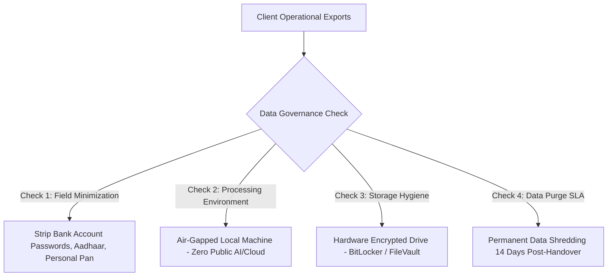

# Regulatory Compliance, Data Governance & Operational Risk Assessment
## Business Data Consolidation & Reporting Automation Practice

**Working Jurisdiction:** India (Primary Client Beachhead: Coimbatore & Chennai, Tamil Nadu)  
**Operating Nature:** Sole-Proprietor Technical Services & Business Data Consulting  
**Regulatory Class:** Unregulated Data & Software Consultancy (Non-Statutory / Non-Financial Audit)  
**Effective Audit Date:** 27 October 2026  

---

## Executive Assessment: Legal Nature of the Practice

> [!IMPORTANT]
> **This business is an unregulated technical data consultancy, not a chartered accountancy practice, financial auditing firm, or medical device software manufacturer.**
> 
> You do **not** require statutory auditing certifications, SEBI approvals, factory manufacturing licenses, or BIS hardware certifications. However, because you ingest raw commercial ledgers, customer pricing lists, and transaction histories, **data privacy, confidentiality, and contractual risk allocation represent your highest legal exposure.**

```
┌───────────────────────────────────────────────────┬───────────────────────────────────────────────────┐
│ WHAT APPLIES ON DAY 1 (MANDATORY & ESSENTIAL)     │ WHAT DOES NOT APPLY AT LAUNCH (DEFERRED / N/A)    │
├───────────────────────────────────────────────────┼───────────────────────────────────────────────────┤
│ • Sole Proprietorship / Basic Entity Structuring  │ • BIS Certification & Hardware Testing            │
│ • PAN & Business Current Bank Account             │ • Factory & Industrial Manufacturing Approvals    │
│ • Income Tax (Section 44ADA / Advance Tax)        │ • CDSCO / Medical Device Approvals                │
│ • GST Evaluation (₹20 Lakh Service Threshold)    │ • ISO/IEC 27001 Formal External Certification     │
│ • Digital Personal Data Protection Act (DPDPA)    │ • Statutory Financial Audit / Tax Certification   │
│ • Enforceable Mutual NDA & Bounded SOW Contract   │ • Private Limited Company Formal Incorporation    │
│ • CERT-In Cybersecurity Incident Framework        │ • EPF / ESI / POSH Headcount Statutory Obligations│
└───────────────────────────────────────────────────┴───────────────────────────────────────────────────┘
```

---

## 1. Business Registration, Entity Structuring & Local Taxes

### Structure Selection: Sole Proprietorship vs. LLP vs. Pvt Ltd

| Entity Structure | Setup Cost | Compliance Burden | Suitability for Launch | Recommendation |
| :--- | :---: | :---: | :---: | :--- |
| **Sole Proprietorship** | **Near ₹0** | Minimal (Individual ITR) | **Optimal for Validation.** Lowest friction to invoice and test. Personal liability is protected via strict SOW liability caps. | **Start Here.** |
| **Limited Liability Partnership (LLP)** | ₹5,000–₹10,000 | Moderate (Annual ROC filings) | Suitable if onboarding a formal co-founder with split equity. | Revisit when adding a partner. |
| **Private Limited Company** | ₹12,000–₹25,000 | High (Audits, secretarial, board mins) | Premature for early consulting. Only required if raising equity capital or building multi-tenant SaaS. | Strictly defer. |

---

### Core Business Registrations & Tax Framework

#### 1. Udyam MSME Registration
* **Cost:** **100% Free** *(Official Portal: [udyamregistration.gov.in](https://udyamregistration.gov.in))*.
* **Purpose:** Classifies the practice as a "Micro Enterprise" under Service classification (NIC Code: `62011 - Software and data consulting`).
* **Benefits:** Access to priority MSME banking, protection against delayed commercial payments under Section 15 of the MSMED Act, 2006.
* *Action:* Complete online self-declaration using Aadhaar and PAN. Never pay third-party intermediaries.

#### 2. Goods and Services Tax (GST)
* **General Threshold:** In Tamil Nadu, the mandatory registration threshold for service providers is **₹20 Lakh aggregate annual turnover** *(across all Pan-India supplies)*.
* **Inter-State Exemption:** Under *CBIC Notification No. 10/2017-Integrated Tax*, service providers with aggregate turnover below ₹20 Lakh are generally exempt from mandatory registration even when supplying services across state lines (e.g., operating from Rajasthan while servicing Tamil Nadu clients), subject to statutory conditions.
* **Operating Protocol:**
  - *Below ₹20 Lakh:* You do not collect GST and do not issue tax invoices. Issue standard commercial invoices.
  - *Above ₹20 Lakh:* Mandatory GST registration. Issue compliant tax invoices charging **18% GST** (SAC Code: `998314 - IT design and development / data processing services` or `998311 - Management consulting`).

#### 3. Income Tax & Presumptive Taxation (Section 44ADA)
* **Presumptive Taxation:** Under Section 44ADA of the Income Tax Act, 1961, eligible professionals (including technical consultants and software engineers) with gross receipts $<₹50\text{–}₹75\text{ Lakh}$ can declare **50% of gross receipts as taxable net income**, eliminating the requirement to maintain audited financial ledgers.
* **TDS Withholding:** Corporate clients may deduct **1% to 2% TDS** under Section 194C or 194J. Obtain Form 16A quarterly and reconcile against your Income Tax Form 26AS/AIS to claim tax credits.
* **Advance Tax:** If estimated net tax liability exceeds ₹10,000/year, pay advance tax installments quarterly (15-Jun, 15-Sep, 15-Dec, 15-Mar).

#### 4. Premises & Local Municipal Trade Licensing
* **Home Office:** If operating from a residential home office, municipal trade licensing and Tamil Nadu Shops and Establishments registrations generally do not apply for a solo proprietor with zero employees.
* **Commercial Premises:** If leasing dedicated commercial office space in Coimbatore or Chennai, verify municipal corporation trade license requirements and commercial landlord lease permissions.

---

## 2. Privacy, Cybersecurity & Customer Data Obligations

Data protection and confidentiality represent the core operational risk for this practice. Even if files lack consumer personal data, distributor sales registers contain **commercially sensitive trade secrets** (margins, vendor rebate slabs, customer credit limits).



### India's Data Protection Framework (DPDPA 2023)
* **Status as of October 2026:** India notified the Digital Personal Data Protection Rules in November 2025 with a phased implementation timeline. The primary processing obligations under Sections 3–17 transition over an 18-month window (targeted for full enforcement by **May 2027**).
* **Role Classification:** The practice operates primarily as a **Data Processor** executing data reconciliation strictly on the documented instructions of the client (**Data Fiduciary**).
* **Contractual Mandate:** Your services agreement must explicitly establish that the client has secured all necessary legal consents before handing over employee or customer data.

### CERT-In Cybersecurity Directives (Section 70B of IT Act)
* Under official CERT-In directions, covered entities must report specified cybersecurity incidents (unauthorized database access, data leaks, ransomware) within **6 hours** of detection.
* Maintain complete, immutable transformation logs for all processed customer datasets.

---

### The 8-Point Pre-Client Launch Security Checklist

- [ ] **1. Dedicated Business Profile:** Maintain an isolated operating system profile on a laptop equipped with full-disk encryption (BitLocker / FileVault) and a strict 5-minute screen timeout.
- [ ] **2. Multi-Factor Authentication (MFA):** Enforce hardware-token or authenticator-app MFA across all business email, cloud storage, and GitHub accounts.
- [ ] **3. Air-Gapped Local Processing:** Execute all data manipulation locally using Python/pandas or Excel. **Zero customer records may be uploaded to public LLMs (ChatGPT, Claude web apps, unverified cloud APIs).**
- [ ] **4. Field Minimization Protocol:** Require clients to redact bank account credentials, employee salary records, and consumer phone numbers prior to file transfer.
- [ ] **5. Read-Only Ingestion:** Never edit client original files. Store source exports in a write-protected `01_raw_vault/` directory and execute transformations exclusively on working copies.
- [ ] **6. Segregated Directory Architecture:** Maintain separate encrypted folders for each client:
  ```
  c:/client_vault/
  ├── client_A_coimbatore/
  │   ├── 01_raw_source/ (Read-only)
  │   ├── 02_scripts/ (Version controlled ETL)
  │   └── 03_deliverables/ (Exception registers & PDF reports)
  ```
- [ ] **7. Documented Data Deletion SLA:** Contractually guarantee the permanent, cryptographic wiping of raw client records **14 business days** following final handover sign-off.
- [ ] **8. Incident Response Protocol:** Maintain an offline incident escalation plan containing client contact information to provide written notification within 6 hours in the event of hardware theft or breach.

---

## 3. Contracts, Intellectual Property & Liability Allocation

### The Triad of Legal Protection
Never accept live customer data without executing the standardized contract pack from [legal_contract_pack_nda_and_sow.md](file:///c:/Users/sukes/Downloads/business%20plan/legal_contract_pack_nda_and_sow.md):

```
┌───────────────────────────────────────┬───────────────────────────────────────┬───────────────────────────────────────┐
│ 1. MUTUAL NDA                         │ 2. FIXED-SCOPE SOW                    │ 3. SCHEDULE A LIABILITY LIMIT         │
├───────────────────────────────────────┼───────────────────────────────────────┼───────────────────────────────────────┤
│ • Protects client trade secrets       │ • Binds scope to 1 workflow / 2 files │ • Caps total financial liability to   │
│ • Governs offline data hygiene        │ • Sets 4-day delivery timeline        │   100% of fees paid (₹8,500)          │
│ • Prohibits third-party disclosure    │ • Defines acceptance criteria         │ • Excludes consequential / lost-profit│
│ • Defines permitted analysis purpose  │ • Enforces 50% upfront payment        │   damages under Section 73 Contract Act│
└───────────────────────────────────────┴───────────────────────────────────────┴───────────────────────────────────────┘
```

### Intellectual Property Allocation (Indian Copyright Act, 1957)
* **Customer Retains:** All ownership of raw source records, customer transaction history, and specific business financial data.
* **Customer Receives:** A perpetual, non-exclusive, royalty-free license to use the delivered Exception Register and configured Power Query/Python pipeline for internal operations.
* **Agency Retains:** Complete, unencumbered ownership of all pre-existing code, generic Python cleaning scripts, RegEx parsers, exception taxonomies, and modular ETL templates.

---

## 4. Operational Boundaries: What We Do vs. What We Reject

To avoid unauthorized practice of regulated professions or civil liability, maintain strict operational boundaries:

```
┌───────────────────────────────────────────────────┬───────────────────────────────────────────────────┐
│ PERMITTED OPERATIONAL SERVICES                    │ STRICTLY REJECTED SERVICES (OUT OF BOUNDS)       │
├───────────────────────────────────────────────────┼───────────────────────────────────────────────────┤
│ • Cross-system record reconciliation              │ • Statutory financial audit or tax certification  │
│ • Operational exception identification            │ • Legal, tax optimization, or accounting advice   │
│ • Data cleaning, formatting, and deduplication    │ • Taking custody of live bank OTPs or logins      │
│ • Management MIS dashboard compilation            │ • Directly writing edits to live Tally databases  │
│ • Documented exception reporting with source rows │ • Declaring legal fraud, embezzlement, or theft   │
└───────────────────────────────────────────────────┴───────────────────────────────────────────────────┘
```

> [!WARNING]
> **The Exception Reporting Boundary:**  
> In all deliverables, an unlinked delivery challan or missing invoice must be classified as an **"Operational Discrepancy Requiring Investigation."**  
> Never label an exception as *"Financial Fraud," "Tax Evasion,"* or *"Embezzlement."* Providing legal or fraud opinions exposes you to severe defamation and professional negligence liabilities.

---

## 5. Geographic Operating Reality: Remote vs. Local Base

Your business plan targets Coimbatore and Chennai distributors. However, your physical operating base dictates local licensing:

| Scenario | Tax & Registration Reality | Recommended Action |
| :--- | :--- | :--- |
| **Operating from Jodhpur, Rajasthan (Servicing Tamil Nadu Remotely)** | Registered place of business is Rajasthan. GST applies in Rajasthan. No Tamil Nadu municipal trade license required. Inter-state services governed by CBIC Notification No. 10/2017. | Do **not** register a Tamil Nadu office. Invoice from your home state; deliver remotely via video walkthrough. |
| **Operating Physically in Coimbatore / Chennai (On-Site Office)** | Registered place of business is Tamil Nadu. Tamil Nadu professional tax and municipal trade rules apply if commercial space is rented. | Obtain local municipal trade NOC if renting commercial property in Gandhipuram or Parrys. |

---

## 6. The 17-Point Pre-Flight Launch Compliance Gate

Use this compliance tracker prior to closing your first paying engagement:

```
[ Gate 1: Entity & Tax Setup ] ──► [ Gate 2: Security & Storage ] ──► [ Gate 3: Contractual Armor ]
```

### Gate 1: Entity & Tax Setup
- [ ] 1. Settle legal operating structure (Sole Proprietorship baseline).
- [ ] 2. Open dedicated Business Current Bank Account under the trade name.
- [ ] 3. Complete free online Udyam MSME registration.
- [ ] 4. Consult a CA to verify GST threshold status and 44ADA presumptive eligibility.
- [ ] 5. Establish standard commercial invoice numbering template (`INV-2026-001`).

### Gate 2: Security & Local Processing
- [ ] 6. Enable full-disk encryption (BitLocker / FileVault) on primary work machine.
- [ ] 7. Enforce multi-factor authentication on all business email and software accounts.
- [ ] 8. Procure dedicated external encrypted backup hardware.
- [ ] 9. Configure air-gapped local Python/pandas environment with zero cloud sync.
- [ ] 10. Implement field-minimization checklist for client data intake.
- [ ] 11. Draft written incident-response escalation contact sheet.

### Gate 3: Contracts & Client Armor
- [ ] 12. Finalize 1-page Mutual Non-Disclosure Agreement (NDA).
- [ ] 13. Finalize fixed-scope 4-day Reconciliation Diagnostic Statement of Work (SOW).
- [ ] 14. Embed Schedule A Limitation of Liability clause (capped at 100% of fees paid).
- [ ] 15. Embed explicit intellectual property allocation (Agency retains generic scripts).
- [ ] 16. Verify that all reports contain statutory neutrality and audit disclaimer notices.
- [ ] 17. Confirm customer data deletion and shredding schedule (14 days post-handover).

---

## 7. Matters Requiring Professional Advisory Prior to Scale

Before crossing ₹10,00,000 in annual collections or hiring your first employee, conduct these specific professional reviews:

1. **Chartered Accountant (CA):**  
   *Scope:* Confirm aggregate turnover tracking toward the ₹20 Lakh GST threshold, verify Section 44ADA eligibility for IT filing, and reconcile TDS Form 26AS credits.
2. **Indian Technology / Commercial Lawyer:**  
   *Scope:* Review Master Services Agreement (MSA) indemnification clauses and ensure compliance with full DPDPA 2023 Rules enforcement prior to May 2027.
3. **Insurance Broker (When Servicing >₹100 Cr Enterprise Clients):**  
   *Scope:* Price an entry-level **Professional Indemnity & Errors & Omissions (E&O)** policy (coverage: ₹25 Lakh to ₹50 Lakh) if enterprise client vendor onboarding requires proof of insurance.
