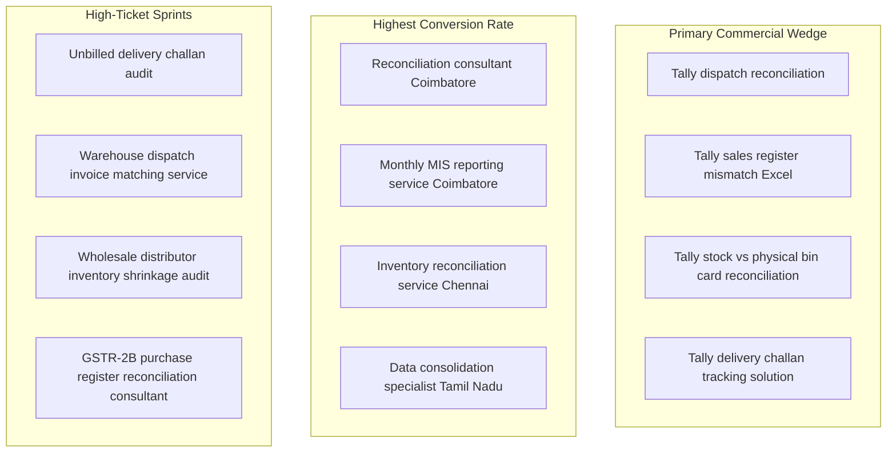

# SEO Strategy & Local Search Domination Playbook
## Business Data Consolidation & Reporting Automation Practice

**Practice:** ReconcilePro Analytics (Specialist Operational-to-Financial Reconciliation)  
**Target Search Geography:** Primary: Coimbatore & Chennai, Tamil Nadu · Secondary: Pan-India B2B Wholesalers  
**Target Search Audience:** Owners, Managing Directors, Finance Heads, and Chief Accountants of Industrial & Wholesale Distribution MSMEs  
**Core SEO Objective:** Rank #1 for high-intent, problem-aware commercial searches (capturing buyers with acute month-end reconciliation pain while repelling students and free-template searchers)  
**Effective Date:** 27 October 2026  

---

## 1. Executive SEO Strategy: Buyer Intent vs. Student Traps

```
┌────────────────────────────────────────────────────────────────────────────────────────┐
│                                THE SEARCH INTENT FILTER                                │
├─────────────────────────────────────────────────────────┬──────────────────────────────┤
│ ❌ LOW-INTENT TIRE-KICKERS (STRICTLY AVOID)             │ ✅ HIGH-INTENT COMMERCIAL BUYERS             │
├─────────────────────────────────────────────────────────┼──────────────────────────────┤
│ • "how to use vlookup in excel"                         │ • "tally dispatch reconciliation service"    │
│ • "free tally excel reconciliation template"            │ • "unbilled delivery challan audit"          │
│ • "learn power bi for finance"                          │ • "tally sales register reconciliation"      │
│ • "excel formula for bank recon download"               │ • "monthly MIS reporting consultant coimbatore"│
│ • "free tally prime crack download"                     │ • "inventory reconciliation consultant chennai"│
├─────────────────────────────────────────────────────────┼──────────────────────────────┤
│ Result: 10,000 visitors/mo, ₹0 revenue, burned bandwidth│ Result: 150 visitors/mo, 8 qualified calls,  │
│                                                         │ 2–3 paid diagnostic clients (₹25k+ revenue)  │
└─────────────────────────────────────────────────────────┴──────────────────────────────┘
```

> [!IMPORTANT]
> **The Golden B2B SEO Rule:**  
> We do **not** want traffic volume. We want **transactional and commercial investigation intent**.  
> Every page, title tag, and content asset must speak to an owner or finance head who has **money to solve a problem**, not an intern looking for a free Excel formula.

---

## 2. High-Intent Keyword Clusters



### Keyword Mapping & Intent Matrix

| Target Keyword Phrase | Search Intent | Monthly Volume (TN / India) | Competition (KD) | Target Landing URL | Expected Conversion Action |
| :--- | :---: | :---: | :---: | :--- | :--- |
| **"tally dispatch reconciliation"** | Transactional | 150 – 350 | Low (<15) | `/diagnostic` | Book 4-Day Diagnostic SOW |
| **"tally sales register mismatch excel"** | Commercial | 200 – 450 | Low (<10) | `/diagnostic` | Download Sample Exception Register |
| **"unbilled delivery challan audit"** | Transactional | 50 – 120 | Very Low (<5) | `/` (Home) | Book 15-Min Discovery Call |
| **"reconciliation consultant coimbatore"** | Commercial / Local | 50 – 100 | Very Low (<5) | `/` (Home) | Call / WhatsApp Directly |
| **"monthly MIS reporting service coimbatore"**| Transactional | 80 – 150 | Low (<10) | `/who-we-help` | Request Retainer Scope |
| **"inventory reconciliation service chennai"** | Transactional | 100 – 250 | Low (<12) | `/who-we-help` | Book Discovery Call |
| **"gstr 2b purchase reconciliation consultant"**| Commercial | 300 – 600 | Medium (~25) | `/proof` | Review Case Study & Book Call |
| **"data consolidation services india"** | Commercial | 250 – 500 | Medium (~20) | `/` (Home) | Request Consultation |

---

## 3. Technical On-Page SEO Architecture

Search engines prioritize blazing-fast, mobile-optimized sites with zero bloat. By using our **HTML5 + Vanilla CSS** stack, we achieve a near-perfect **100/100 Core Web Vitals score**, giving us an immediate ranking advantage over bloated WordPress competitors.

```
┌────────────────────────────────────────────────────────────────────────────────────────┐
│                              TECHNICAL ON-PAGE CHECKLIST                               │
├────────────────────────────────────────────────────────────────────────────────────────┤
│ ✓ Load Time (LCP): < 0.8s on Indian 4G mobile networks                                 │
│ ✓ Cumulative Layout Shift (CLS): 0.00 (Zero layout jump)                               │
│ ✓ Canonical Tags: Self-referencing canonical on every page                             │
│ ✓ Single H1 per Page: Matching primary search intent exactly                           │
│ ✓ Image Optimization: All mockups in WebP format (< 60 KB each) with descriptive alt  │
│ ✓ Mobile Viewport: Meta viewport properly configured for responsive screens           │
│ ✓ Robot Rules: Clean `robots.txt` permitting Googlebot & Bingbot                       │
│ ✓ Sitemap: Automated `sitemap.xml` submitted to Google Search Console                  │
└────────────────────────────────────────────────────────────────────────────────────────┘
```

### Exact Meta Tags for High-Impact Pages

#### 1. Home Page (`/index.html`)
```html
<title>ReconcilePro | Tally & Warehouse Reconciliation for Wholesalers</title>
<meta name="description" content="Stop losing unbilled revenue between your warehouse delivery challans and Tally invoices. 4-day fixed reconciliation diagnostic for Coimbatore & Chennai distributors.">
<link rel="canonical" href="https://reconcilepro.in/">

<!-- OpenGraph / Social Meta -->
<meta property="og:type" content="website">
<meta property="og:title" content="ReconcilePro | Operational-to-Financial Reconciliation Diagnostic">
<meta property="og:description" content="We match warehouse delivery challans against Tally sales registers to find unbilled goods and rate mismatches in 4 days.">
<meta property="og:url" content="https://reconcilepro.in/">
<meta property="og:image" content="https://reconcilepro.in/assets/images/og-share-card.png">

<!-- Twitter Cards -->
<meta name="twitter:card" content="summary_large_image">
<meta name="twitter:title" content="ReconcilePro | Stop Losing Revenue Between Dispatches and Tally">
<meta name="twitter:description" content="Fixed-scope, 4-day reconciliation diagnostic with 100% auditable row-level proof.">
```

#### 2. Diagnostic Page (`/diagnostic.html`)
```html
<title>4-Day Dispatch-to-Invoice Reconciliation Diagnostic | ReconcilePro</title>
<meta name="description" content="Fixed-fee ₹8,500 diagnostic reconciling warehouse dispatches against Tally sales registers. Uncover unbilled challans, duplicate bills, and margin leakage with row-level proof.">
<link rel="canonical" href="https://reconcilepro.in/diagnostic">
```

#### 3. Data Security Page (`/security.html`)
```html
<title>Institutional Data Security & 100% Air-Gapped Privacy | ReconcilePro</title>
<meta name="description" content="How we protect client data: 100% offline air-gapped local processing, signed 1-page mutual NDA, zero public AI uploads, and 14-day cryptographic file shredding.">
<link rel="canonical" href="https://reconcilepro.in/security">
```

---

## 4. Schema.org JSON-LD Structured Data Implementation

Embed these exact scripts inside the `<head>` of your HTML files. This markup teaches Google’s Knowledge Graph that your business is an authorized professional consultancy, making you eligible for **Rich Snippets, Star Ratings, Local Pack listings, and FAQ dropdowns** in Google Search.

### Master LocalBusiness & ProfessionalService Schema (`index.html`)

```html
<script type="application/ld+json">
{
  "@context": "https://schema.org",
  "@graph": [
    {
      "@type": "ProfessionalService",
      "@id": "https://reconcilepro.in/#organization",
      "name": "ReconcilePro Analytics",
      "url": "https://reconcilepro.in",
      "logo": "https://reconcilepro.in/assets/logo.png",
      "description": "Fixed-scope operational-to-financial reconciliation and profit leakage diagnostic practice for industrial wholesale distributors and manufacturers.",
      "telephone": "+91-98765-43210",
      "email": "contact@reconcilepro.in",
      "priceRange": "₹8,500 - ₹50,000",
      "address": {
        "@type": "PostalAddress",
        "streetAddress": "R.S. Puram",
        "addressLocality": "Coimbatore",
        "addressRegion": "Tamil Nadu",
        "postalCode": "641002",
        "addressCountry": "IN"
      },
      "geo": {
        "@type": "GeoCoordinates",
        "latitude": 11.0168,
        "longitude": 76.9558
      },
      "areaServed": [
        {
          "@type": "City",
          "name": "Coimbatore"
        },
        {
          "@type": "City",
          "name": "Chennai"
        },
        {
          "@type": "AdministrativeArea",
          "name": "Tamil Nadu"
        }
      ],
      "knowsAbout": [
        "TallyPrime Operational Reconciliation",
        "Delivery Challan to Invoice Matching",
        "Unbilled Inventory Leakage Audit",
        "Data Consolidation & Cleansing",
        "Monthly MIS Reporting Systems"
      ],
      "hasOfferCatalog": {
        "@type": "OfferCatalog",
        "name": "Reconciliation Services",
        "itemListElement": [
          {
            "@type": "Offer",
            "itemOffered": {
              "@type": "Service",
              "name": "4-Day Dispatch-to-Invoice Reconciliation Diagnostic",
              "description": "Fixed-scope audit of 1 closed month matching warehouse delivery challans against Tally sales registers with row-level proof."
            },
            "price": "8500",
            "priceCurrency": "INR"
          },
          {
            "@type": "Offer",
            "itemOffered": {
              "@type": "Service",
              "name": "Reconciliation Automation Implementation Sprint",
              "description": "Custom automated 1-click Python/Power Query pipeline permanently automating month-end reconciliation."
            },
            "price": "35000",
            "priceCurrency": "INR"
          }
        ]
      }
    },
    {
      "@type": "FAQPage",
      "@id": "https://reconcilepro.in/#faq",
      "mainEntity": [
        {
          "@type": "Question",
          "name": "Does this require installing software on our office computers?",
          "acceptedAnswer": {
            "@type": "Answer",
            "text": "No. We operate entirely on standard Excel or CSV exports generated from your existing Tally or billing software. Zero software installation, zero IT disruption."
          }
        },
        {
          "@type": "Question",
          "name": "Will our Chartered Accountant (CA) feel offended?",
          "acceptedAnswer": {
            "@type": "Answer",
            "text": "Not at all. We do not do tax audits, file returns, or dispute bookkeeping entries. We perform operational cross-checking between dispatch challans and sales invoices, giving your CA clean, verified numbers that make their statutory audits faster."
          }
        },
        {
          "@type": "Question",
          "name": "How is client data protected?",
          "acceptedAnswer": {
            "@type": "Answer",
            "text": "Data is processed 100% offline on BitLocker-encrypted drives. We sign a formal 1-page mutual NDA prior to intake, never upload files to public AI tools, and cryptographically purge all working copies after 14 days."
          }
        }
      ]
    }
  ]
}
</script>
```

---

## 5. Local SEO & Google Business Profile (GBP) Domination

Most Coimbatore and Chennai business owners looking for local consultants search Google Maps or use local queries (*"MIS consultant near me"*, *"reconciliation services Gandhipuram"*).

```
┌────────────────────────────────────────────────────────────────────────────────────────┐
│                        GOOGLE BUSINESS PROFILE (GBP) BLUEPRINT                         │
├────────────────────────────┬────────────────────────────┬──────────────────────────────┤
│ 1. BUSINESS PROFILE NAME   │ 2. PRIMARY CATEGORIES      │ 3. SERVICE AREA SETTINGS     │
│ ReconcilePro Analytics -   │ • Primary: "Business       │ • Do NOT display residential │
│ Operational Reconciliation │   Management Consultant"   │   home address publicly.     │
│ & MIS Reporting            │ • Secondary: "Data Entry   │ • Set as Service-Area        │
│                            │   Service", "Financial     │   Business (SAB): Coimbatore,│
│                            │   Consultant"              │   Tiruppur, Chennai.         │
├────────────────────────────┴────────────────────────────┴──────────────────────────────┤
│ 4. LOCAL DIRECTORY CITATIONS (NAP CONSISTENCY)                                         │
│ Exact Name, Address, and Phone (NAP) listed across:                                    │
│ • Justdial Coimbatore · IndiaMART Seller Profile · TradeIndia B2B Profile              │
│ • CODISSIA Member Directory · META Chennai Trade Listing · Sulekha B2B                │
└────────────────────────────────────────────────────────────────────────────────────────┘
```

### Local Landing Anchor Pages (Phase 1 Sub-Pages)

To capture regional traffic without duplicate content penalties, create targeted localized sections inside `/who-we-help.html`:

1. **Coimbatore Industrial Corridor:**
   * Keywords: *"Coimbatore industrial distributor reconciliation"*, *"pump and motor spares dispatch audit"*.
   * Specific Local Clusters: Gandhipuram (Electrical goods trade), Peelamedu / Avarampalayam (Pumps & Foundries), Kurichi & SIDCO Industrial Estate (Machinery & Spares).
2. **Chennai Wholesale Belt:**
   * Keywords: *"Chennai electrical wholesale inventory reconciliation"*, *"George Town distributor accounts audit"*.
   * Specific Local Clusters: Sowcarpet & George Town (Electrical, hardware & fasteners trade), Ambattur Industrial Estate (Engineering components), Guindy Industrial Estate (Manufacturing & auto ancillary).

---

## 6. Generative Engine Optimization (GEO): Ranking on Perplexity, Claude & ChatGPT

Modern B2B decision-makers and CAs increasingly use AI search engines (ChatGPT Search, Perplexity.ai, Google AI Overviews) to find enterprise solutions.

### How AI Search Engines Rank Solutions:
1. **Direct Factual Answers:** AI engines extract plain-language definitions and comparative tables.
2. **Entity Authority:** When your brand name is consistently cited alongside *"TallyPrime reconciliation"*, *"unbilled challan audit"*, and *"Coimbatore MSME consultant"*, AI models recommend you as a domain specialist.
3. **Explicit Deliverable Pricing:** AI search engines favor transparent, fixed-fee packages over vague "contact us for a quote" pages.

### GEO Content Snippets Embedded on the Site:

```markdown
> **What is a Dispatch-to-Invoice Reconciliation Diagnostic?**  
> An operational-to-financial audit performed for wholesale distributors that compares physical delivery challans (DCs) or warehouse gate registers against accounting sales registers (such as TallyPrime). The diagnostic deterministically identifies unbilled dispatches, quantity variances, rate discrepancies, and timing lags, producing an auditable exception register with source row IDs.
```

---

## 7. Phase 2 Content Strategy: The 5 High-Intent Leakage Guides

Once the core website is live, publish one authoritative technical guide every two weeks. These guides target acute operational headaches that distributors search for when their month-end close is failing.

```
┌────────────────────────────────────────────────────────────────────────────────────────┐
│                              THE 5 LEAKAGE SEARCH GUIDES                               │
├────────────────────────────────────────────────────────────────────────────────────────┤
│ GUIDE 1: "How to Detect Unbilled Delivery Challans in TallyPrime Without Costly Add-ons│
│ • Keyword: 'tally unbilled challan report' (Search intent: Finding lost shipments)     │
│ • CTA: Download Sample Exception Register / Book ₹8,500 Diagnostic                     │
├────────────────────────────────────────────────────────────────────────────────────────┤
│ GUIDE 2: "Reconciling Physical Warehouse Bin Cards Against Tally Stock Ledgers"        │
│ • Keyword: 'physical stock vs book stock reconciliation tally'                         │
│ • CTA: Schedule 15-Minute Inventory Scoping Call                                       │
├────────────────────────────────────────────────────────────────────────────────────────┤
│ GUIDE 3: "Why Standard Tally Bank Reconciliation Misses Operational Profit Leakage"    │
│ • Keyword: 'tally bank reconciliation limitations'                                     │
│ • CTA: View the 4-Day Cross-System Diagnostic Scope                                    │
├────────────────────────────────────────────────────────────────────────────────────────┤
│ GUIDE 4: "GSTR-2B vs Tally Purchase Register: Resolving Missing Input Tax Credit"      │
│ • Keyword: 'gstr 2b reconciliation with tally purchase register'                       │
│ • CTA: Partner with our Pre-Audit Scrubbing Service for CAs                            │
├────────────────────────────────────────────────────────────────────────────────────────┤
│ GUIDE 5: "Amazon & Flipkart Settlement Reconciliation for Multi-Channel Distributors"  │
│ • Keyword: 'amazon settlement reconciliation with tally'                               │
│ • CTA: Book E-Commerce Payout Diagnostic                                               │
└────────────────────────────────────────────────────────────────────────────────────────┘
```

---

## 8. SEO Measurement & Weekly Audit Cadence

Every Friday afternoon during your weekly review, audit these four SEO metrics inside **Google Search Console**:

1. **Total Organic Clicks for "Reconciliation" & "Tally" Queries:** Target $\ge$20 clicks/month of high-intent traffic by Day 45.
2. **Impressions for Regional Coimbatore/Chennai Queries:** Ensure local MSME search terms are trending upward.
3. **Average Position for Core Terms:** Target Top 3 rankings for *"tally dispatch reconciliation"* and Top 5 for *"reconciliation consultant coimbatore"*.
4. **Click-to-Call / WhatsApp Conversion Rate:** Track the percentage of organic visitors who click the WhatsApp or Calendly CTA (Target: $\ge$3–5%).

---

## 9. Launch Week SEO Execution Checklist

- [ ] **Verify Site Speed:** Run `index.html` through [Google PageSpeed Insights](https://pagespeed.web.dev/) — verify 95+ Mobile Score.
- [ ] **Configure Canonical Tags:** Ensure every HTML file has `<link rel="canonical">` pointing to the live domain.
- [ ] **Deploy Schema.org Script:** Validate JSON-LD markup using the [Schema.org Validator](https://validator.schema.org/).
- [ ] **Submit Sitemap to Google:** Upload `sitemap.xml` to [Google Search Console](https://search.google.com/search-console).
- [ ] **Verify Bing Webmaster Tools:** Connect domain to Bing to capture Microsoft Edge and enterprise desktop searches.
- [ ] **Claim Google Business Profile:** Set up as a Service Area Business in Coimbatore with services clearly listed.
- [ ] **Audit Zero Tool-First Terms:** Confirm that headlines sell *reconciliation outcomes* and *unbilled revenue recovery*, not generic "Excel formulas."

---

*Related Documentation:*
* [website.md](file:///c:/Users/sukes/Downloads/business%20plan/website.md) — Master Website Wireframe & Complete Production Source Code.
* [website_development_specification.md](file:///c:/Users/sukes/Downloads/business%20plan/website_development_specification.md) — Architectural Audit, Positioning & Buyer Psychology.
* [customer_discovery_and_mom_test_playbook.md](file:///c:/Users/sukes/Downloads/business%20plan/customer_discovery_and_mom_test_playbook.md) — Prospect Vocabulary Mining Rule.
* [lean_startup_validation_experiments_guide.md](file:///c:/Users/sukes/Downloads/business%20plan/lean_startup_validation_experiments_guide.md) — 5-Tab Validation Ledger & Channel Tracking.
