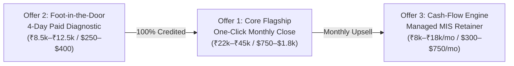
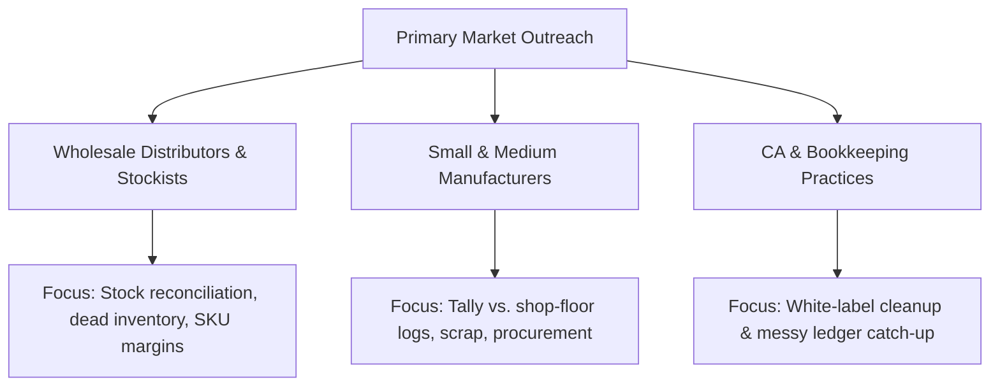

# Productized Service Ladder & Strategic Offer Architecture
## Business Data Automation, Consolidation & Reporting as a Service

---

## Executive Summary & Core Pricing Philosophy

> [!IMPORTANT]
> **The Core Rule of Pricing Technical Services:**  
> Never sell "data cleaning," "Python scripting," or "Power BI dashboard development" as open-ended hourly technical labor. Business owners and accounting partners cannot easily value technical tasks, which instantly drags you into low-margin, race-to-the-bottom haggling.

Instead of selling tools or inputs, structure your business as a **3-Step Productized Service Ladder**. Each step solves one acute, expensive operational bottleneck, provides rapid time-to-value, and naturally creates the justification for the next tier:



---

## Section 1: The 3-Step Productized Service Ladder

### Step 1: The Core Flagship Service (Your Primary Market Proposition)

#### 🚀 The "One-Click Monthly Close & Consolidation System"
* **Engagement Model:** 7–14 Day Fixed-Scope Sprint
* **Ideal Target Profile:**
  * **Regional Manufacturers & Exporters** *(Karur, Coimbatore, Chennai, Bengaluru)* whose Tally accounting totals do not match shop-floor Excel production trackers.
  * **Multi-Channel E-Commerce & Wholesale Operators** drowning in messy Amazon, Shopify, Flipkart, and 3PL warehouse CSV files.
* **Core Deliverables:**
  1. **Folder-Based Automated Ingestion Pipeline:** A standardized ingestion setup (built using Power Query or a lightweight local Python script) where staff drop raw monthly CSVs/Tally exports into a folder and click **Refresh All**—eliminating manual copy-pasting, broken `#REF!` errors, and fragile `VLOOKUP`s.
  2. **Master Mapping & Deduplication Layer:** Standardized vendor entity names, SKU registries, and uniform date/currency schemas spanning 3–10 years of unaligned historical workbooks.
  3. **Automated "Exception & Leakage" Audit View:** A dedicated dashboard tab that instantly flags duplicate invoices, negative stock balances, unmapped SKUs, elevated RTO/return losses, and ledger discrepancies *before* leadership reviews the numbers.
  4. **One-Page Executive Dashboard:** Built in Excel (zero software license friction for traditional Indian SMBs) or Power BI / custom web interface (for multi-branch or remote teams) highlighting:
     * Cash trapped in dead or slow-moving stock
     * True net order/SKU margin after returns and discounts
     * Overdue accounts receivable aging
* **Pricing Architecture:**
  * **India Fixed Sprint:** **₹22,000 – ₹45,000**
  * **International Fixed Sprint:** **$750 – $1,800**

---

### Step 2: The Foot-in-the-Door Offer (To Close Skeptical Prospects Fast)

#### 🔍 The "4-Day Paid Data Diagnostic & Pilot"
* **Strategic Role:** Overcomes buyer hesitation. Cold B2B prospects will rarely commit ₹35,000+ ($1,200+) to an unfamiliar specialist, while doing large "free sample cleanups" wastes 10–15 unpaid hours.
* **Scope of Delivery (Strict 96-Hour SLA):**
  * Executed under a standard 1-page mutual Non-Disclosure Agreement (NDA).
  * Focuses on **one single, high-friction workflow** (e.g., 12 months of sales + inventory records, or a single messy client ledger for a CA firm).
  * Automated Python/pandas profiling audit quantifying exact duplicate counts, formula errors, and missing data points.
  * Delivery of a cleaned, reconciled mini-dataset accompanied by an executive summary view and video audit.
* **The Conversion Hook:**
  * **India Pilot Fee:** **₹8,500 – ₹12,500**
  * **International Pilot Fee:** **$250 – $400**
  * **The Risk-Reversal Guarantee:** **100% of the diagnostic fee is credited** directly toward the Core Flagship Sprint if approved within 14 days of delivery.

---

### Step 3: The Recurring Cash-Flow Engine (Agency Foundation)

#### 🔄 "Managed Monthly MIS & Reconciliation-as-a-Service"
* **Why Clients Buy Retainers:** Automated Excel and Power BI models inevitably break when marketplaces change CSV formats, merchants introduce unmapped SKUs, or internal clerks make data entry typos. Business owners do not want to debug queries—they just want accurate numbers by the 5th of every month.
* **Monthly Retainer Deliverables:**
  * Monthly folder ingestion of raw month-end exports and manual resolution of all flagged exceptions.
  * Full mathematical reconciliation of operational spreadsheets against Tally / QuickBooks / Xero general ledger balances.
  * Delivery of the refreshed dashboard on an agreed deadline.
  * **A 3-minute personalized screen-share briefing (Loom)** highlighting key margin leakages, aging stock warnings, and month-over-month variances.
* **Retainer Pricing:**
  * **India Monthly Retainer:** **₹8,000 – ₹18,000 / month** *(less than half the salary of a junior MIS clerk, with zero employment overhead).*
  * **International Monthly Retainer:** **$300 – $750 / month**.

---

## Section 2: Your Secret Unfair Advantage

Most Excel and Power BI freelancers hit a hard technical ceiling when confronted with 500,000+ messy records, 150+ unaligned historical workbooks, or when clients balk at paying **$14/user/month for Microsoft Power BI Pro per-seat licenses**.

Because you possess **Python, pandas, JavaScript, and full-stack web development skills**, you can deploy two high-margin, enterprise-grade capabilities that ordinary spreadsheet freelancers cannot touch:

```
┌────────────────────────────────────────────────────────────────────────┐
│ HIGH-MARGIN COMPETITIVE DIFFERENTIATORS                                │
├────────────────────────────────────────────────────────────────────────┤
│ 1. White-Label "Messy Ledger Catch-Up" for CA & Bookkeeping Firms      │
│    • Use Python/pandas under the hood to normalize 3–5 years of chaotic│
│      bank/GST/marketplace exports in 2 hours instead of 20 hours.     │
│    • Charge premium fixed per-client cleanup fees.                     │
│                                                                        │
│ 2. Zero-License Custom Web Portals (Enterprise Upsell)                 │
│    • Deliver lightweight, password-protected web dashboards for        │
│      distributors with 10+ branch managers without per-seat licenses.  │
│    • Price: ₹60,000 – ₹1,20,000+ ($2,000 – $4,000+).                   │
└────────────────────────────────────────────────────────────────────────┘
```

---

## Section 3: The 5 Modular Service Offerings

When prospects require isolated components rather than the complete flagship package, utilize these structured service tiers:

| # | Service Line | Technical Scope & Deliverables | India Starting Price | International Starting Price |
| :-: | :--- | :--- | :---: | :---: |
| **1** | **Spreadsheet Consolidation & Cleaning** | Combine 10–500 files, remove duplicates, normalize dates/schemas, flag anomalies, and create a verified master table. | ₹3,500 – ₹7,500 | $100 – $200 |
| **2** | **Business Dashboard Development** | Transform sales, inventory, or expense records into interactive Excel or Power BI dashboards with dynamic KPI slicers. | ₹7,500 – ₹15,000 | $200 – $450 |
| **3** | **Reporting Automation Setup** | Build reusable Power Query or Python ingestion pipelines to replace manual copy-paste reporting. | ₹10,000 – ₹25,000 | $300 – $750 |
| **4** | **Historical Business Data Analysis** | Normalize 5–15 years of records, reconcile multi-year accounts, and assemble long-term trend reports. | ₹15,000 – ₹35,000+ | $450 – $1,200+ |
| **5** | **Monthly Reporting as a Service** | Monthly data hygiene, reconciliation against GL, dashboard refresh, exception logging, and executive briefings. | ₹5,000 – ₹12,000 / mo | $150 – $500 / mo |

---

## Section 4: The Streamlined Entry Pilot (₹7,500 Flagship Test)

For regional SMBs that need an immediate, accessible entry point, deploy the **Business Data Cleanup & Reporting System**:

```
┌────────────────────────────────────────────────────────────────────────┐
│ THE ₹7,500 ENTRY-LEVEL TRANSFORMATION PILOT                            │
├────────────────────────────────────────────────────────────────────────┤
│ • Positioning: From scattered spreadsheets to a reliable monthly report│
│ • Turnaround: 3–5 business days                                        │
│ • Deliverables:                                                        │
│   - Ingestion & consolidation of up to 5 source files                  │
│   - Column, date, and category standardization                         │
│   - Duplicate detection & exception report                             │
│   - Reconciliation of key totals against source ledgers                │
│   - 1 interactive Excel or Power BI dashboard                          │
│   - Documented refresh process & user SOP walkthrough                 │
└────────────────────────────────────────────────────────────────────────┘
```

---

## Section 5: Monthly Recurring Revenue (MRR) Scaling Model

Converting one-off pilots into monthly retainers builds predictable agency cash flow:

| Retainer Tier | Suggested Price (India) | Monthly Scope of Deliverables |
| :--- | :---: | :--- |
| **Basic Retainer** | **₹5,000 / mo** | 1 recurring report workflow, monthly data ingestion, and basic validation checks. |
| **Standard Retainer** | **₹8,000 / mo** | Multiple reports, operational vs. GL reconciliations, dashboard refresh, and anomaly summary. |
| **Advanced Retainer** | **₹12,000 – ₹18,000+ / mo** | Multi-system data pipeline (Tally + Sheets + CRM), detailed exception analysis, and recorded video brief. |

### The 5-Client Cash-Flow Milestone
* **5 Clients on Standard Retainers (@ ₹8,000/mo) = ₹40,000 / month MRR.**
* Operates on ~20–25 hours of monthly recurring maintenance once pipelines are automated.
* Leaves ample bandwidth to acquire new flagship sprint projects.

---

## Section 6: Target Customer Niches & Outreach Prioritization

Focus initial outbound energy strictly on two core operational segments, with one high-leverage referral channel:



1. **Wholesale Distributors & Stockists:** Immediate pain in inventory reconciliation across depots, slow-moving SKU detection, and sales-to-purchase reconciliation.
2. **Small & Medium Manufacturers (Coimbatore, Karur, Chennai):** Severe mismatch between formal accounting (Tally) and actual production floor/weaving/machining records.
3. **CA & Bookkeeping Practices:** High-value partners with massive client reporting backlogs during quarterly and fiscal closes.

---

## Section 7: Brand Positioning & Market Differentiation

> [!CAUTION]
> **Avoid the "AI Hype" Positioning Trap:**  
> Never market yourself simply as "someone who uses AI to clean spreadsheets." Business owners distrust black-box automation with financial records and fear data leaks.

### How to Position Your Business:
* **Brand Headline:** **Business Reporting & Spreadsheet Automation Services**
* **The Core Value Proposition:**  
  *"We help small and mid-sized businesses turn scattered Excel, CSV, and Google Sheets data into reliable, automated management reports and interactive dashboards."*
* **What Clients Actually Value:**
  * **Mathematical Accuracy:** 100% verified totals matching source documents.
  * **Saved Time:** Cutting month-end preparation from 5 days to 15 minutes.
  * **Data Confidentiality:** Air-tight data security with zero unapproved public cloud/AI exposure.
  * **Actionable Results:** Clear dashboards that highlight where money is being lost.

---

## Section 8: Immediate Next Steps (Day-One Action Plan)

To generate commercial traction immediately:

1. **Build One Flagship Synthetic Demo:**  
   Choose between:
   * **Option A (Manufacturing/Export):** A Tally vs. Shop-Floor manufacturing tracker (machine scrap, raw material consumption, order delivery status).
   * **Option B (Multi-Channel Commerce/Wholesale):** A multi-channel sales and stock dashboard (marketplace settlement fees, gross margin per SKU, dead stock alerts).
2. **Record a 60-Second Loom Walkthrough:** Showcase the messy inputs, click refresh, and display the clean, reconciled executive dashboard.
3. **Deploy the Foot-in-the-Door CTA:** Lead with the **4-Day Paid Diagnostic (₹8,500 / $250)** in all outbound messages, highlighting that **100% is credited** toward the full implementation upon upgrade.
