# Startup Pre-Mortem & Enterprise Risk Register
## Business Data Consolidation & Reporting Automation Practice

**Perspective:** Skeptical Seed Investor & Enterprise Risk Analyst  
**Assessment Date:** 27 October 2026  
**Planning Horizon:** 24 Months (October 2026 $\rightarrow$ October 2028 Simulation)  
**Operating Geography:** Coimbatore & Chennai, Tamil Nadu, India  
**Current Status:** Pre-Launch / Lean Validation Phase  

---

## Executive Verdict: How This Business Dies

> [!CAUTION]
> **The most likely failure is not that your Python automation fails. It is that customers don't have a sufficiently painful, frequent, and poorly solved problem to justify paying you enough to build a sustainable service business.**
> 
> Your proposed consultancy has several advantages: low initial capital requirements, a service that can be delivered with existing tools, a narrow initial customer segment, and the ability to validate demand before building software.
> 
> But these are advantages in **testing** the idea, not evidence that the idea will work.

```
                              [ THE 24-MONTH FAILURE SEQUENCE ]
                                              
    Months 1–3: Build Before Validating
    You create robust scripts, dashboards, and matching logic. Prospects compliment the demo 
    but do not commit to a paid diagnostic.
                          │
                          ▼
    Months 4–6: One Customer Buys (The Custom Data Trap)
    You solve a real problem, but the customer's exports require custom cleaning. 
    The job takes 25 hours instead of the planned 10. The fee is ₹8,500 (Negative hourly return).
                          │
                          ▼
    Months 7–12: Revenue Fails to Compound
    The customer is satisfied but does not need the service again. Referrals are slow. 
    You spend more time finding the next customer than doing paid work.
                          │
                          ▼
    Months 13–24: The Founder Stops (Economic Exhaustion)
    Cash flow is inconsistent, founder time is underpaid, and no repeatable acquisition channel 
    exists. The code still works, but the business is quietly abandoned.
```

### The Initial Commercial Thesis
* **Target Customer:** Owner-managed industrial and electrical wholesalers in Coimbatore and Chennai, using TallyPrime and Excel.
* **Core Problem:** Recurring mismatches between financial records (Tally sales registers) and operational records (dispatch challans, LR notes, warehouse spreadsheets).
* **Entry Offer:** A fixed-scope reconciliation diagnostic, provisionally priced at **₹8,500 + GST**, followed by separately scoped implementation sprints.
* **Acquisition:** Direct outreach to business owners and referrals from accountants or Tally implementation partners.
* **Delivery:** Python/pandas and spreadsheet-based analysis, with a proposed four-business-day turnaround.

The central evidence gap is that **you have not yet established a repeatable pattern of painful incidents, a willingness to pay, or a predictable route to buyers.** The ₹8,500 price, customer profile, conversion rates, and follow-on revenue assumptions remain unvalidated hypotheses.

---

## Pre-Mortem Conclusion: The Three Core Threat Vectors

1. **Primary Risk: Commercial Viability**  
   Buyers may acknowledge the problem but prefer existing Tally reports, Excel, internal staff, or their accountant rather than purchase a separate diagnostic.
2. **Secondary Risk: Founder Economics**  
   Outreach, data cleaning, exception review, and customer-specific rules may consume so much unpaid time that apparent revenue becomes a poor hourly return.
3. **High-Consequence Risk: Data and Reconciliation Errors**  
   A false match or disclosure of commercially sensitive records could damage trust, create liability, and undermine referrals.

> [!IMPORTANT]
> **Investor Recommendation:**  
> Do not abandon the business. **Withhold significant investment until you have tested whether the commercial problem exists and can be sold repeatedly.**

---

## 1. The Master 12-Risk Register (Two-Year Horizon)

Scales: Likelihood and Impact are Low / Medium / High / Critical. Detectability is rated High when the problem is difficult to detect early. Time indicates the plausible period before the risk becomes material if left unaddressed.

| # | Risk Description | Likelihood | Impact | Detection Difficulty | Time to Materialize | Strategic Category |
| :-: | :--- | :---: | :---: | :---: | :---: | :--- |
| **1** | **No urgent, recurring customer problem** | High | Critical | High | 0–6 months | Market Demand |
| **2** | **Buyers will not pay the proposed price** | High | High | Medium | 0–3 months | Commercial Viability |
| **3** | **Customer acquisition is too slow or expensive** | High | High | Medium | 1–9 months | Go-to-Market / CAC |
| **4** | **Existing tools or staff solve the problem adequately** | High | High | Medium | 0–6 months | Incumbent Competition |
| **5** | **Each customer requires bespoke data cleaning & rules** | High | High | Medium | 1–12 months | Delivery Economics |
| **6** | **False matches or misleading exception reports** | Medium | Critical | High | First few projects | Operational Liability |
| **7** | **Confidentiality or cybersecurity data incident** | Low–Med | Critical | High | Any time | Data & Legal Risk |
| **8** | **Cash flow and founder income become unsustainable** | Med–High | Critical | Medium | 3–18 months | Working Capital |
| **9** | **Referrals do not convert into qualified opportunities** | Med–High | High | Medium | 1–9 months | Distribution Channel |
| **10**| **Regulatory or contractual obligations misunderstood** | Medium | High | High | Before sale / expansion | Compliance & Tax |
| **11**| **Founder burnout, inconsistent selling, or bottlenecks** | Med–High | High | Medium | 3–18 months | Operational Capacity |
| **12**| **The service is commoditized or copied** | Medium | Med–High | High | 6–24 months | Competitive Moat |

---

## 2. Risk-by-Risk Deep Dive: Failure Mechanisms & Controls

```mermaid
graph TD
    subgraph Dimension 1: Demand & Distribution
        R1[Risk 1: No Urgent Recurring Problem]
        R2[Risk 2: Price Resistance @ Rs 8,500]
        R3[Risk 3: Unviable Acquisition Drag]
        R4[Risk 4: Existing Tools 'Good Enough']
        R9[Risk 9: Referral Partners Stall]
    end

    subgraph Dimension 2: Delivery & Economics
        R5[Risk 5: Bespoke Cleaning Quagmire]
        R6[Risk 6: False Match Kills Trust]
        R8[Risk 8: Unsustainable Cash Runway]
        R11[Risk 11: Solo Bottleneck & Burnout]
        R12[Risk 12: Commoditization by Tally Partners]
    end

    subgraph Dimension 3: Legal & Trust
        R7[Risk 7: Data Disclosure Breach]
        R10[Risk 10: Regulatory/Tax Non-Compliance]
    end

    R1 & R2 & R3 & R4 --> Death[BUSINESS SHUTDOWN<br/>Unviable Economics]
    R5 & R6 & R8 & R11 --> Death
    R7 & R10 --> Death
```



---

### Risk 1: No Urgent, Recurring Customer Problem
* **Severity:** **CRITICAL** | **Likelihood:** High | **Time:** 0–6 Months
* **Failure Mechanism:** Businesses may experience occasional discrepancies without suffering enough pain to buy a separate service. Staff resolve them informally, or the cost of unresolved issues is too small to matter to the owner.
* **Early Warnings:**
  * Interviews produce general complaints about Excel, but no recent concrete financial incidents.
  * Prospects cannot estimate the time or rupee consequence of the discrepancy.
  * The same workflow does not recur across independent companies.
  * Nobody agrees to a next step involving actual records or a paid engagement.
* **Mitigation:** Interview owners exclusively about the *last real incident*, the manual workaround used, and what happened afterward. Test a second workflow only if the first lacks evidence.
* **Contingency:** Narrow the offer to the single workflow with demonstrated economic consequences (e.g., Unbilled Dispatches), or exit this customer segment.
* **Owner:** Founder.

---

### Risk 2: Willingness to Pay is Lower than the Price
* **Severity:** **HIGH** | **Likelihood:** High | **Time:** 0–3 Months
* **Failure Mechanism:** ₹8,500 feels expensive for a report that customers believe their staff, accountant, or existing software should produce. The diagnostic may identify problems without providing a sufficiently clear next operational action.
* **Early Warnings:**
  * Prospects praise the idea but avoid a formal purchase decision.
  * Buyers request free analysis of their real records under the guise of a "trial."
  * Price objections occur even after the scope and deliverable are fully understood.
  * Substantial discounts are required to close any sale.
* **Mitigation:** Present a fixed deliverable and test paid offers at controlled price points (e.g., ₹6,500, ₹8,500, ₹12,000) with identical scope. Track cleared bank transfers, not hypothetical willingness to pay.
* **Contingency:** Reduce scope and delivery time if a lower price remains profitable. If perceived value cannot support an economically viable price, discontinue the offer rather than repeatedly discounting it.
* **Owner:** Founder.

---

### Risk 3: Customer Acquisition Does Not Scale Economically
* **Severity:** **HIGH** | **Likelihood:** High | **Time:** 1–9 Months
* **Failure Mechanism:** Business owners are difficult to reach, do not prioritize reconciliation, or rely entirely on trusted advisors. A low-priced service cannot support lengthy sales cycles, repeated physical visits, or extensive follow-ups.
* **Early Warnings:**
  * High outreach volume produces few conversations with relevant decision-makers.
  * Sales require repeated visits and weeks of follow-up.
  * Referral partners express interest but never introduce actual prospects.
  * Founder spends 80% of time selling and 20% delivering, without enough deals to support living expenses.
* **Mitigation:** Track Cash CAC and Economic CAC separately. Test direct outreach and referral partnerships independently with a fixed time budget for each.
* **Contingency:** Concentrate on the channel with the lowest cost per qualified opportunity. Stop channels that fail after a defined test rather than buying ads to compensate.
* **Owner:** Founder.

---

### Risk 4: Existing Alternatives Are Good Enough
* **Severity:** **HIGH** | **Likelihood:** High | **Time:** 0–6 Months
* **Failure Mechanism:** TallyPrime, Excel/Power Query, internal accountants, or external CA firms already provide an adequate solution. The diagnostic becomes an unneeded extra layer of cost and friction.
* **Early Warnings:**
  * A prospect's existing standard Tally report already resolves the discrepancy.
  * A local Tally partner configures the same check cheaply using custom TDL.
  * The customer cannot articulate what remains unresolved after normal month-end procedures.
  * Your output merely duplicates information the buyer already receives.
* **Mitigation:** Ask what the customer tried and why it failed. Review existing reports before proposing a new solution. Sell only where a verified gap remains.
* **Contingency:** Specialize exclusively in exceptions that existing processes demonstrably miss (e.g., cross-system rate variances), or abandon the workflow.
* **Owner:** Founder.

---

### Risk 5: Delivery Is Too Bespoke (The Ingestion Quagmire)
* **Severity:** **HIGH** | **Likelihood:** High | **Time:** 1–12 Months
* **Failure Mechanism:** Inconsistent exports, varied date formats, missing product codes, duplicate records, and undocumented business rules require extensive manual cleanup. Each project becomes an entirely new consulting engagement.
* **Early Warnings:**
  * Intake repeatedly reveals missing or corrupted primary fields.
  * Delivery exceeds the planned 10-hour cap for a diagnostic.
  * Matching rules must be rewritten mid-project.
  * Scripts cannot be reused across clients without extensive rewrites.
* **Mitigation:** Define strict accepted file formats and scope limits. Use a reusable intake checklist, schema profiling scripts, standard matching libraries, and an exception taxonomy.
* **Contingency:** Charge separately for data preparation, reduce supported input formats, or decline cases that cannot be delivered profitably and reliably within 12 hours.
* **Owner:** Founder / Technical Delivery.

---

### Risk 6: False Matches or Misleading Reports Damage Trust
* **Severity:** **CRITICAL** | **Likelihood:** Medium | **Time:** First few projects onward
* **Failure Mechanism:** Similar invoice numbers, split dispatches, returns, timing differences, or duplicate entries cause the script to classify records incorrectly. Polished reports make uncertain results appear authoritative.
* **Early Warnings:**
  * Output changes significantly when minor matching thresholds are adjusted.
  * Report totals fail to reconcile with raw source records.
  * Sample audits reveal false positives or missed exceptions.
  * Customers challenge findings that cannot be traced to raw source rows.
* **Mitigation:** Preserve row-level provenance (`SourceA_RowID`, `SourceB_RowID`), distinguish exact from probable matches, reconcile control totals, test against 200 synthetic edge cases, and require human review of ambiguous cases.
* **Contingency:** Suspend delivery immediately, notify the customer, correct and reissue the report within 24 hours, document the root cause, and tighten QA gates before accepting new work.
* **Owner:** Technical Delivery Lead (Founder).

---

### Risk 7: Confidentiality Breach or Security Incident
* **Severity:** **CRITICAL** | **Likelihood:** Low–Medium | **Time:** Any time
* **Failure Mechanism:** Customer financial data, customer pricing lists, or margins are exposed through unsecured cloud drives, personal email, a compromised device, or an unapproved public AI service. A single leak can destroy the consultancy's reputation.
* **Early Warnings:**
  * Client files copied to uncontrolled or unencrypted storage.
  * No documented data deletion date or access log.
  * Personal and business accounts share credentials.
  * Processing workflow involves public cloud models without explicit client consent.
* **Mitigation:** Obtain written authorization, enforce data minimization, execute 100% air-gapped local processing on BitLocker-encrypted drives, maintain cryptographic wipe logs (`shred -u`), and execute mutual NDAs.
* **Contingency:** Contain access, preserve audit evidence, notify the affected client immediately, and fulfill all applicable legal and contractual obligations.
* **Owner:** Founder.

---

### Risk 8: Cash Flow and Founder Economics Become Unsustainable
* **Severity:** **CRITICAL** | **Likelihood:** Medium–High | **Time:** 3–18 Months
* **Failure Mechanism:** Revenue arrives irregularly while the founder incurs travel, software, tax compliance, and living expenses. A profitable-looking project can still burn too many hours or collect payment too late.
* **Early Warnings:**
  * Customers delay payment or renegotiate scope post-delivery.
  * Monthly cash outflow exceeds collections for two consecutive months.
  * Founder uses personal savings to subsidize project delivery.
  * No distinction made between gross cash receipts and net founder hourly return.
* **Mitigation:** Require 100% upfront payment for diagnostics, maintain a rolling 13-week cash flow forecast, track all delivery minutes, and preserve a personal financial reserve.
* **Contingency:** Freeze discretionary spending, stop unpaid customization, require full payment before file intake, and pause operations before personal safety reserves are breached.
* **Owner:** Founder / Finance.

---

### Risk 9: Referral Channel Fails to Produce Qualified Deals
* **Severity:** **HIGH** | **Likelihood:** Medium–High | **Time:** 1–9 Months
* **Failure Mechanism:** Accountants and Tally partners see the service as competing with their own practice, worry about risking client goodwill, or simply lack clients with this specific operational problem.
* **Early Warnings:**
  * Partners praise the concept but never name a specific client.
  * Client introductions repeatedly stall before meetings happen.
  * Partners view the service as an audit of their own accounting work.
  * No partner allows a client to validate the need independently.
* **Mitigation:** Ask partners about recurring gaps in their own workflows, clarify responsibilities, position as a "pre-audit cleaner," and offer transparent referral incentives where appropriate.
* **Contingency:** Treat partnerships as secondary and return to direct outbound outreach if partners fail to produce introductions within 30 days.
* **Owner:** Founder.

---

### Risk 10: Regulatory, Tax, or Contractual Mistakes
* **Severity:** **HIGH** | **Likelihood:** Medium | **Time:** Before sale or upon expansion
* **Failure Mechanism:** The practice mismanages GST registration thresholds, inter-state invoicing, local establishment rules, DPDPA 2023 obligations, IP ownership, or unlimited contractual liability.
* **Early Warnings:**
  * No qualified CA has reviewed the invoicing and operating structure.
  * SOW lacks a limitation of liability clause (exposing founder to enterprise damages).
  * Customers request procurement terms that have not been legally assessed.
  * Service expands into personal, health, or regulated data without review.
* **Mitigation:** Obtain targeted CA and legal advice before the first paid engagement; use the pre-drafted legal pack from [legal_contract_pack_nda_and_sow.md](file:///c:/Users/sukes/Downloads/business%20plan/legal_contract_pack_nda_and_sow.md); maintain a compliance calendar.
* **Contingency:** Pause affected services, correct filings immediately, and seek professional counsel rather than improvising legal positions.
* **Owner:** Founder, supported by external CA.

---

### Risk 11: Founder Capacity Bottlenecks & Selling Inconsistency
* **Severity:** **HIGH** | **Likelihood:** Medium–High | **Time:** 3–18 Months
* **Failure Mechanism:** Sales, discovery, data wrangling, reporting, client presentations, accounting, and compliance all depend on one person. The founder halts sales during delivery weeks, creating an endless cycle of boom and bust.
* **Early Warnings:**
  * Lead prospecting stops completely during delivery weeks.
  * Proposals and follow-up calls are delayed.
  * New projects accepted without the physical capacity to deliver within 4 days.
  * No documented process exists that an assistant or junior analyst could execute.
* **Mitigation:** Block Mondays and Friday mornings strictly for outbound sales (Zero coding); enforce a strict delivery checklist; limit concurrent diagnostics to two per week.
* **Contingency:** Reduce customer load, pause outbound temporarily, or discontinue the offer if delivery cannot fit within sustainable 40-hour workweeks.
* **Owner:** Founder.

---

### Risk 12: Commoditization and Weak Competitive Moat
* **Severity:** **MED–HIGH** | **Likelihood:** Medium | **Time:** 6–24 Months
* **Failure Mechanism:** Generic reconciliation scripts and basic Excel dashboards are easily replicated. Larger IT consultancies, Tally partners, or internal junior staff copy the checks at lower perceived cost.
* **Early Warnings:**
  * Prospects evaluate proposals solely on hourly price.
  * Every sale requires explaining basic automation rather than domain-specific operational results.
  * No customer-approved case studies or traceable error taxonomies exist.
  * Competitors bundle identical reconciliation into standard accounting retainers.
* **Mitigation:** Build deep vertical expertise in electrical/industrial distributor workflows, establish proprietary exception taxonomies, maintain ironclad QA, and cultivate trusted executive relationships.
* **Contingency:** Specialize in demonstrably difficult, high-volume reconciliations (e.g., automated Amazon/Flipkart settlement leakage) or shift to high-ticket implementation sprints.
* **Owner:** Founder.

---

## 3. The Four Independent Dimensions of Failure

A business can fail across any of four independent dimensions, even if technical code is flawless:

```
┌────────────────────────────────────────────────────────────────────────────────────────┐
│                        THE FOUR VITAL DIMENSIONS OF SURVIVAL                           │
├────────────────────────────┬────────────────────────────┬──────────────────────────────┤
│ 1. DEMAND DIMENSION        │ 2. DISTRIBUTION DIMENSION  │ 3. DELIVERY ECONOMICS        │
│ The problem matters enough │ You can reach buyers at an │ The work is reliable and     │
│ for buyers to pay real     │ acquisition cost below     │ profitable after valuing     │
│ money to solve it.         │ gross project margin.      │ founder labor at market rate.│
├────────────────────────────┴────────────────────────────┴──────────────────────────────┤
│ 4. TRUST & GOVERNANCE DIMENSION                                                        │
│ Customers trust you with sensitive financial records and act decisively on findings.   │
└────────────────────────────────────────────────────────────────────────────────────────┘
```

> **Failure in any single dimension defeats the entire business.** Technical excellence only addresses half of Dimension 3; it does nothing to guarantee Demand, Distribution, or Trust.

---

## 4. Ten Hidden Assumptions and Dependencies

| # | Hidden Assumption | Why It Could Be Wrong | Required Empirical Evidence |
| :-: | :--- | :--- | :--- |
| **1** | **Tally + Excel is a sufficient filter** | Many distributors use both but have no material discrepancy gap | Interviews confirming both the software stack and recurring gaps |
| **2** | **Wholesalers share similar data structures** | Product codes, dispatches, returns, and export formats vary wildly | Sample authorized exports inspected across 3 independent firms |
| **3** | **A diagnostic is a product buyers understand** | Buyers may expect a complete software fix, not an audit report | Live proposal feedback and signed, paid SOWs |
| **4** | **₹8,500 is an acceptable price point** | High relative to clerical labor; or too low to cover delivery effort | Real price tests and recorded delivery hour logs |
| **5** | **Four business days is achievable** | Dirty files, missing keys, and client delays block delivery | Time logs from live pilot engagements |
| **6** | **Flagged exceptions are commercially meaningful** | Mismatches may be immaterial timing lags or already understood | Customer-confirmed outcomes and audit verification |
| **7** | **CAs and Tally partners will refer clients** | They may view you as a competitor or audit of their work | Actual introductions that progress to qualified meetings |
| **8** | **The diagnostic leads to implementation** | Clients take the report and have internal clerks fix future months | Observed paid follow-on conversion rates |
| **9** | **Client data can be secured at low cost** | Enterprise clients may demand SOC 2 or expensive cyber insurance | Compliance audit against actual client procurement terms |
| **10**| **One founder can sell and deliver consistently**| Sales and coding compete for the exact same 40 weekly hours | Weekly capacity and time-allocation logs |

---

## 5. The Five Most Dangerous Assumptions — And How to Test Them

```
  Assumption 1: Urgent Problem Exists       Assumption 2: Buyer Will Pay Rs 8,500
  • Test: 10-15 Mom Test interviews        • Test: 5-8 Paid SOW proposals
  • Pass: >=5 cite recent acute pain        • Pass: >=1-2 clear bank transfer
  • Fail: Problems are minor/tolerated      • Fail: Demand free audits / ghost
                 │                                         │
                 ├─────────────────────────────────────────┘
                 ▼
  Assumption 3: Viable Acquisition CAC      Assumption 4: Delivery Economics Work
  • Test: 30 direct touches vs 10 partners  • Test: 200 synthetic tests + 1 live pilot
  • Pass: Economic CAC <= Rs 4,500          • Pass: Delivery <=12 hours @ Rs 700+/hr
  • Fail: Endless meetings, zero deals      • Fail: Messy data burns 25+ hours
                 │                                         │
                 ├─────────────────────────────────────────┘
                 ▼
  Assumption 5: Follow-On Revenue Exists
  • Test: Post-handover sprint proposal
  • Pass: >=1 client buys implementation
  • Fail: Client treats diagnostic as one-off
```

1. **Test 1: A Painful Problem Exists (P0 Gate)**  
   *Experiment:* Interview 10–15 independent distributors. Ask about the last reconciliation incident, frequency, workaround, wasted staff hours, and rupee consequences.  
   *Positive Signal:* $\ge$5 firms describe a specific incident; $\ge$3 describe the identical workflow.  
   *Negative Signal:* Problems are minor or existing Tally routines handle them fine.
2. **Test 2: A Buyer Will Pay for the Diagnostic (P0 Gate)**  
   *Experiment:* Offer the fixed-scope diagnostic at ₹8,500 to qualified leads under standard SOW terms.  
   *Positive Signal:* $\ge$1–2 independent buyers sign and clear bank payment.  
   *Negative Signal:* Prospects demand free audits or insist internal clerks will handle it.
3. **Test 3: You Can Reach Buyers Economically (P1 Gate)**  
   *Experiment:* Test 30 personalized direct touches against 10 partner discussions. Measure Economic CAC.  
   *Positive Signal:* At least one channel generates qualified opportunities at an economic cost below project gross contribution.  
   *Negative Signal:* Zero qualified opportunities after 30 direct attempts and 10 partner meetings.
4. **Test 4: Delivery Can Be Accurate and Profitable (P0 Gate)**  
   *Experiment:* Stress-test 200 synthetic edge cases; deliver one authorized paid pilot; track every minute.  
   *Positive Signal:* Delivery completed in $\le$12 hours; 100% control-total reconciliation; zero false matches.  
   *Negative Signal:* Manual cleaning consumes 20+ hours; findings challenged by client.
5. **Test 5: The Business Can Earn Follow-On Revenue (P1 Gate)**  
   *Experiment:* At diagnostic handover, present an Implementation Sprint SOW to automate the workflow.  
   *Positive Signal:* $\ge$1 client buys implementation or recurring refresh.  
   *Negative Signal:* Client finds diagnostic helpful but has zero recurring need.

---

## 6. Diagnostic Delivery Economics & Labor Sensitivity

The standard financial assumption is an **₹8,500 fee**, **10 delivery hours**, **₹400/hour founder labor allocation**, and **₹700 direct expenses**:

$$\text{Contribution} = ₹8,500 - (10 \text{ hrs} \times ₹400) - ₹700 = ₹3,800 \quad (44.7\% \text{ gross contribution})$$

### Delivery Hours Downside Sensitivity Table

| Delivery Hours | Founder Labor (@ ₹400/hr) | Direct Costs | Net Contribution | Contribution Margin (%) | Commercial Status |
| :---: | :---: | :---: | :---: | :---: | :--- |
| **10 Hours** | ₹4,000 | ₹700 | **+₹3,800** | **44.7%** | **Target Viable Plan** |
| **15 Hours** | ₹6,000 | ₹700 | **+₹1,800** | **21.2%** | **Acceptable Floor** |
| **20 Hours** | ₹8,000 | ₹700 | **−₹200** | **−2.4%** | **Unprofitable Trap** |
| **25 Hours** | ₹10,000 | ₹700 | **−₹2,200** | **−25.9%** | **Disastrous Loss** |

> [!CAUTION]
> At **20 delivery hours**, the fee fails to cover founder labor and expenses—even before factoring in customer acquisition or overhead.  
> **Operational Rule:** Enforce the **12-Hour Delivery Stop-Loss**. If raw data cleaning exceeds 6 hours by Day 2, pause delivery, show the corrupted files, and re-scope or invoke the stop-loss.

---

## 7. The Three Distinct Failure States

```
┌────────────────────────────────────────────────────────────────────────────────────────┐
│                          THREE DISTINCT FAILURE STATES                                 │
├────────────────────────────┬────────────────────────────┬──────────────────────────────┤
│ STATE A: NO DEMAND         │ STATE B: NO UNIT MARGIN    │ STATE C: NO CASH RUNWAY      │
│ Customers refuse to buy.   │ Customers buy, but each    │ Projects are profitable on   │
│ The problem lacks economic │ project takes 25 hours,    │ paper, but collections lag   │
│ urgency or perceived value.│ yielding sub-minimum wage. │ 60 days while expenses hit.  │
├────────────────────────────┴────────────────────────────┴──────────────────────────────┤
│ Strategic Response:                                                                    │
│ • State A: Pivot problem or exit segment (More leads will NOT fix this).               │
│ • State B: Enforce strict input templates or raise price (Better code won't fix this). │
│ • State C: Enforce 100% advance payment prior to intake (More sales won't fix this).   │
└────────────────────────────────────────────────────────────────────────────────────────┘
```

---

## 8. Explicit Stop-Loss Limits: Money, Time, and Effort

A skeptical investor never authorizes an open-ended experiment. Enforce these non-negotiable boundaries:

### Financial Stop-Loss
* **Initial 30-Day Acquisition Spend:** Maximum **₹5,000 cash**.
* **Overall Validation Ceiling:** Maximum **₹15,000 cash** (or the amount genuinely available after essential living reserves). Never borrow or touch emergency savings.
* **Capital Expense Freeze:** Zero hardware purchases, office leases, or paid software subscriptions prior to cleared client revenue.
* **Pause Trigger:** If cash spend reaches ₹15,000 with zero paying clients, halt all commercial activity immediately.

### Time Stop-Loss
* **Days 1–7:** Build prospect list and initiate outreach. *Action if missed:* Fix targeting before building tools.
* **Days 1–14:** Complete first 5 substantive interviews. *Action if missed:* Change outreach channel if conversations stall.
* **Days 1–21:** Complete 10–12 discovery interviews cumulatively. *Action if missed:* Re-evaluate market segment.
* **By Day 30:** Secure at least one paid diagnostic. *Action if missed:* Audit sales funnel objections; do not spend more money.
* **By Day 60:** Secure at least two independent paid engagements. *Action if missed:* Pause and re-evaluate offer.
* **By Day 90:** Establish repeatable delivery economics and a predictable lead source. *Action if missed:* Terminate practice.

### Effort Stop-Loss
* **Zero SaaS Coding:** Do not build multi-tenant web platforms, user portals, or cloud databases before 5 paying clients repeat on an identical schema.
* **Zero Free Data Audits:** Never perform free data cleaning on real customer files beyond a 15-minute schema feasibility inspection.
* **Zero Unscoped Customization:** Reject client requests for extra reports, sister-company reconciliations, or custom ERP scripts without a signed change order.
* **Zero Phantom Chasing:** Stop pursuing any referral partner or prospect who fails to advance after three touches.

---

## 9. Risk Ownership and Weekly Governance

| Risk Area | Accountable Owner | Review Cadence | Escalation Trigger |
| :--- | :--- | :--- | :--- |
| **Market Demand & Positioning** | Founder | Weekly | No recurring painful problem emerging from interviews |
| **Sales & Acquisition CAC** | Founder | Weekly | Zero qualified opportunities after planned outreach cohort |
| **Delivery Hours & Margin** | Founder / Delivery | Per Project | Direct delivery hours exceed 12 hours on a diagnostic |
| **Reconciliation Accuracy** | Founder / QA | Every Delivery | Failed control totals or material false matches |
| **Data Security & Privacy** | Founder / Security | Pre-Project | Unsecured file transmission or unexplained data movement |
| **Legal & Tax Compliance** | Founder with CA | Pre-Launch | Uncertainty regarding GST, Section 44ADA, or SOW liability |
| **Cash Runway & Reserves** | Founder / Finance | Weekly | Personal cash reserve drops below agreed survival floor |
| **Founder Capacity & Burnout** | Founder | Weekly | Sales outreach halts entirely during delivery weeks |

---

## 10. The Weekly Risk Review Protocol

Every Friday afternoon, maintain a one-page risk log and answer these five mandatory questions:

```
┌────────────────────────────────────────────────────────────────────────────────────────┐
│                        THE WEEKLY 5-QUESTION RISK AUDIT                                │
├────────────────────────────────────────────────────────────────────────────────────────┤
│ 1. What empirical evidence changed my view of customer demand this week?               │
│ 2. What did an independent buyer actually pay for (cleared bank funds)?                │
│ 3. Did delivery labor stay within the 10-hour cap and pass all control totals?         │
│ 4. Did any strategic risk increase enough to justify pausing commercial work?          │
│ 5. What is the cheapest next experiment that could disprove my current assumption?     │
└────────────────────────────────────────────────────────────────────────────────────────┘
```

> [!TIP]
> **Governing Heuristic:**  
> Never lower a risk rating simply because you created a mitigation plan. Lower it only when the mitigation has been tested in the real world and residual risk is demonstrably smaller.

---

## Final Investment Judgment: Conditional Go

If deciding whether to fund this practice today:
* **Verdict:** **DO NOT FUND A SOFTWARE BUILD OR MARKETING CAMPAIGN.**
* **Authorization:** **AUTHORIZE A TIGHTLY CAPPED, ₹15,000 / 6-WEEK VALIDATION EXPERIMENT.**

The business has a credible path to becoming a small, profitable specialist consultancy if it can repeatedly identify an expensive unresolved workflow, reach the person who controls the budget, and deliver a traceable result at a healthy effective hourly rate.

The thesis collapses if the problem is merely inconvenient, the buyer expects it for free from their CA, or every engagement requires extensive manual data repair.

Your next milestone is **not a website, logo, registration package, or automation framework.**  
It is **a small set of independent customer interviews, one genuinely paid diagnostic, and measured delivery economics.**

---

*Related Documentation:*
* [lean_startup_validation_experiments_guide.md](file:///c:/Users/sukes/Downloads/business%20plan/lean_startup_validation_experiments_guide.md) — 8-Experiment Backlog, Pre-Registered Thresholds, and 6-Week Validation Timeline.
* [customer_discovery_and_mom_test_playbook.md](file:///c:/Users/sukes/Downloads/business%20plan/customer_discovery_and_mom_test_playbook.md) — 18-Minute Discovery Interview Protocol.
* [legal_contract_pack_nda_and_sow.md](file:///c:/Users/sukes/Downloads/business%20plan/legal_contract_pack_nda_and_sow.md) — 1-Page Offline NDA and 4-Day SOW.
* [financial_feasibility_and_cash_flow_model.md](file:///c:/Users/sukes/Downloads/business%20plan/financial_feasibility_and_cash_flow_model.md) — Financial Feasibility and Labor Margin Model.
